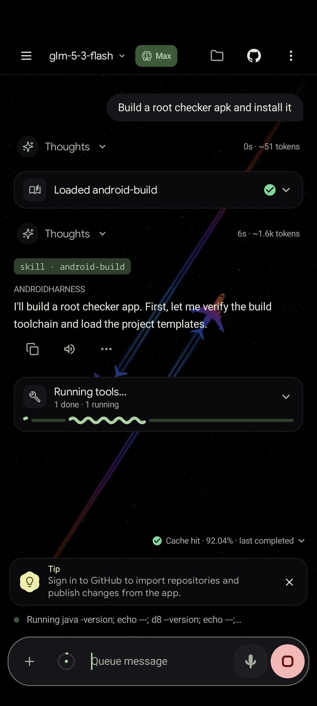
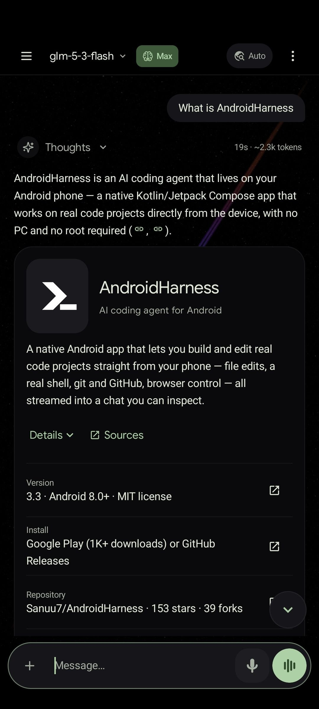
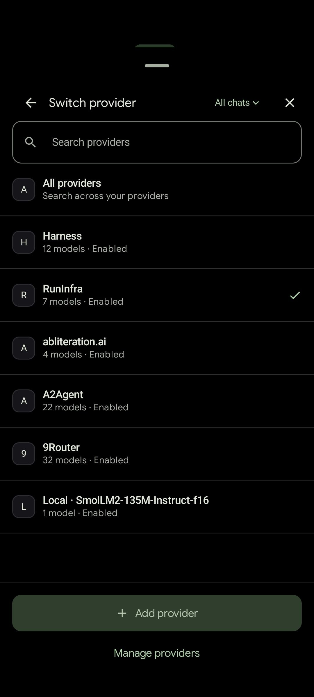
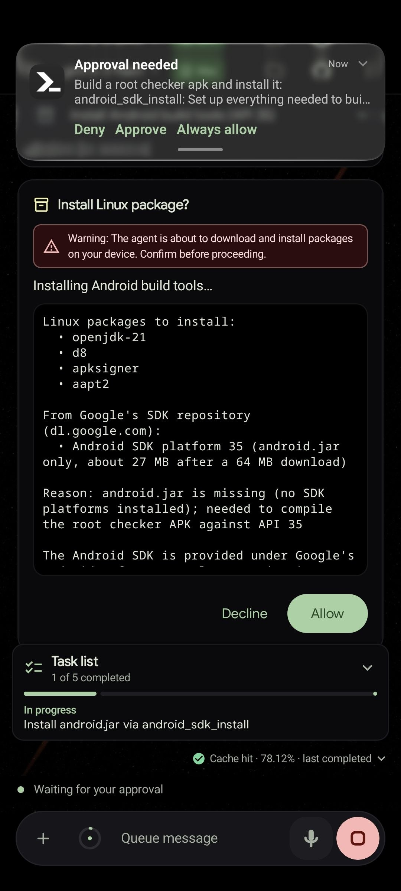
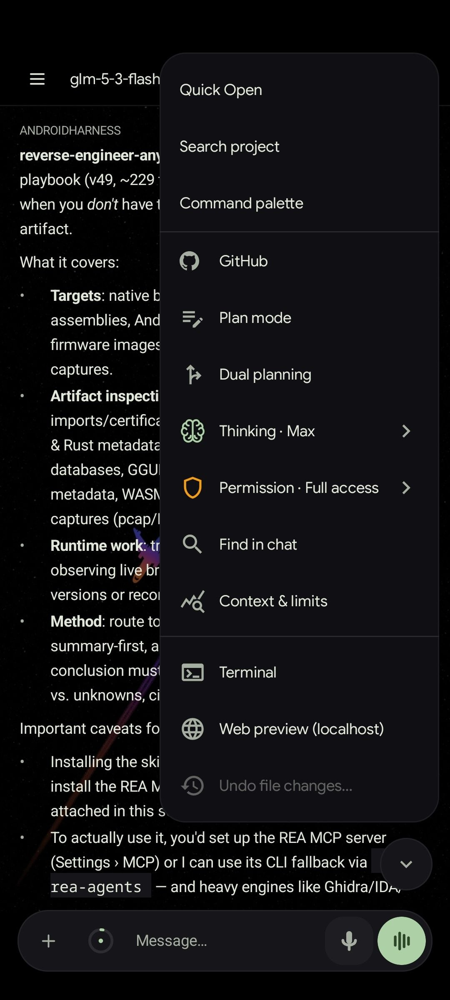
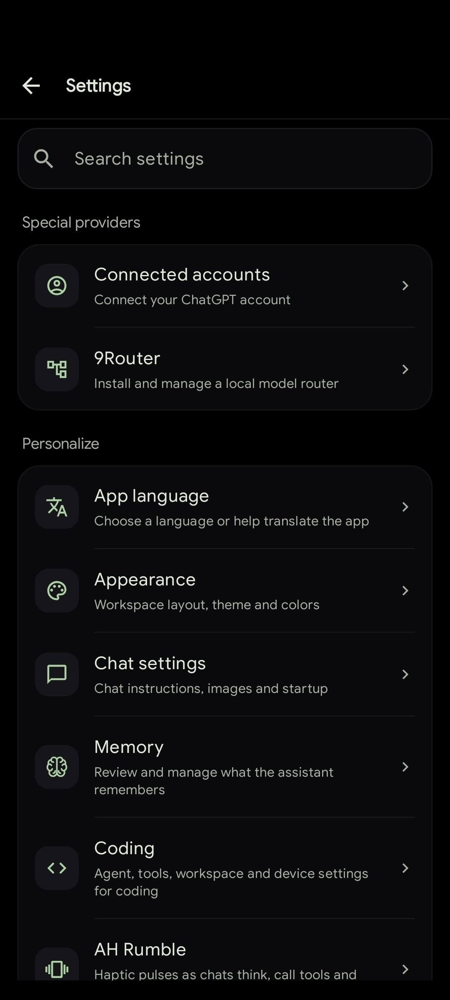
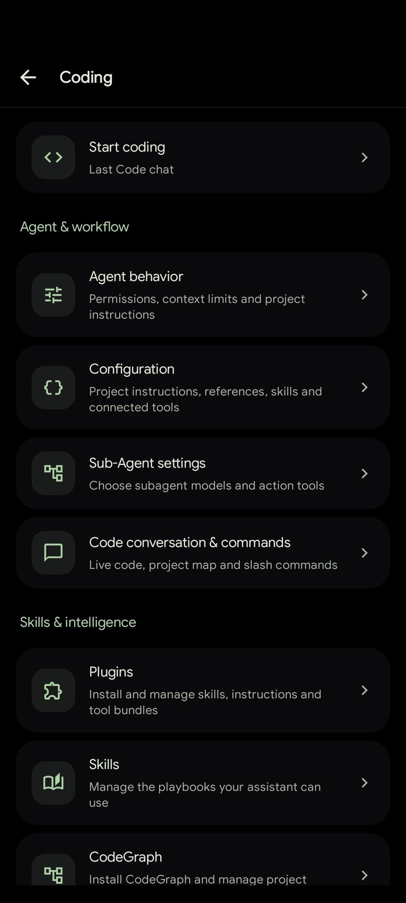
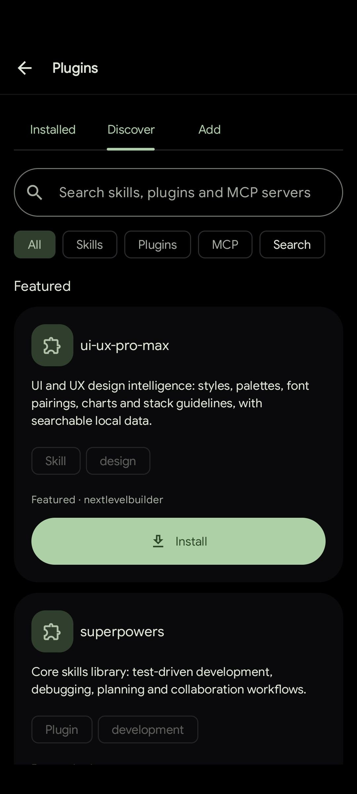
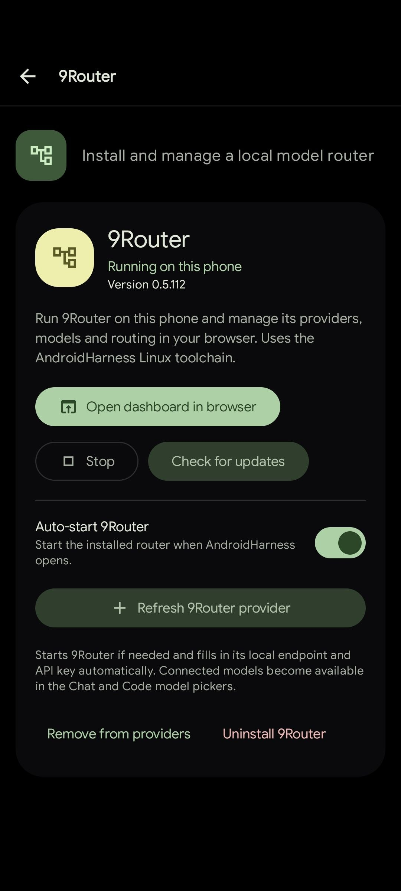
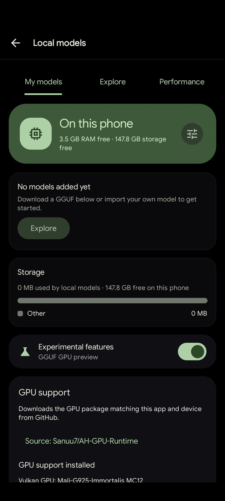

<div align="center">


# AndroidHarness

**An AI coding agent and chat assistant that runs on your Android phone.**

No PC needed. No root needed.

<p>
  <a href="https://github.com/Sanuu7/AndroidHarness/releases/latest"></a>
  <a href="https://play.google.com/store/apps/details?id=com.androidharness.app"></a>
  <a href="https://buymeacoffee.com/sanuj7"></a>
</p>

[](https://github.com/Sanuu7/AndroidHarness/actions/workflows/nightly.yml)
[](https://github.com/Sanuu7/AndroidHarness/releases/latest)
[](https://developer.android.com/about/versions/oreo)
[](LICENSE)

</div>

## About

AndroidHarness is a native Android app, written in Kotlin with Jetpack Compose, for working on real code projects from your phone. The agent reads and edits files, runs commands in a real Linux toolchain (bash, git, python, node), pushes to GitHub, drives a browser, and shows every step in a chat you can inspect.

The app has two sections:

- **Code** is the agent. It works inside a project folder with files, shell, git, tests and browser tools.
- **Chat** is for everyday questions, research, writing and brainstorming. It uses read-only tools and can hand work over to Code when a conversation turns into a project.

You can start for free with the built-in provider, which needs no account, or run models fully offline on the device.

## Screenshots

<table>
  <tr>
    <td align="center" width="20%"><br><sub>Code agent at work</sub></td>
    <td align="center" width="20%"><br><sub>Chat with rich answers</sub></td>
    <td align="center" width="20%"><br><sub>Switch providers</sub></td>
    <td align="center" width="20%"><br><sub>Approve before installs</sub></td>
    <td align="center" width="20%"><br><sub>Chat tools and modes</sub></td>
  </tr>
  <tr>
    <td align="center" width="20%"><br><sub>Settings</sub></td>
    <td align="center" width="20%"><br><sub>Coding settings</sub></td>
    <td align="center" width="20%"><br><sub>Plugins and skills</sub></td>
    <td align="center" width="20%"><br><sub>9Router on the phone</sub></td>
    <td align="center" width="20%"><br><sub>Offline local models</sub></td>
  </tr>
</table>

## Highlights

- **A real coding agent.** File edits, shell, git, tests, browser control and subagents. Every tool call gets a card you can open to see exactly what happened.
- **A real shell.** Commands run through Shizuku, Wireless ADB pairing, optional root, a Termux-based Linux toolchain, or a toybox fallback. A shell policy and a secret redactor sit on top.
- **Free to start.** The built-in keyless provider works without sign-up, and local GGUF models run offline. Cloud API keys and ChatGPT accounts are optional.
- **Many providers.** Anthropic, Google Gemini, ChatGPT accounts, any OpenAI-compatible endpoint, and fallback chains that switch models when one fails.
- **Plugins, skills and MCP.** Install plugins from npm, GitHub, Claude marketplaces, archives or a folder on the phone. Connect MCP servers over stdio or HTTP.
- **Built for long runs.** A foreground service, resume cards, a saved message queue and optional auto-continue keep work safe when the screen turns off or the connection drops.
- **Safe by default.** The agent stays inside the workspace, sensitive actions ask for approval, and every change can be reviewed as a diff and undone.
- **21 languages.** Switch the app language at any time without a restart.

## What's new in 3.3

- **Live Mode.** Talk an idea through hands-free. It listens, answers out loud and keeps the transcript in the chat.
- **Context meter.** A ring next to the Code composer shows how full the context is, with token details and a Compact button. Auto-compaction can run at a threshold you pick.
- **Movable subagent button.** Background subagents show up as a button above the composer that you can drag anywhere.
- **Eleven more languages**, Markdown preview in the editor, folder import in the file manager, and plugin MCP servers listed in Settings.

See [CHANGELOG.md](CHANGELOG.md) for the full release notes.

## Getting started

1. Install the app from [Google Play](https://play.google.com/store/apps/details?id=com.androidharness.app) or [GitHub Releases](https://github.com/Sanuu7/AndroidHarness/releases/latest), or build it from source.
2. Grant storage access. On Android 11 and newer the app needs All files access so the shell and file tools can use real paths.
3. Pick a model. Use the built-in keyless provider, add an API key in Settings, or download a model in Settings → Local models.
4. Recommended: install [Shizuku](https://github.com/RikkaApps/Shizuku), pair Wireless ADB in Settings → Terminal & device, or install the Linux environment from inside the app. This lets shell commands run with proper permissions. Rooted devices can also turn on direct root there.

Then open a workspace and ask for a change, or open Chat for anything that does not need a project. If something feels off, run `/doctor` to test every tool family.

## Features

A short tour of what the app can do. The complete list, with every detail, is in [FEATURES.md](FEATURES.md).

**Code**
- Streaming chat with thinking blocks, tool cards, diffs and verification cards that list every build or test that ran.
- One or several workspaces per chat, each set to editable or read only.
- Plan mode, dual planning (plan on one model, execute on another), subagents and a persistent message queue.
- Scheduled automations that run prompts daily, hourly or on demand.

**Chat**
- Web research with cited sources and adjustable depth.
- Personal Chat agents with their own instructions, model, tools and knowledge files.
- Rich answers with tables, charts, diagrams, images and interactive previews.
- Shared memory with Code, saved answers and voice input and output.

**Files, editor and Git**
- File manager, tabbed code editor with syntax highlighting, search and replace, and offline language tools.
- Side-by-side diff viewer, per-chat change tracking with undo, and a Build & Test dashboard.
- GitHub sign-in, repository import, commit and push, and pull requests from the app.
- SSH workspaces and FTP or SFTP sync.

**Models**
- Built-in free provider, ChatGPT accounts, Anthropic, Gemini and any OpenAI-compatible API.
- Up to 20 rotating API keys per provider, proxies, custom headers and fallback chains.
- On-device GGUF models with optional GPU acceleration, plus 9Router as a local model router.

**Personalization**
- Custom color palettes, a background canvas, experimental glass effects and haptic feedback.
- Phone and desktop layouts with keyboard shortcuts.

## Shell access

Commands always run in the strongest environment the device allows.

| Command target | Runs as | Environment |
| --- | --- | --- |
| Privileged commands | shell uid via Shizuku | system access, like adb shell |
| Privileged commands, no Shizuku | shell uid (2000) via Wireless ADB | system access, like adb shell |
| Explicit root requests | UID 0 via the verified root service | full device access, when root is enabled |
| Workspace commands | app uid | Linux toolchain with bash, git, python and node |
| Fallback | app uid | toybox sh when nothing else is installed |

Root is always optional and opt-in. More detail is in [FEATURES.md](FEATURES.md#terminal-and-shells).

## FAQ

**Do I need a PC?**
No. Editing, shell, git, GitHub, SSH, the models, and even building and signing APKs all happen on the phone.

**Do I need an API key?**
No. The built-in provider offers free models without an account, and local models run offline. Keys are only needed for cloud providers.

**Do I need root?**
No. Shizuku or the built-in Wireless ADB pairing gives shell-level access without unlocking the bootloader. Root is supported if you have it.

**Does it work offline?**
Local models do, once downloaded. Web search, page reading and GitHub need a connection.

**Which languages are supported?**
English, Simplified Chinese, Traditional Chinese, Russian, Arabic, Persian, Brazilian Portuguese, German, Spanish, Japanese, Indonesian, Sinhala, Vietnamese, Turkish, Malay, Thai, French, Hindi, Korean, Tamil, Bengali and Filipino.

**Where do my chats and keys go?**
Chat traffic goes only to the provider you choose. Credentials are stored encrypted on the device, and secrets are redacted before they reach a model. Settings backups include API keys only if you ask, and ChatGPT sign-ins are never included.

**Can it damage my files?**
The agent is limited to the workspace, every write shows up as a diff, and changes can be rewound or undone.

**Which devices are supported?**
Android 8.0 and newer. Local models need a compatible 64-bit device.

## Build from source

You need JDK 17 and the Android SDK.

```bash
./gradlew :app:assembleDebug
adb install -r app/build/outputs/apk/debug/app-debug.apk
```

Run the unit tests:

```bash
./gradlew :app:testDebugUnitTest
```

Debug APKs are also built on every push to `main` and nightly in the Actions tab. See [CONTRIBUTING.md](CONTRIBUTING.md) for the full setup.

## GitHub setup

In Settings → GitHub, choose **Sign in with GitHub** or **Use a personal access token**.

- Device sign-in shows a code that you enter on GitHub in your browser.
- Only enable workflow access if you need to edit GitHub Actions files.
- Fine-grained tokens need the target repositories and **Contents: read and write**. Editing workflows also needs **Workflows** access.
- Organizations may require approval or SSO authorization.

Importing a repository needs the Linux environment. Clones go into private app storage, so broad storage permission is not required. Pushes never force-push, and each pushed commit is checked against the remote branch.

If a push automation fails, open its history to see the real cause. Common ones are the wrong workspace, missing Git, an SSH remote, missing token permissions, newer commits on the remote, or branch protection. A failed push can be retried with **Push existing commits**.

<details>
<summary>Building with your own OAuth app</summary>

Register a [GitHub OAuth app](https://github.com/settings/developers), turn on **Enable Device Flow**, and set `GITHUB_CLIENT_ID` in the ignored `local.properties` file. Local debug and release builds include that value. The Client ID is not stored in the repository source, docs or public workflows, and no client secret or auth server is used. Builds without it still support token login. Keep a token as a backup, since GitHub rate limits Device Flow for shared OAuth apps.

</details>

## Documentation

- [FEATURES.md](FEATURES.md): the complete feature reference
- [Configuration guide](docs/configuration/README.md) and [JSON Schema](docs/harness.schema.json) for `harness.json`
- [Plugin guide](docs/configuration/plugin-manager.md)
- [Developer repo wiki](https://github.com/Sanuu7/AndroidHarness/tree/main/repowiki): architecture of the agent engine, tools, providers, MCP and workspaces
- [CHANGELOG.md](CHANGELOG.md), [PRIVACY.md](PRIVACY.md) and [SECURITY.md](SECURITY.md)

## Contributing

Bug reports, fixes, tests and documentation are all welcome. Start with [CONTRIBUTING.md](CONTRIBUTING.md) and use the issue forms for bugs and feature requests. Please follow the [Code of Conduct](CODE_OF_CONDUCT.md). Translations are handled on [POEditor](https://poeditor.com/join/project/ZPbHNa9WWc).

## Acknowledgements

AndroidHarness takes ideas and design inspiration from these open source projects:

[Hermes Agent](https://github.com/NousResearch/hermes-agent),
[Aider](https://github.com/Aider-AI/aider),
[pi (ohmypi)](https://github.com/earendil-works/pi),
[OpenCode](https://github.com/anomalyco/opencode),
[Claude Code](https://github.com/anthropics),
[Roo Code](https://github.com/RooCodeInc/Roo-Code),
[Cline](https://github.com/cline/cline),
[browser-use](https://github.com/browser-use/browser-use),
[Termux](https://github.com/termux),
[Shizuku](https://github.com/RikkaApps/Shizuku),
[CodeGraph](https://github.com/colbymchenry/codegraph),
[Caveman](https://github.com/JuliusBrussee/caveman),
[llama.cpp](https://github.com/ggerganov/llama.cpp),
[sora-editor](https://github.com/Rosemoe/sora-editor) and
[Eruda](https://github.com/liriliri/eruda).

## License

Released under the [MIT License](LICENSE).
