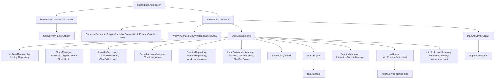

# Application Initialization and State

> Boots the process, owns the single dependency graph, and holds the state that must outlive every Activity.

`HarnessApp` is the `Application` subclass. It fixes two global framework behaviors, then builds one `AppContainer`. `AppContainer` is the service locator for the whole app: settings, encrypted keys, Room database, repositories, provider routing, the agent engine, `RunManager`, the Linux environment, terminals, and every pending deep-link channel. `MainActivity` reads the container from the application object instead of constructing anything itself.

## Module Responsibilities

- **`HarnessApp`**: process entry point. Disables pausable LazyColumn prefetch, enables slow whole-document `WebView` draw, constructs `AppContainer`, and releases cached local models on memory pressure.
- **`AppContainer`**: dependency injection root. Property initializers and five `init` blocks build the graph in declaration order, then start independent collectors that mirror settings and environment state.
- **`KeyStoreManager`**: API keys, tokens, and provider credentials in `EncryptedSharedPreferences` backed by an Android Keystore AES256-GCM master key.
- **`SettingsRepository`**: one DataStore preferences file named `settings`, decoded into the immutable `AppSettings` data class.
- **`AppRuntimePolicy`**: process-wide foreground/background truth and the single gate for whether work may run.
- **`RuntimeNotifier`**: process-wide status, active-task flag, pending notification prompts, and completed-run events.

## Architecture and Flow

- `attachBaseContext` runs before `onCreate` and hands the base `Context` to `GpuDeliveryFactory`, so GPU delivery is ready before any Compose surface exists.
- `onCreate` builds `AppContainer` synchronously. Anything that needs a coroutine is deferred into one of the collectors in the last `init` block.
- `MainActivity` only resolves `(application as HarnessApp).container` and passes it to `AppNav`.

## Invocation Chain

1. Android instantiates `HarnessApp`, declared as `.HarnessApp` in `app/src/main/AndroidManifest.xml`.
2. `HarnessApp.attachBaseContext` calls `super`, then `GpuDeliveryFactory.attach(this)`.
3. `HarnessApp.onCreate` sets `ComposeFoundationFlags.isPausableCompositionInPrefetchEnabled` to false because paused prefetch crashes in `LayoutNode.onChildRemoved` when chat items change.
4. `WebView.enableSlowWholeDocumentDraw()` is called once for the whole process.
5. `AppContainer(this)` runs. `KeyStoreManager` is created first, and its `providerProxy` is injected into `ProviderNetwork.settings` in the following `init`.
6. `SettingsRepository`, `PluginManager`, `HarnessConfigRepository`, `PluginHooks`, `AppRuntimePolicy`, `TtsController`, the editor draft and tab stores, `LocalModelManager`, `ChatGptAccounts`, and `ProviderRepository` are created.
7. The `init` at lines 127 to 135 installs `RotatingKeyProvider.pools`, `ProviderFactory.chatGptProvider`, `ModelCatalog.chatGptModels`, and `ProviderFactory.localProvider`.
8. `Room.databaseBuilder` opens `harness.db` lazily with migrations 4 through 25, the `OVERSIZED_ROW_SANITIZER` callback, and destructive fallback.
9. `ImageStore`, `SessionRepository`, `MemoryRepository`, and `ChatModelRepository` wrap the database. `WorkspaceManager`, `SshConnections`, `CheckpointStore`, and `TodoStore` follow.
10. `LinuxEnvironmentManager`, `WirelessAdbManager`, `ShizukuManager`, `DhizukuManager`, `DeviceAccessManager`, `ShellTierRouter`, and `CodeGraphManager` are constructed after the settings layer so they can read provider and proxy state.
11. `ToolRegistry.default(...)` receives every shared service and builds the tool set. `AgentEngine` receives the registry, checkpoint store, skills, plugin hooks, and subagent resolver.
12. `RunManager` is created with `canRun = runtimePolicy::canRun`, so every run start and every background check routes through the same policy.
13. The `init` at line 372 calls `runtimePolicy.start(...)`, wires `ModelsDev.load`, and launches the settings, workspace, environment, and repair collectors.
14. `MainActivity.onCreate` reads the container, applies the theme from `container.settings.settings`, and calls `AppNav(container)`.

## Key State and Data Structures

| Field | Type | Purpose | Survives process death |
| --- | --- | --- | --- |
| `pendingSessionId` | `MutableSharedFlow<String>` with `extraBufferCapacity = 1` | Run-result notification deep link | No |
| `pendingSubagentChat` | `MutableStateFlow<Pair<String, String>?>` | Subagent chat deep link | No |
| `pendingImportedWorkspace` | `MutableStateFlow<String?>` | Open files after a repository import | No |
| `pendingShare` | `MutableStateFlow<PendingShare?>` | Incoming share awaiting a Chat destination | No |
| `pendingCodeDraft` | `MutableStateFlow<CodeChatDraft?>` | Selected code plus prompt for a composer | No |
| `pendingAgentPrompt` | `MutableStateFlow<String?>` | Build or test failure prompt | No |
| `pendingSettingsScroll` | `MutableStateFlow<String?>` | Deep link into a settings page or anchor | No |
| `keys` | `KeyStoreManager` | API keys, GitHub token, provider pools | Yes, encrypted |
| `settings` | `SettingsRepository` | `AppSettings` in DataStore | Yes |
| `sessions` | `SessionRepository` | Chats, messages, usage, saved answers | Yes, Room |
| `workspace` | `WorkspaceManager` | Projects and active workspace | Yes, Room plus files |
| `checkpoints` | `CheckpointStore` | Undo history and durable file copies | Yes |
| `todoStore` | `TodoStore` | Per-session task list | See agent pages |
| `runManager` | `RunManager` | Live runs, queues, controls | Controls persist under `filesDir/task-controls` |
| `terminal` | `TerminalManager` | Foreground shell and keepalive | No |
| `interactiveTerminal` | `InteractiveTerminalManager` | PTY sessions | No |

The pending channels are deliberately in memory: they carry an intent from one screen to another inside the same process. Deep links that cross process death use Intent extras on `MainActivity` instead, which `handleSessionIntent`, `handleMcpOAuth`, and `handleShareIntent` convert back into these flows.

`AppSettings` is one serializable data class with defaults for every preference. `SettingsRepository.settings` maps the whole preferences snapshot on each DataStore emission, so consumers always see one consistent object rather than a mix of keys.

`AppDatabase` is version 25 with 13 entities: sessions, messages, projects, checkpoints, snippets, usage events, file edits, code activity, session file changes, message FTS, memories, chat answer versions, and saved answers. The newest migration, `MIGRATION_24_25`, creates the `saved_answers` table and its two indexes.

## Boundary Conditions

- **DataStore has not emitted yet**: `AppNav` maps settings to `AppSettings?` with a null initial value and renders an empty `Box` until the first real emission. This prevents the synthetic `AppSettings()` default (`onboardingDone = false`) from flashing the setup screen.
- **Missing migrations**: `fallbackToDestructiveMigration(true)` is enabled, but only triggers when no migration path exists (pre-v4 databases). The v4 to v5 path preserves sessions and usage totals.
- **Oversized rows**: `OVERSIZED_ROW_SANITIZER.onOpen` truncates message text and thinking above 250000 characters to 100000 plus a marker, and replaces oversized `toolCallsJson` with `[]`. This avoids `SQLiteBlobTooBigException` from CursorWindow's 2 MB cap.
- **Memory pressure**: `onTrimMemory` at `TRIM_MEMORY_RUNNING_LOW` or worse, and `onLowMemory`, both launch `container.localModels.releaseCachedModel()` on `memoryScope`. Nothing else is torn down.
- **Background disabled**: `AppRuntimePolicy.start` calls `onBackgroundDisabled`, which stops runs, Telegram, FTP sharing, the terminal, background processes, and `AgentService`. See the foreground service page.
- **Coroutine scopes have no cancellation path**: all the `CoroutineScope(SupervisorJob() + Dispatchers.IO)` collectors in `AppContainer` live for the process. They are not tied to an Activity and cannot be restarted from the UI.

## Extension Points

- **`AppContainer` itself**: new cross-cutting services are added as properties and read through `MainActivity`, `AppNav`, or a ViewModel factory. There is no annotation-based injection.
- **`ToolRegistry.default`**: its argument list is the contract for what tools can see. Passing a new manager here makes it reachable from the agent.
- **`PluginRuntime`**: `PluginManager` receives an anonymous runtime that maps plugin package requests onto `LinuxEnvironmentManager`. Replacing that object changes plugin behavior without touching the manager.
- **Settings**: `SettingsRepository.Keys`, `AppSettings`, and the agent settings catalog are the three places a preference must be registered.
- **`ModelsDev`, `HarnessProvider.pins`, and `HarnessProvider.config`**: static hooks populated during startup, then read synchronously by request paths.

## Known gaps

- There is no global `Thread.setDefaultUncaughtExceptionHandler` and no crash log file. Failures are reported with `android.util.Log` at the call site, for example in `KeyStoreManager`, `TtsController`, `UpdateManager`, and `LinuxEnvironment`.
- Startup has no explicit ordered phase list. Ordering is whatever Kotlin property initializers and the five `init` blocks produce, plus independent coroutine launches that can finish in any order.
- The only boot restore receivers are `TelegramBootReceiver` for `BOOT_COMPLETED` and `MY_PACKAGE_REPLACED`, and `WirelessAdbReconnectReceiver` for `MY_PACKAGE_REPLACED`. Agent runs are not restored at boot.

Sources: [app/src/main/java/com/androidharness/app/HarnessApp.kt](../app/src/main/java/com/androidharness/app/HarnessApp.kt)#L32-L477), [app/src/main/java/com/androidharness/app/MainActivity.kt](../app/src/main/java/com/androidharness/app/MainActivity.kt)#L59-L229), [app/src/main/java/com/androidharness/app/data/db/Database.kt](../app/src/main/java/com/androidharness/app/data/db/Database.kt)#L740-L880), [app/src/main/java/com/androidharness/app/data/SettingsRepository.kt](../app/src/main/java/com/androidharness/app/data/SettingsRepository.kt)#L16-L479), [app/src/main/java/com/androidharness/app/data/KeyStoreManager.kt](../app/src/main/java/com/androidharness/app/data/KeyStoreManager.kt)#L9-L42), [app/src/main/java/com/androidharness/app/AppRuntimePolicy.kt](../app/src/main/java/com/androidharness/app/AppRuntimePolicy.kt)#L13-L85)

## Source files

- `app/src/main/java/com/androidharness/app/HarnessApp.kt`
- `app/src/main/java/com/androidharness/app/MainActivity.kt`
- `app/src/main/java/com/androidharness/app/AppRuntimePolicy.kt`
- `app/src/main/java/com/androidharness/app/data/SettingsRepository.kt`
- `app/src/main/java/com/androidharness/app/data/KeyStoreManager.kt`
- `app/src/main/java/com/androidharness/app/data/db/Database.kt`
- `app/src/main/AndroidManifest.xml`
