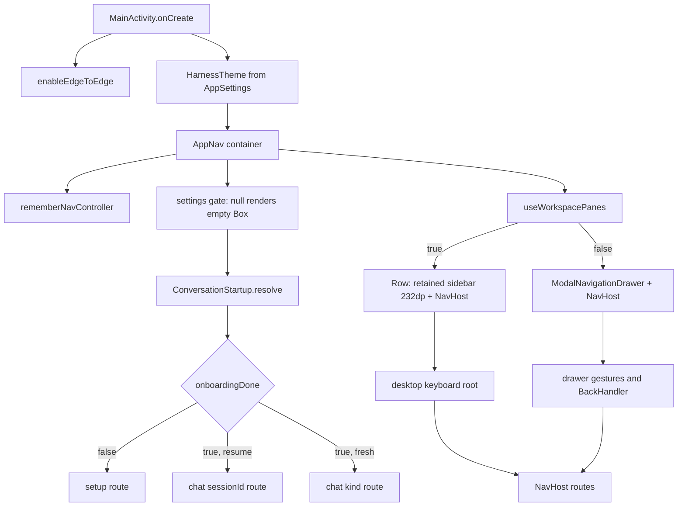

# UI Shell, Navigation, and Layouts

> One navigation graph, one sidebar, and two layout modes that share the same screens.

`MainActivity` owns the window and a single Compose root. `AppNav` owns the `NavHost`, the drawer, the desktop sidebar, deep-link collection, and all route definitions. The same `ProjectNavigationSidebar` renders inside a `ModalNavigationDrawer` on phones and as a fixed 232 dp column on desktop. `WorkspaceLayoutMode` decides which of those two shells the window gets, and `WorkspaceSplitLayout` gives the desktop conversation resizable panes that stay composed while hidden.

## Module Responsibilities

- **`MainActivity`**: edge-to-edge window, refresh rate, screenshot blocking, biometric lock, intent routing, and the theme.
- **`AppNav`**: navigation state, drawer and sidebar, route table, deep-link channels, and the desktop key router.
- **`ProjectNavigationSidebar`**: chats, projects, search, sections, selection, and the footer tool rows.
- **`WorkspaceLayoutMode` and `useWorkspacePanes`**: the phone/desktop decision.
- **`WorkspaceSplitLayout` and `RetainedWorkspaceContent`**: resizable, retained panes.
- **`AppHeader`**: the one screen header used by chat, terminal, files, settings, and providers.

## Architecture and Flow

- `MainActivity` reads settings as a nullable Compose state and returns early until the first real DataStore emission, so the theme never applies defaults.
- `AppNav` resolves `ConversationStartup.resolve(launchSettings, previousKind)` once with `produceState`, and freezes the result in `startDestination`. Regular navigation never recalculates it.
- `desktopNavigation` comes from `useWorkspacePanes(settings.workspaceLayout, screenWidthDp, fontScale)`. The value is provided to every descendant through `LocalDesktopLayout`.
- The drawer is only composed when `desktopNavigation` is false. In desktop mode the sidebar is a retained sibling of the `NavHost`, so the chat composer and unsaved editor state survive toggling the sidebar.

## Invocation Chain

1. `MainActivity.onCreate` reads `container` from `HarnessApp`, starts a foreground update check 2000 ms after resume, and asks for `POST_NOTIFICATIONS` on API 33 and later when notifications are enabled.
2. It routes the launch Intent: `handleSessionIntent` for `AgentService.EXTRA_SESSION_ID`, `handleMcpOAuth` for `androidharness://mcp`, and `handleShareIntent` for a share target.
3. `setContent` applies `HarnessTheme`, checks biometric unlock, sets `FLAG_SECURE` from `ScreenshotPolicy.blocked`, binds the `WebView` read-capture host, and calls `AppNav(container)`.
4. `AppNav` collects sessions, settings, providers, projects, the current back stack entry, and running session ids with `collectAsStateWithLifecycle`.
5. It resolves the start destination, then computes `desktopNavigation`, `sidebarVisible`, `desktopGuard`, `desktopKeyboard`, and `desktopFocus`.
6. `ModalNavigationDrawer` wraps the shell. `gesturesEnabled = !desktopNavigation && drawerGesturesEnabled`, where `drawerSwipeAllowed(route)` excludes settings, providers, skills, stats, setup, `viewer/*`, and `* /memory`.
7. The root `Row` handles desktop shortcuts, then renders `RetainedWorkspaceContent` for the sidebar and a `Column` containing `SshWorkspaceBar` plus the `NavHost`.
8. `NavHost` composites the route table with directional transitions computed by `sectionMotion(initialState, targetState)`, which orders Chat and Code transitions.

## Key State and Data Structures

| State | Type | Where | Notes |
| --- | --- | --- | --- |
| `drawerState` | `DrawerState` | `AppNav` | Closed on desktop and on routes that own their swipes |
| `sidebarVisible` | `Boolean`, `rememberSaveable` | `AppNav` | Desktop only, toggled by Ctrl+Shift+B |
| `desktopGuard` | `EditorNavigationGuard` | `AppNav` | Asks the editor to confirm before leaving |
| `desktopKeyboard` | `DesktopKeyboardRouter` | `AppNav` into `LocalDesktopKeyboardRouter` | One registered pane handler |
| `searchQuery`, `fuzzySearch`, `messageHits` | Compose state | `AppNav` | Debounced 250 ms search over titles and messages |
| `expandedProjects` | `List<String>`, `rememberSaveable` | `ProjectNavigationSidebar` | Project tree expansion |
| `showArchived`, `showSaved`, `toolsOpen` | `Boolean`, `rememberSaveable` | `ProjectNavigationSidebar` | Section visibility |
| `selectedChatIds` | `List<String>`, `rememberSaveable(activeKind)` | `AppNav` | Multi-select, cleared when the drawer closes |
| `codeRoute`, `plainRoute` | `String?`, `rememberSaveable` | `AppNav` | Last route per conversation section |
| `page` | enum `SettingsPage` | Settings screen | See the settings page |

`SidebarChats.of(projects, sessions, pinned, archived)` partitions sessions into pinned, per-project groups, project-less chats, and archived chats. `SidebarChats` is recomputed only when projects, sessions, or the pin and archive sets change.

## Layout Modes

`WorkspaceLayoutMode` has three values:

- `AUTO` returns panes at 840 dp times the font scale.
- `PHONE` always returns false.
- `DESKTOP` returns panes at 720 dp times the font scale.

`useWorkspacePanes` reads the app window width in dp and never the device orientation. The stored name `EMULATOR` is still accepted by `fromStored` and maps to `DESKTOP`.

Phone shell:

- `ModalNavigationDrawer` with `ModalDrawerSheet`.
- Drawer closes on navigation, on a route that owns its swipes, and on the `BackHandler` at `AppNav.kt:984`.
- The sidebar opens from the chat header menu and from `onOpenDrawer`, which calls `drawerState.open()`.

Desktop shell:

- Sidebar is a retained column with `Modifier.width(232.dp)` when visible and `0.dp` when hidden.
- `Ctrl+Shift+B` toggles it. Chat and Code screens call the same toggle through `onOpenDrawer`.
- `WorkspaceSplitLayout` divides chat and a tool panel. The drag handle is 24 dp wide, clamped so chat keeps at least 320 dp times font scale and the panel at least 340 dp times font scale, and arrow keys move the split by 0.03.
- `RetainedWorkspaceContent` measures hidden panes with their last known size, so a hidden editor keeps its text and a hidden composer keeps its draft.

## Sidebar Content

The sidebar has a fixed header and a scrolling list:

- Header: `HarnessMark`, app name, collapse button, `ConversationSectionSwitcher`, New chat button, search field, collection buttons (Saved and Archived) for Chat, and a Chats/Projects segmented row for Code.
- Chat rows: title, draft marker, activity dot (`SidebarActivity.WORKING`) or help icon (`NEEDS_YOU`), project name, pin, and the current-chat check.
- Chat menu: Select, Rename, Pin, Details, Archive, Delete. Long-press or Shift+F10 opens the same actions.
- Project rows: expand arrow, folder badge, name, pin, chat count, and a menu with New chat, Open, Rename, Pin, Archive, Delete. Delete is hidden for the app workspace (`WorkspaceManager.KIND_APP`).
- Projects view: projects sorted pinned first, then chats nested under each expanded project, with "Pinned" and "All projects" headers.
- Footer: Tools (Terminal, Build and test, Scheduled tasks, Workspace, plus Files changed when the session has changes), Providers, Settings.

Multi-select lives in the sidebar header as `ChatSelectionToolbar`. `selectableIds` is derived from the current list context: search results, saved answers, expanded project chats, archived chats, or active chats.

## Back Behavior

- Switching conversations replaces the destination: `navigateToConversation` calls `navigate(route) { popUpTo(graph.id); launchSingleTop = true }`. Back does not replay previously selected chats.
- `BackHandler` in `AppNav` closes the open drawer first.
- `ProjectNavigationSidebar` has its own `BackHandler` that clears a multi-select.
- `ChatWorkspaceScreen` handles Back for the entity tool panel and file preview before the navigation graph sees it.
- `SettingsScreen` handles Back through `goBack`, which unwinds the Learn lesson, the page history, the desktop page, the page itself, then the search query.
- The manifest enables `android:enableOnBackInvokedCallback="true"` and `singleTask` launch mode, so notification deep links reuse the same Activity and arrive in `onNewIntent`.

## Keyboard Shortcuts

| Shortcut | Scope | Effect |
| --- | --- | --- |
| `Ctrl+N` | Desktop root | New chat through the navigation guard |
| `Ctrl+,` | Desktop root | Open Settings |
| `Ctrl+Shift+B` | Desktop root | Toggle the sidebar |
| `Ctrl+L` | Desktop workspace | Focus the composer |
| `Ctrl+Alt+F` | Desktop workspace | Files panel |
| `Ctrl+Alt+T` | Desktop workspace | Terminal panel |
| `Ctrl+Alt+G` | Desktop workspace | GitHub workspace dialog |
| `Ctrl+P` | Workspace, editor | Quick file open |
| `Ctrl+Shift+P` | Workspace | Command palette |
| `Ctrl+Shift+F` | Workspace, editor | Project search |
| `Ctrl+Enter` | Desktop composer | Send |
| `Tab` / `Shift+Tab` | Desktop composer | Move focus |
| `Escape` | Desktop workspace | Close the tool panel |
| `Ctrl+S` | Editor | Save |
| `Ctrl+Shift+I` | Editor | Format, when the file type supports it |
| `Ctrl+C` | Terminal | Interrupt a busy command |
| `Enter`, `Up`, `Down` | Terminal | Run, previous command, next command |

`DesktopKeyboardRouter` exists so a pane can register a handler that works before the user focuses a field. `ChatWorkspaceScreen` registers `handleKey` on composition and unregisters on dispose. The root `Row` calls the router first, then its own shortcuts.

## Theme and Shared Chrome

`HarnessTheme` resolves dark mode, then picks a color scheme in this order: Canvas seed, custom palette, dynamic Material You on API 31 and later, then the selected `ThemePalette`. `AMOLED` maps surfaces to black while keeping accent roles. Glass mode is resolved by `HarnessGlassMode.resolve(enabled, liquid, sdk)`: off below API 31, `LIQUID` below API 33 only when liquid is requested, otherwise `FROSTED`. Motion comes from `Motion.kt`: `defaultSpatialSpec` is a spring with damping 0.86 and stiffness 700, `expressiveSpatialSpec` and `expressiveEffectsSpec` opt specific controls into the expressive scheme.

`AppHeader` is the shared screen header. It renders one row with a back or menu button, a title, an optional subtitle, and actions. On desktop the back icon becomes Close and the height drops to 42 dp.

## Boundary Conditions

- **No settings yet**: `AppNav` returns an empty box until DataStore emits.
- **Setup gate**: `needsSetup` is `!settings.onboardingDone`, and the setup route is the only start destination in that case. Connecting a provider does not remount the graph.
- **Route-owned swipes**: `drawerSwipeAllowed` keeps the drawer from interfering with settings, providers, skills, stats, setup, the editor, and project memory.
- **Hidden panes**: `RetainedWorkspaceContent` clears semantics for hidden content, so accessibility and screenshots do not see an invisible pane.
- **Glass drawer capture**: a retained drawer only keeps the glass capture alive while the drawer is moving or open, tracked by `glassDrawerCapture`.
- **Editor guard**: navigation that would discard editor changes goes through `EditorNavigationGuard.navigate`, which runs the confirmation callback when one is registered.

## Extension Points

- **New route**: add a `composable("route")` block inside `NavHost`, pass `container` to the screen, and handle Back with `nav.popBackStack()`.
- **New sidebar action**: extend `SidebarChatAction`, `SidebarProjectAction`, and the corresponding `when` in `AppNav`.
- **New desktop shortcut**: add a branch in the root `onPreviewKeyEvent` or register through `DesktopKeyboardRouter`.
- **New layout rule**: change `useWorkspacePanes` thresholds or add a `WorkspaceLayoutMode` value and its settings label.
- **New screen chrome**: use `AppHeader` so back, menu, insets, and divider behavior stay consistent.

Sources: [app/src/main/java/com/androidharness/app/ui/AppNav.kt](../app/src/main/java/com/androidharness/app/ui/AppNav.kt)#L104-L1305), [app/src/main/java/com/androidharness/app/ui/ProjectNavigationSidebar.kt](../app/src/main/java/com/androidharness/app/ui/ProjectNavigationSidebar.kt)#L68-L554), [app/src/main/java/com/androidharness/app/ui/WorkspaceSplitLayout.kt](../app/src/main/java/com/androidharness/app/ui/WorkspaceSplitLayout.kt)#L23-L96), [app/src/main/java/com/androidharness/app/data/WorkspaceLayoutMode.kt](../app/src/main/java/com/androidharness/app/data/WorkspaceLayoutMode.kt)#L5-L29), [app/src/main/java/com/androidharness/app/ui/DesktopUi.kt](../app/src/main/java/com/androidharness/app/ui/DesktopUi.kt)#L6-L27), [app/src/main/java/com/androidharness/app/ui/theme/Theme.kt](../app/src/main/java/com/androidharness/app/ui/theme/Theme.kt)#L30-L85), [app/src/main/java/com/androidharness/app/MainActivity.kt](../app/src/main/java/com/androidharness/app/MainActivity.kt)#L68-L336)

## Source files

- `app/src/main/java/com/androidharness/app/ui/AppNav.kt`
- `app/src/main/java/com/androidharness/app/ui/ProjectNavigationSidebar.kt`
- `app/src/main/java/com/androidharness/app/ui/WorkspaceSplitLayout.kt`
- `app/src/main/java/com/androidharness/app/ui/DesktopUi.kt`
- `app/src/main/java/com/androidharness/app/ui/NavigationGestures.kt`
- `app/src/main/java/com/androidharness/app/ui/ChatWorkspaceScreen.kt`
- `app/src/main/java/com/androidharness/app/ui/common/AppHeader.kt`
- `app/src/main/java/com/androidharness/app/ui/theme/Theme.kt`
- `app/src/main/java/com/androidharness/app/ui/theme/HarnessGlass.kt`
- `app/src/main/java/com/androidharness/app/data/WorkspaceLayoutMode.kt`
