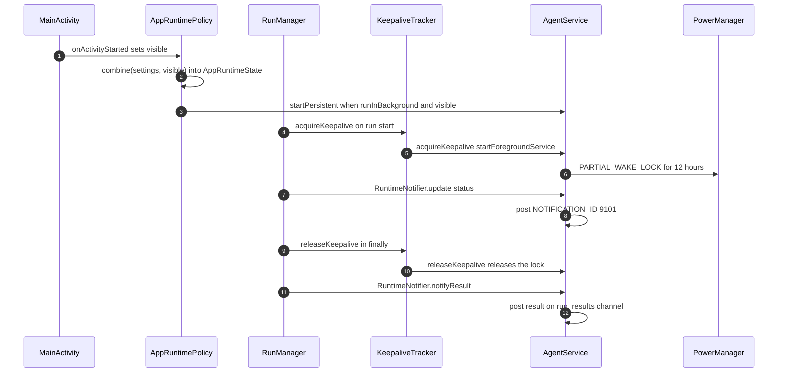

# Foreground Service and Execution Host

> Keeps the process alive while an agent run or terminal is active, and hosts the runs themselves.

`AgentService` is a `specialUse` foreground service with a partial wake lock. It does not execute tools itself. The execution host is `RunManager`, which owns runs on an application-wide coroutine scope and publishes live state through `RuntimeNotifier`. `AppRuntimePolicy` decides when the service may exist, `KeepaliveTracker` turns overlapping tasks into reference-counted wake leases, and `TerminalManager` plus `InteractiveTerminalManager` use the same lease so a shell survives minimizing the app.

## Module Responsibilities

- **`AgentService`**: foreground lifecycle, wake lock, notification channels, ongoing status notification, answerable alerts, Live Update promotion.
- **`RuntimeNotifier`**: status text, active-task flag, per-session pending prompts, completed-run events.
- **`AppRuntimePolicy`**: tracks app visibility across all Activities and exposes `AppRuntimeState.canRun`.
- **`KeepaliveTracker`**: reference-counts active tasks and background holders, then acquires or releases the service lease once.
- **`RunManager`**: creates sessions, launches run jobs, persists controls, mirrors prompts, and posts results.
- **`TerminalManager` and `InteractiveTerminalManager`**: hold keepalive while a shell or PTY session is alive.
- **`NotificationActionReceiver`**: resolves notification buttons against `RunManager`.

## Architecture and Flow

- `AppRuntimePolicy` counts started Activities in a set. A 700 ms delay after the last stop keeps rotation and Activity replacement from toggling background.
- `AppRuntimeState.canRun = ready && (visible || runInBackground)`. `RunManager` checks the same predicate before starting a run and again at the top of the run job.
- The service is only started when `runInBackground` is true. If background running is off, the policy calls `AgentService.stop`, and the app can still run while visible.

## Service Lifecycle

`onCreate` (`AgentService.kt:194`) does the following in order:

1. Stores itself in the companion `current` reference.
2. Creates the three notification channels.
3. Calls `startForeground(NOTIFICATION_ID, buildNotification(...))` with ID 9101.
4. Launches collectors for `RuntimeNotifier.status`, `RuntimeNotifier.active`, `RuntimeNotifier.results`, and `RuntimeNotifier.pendingPrompts`, each posting under `runCatching` so a notification failure never kills the service.
5. Combines `runtimePolicy.state` with `settings.liveUpdatesEnabled`. If the policy is not ready, it returns without touching the notification. If `runInBackground` is false it removes the foreground notification and stops itself. Otherwise it recomputes `liveUpdatesEnabled` and reposts the notification.

`onStartCommand` (`AgentService.kt:246`) returns `START_NOT_STICKY` when the policy says background running is off. It handles three actions: `ACTION_ACQUIRE_WAKELOCK`, `ACTION_RELEASE_WAKELOCK`, and `ACTION_STOP`. Every other start returns `START_STICKY`.

`onDestroy` cancels the service scope, releases the wake lock, and removes the foreground notification.

The wake lock is `PowerManager.PARTIAL_WAKE_LOCK` named `harness:agent`, acquired with a 12 hour ceiling so a long run is not silently killed at the platform's 10 minute default. `acquireWakeLock` is idempotent while a lock is held.

## Notifications

Three channels are created in `createChannels`:

| Constant | ID string | Importance | Purpose |
| --- | --- | --- | --- |
| `CHANNEL_ID` | `agent_runs` | LOW | Ongoing foreground status |
| `RESULTS_CHANNEL_ID` | `run_results` | DEFAULT | Completed and failed runs |
| `ALERT_CHANNEL_ID` | `action_needed` | HIGH, public lock screen | Blocking approval, question, environment |

Notification IDs:

- `NOTIFICATION_ID = 9101`: the ongoing service notification, with a Stop action.
- `RESULT_NOTIFICATION_ID = 9102`: base for run results, offset by a hash of the session or subagent key.
- `ALERT_NOTIFICATION_ID = 9103`: shared ID for action alerts, keyed by session id as the notification tag so parallel runs do not overwrite each other.

`buildNotification` always shows AndroidHarness as the title and `localizedOptionLabel(text)` as the body when alerts are enabled. When alerts are off it shows the generic background service notice, since Android still requires a visible foreground notification. It adds Approve and Deny actions for the first pending approval, or Skip and Install for a pending environment prompt. Question prompts are answered from the separate alert notification, which uses `RemoteInput` with key `reply_text` and up to `MAX_OPTION_BUTTONS = 3` option buttons.

On API 36 (`Build.VERSION_CODES.BAKLAVA`) and later, with alerts and live updates enabled and an active task, the ongoing notification calls `setRequestPromotedOngoing(true)`, sets a short critical text from `liveUpdateShortText`, and uses an indeterminate `ProgressStyle`. This is what OEMs surface as a Live Update or Now Bar card. `liveUpdateShortText` maps known status prefixes to string resources and otherwise truncates the first line to 24 characters.

`stopFromNotification` stops Telegram, `runManager.stopAllAndJoin`, the terminal, and all background processes, then releases the lock, removes the notification, and calls `Process.killProcess(Process.myPid())`.

## Execution Host

`RunManager` is constructed with an `appScope = CoroutineScope(SupervisorJob() + Dispatchers.Default)` and the comment block at the class head states the design: a run survives minimizing, rotation, and navigation, and only process death ends it. The foreground service and wake lock exist to make process death unlikely.

The run path in `startRunLocked`:

1. `check(canRun())` with `R.string.background_run_blocked`.
2. Resolve or create the session, cancel any previous job for it, and join it.
3. Resolve the provider config, context limit, workspace, and any replacement-message rewind.
4. Write `TaskRecord` fields through `controls.update`, including status `running`, provider, workspace paths, limits, turn id, and initial prompt.
5. Set `mainRunningSessionIds` and `runningSessionIds`, then call `acquireKeepalive()` and `RuntimeNotifier.update("Working…")`.
6. Launch the job on `appScope` with `CoroutineStart.ATOMIC`, so a stop that arrives before the worker is scheduled still enters the `finally`.
7. Inside the job, launch three helpers: a 16 ms delta flusher, a 2500 ms usage writer, and a prompt mirror that maps live state to `PendingPrompt` objects and pushes them to `RuntimeNotifier.setSessionPrompts`.
8. Call `engine.run(...)`.
9. In `finally`, persist status `idle` or `paused`, clear prompts, stop the helpers, publish the terminal `LiveRunState`, remove the session from the running sets, call `notifyFinished`, and always call `releaseKeepalive()`.

`TaskControlStore` persists each session as `filesDir/task-controls/<sessionId>.json` with `Json { ignoreUnknownKeys = true; encodeDefaults = true }`. That record is what lets a paused task be resumed after process death. `CheckpointStore` keeps file undo data, and `RunRecovery` rebuilds context and missing tool results on resume.

`notifyFinished` builds a `RunResultNotification` and calls `RuntimeNotifier.notifyResult`. `RunResultNotifications.post` creates the results channel if needed and posts a `BigTextStyle` notification whose content Intent carries `EXTRA_SESSION_ID` and optional `EXTRA_SUBAGENT_CALL_ID`.

## Keepalive Accounting

`KeepaliveTracker` has two counters: `tasks` for active agent work and `background` for passive holders such as NineRouter.

- `acquire(activeTask = true)` increments `tasks`; the first task flips `onActiveChanged(true)`.
- `acquire(activeTask = false)` increments `background` without advertising an active task.
- `release` mirrors the counters. The service lease is released only when both reach zero.
- `RunManager.acquireKeepalive()` and `releaseKeepalive()` use the active counter. `acquireBackgroundKeepalive()` and `releaseBackgroundKeepalive()` use the background counter.

`TerminalManager` calls `runManager.acquireKeepalive()` when the app-tier shell process starts and releases it in the reader's `finally` when that process exits. SSH commands acquire and release around each command. `InteractiveTerminalManager` acquires before creating a `TerminalSession` and releases in the session's close callback. Because the lease is reference-counted, closing one terminal cannot release the wake lock while an agent run is still active.

## Boundary Conditions

- **Background running off**: `startRunLocked` throws before creating work, `onStartCommand` stops the service, and the policy observer stops Telegram, FTP sharing, terminals, background processes, and `AgentService` in `HarnessApp` lines 373 to 383.
- **Service started by the user, then disabled**: the policy collector calls `stopForeground(STOP_FOREGROUND_REMOVE)` and `stopSelf`.
- **App killed by the user**: `releaseKeepalive` uses `current?.releaseWakeLock()`, so releasing the last task cannot resurrect a service the user stopped.
- **First notification**: `startForeground` runs in `onCreate` before any collector can post, so the service is foreground from its first frame.
- **Alerts disabled**: `AppNotifications.enabled` gates every post, and `applyPreference` cancels non-foreground notifications when the user turns alerts off. The foreground notice stays because Android owns it.
- **Notification action races**: the receiver cancels the alert first, then resolves `RunManager`; if the in-app UI already answered, the cancel is still harmless.
- **PendingIntent identity**: request codes are `31 * sessionId.hashCode() + slot`, because extras are not part of PendingIntent identity. The free-text answer intent is the only `FLAG_MUTABLE` one, required by `RemoteInput`.
- **Process death**: a run does not resume automatically. Its `TaskRecord` stays `completed = false` with status `paused` and a reason, and the user resumes it from the chat.

## Boot and Restore

The manifest declares `RECEIVE_BOOT_COMPLETED`, but no receiver starts `AgentService` after boot. The only boot-related receivers are:

- `TelegramBootReceiver` in `TelegramService.kt`, which handles `BOOT_COMPLETED` and `MY_PACKAGE_REPLACED` and calls `container.telegram.restoreIfEnabled()`.
- `WirelessAdbReconnectReceiver`, which handles `MY_PACKAGE_REPLACED` and calls `WirelessAdbService.resume(context)`.

`AgentService` relies on `START_STICKY` plus the foreground notification rather than boot restore.

## Extension Points

- **New notification action**: add an action constant to `NotificationActionReceiver` and a branch in its `when`.
- **New prompt kind**: extend `PendingPrompt.Kind`, `RuntimeNotifier.setSessionPrompts`, and `buildActionNeeded`.
- **New keepalive holder**: call `acquireBackgroundKeepalive` and `releaseBackgroundKeepalive` on `RunManager`, then release on the same code path that closes the holder.
- **New service state**: add a field to `AppRuntimeState` and fold it into `canRun` or the policy `combine`.
- **New live status**: update through `RuntimeNotifier.update`; add a prefix to `liveUpdateShortLabel` if it should get a short chip.

## Known gaps

- `AppSettings.keepAlive` is persisted and shown as the Environment keep alive switch, but no service or run code reads it at HEAD. The wake lock is gated by `runInBackground`, not by `keepAlive`.
- `NotificationActionReceiver` and alert buttons depend on `RunManager` state held in the same process. If the process is gone, the pending alert cannot restore the run, only reopen the chat.
- The 12 hour wake lock ceiling is a hard limit. A run that exceeds it loses the CPU guarantee even though the foreground service remains.

Sources: [app/src/main/java/com/androidharness/app/AgentService.kt](../app/src/main/java/com/androidharness/app/AgentService.kt)#L36-L571), [app/src/main/java/com/androidharness/app/AppRuntimePolicy.kt](../app/src/main/java/com/androidharness/app/AppRuntimePolicy.kt)#L13-L106), [app/src/main/java/com/androidharness/app/agent/KeepaliveTracker.kt](../app/src/main/java/com/androidharness/app/agent/KeepaliveTracker.kt)#L1-L30), [app/src/main/java/com/androidharness/app/agent/RunManager.kt](../app/src/main/java/com/androidharness/app/agent/RunManager.kt)#L47-L100), [app/src/main/java/com/androidharness/app/agent/RunManager.kt](../app/src/main/java/com/androidharness/app/agent/RunManager.kt)#L355-L770), [app/src/main/java/com/androidharness/app/agent/RunManager.kt](../app/src/main/java/com/androidharness/app/agent/RunManager.kt)#L1561-L1576), [app/src/main/java/com/androidharness/app/data/TerminalManager.kt](../app/src/main/java/com/androidharness/app/data/TerminalManager.kt)#L132-L192), [app/src/main/AndroidManifest.xml](../app/src/main/AndroidManifest.xml)#L1-L185)

## Source files

- `app/src/main/java/com/androidharness/app/AgentService.kt`
- `app/src/main/java/com/androidharness/app/AppRuntimePolicy.kt`
- `app/src/main/java/com/androidharness/app/agent/KeepaliveTracker.kt`
- `app/src/main/java/com/androidharness/app/agent/RunManager.kt`
- `app/src/main/java/com/androidharness/app/agent/TaskControl.kt`
- `app/src/main/java/com/androidharness/app/agent/NotificationActionReceiver.kt`
- `app/src/main/java/com/androidharness/app/data/TerminalManager.kt`
- `app/src/main/java/com/androidharness/app/terminal/InteractiveTerminalManager.kt`
- `app/src/main/AndroidManifest.xml`
