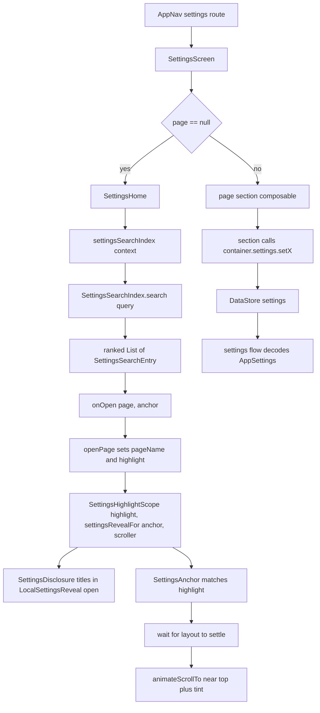

# Settings Architecture and Search

> A page catalog, a section renderer, and a search index that can land on a single control inside a collapsed section.

Settings is one route with an internal page stack. `SettingsNavigation.kt` describes every page and every searchable control as data. `SettingsScreen.kt` renders the selected page by delegating to one section composable per area. `SettingsSearch.kt`, `SettingsSearchCatalog.kt`, and `SettingsAnchor.kt` make search work across pages, languages, and collapsed disclosures. Persistence is a single DataStore file exposed as `AppSettings` by `SettingsRepository`.

## Module Responsibilities

- **`SettingsPage`**: enum of pages with a title, description, group, English keywords, and whether the page appears on the settings home.
- **`SettingsScreen`**: page stack, Back handling, search query, highlight lifetime, desktop navigation, and the `when (page)` dispatch to section composables.
- **`SettingsHome` and `DesktopSettingsNavigation`**: grouped result list plus search field, in phone and desktop form.
- **`SettingsSearch`**: Unicode folding, term splitting, weighted matching, and typo tolerance.
- **`SettingsSearchIndex`**: builds weighted fields per entry and ranks results.
- **`SettingsSearchCatalog`**: one `SettingsSearchEntry` per control, including its anchor and collapsed sections.
- **`SettingsAnchor` and `SettingsDisclosure`**: scroll to the target control, tint it, and open the sections that hide it.
- **`DeviceSupport`**: marks entries that need a newer Android version or a vibrator.
- **`SettingsRepository` and `AgentSettingsCatalog`**: declaration, decoding, and persistence of preferences.

## Architecture and Flow

- `SettingsScreen` holds `pageName` and `pageHistory` in `rememberSaveable`, so rotation and process recreation restore the page stack and the Back path.
- On desktop the initial page is `APPEARANCE`; on phone the initial page is `null`, which renders `SettingsHome`.
- `highlight` is a string resource id, never rendered text. It is cleared after 2600 ms.

## Page Model

`SettingsPage` has 38 values covering Learn, Language, Chat Options, Memory, Coding, Rumble, GitHub, Connected Accounts, 9Router, Models, Subagent, Local Models, Plugins, Configuration, Agent, Chat, Code Intelligence, Caveman, Voice, Live Mode, Skills, Appearance, Privacy, Search, MCP, Telegram, Workspace, Background, Storage, Environment, Troubleshooting, Sync, FTP Server, Backup, Usage, Updates, Setup, and About.

Two lists decide where pages appear:

- `settingsHomePages` is the ordered home list.
- `settingsCodingPages` is the list reached from the Coding hub. Pages with `onHome = false` appear only through that hub.

`settingsDisplayGroups` groups results by `page.group`, except that Connected Accounts and 9Router are hoisted into `settings_group_special_providers` while the query is blank.

`SettingsScreen` dispatches with `when (page)`. Examples: `LANGUAGE -> LanguageSection()`, `MODELS -> Manage providers row, PlanningModelSection, CurrentSetupCard, FallbackSettingsSection`, `ENVIRONMENT -> TerminalSection(...)`, `BACKGROUND -> BackgroundSettingsSection(container, settings)`. Skills, Usage, and Setup are routed out of Settings to separate screens, so their `when` branches are `Unit`.

## Search Pipeline

Search runs over `allSettingsEntries`, which is `searchableSettingsEntries` (one primary entry per page) plus `settingsControlEntries` (one entry per control). The index is built once per resolution with `settingsSearchIndex(context)`, which passes the running locale and, when that is not English, a second `Context` configured to English. Titles and descriptions therefore match in both the current language and English.

`SettingsSearchIndex` builds these weighted fields per entry:

| Field | Weight | Purpose |
| --- | --- | --- |
| Page or control title | 1.0 | Exact label match |
| English title when different | 0.95 of the title weight | Keeps English names working in other locales |
| Keywords | 0.7 | English search vocabulary |
| Parent page title for a control | 0.5 | Finding a control by its page |
| Collapsed section titles in `within` | 0.5 | Finding a control by where it lives |
| Description | 0.45 | Topical matches |
| Page group | 0.3 | Broad category matches |

Ranking:

1. `SettingsSearch.terms(query)` folds and splits the query.
2. If there are no terms, the home page list is returned.
3. Exact scoring runs first. If nothing matches, the same scoring runs with fuzzy typo tolerance.
4. Each term must match at least one field. Scores are summed.
5. A primary page entry is dropped when one of its own control entries scores at least as high, so searching for a control lands on the control, not the page.
6. Ties break toward non-primary entries, then shorter titles, then alphabetical order.

`SettingsSearch.fold` normalizes NFKD, removes combining marks and Arabic tatweel, maps katakana to hiragana, folds German sharp s and Turkish dotless i, normalizes Arabic and Persian letter variants and digits, lowercases, and collapses spaces. `SettingsSearch.quality` scores exact field match 1.0, first word 0.97, any whole word 0.95, word prefix 0.85, substring 0.7, compact substring 0.6, then optional fuzzy distance. `SettingsSearch.distance` is optimal string alignment, so adjacent transpositions count as one edit. Fuzzy matching requires at least four characters and allows one edit, or two at eight characters and above.

## Anchors and Collapsed Sections

The link between a search entry and a real control is a string resource id used three times: as the entry's `anchor`, as the control's visible label, and as the `SettingsAnchor` argument. This keeps translations from drifting.

- `SettingsAnchor(@StringRes title)` wraps content and marks it as the target when `title == LocalSettingsHighlight.current`.
- The string overload matches when the highlighted resource renders to the same text, so shared rows become targets without wrapping every call site.
- `Modifier.settingsAnchor(title)` is the row or card form. `SettingRow` applies the string form automatically at `SettingsScreen.kt:3309`.

`SettingsDisclosure(icon, title, subtitle, anchors, ...)` stores its expanded state in `rememberSaveable(title)`. A `LaunchedEffect` opens it when `forceExpanded` is true, when `settingsRevealed(title)` is true, or when the current highlight is in its `anchors` set. `settingsRevealed` compares the disclosure title against `LocalSettingsReveal`, which `SettingsHighlightScope` fills with `settingsRevealFor(highlight)`. `settingsRevealFor` looks up the entry whose `anchor` equals the highlight and returns its `within` list.

A control inside a nested section lists every enclosing section title in `within`, outermost first. For example, root access controls list `settings_device_advanced`; the battery keep-alive control lists `settings_device_background`. On arrival the page opens those disclosures, then the anchor scrolls.

`anchorModifier` handles the scroll:

1. It records its position with `onGloballyPositioned`.
2. It animates a tint from transparent to `primaryContainer` at 55 percent alpha.
3. It waits for the position to stay unchanged for three frames, capped at 1.2 seconds, because sections above may still be expanding.
4. It computes `viewport.localPositionOf(anchor).y`, subtracts a 72 dp margin, clamps to the scroll range, and calls `animateScrollTo`.
5. If no scroller viewport is available, it falls back to `BringIntoViewRequester`.

`SettingsScroller` wraps the page `ScrollState` and the viewport coordinates. Lazy pages (Learn, Local Models, Configuration, Plugins) do not provide a scroller, so their anchors use `bringIntoView`.

Deep links reuse the same path. `AppNav` collects `container.pendingSettingsScroll` and navigates to `settings`. `SettingsScreen` maps the string through `settingsDeepLink` and `settingsDeepLinkAnchor`, pushes the previous page onto `pageHistory`, sets `pageName`, and sets `highlight`. Forms like `page:APPEARANCE:123` carry a page plus an anchor resource id in memory only.

## Declaring and Persisting a Setting

Adding a preference touches these files in order:

1. **`AppSettings`**: add a property with a default, for example `val runInBackground: Boolean = true` at `SettingsRepository.kt:63`. This is the single decoded model every reader sees.
2. **`Keys`**: add a preference key with the right type, for example `val RUN_IN_BACKGROUND = booleanPreferencesKey("run_in_background")` at `SettingsRepository.kt:269`.
3. **`settings` flow**: decode the key with a default in the `AppSettings(...)` mapping, for example `runInBackground = prefs[Keys.RUN_IN_BACKGROUND] ?: true` at line 395.
4. **Setter**: add a suspend function that edits DataStore, for example:
   `suspend fun setRunInBackground(enabled: Boolean) { context.settingsStore.edit { it[Keys.RUN_IN_BACKGROUND] = enabled } }` at lines 897 to 899.
5. **Section UI**: render the control inside a section composable. `BackgroundSettingsSection` builds a switch row and calls `container.settings.setRunInBackground(it)`.
6. **Search**: add a `SettingsSearchEntry` or a `control(...)` entry in `SettingsSearchCatalog` with the same label resource as its anchor, plus `within` if a disclosure hides it.
7. **Agent control (optional)**: add an `AgentSetting` in `AgentSettingsCatalog` with a stable `key`, a `SettingKind`, `read`, and `write`. Sensitive settings set `sensitive = true`.

`SettingsRepository.restorePortable` writes the same keys for an encrypted settings import, so a new key must also be added there or it will not round-trip.

`settingsStore` is declared once as `val Context.settingsStore by preferencesDataStore(name = "settings")`. There is one file for the whole app; the `settings` flow emits a complete `AppSettings` on every edit. Setters never expose partial state.

## Device Support Gating

`settingsAvailability(entry, sdk, hasVibrator)` returns:

- `NeedsAndroid(version)` when `sdk < entry.minSdk`.
- `NoVibrator` when `entry.needsVibrator` is true and `deviceHasVibrator(context)` is false.
- `Available` otherwise.

`androidVersionName` maps API 26 through 36 to marketing versions. `SettingsAvailabilityTag` renders a small chip under a search result. `rememberSettingsAvailability` recomputes with `Build.VERSION.SDK_INT` and the vibrator check.

The catalog uses this for Glass (`minSdk` S and TIRAMISU), Live Updates (`BAKLAVA`), dynamic color (`S`), and every Rumble control (`needsVibrator = true`). The tag is advisory: it changes what the search result says, not whether the control below is enabled.

## Boundary Conditions

- **Back order**: `goBack` unwinds a Learn lesson first, then page history, then the desktop page, then the phone page, then the search query, then the route. `BackHandler` is enabled only when a page or query exists.
- **Desktop history**: opening a page from the desktop navigation clears `pageHistory` unless the user is moving within the Coding hub, so the desktop never builds a long fake stack.
- **Highlight lifetime**: 2600 ms. A second search result resets it.
- **Nested disclosures**: `settingsRevealFor` uses the first entry with that anchor and its `within` list. A section nested deeper than the listed titles will not open.
- **Lazy pages**: they have no `SettingsScroller`, so the 72 dp landing margin does not apply.
- **Shared rows**: string anchors match on rendered text, so two rows with identical labels both become potential targets; `LocalAnchorClaimed` stops the inner one from scrolling twice.
- **Missing translations**: keywords stay English on purpose. A translated title is still matched through the English context fallback.
- **Search index cost**: `settingsSearchIndex` resolves every string and builds folded fields per call site `remember`. It is created separately by `SettingsHome`, `DesktopSettingsNavigation`, and the matching helpers.

## Extension Points

- **New page**: add a `SettingsPage` value, add it to a section list or the Coding hub, add a `when` branch in `SettingsScreen`, and add a `settingsIcon` case.
- **New control entry**: add one `control(...)` call to `SettingsSearchCatalog` with the label resource used by the control.
- **New anchor**: wrap the row with `SettingsAnchor(R.string.label)` or add `Modifier.settingsAnchor(R.string.label)`.
- **New disclosure section**: pass the section title resource in each contained entry's `within` list.
- **New setting**: follow the seven steps above. The agent catalog is optional but required for "ask the agent to change a setting".
- **Deep link**: add a case to `settingsDeepLink`, or use `settingsTarget(page, anchor)` for an in-memory page plus control link.

## Known gaps

- `SettingsAvailabilityTag` is rendered only by `SettingsHome` at line 118. `DesktopSettingsNavigation` shows no availability chip, and no section composable consults `SettingsAvailability`, so the control itself is not disabled by `minSdk` or the vibrator check.
- `SettingsSearchCatalog` is maintained by hand. A control without an entry is still reachable by page search, but cannot be found by its own label or scrolled to.
- `settingsRevealFor` supports only the disclosures named in `within`. A control hidden behind a second, unlisted level will land on a collapsed section.

Sources: [app/src/main/java/com/androidharness/app/ui/settings/SettingsNavigation.kt](../app/src/main/java/com/androidharness/app/ui/settings/SettingsNavigation.kt)#L20-L455), [app/src/main/java/com/androidharness/app/ui/settings/SettingsScreen.kt](../app/src/main/java/com/androidharness/app/ui/settings/SettingsScreen.kt)#L154-L426), [app/src/main/java/com/androidharness/app/ui/settings/SettingsHome.kt](../app/src/main/java/com/androidharness/app/ui/settings/SettingsHome.kt)#L36-L243), [app/src/main/java/com/androidharness/app/ui/settings/SettingsSearch.kt](../app/src/main/java/com/androidharness/app/ui/settings/SettingsSearch.kt)#L18-L98), [app/src/main/java/com/androidharness/app/ui/settings/SettingsAnchor.kt](../app/src/main/java/com/androidharness/app/ui/settings/SettingsAnchor.kt)#L33-L190), [app/src/main/java/com/androidharness/app/ui/settings/SettingsExperience.kt](../app/src/main/java/com/androidharness/app/ui/settings/SettingsExperience.kt)#L52-L72), [app/src/main/java/com/androidharness/app/ui/settings/SettingsSearchCatalog.kt](../app/src/main/java/com/androidharness/app/ui/settings/SettingsSearchCatalog.kt)#L19-L549), [app/src/main/java/com/androidharness/app/ui/settings/DeviceSupport.kt](../app/src/main/java/com/androidharness/app/ui/settings/DeviceSupport.kt)#L25-L77), [app/src/main/java/com/androidharness/app/data/SettingsRepository.kt](../app/src/main/java/com/androidharness/app/data/SettingsRepository.kt)#L16-L520), [app/src/main/java/com/androidharness/app/ui/settings/AgentSettingsCatalog.kt](../app/src/main/java/com/androidharness/app/ui/settings/AgentSettingsCatalog.kt)#L27-L130)

## Source files

- `app/src/main/java/com/androidharness/app/ui/settings/SettingsScreen.kt`
- `app/src/main/java/com/androidharness/app/ui/settings/SettingsNavigation.kt`
- `app/src/main/java/com/androidharness/app/ui/settings/SettingsHome.kt`
- `app/src/main/java/com/androidharness/app/ui/settings/SettingsSearch.kt`
- `app/src/main/java/com/androidharness/app/ui/settings/SettingsSearchCatalog.kt`
- `app/src/main/java/com/androidharness/app/ui/settings/SettingsAnchor.kt`
- `app/src/main/java/com/androidharness/app/ui/settings/SettingsExperience.kt`
- `app/src/main/java/com/androidharness/app/ui/settings/DeviceSupport.kt`
- `app/src/main/java/com/androidharness/app/ui/settings/AgentSettingsCatalog.kt`
- `app/src/main/java/com/androidharness/app/ui/settings/BackgroundSettingsSection.kt`
- `app/src/main/java/com/androidharness/app/data/SettingsRepository.kt`
