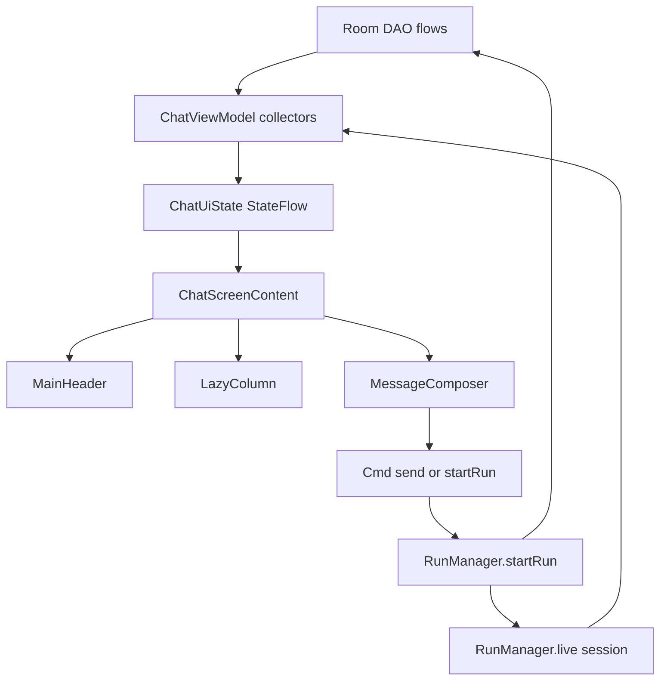

# Chat Screen and View Model

> The Compose chat surface and its view model: state holding, streaming display, scroll following, history paging, composer wiring, and per-chat model state.

`ChatScreen.kt` owns all chat layout, dialogs, and list assembly, while `ChatViewModel.kt` holds a single `ChatUiState` that mirrors Room flows and the app-scoped `RunManager`. The split matters because the agent run does not live in the view model: navigation away, rotation, or minimizing the app does not kill a run, and the screen is rebuilt from persisted state plus the live run mirror.

## Module Responsibilities

- **`ChatScreen` and `ChatScreenContent`**: entry composable and the stateful body. `ChatScreen` provides `ChatAppearance` plus `HarnessCanvasBackdrop`, then delegates. All visual pieces imported from `ui/chat/components/` are assembled here.
- **`ChatViewModel`**: owns `MutableStateFlow<ChatUiState>`, the current `sessionId`, attachment buffers, history paging mutex, and all user actions. It never executes the agent loop itself.
- **`ChatListState.kt`**: a prefetch-free `LazyListState` (`rememberChatListState`) plus the `ChatListContentType` row kinds.
- **`ChatDetailScroll.kt`**: tracks expanded disclosures that own their gestures, and pauses transcript following while the reader interacts with one.
- **`UserScrollObserver.kt`**: `NestedScrollConnection` that reports real finger drags so programmatic scrolls are not mistaken for reader intent.
- **`ChatModelSelection.kt`** (`ChatModelRepository`): resolves the model choice for a chat, shared or per-chat, and persists a per-session snapshot.

## Architecture and Flow

The view model starts collectors in `init` (lines 398 to 630 of `ChatViewModel.kt`):

1. `c.chatModels.observe(sessionIdFlow)` feeds `applyModelState`.
2. Provider catalogs, snippets, settings, memory, Linux env, Shizuku, and task controls feed discrete state slices.
3. `sessionIdFlow.flatMapLatest { c.sessions.messageWindowFlow(sid, start) }` feeds `messages`, `hasOlderMessages`, and clears the initial loading flag.
4. The sessions list feeds `sessionTitle`, `usage`, and the decoded `ConversationConfig`.
5. `c.runManager.live(sid)` feeds `mirrorLive`.

Committed messages never come from the streaming path. The stream is a separate, temporary overlay that is dropped the instant the committed row appears.

## Invocation Chain

1. `AppNav` builds `ChatViewModel.factory(container, sessionId, kind)` and calls `ChatWorkspaceScreen` (`ui/AppNav.kt` lines 665 to 750).
2. `ChatWorkspaceScreen` calls `ChatScreen(viewModel, ...)` (`ui/ChatWorkspaceScreen.kt` line 86).
3. `ChatScreen` collects `AppSettings` and `ChatUiState`, then calls `ChatScreenContent`.
4. `ChatScreenContent` collects `uiState`, then wires header, list, dialogs, and `MessageComposer` (lines 2489 onward).
5. Composer `onSend` builds the payload from attached concept and response context, then calls `ChatViewModel.send` (lines 2527 to 2539).
6. `send` resolves slash commands, injects into a running chat or calls `startRun` (lines 816 to 934).
7. `startRun` validates provider, key, model, and workspace MCP approval, then calls `c.runManager.startRun` (lines 1572 to 1588).

## Key State and Data Structures

- **`ChatUiState`** (`ChatViewModel.kt` lines 85 to 262): one immutable data class with roughly 90 fields. Important groups:
  - Identity: `sessionId`, `sessionTitle`, `conversation`, `conversationReady`, `conversationSaving`.
  - Message window: `messages`, `isLoadingMessages`, `hasOlderMessages`, `isLoadingOlderMessages`.
  - Stream overlay: `streamingText`, `streamingThinking`, `streamingMessageId`, `streamingCommitted`, `currentTurnId`.
  - Tool activity: `runningCalls`, `codeDrafts`, `packageProgress`, `pendingApproval`, `pendingQuestion`, `pendingEnvironment`, `installingEnvironment`, `currentToolAction`, `subagentSteps`, `thinkingTiming`, `reasoningTokens`.
  - Composer content: `attachments` (image display names), `fileAttachments`, `attachmentImports`, `queuedMessage`.
  - Per-chat limits and model: `maxContextTokens`, `autoCompactTokens`, `maxOutputTokens`, `maxIterations`, `activeProviderId`, `activeModel`, `sameModelAcrossChats`, `planning*` and `execution*` pairs.
  - Derived: `activeProvider` (line 208), `effectiveModel` (line 220), `modelSelectionTarget` (line 233), `selectedProviderIdFor` and `selectedModelFor` (lines 240 and 246), and `contextUsed` (line 260), which prefers the estimator and falls back to `usage.lastInput`.
- **`UsageStats`** (lines 56 to 71): token totals and `avgCacheHitRate`, computed as cached over total input so cache writes count as misses.
- **`ModelSelectionTarget`** (lines 79 to 83): `ACTIVE`, `PLANNING`, `EXECUTION`, used by the header picker.
- **`HeldStream`** (private, lines 378 to 384): session id, message id, text, thinking. It keeps a just-committed bubble on screen until Room delivers the row.
- **`MessageWindow`** (`data/SessionRepository.kt` lines 81 to 102): message list plus `hasOlder`; the window is a lower-boundary page, not the whole session.
- **`ChatListContentType`**: 18 row kinds from `Empty` to `Handoff`; reused compositions never cross kinds.

### Streaming UI state

`mirrorLive` (lines 648 to 709) copies the live run into the state. When both stream texts are null but the previous state still had content for `live.lastCommittedId`, it creates a `HeldStream` and schedules `scheduleHoldRelease` (lines 711 to 725). The hold is released immediately when the messages flow contains the id, or after `HOLD_TIMEOUT_MS` (2,000 ms, line 2357). `streamingCommitted` tells the UI the live bubble is now a stand-in for a saved row.

The live bubble is rendered only when `streamingMessageId` is not yet in `messages` (`ChatScreen.kt` lines 2227 to 2272). Chat renders progress through `chatActivityItem`; Code separately renders a `ThinkingBlock` and `LiveCodeCard`.

### Auto-scroll and list state

`ChatScreenContent` keeps `pinnedToBottom`, `returnToQuestion`, `lastAnchoredTurnId`, `gestureActive`, `mainListDragged`, and `userReachedBottom` (lines 577 to 601). Behaviour:

- On a new latest user turn, Chat anchors that user item to the top by index (`userItemIndexes`), while Code follows the bottom (lines 1192 to 1210).
- Any real `DragInteraction.Start` clears both flags and marks a gesture (lines 1227 to 1241).
- Only a direct drag that settles at the bottom resumes following (lines 1244 to 1257).
- While pinned, a `snapshotFlow` tracks total items and the last item's bottom; it either calls `scrollToEnd` or applies a small `scrollBy` delta, coalesced to at most one scroll per `FOLLOW_MIN_INTERVAL_MS` (16 ms, line 2855) (lines 1262 to 1285).
- The jump button appears when the bottom is farther than 96 dp away (`hideJumpAt`, line 615) and pulses when new content arrives (lines 1288 to 1301).

Chat also reserves trailing space so the newest question anchors: `chatViewportHeight`, `chatItemHeights`, and `remainingTurnSpace` compute unused room below the latest turn (lines 603 to 613), and a final `chat-turn-space` item writes `chatTrailingSpace` (lines 2340 to 2343).

### List state and paging

`rememberChatListState` installs `ChatListPrefetchStrategy`, whose three callbacks are all no-ops (lines 20 to 31). The comment explains why: rows change shape while streaming and while history loads, and Android's prefetch scheduler crashed on reuse. Content types are declared in the same file.

`loadOlderMessages` (lines 1945 to 1959) guards on `hasOlderMessages` and `isLoadingOlderMessages`, then under the `historyPaging` mutex advances `messageWindowStart` with `c.sessions.messageWindowStart(sid, before = start)`. `revealMessage` (lines 1962 to 1974) moves the window start back to a searched message's position and waits up to five seconds for the state to contain it.

### Composer wiring

The composer holds a `TextFieldValue` in `rememberSaveable` (lines 327 to 339), restores `conversation.draftText` once when `conversationReady` flips, and calls `saveDraft` on every text change. `saveDraft` debounces 400 ms unless `immediate` is true (lines 2097 to 2107). Send clears the field and saves an empty draft immediately.

`MessageComposer` receives `busy`, `sendAllowed` from `attachmentBlockReason()`, the attachment chips, slash suggestions, and an optional schedule action for Code only (lines 2489 to 2560).

### Per-chat model state

`ChatModelRepository.observe` combines settings, providers, and `sessions.sessionFlow`. With `sameModelAcrossChats` on, or for a sessionless draft, it returns shared settings. Otherwise it decodes `session.modelSelectionJson`, initializing it once if absent (lines 75 to 98). Edits are serialized by a `Mutex`. `select`, `setThinking`, and `setCustomThinking` write to settings when shared, or to the session snapshot when per-chat. Returning to shared mode keeps the chat's saved choice but does not erase other chats' choices (`setShared`, lines 100 to 108).

`applyModelState` copies the resolved selection into `ChatUiState` and sets `modelSelectionReady` (lines 729 to 761). `editModelSelection` sets a busy flag so `startRun` rejects sends while a selection is being saved (lines 763 to 774).

## Boundary Conditions

- `startRun` returns false and sets `error` for: missing conversation readiness, blank model selection, model selection busy or errored, removed provider, removed local model, blank API key, unsanitized pinned Harness model (lines 1425 to 1494).
- A workspace `.harness/mcp.json` with unapproved servers stops before starting the run and sets `pendingWorkspaceMcp`; approve or deny decides whether `startRun` continues (lines 1532 to 1547, plus `approveWorkspaceMcp` and `denyWorkspaceMcp` at 337 to 370).
- Sending while this chat is already running calls `c.runManager.inject` instead of starting a second run (lines 922 to 932).
- `/compact` is refused while busy or starting, and any send is refused while a compaction job is active (lines 819 to 822, 844 to 851).
- `ChatDetailScroll` pauses following on any pointer down inside a disclosure and resumes through the same nested-scroll chain; a pointer gesture in an expanded block cannot drag the transcript (lines 16 to 58).
- `scheduleHoldRelease` is a failsafe so a failed DB delivery cannot leave a bubble on screen forever (lines 711 to 725).
- The state update after a window change detects an empty window with `hasOlder` and resets the window start, which covers rewinds that remove the loaded suffix (lines 528 to 532).

## Extension Points

- **`ChatListContentType`**: add a row kind and use it in `indexedItem` to keep composition identity safe.
- **`ChatViewModel.factory`**: the single construction path, currently parameterized by container, session id, and `ConversationKind` (lines 2361 to 2363).
- **`NavEvent`** (lines 73 to 77): `NewChat`, `OpenSession`, `SelectSection`, emitted on `navEvents` and consumed in `ChatScreen` lines 1180 to 1188.
- **`ChatModelRepository`**: implement scope changes by calling `setShared`, and model changes through `select` with a `ChatModelTarget`.
- **`ChatDetailScroll`** and `LocalChatDetailScroll`: any disclosure composable can call `containChatDetailScroll()` to pause transcript following.

## Known gaps

- `FEATURES.md` line 45 says paging keeps complete turns and does not change model context. The page start is snapped to the first message of a turn (`completeTurnStart`, `SessionRepository.kt` lines 94 to 96), and the model path reads `historyFor` independently, so the claim holds. No gap found.
- `FEATURES.md` line 13 says Chat does not create saved artifacts. Confirmed by `ChatExperience.tools`, which omits `create_artifact` (`core/ChatExperience.kt` lines 9 to 16).

Sources: [app/src/main/java/com/androidharness/app/ui/chat/ChatScreen.kt](../app/src/main/java/com/androidharness/app/ui/chat/ChatScreen.kt)#L189-L212), [app/src/main/java/com/androidharness/app/ui/chat/ChatViewModel.kt](../app/src/main/java/com/androidharness/app/ui/chat/ChatViewModel.kt)#L85-L262), [app/src/main/java/com/androidharness/app/ui/chat/ChatListState.kt](../app/src/main/java/com/androidharness/app/ui/chat/ChatListState.kt)#L20-L37)

## Source files

- `app/src/main/java/com/androidharness/app/ui/chat/ChatScreen.kt`
- `app/src/main/java/com/androidharness/app/ui/chat/ChatViewModel.kt`
- `app/src/main/java/com/androidharness/app/ui/chat/ChatListState.kt`
- `app/src/main/java/com/androidharness/app/ui/chat/ChatDetailScroll.kt`
- `app/src/main/java/com/androidharness/app/ui/chat/UserScrollObserver.kt`
- `app/src/main/java/com/androidharness/app/data/ChatModelSelection.kt`
- `app/src/main/java/com/androidharness/app/ui/chat/components/ChatActivity.kt`
- `app/src/main/java/com/androidharness/app/ui/chat/components/MessageComposer.kt`
- `app/src/main/java/com/androidharness/app/data/SessionRepository.kt`
