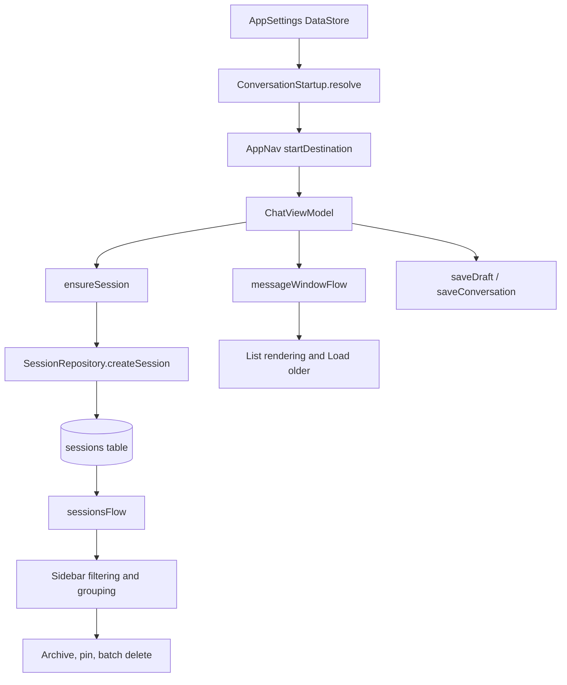

# Conversation Lifecycle and History

> How a conversation is created, selected, persisted, paged, archived, resumed, and grouped in the navigation surfaces.

Sessions are rows in the `sessions` table, created through `SessionRepository` and enumerated through `sessionsFlow`. The app has two conversation kinds, Code and Chat, stored in `ConversationConfig` and decoded on every read so an unknown or damaged configuration can never unlock coding tools. The UI holds one `ChatViewModel` per open session; the sidebar holds the list and the multi-select state.

## Module Responsibilities

- **`SessionRepository`**: session creation, conversation and model-selection persistence, message windows, message inserts, forks, search, deletion, and answer versions.
- **`ConversationConfig`**: the per-session JSON payload: kind, tool selection, source chat, draft text, instructions, personalization, image frequency, and optional agent profile.
- **`ConversationStartup`**: resolves which section and which session the app opens on a cold start.
- **`Database.kt`**: Room entities and DAO queries for sessions, messages, FTS, and stable message positions.
- **`AppNav`**: route construction, sidebar callbacks, multi-select, archive, pin, and delete flows.
- **`ProjectNavigationSidebar`**: the shared phone drawer and desktop sidebar; pinned, project-grouped, recent, and archived lists.

## Architecture and Flow

### Creation

`ChatViewModel.ensureSession` (lines 306 to 314 of `ChatViewModel.kt`) is the only lazy creation path. It takes the `sessionCreation` mutex, creates a session titled from the string resource, binds the current project id, initializes the per-chat model selection through `c.chatModels.initialize(sid)`, sets `sessionId` and `sessionIdFlow`, and writes `lastActiveSessionId`.

`SessionRepository.createSession` (lines 220 to 229) validates the project when one is supplied, generates a UUID, sets `createdAt` and `updatedAt` to the same millisecond, validates any `ChatAgentProfile`, and seeds `modelSelectionJson` from the agent's model when the conversation carries an agent. The row's `conversationJson` and `modelSelectionJson` are both nullable, which keeps older rows readable.

`createProjectSession` (lines 237 to 241) is the project-scoped variant used when a new chat is started from a project row.

### Switching and section changes

`ChatViewModel.requestSectionSwitch` refuses when attachments are pending and otherwise emits `NavEvent.SelectSection` (lines 1651 to 1659). `prepareSectionSwitch` (lines 1661 to 1678) first saves the composer text into `ConversationConfig.draftText`, then calls the navigation callback. This is why a Code to Chat switch does not lose the draft.

`AppNav.selectSection` (lines 411 to 434) remembers the current route per section, chooses the previous route when it still points at an unarchived session, otherwise optionally resumes the most recent session when the section's start mode says `LAST_*`, otherwise navigates to `chat?kind=...`.

`continueInCode` (lines 1680 to 1689 in the view model, lines 243 to 256 in the repository) creates a linked Code session: it copies the Chat title, sets `sourceChatId`, writes the last 32,000 characters of user and assistant text as a compaction summary with `compactionBefore = 0`, copies the Chat's model selection, and posts a greeting starting with `CONTINUED_IN_CODE_PREFIX`.

### Persistence

- `sessions` stores totals (`totalInputTokens`, `totalOutputTokens`, `totalCachedTokens`, `totalCacheWriteTokens`, `requestCount`, `lastInputTokens`), `projectId`, compaction fields, `pendingPlan`, `modelSelectionJson`, `workspaceSelectionJson`, and `conversationJson` (`data/db/Database.kt` lines 18 to 38).
- `messages` stores role, text, tool calls JSON, tool call id and name, error flag, thinking plus timings, token and generation metrics, images JSON, `turnId`, `createdAt`, `artifactJson`, and `generationJson` (lines 41 to 62).
- `saveConversation` writes the encoded config in a transaction and requires the session to exist (lines 231 to 234).
- `addMessage` writes the row, clamps oversized text fields to `MAX_PERSISTED_FIELD_CHARS` (250,000), compacts oversized `create_artifact` arguments in tool-call JSON, touches `updatedAt`, and, for the first user message in a Chat, derives the title from the message (`SessionRepository.kt` lines 258 to 311).
- Drafts live in `conversationJson.draftText`, not in a separate table. `ChatViewModel.saveDraft` debounces 400 ms and skips the write if the text is unchanged (lines 2097 to 2107). `ChatScreen` restores the draft once when `conversationReady` becomes true (lines 330 to 339).

### Paging older messages

The UI never loads a whole session by default. `messageWindowStart` (lines 84 to 89) asks for the message position 79 rows back from the end. `completeTurnStart` (lines 94 to 96) then walks to the first message of that turn, so a page never begins in the middle of a turn. Loading older asks for 79 rows before the current start (line 87), then snaps again.

`messageWindowFlow` combines `messagesFromPositionFlow` with `hasOlderMessagesFlow` and runs on `Dispatchers.IO` (lines 98 to 102). `messagesFromPositionFlow` selects rows with `createdAt > :at OR (createdAt = :at AND rowid >= :rowId)` ordered ascending; the older check selects any row strictly before the boundary (`Database.kt` lines 418 to 422).

`MessagePosition` is `(createdAt, rowId, turnId)` (line 97). The rowid tiebreak is what keeps ordering stable when several messages share a millisecond. The view model stores the window start in `messageWindowStart: MutableStateFlow<MessagePosition?>` and guards paging with `historyPaging: Mutex` (lines 291 to 292). `loadOlderMessages` (lines 1945 to 1959) flips `isLoadingOlderMessages`, advances the start under the mutex, and clears the flag in `finally`. `revealMessage` (lines 1962 to 1974) moves the boundary backwards for search hits and waits up to 5 seconds for the message to appear.

Rewind can remove the whole loaded suffix. The collector detects `window.messages.isEmpty() && window.hasOlder` and resets the window start instead of leaving an empty list (lines 528 to 532).

### Session listing and grouping

The drawer reads `SessionRepository.sessions`, which is `db.dao().sessionsFlow()` ordered by `updatedAt DESC` (`Database.kt` lines 289 to 290). `AppNav` filters that list to the active `ConversationKind` before passing it to the sidebar (lines 453 to 460).

`SidebarChats.of` (`ProjectNavigationSidebar.kt` lines 85 to 91) produces four buckets in one pass: pinned sessions, sessions grouped by known `projectId`, sessions with no known project, and archived sessions. Each session appears in exactly one bucket. The sidebar shows Archived as a separate collection (`showArchived`), and in the project view it groups chats under expanded projects (lines 315 to 371). Project pin and archive sets are separate settings (`projectPins`, `projectArchives`).

Chat mode passes an empty project list, so Chat sessions use the flat Recent list; Code uses the project tree.

### Archive, pin, and multi-select

Pin and archive are DataStore sets: `pinned_sessions` and `archived_sessions` (`data/SettingsRepository.kt` lines 273 to 274). `setPinned` (lines 913 to 918) adds or removes one id; `setArchived` has a single-id overload that delegates to the set overload (lines 948 to 955); `restoreArchived` restores a previous snapshot (lines 957 to 961); `forgetSidebarSessions` drops ids from both sets and from `last_active_session_id` (lines 963 to 968).

The chat header can pin or archive the open chat, with a snackbar Undo (`ChatScreen.kt` lines 1455 to 1475). The sidebar row menu routes through `AppNav.sidebarAction` (lines 357 to 368), which also shows Undo for archive.

Multi-select starts from `SidebarChatAction.SELECT`. `AppNav` holds `selectedChatIds`, `batchDetails`, `batchDelete`, and a `chatSelectionMutex` (lines 270 to 275). `selectedChatAction` (lines 369 to 398) filters the selection to the active kind, then:

- Archive toggles the whole selection based on whether all selected ids are already archived, captures the previous archived set, and restores it on Undo.
- Delete opens `ChatBatchDeleteDialog`; confirm stops each running task with `stopAndJoin` before `deleteSessions`, then clears `pinned` and `archived` ids (lines 1121 to 1143).
- Details opens `ChatBatchDetailsDialog` with workspace and resolved model per session (lines 1112 to 1120).

`deleteSessions` deletes answer versions, saved answers, messages, checkpoints, usage events, file edits, session file changes, and the session row inside one transaction, then removes unreferenced image originals (`SessionRepository.kt` lines 875 to 894).

Multi-select selection state is cleared when the drawer closes on phone layouts or when the section changes (lines 275 to 278).

### Start preferences and resume

`StartScreen` has `CODE`, `CHAT`, and `LAST_SELECTED`, defaulting unknown stored values to `LAST_SELECTED` (`ConversationStartup.kt` lines 5 to 18). `ChatStartMode` defaults to `NEW_CHAT` (lines 21 to 28); `CodeStartMode` defaults to `LAST_CODE` (lines 31 to 38).

`ConversationStartup.resolve` (lines 41 to 53) computes the kind from the start screen and last conversation kind, then resumes `lastActiveSessionId` only when the section's start mode asks to resume, the stored session's kind matches, the id is nonblank, and the id is not archived.

`AppNav` reads the launch settings once into `launchSettings`, resolves the startup with the previous session's decoded kind (lines 135 to 141), and builds `startDestination` as `setup`, `chat/{id}`, or `chat?kind=...` (lines 142 to 149).

## Invocation Chain

1. `AppNav` reads `last_active_session_id` and `start_screen`, plus the previous session's `ConversationConfig.kind`.
2. `ConversationStartup.resolve` returns `(kind, sessionId)`.
3. The NavHost route creates `ChatViewModel.factory(container, sessionId, kind)` (`ui/AppNav.kt` lines 665 to 750).
4. With no id, the first send calls `ensureSession`, then `SessionRepository.createSession`.
5. With an id, the view model loads the session, initializes model selection, and subscribes to `messageWindowFlow`.
6. The sidebar collects `sessionsFlow`, filters by kind, and calls `SidebarChats.of`.

## Key State and Data Structures

- **`SessionEntity`**: primary key `id`, timestamps, token totals, project, compaction, pending plan, model selection, workspace selection, conversation JSON.
- **`ConversationConfig`**: `kind`, `toolsEnabled`, `selectedTools`, `sourceChatId`, `draftText`, `instructions`, `personalizationEnabled`, `imageFrequency`, `useGlobalInstructions`, `agent`. `decode` requires a `kind` field and falls back to `ConversationConfig(kind = CHAT)` on any error, which is the safe direction because Chat has no coding tools (lines 50 to 57).
- **`MessagePosition`**: `(createdAt, rowId, turnId)`, never persisted as a table.
- **`MessageWindow`**: `messages` and `hasOlder`.
- **`SidebarChats`**: `pinned`, `projects` map, `other`, `archived`.

## Boundary Conditions

- `createSession` throws when the project id no longer exists; `saveConversation` throws when the session was deleted.
- `ConversationConfig.decode` swallows malformed JSON into a Chat config, which disables agent tools rather than enabling them.
- `prepareSectionSwitch` refuses while `conversationSaving` or `startingRun` is true.
- `continueInCode` refuses while busy, starting, or saving.
- `deleteSessions` stops running tasks first; the batch path uses `stopAndJoin` before deletion.
- Multi-select batch archive is serialized by `chatSelectionMutex`, so two rapid actions cannot interleave.
- Resume never crosses sections: a Chat start mode cannot resume a Code session and vice versa.
- `revealMessage` times out after 5 seconds and returns false.

## Extension Points

- Add a new persisted conversation field in `ConversationConfig`; old rows decode with defaults because `ignoreUnknownKeys = true` and `encodeDefaults = true`.
- Add a sidebar surface by handling a new `SidebarChatAction` in `AppNav.sidebarAction` and `selectedChatAction`.
- Change grouping in `SidebarChats.of` only; both phone and desktop surfaces share it.
- Start behaviour is controlled by `start_screen`, `chat_start`, and `code_start` in DataStore (`SettingsRepository.kt` lines 305 to 322).

## Known gaps

- `FEATURES.md` line 9 says batch delete deletes histories "in one transaction". Confirmed in `deleteSessions`.
- `FEATURES.md` line 45 says paging does not change the context used by the model. The model reads `historyFor`, which uses `messagesSince(compactionBefore)` (lines 167 to 178), independent of the UI window. No gap found.

Sources: [app/src/main/java/com/androidharness/app/data/SessionRepository.kt](../app/src/main/java/com/androidharness/app/data/SessionRepository.kt)#L81-L102), [app/src/main/java/com/androidharness/app/data/ConversationStartup.kt](../app/src/main/java/com/androidharness/app/data/ConversationStartup.kt)#L41-L55), [app/src/main/java/com/androidharness/app/data/db/Database.kt](../app/src/main/java/com/androidharness/app/data/db/Database.kt)#L406-L422), [app/src/main/java/com/androidharness/app/ui/ProjectNavigationSidebar.kt](../app/src/main/java/com/androidharness/app/ui/ProjectNavigationSidebar.kt)#L79-L93)

## Source files

- `app/src/main/java/com/androidharness/app/data/SessionRepository.kt`
- `app/src/main/java/com/androidharness/app/data/ConversationConfig.kt`
- `app/src/main/java/com/androidharness/app/data/ConversationStartup.kt`
- `app/src/main/java/com/androidharness/app/data/db/Database.kt`
- `app/src/main/java/com/androidharness/app/data/SettingsRepository.kt`
- `app/src/main/java/com/androidharness/app/ui/AppNav.kt`
- `app/src/main/java/com/androidharness/app/ui/ProjectNavigationSidebar.kt`
- `app/src/main/java/com/androidharness/app/ui/chat/ChatViewModel.kt`
- `app/src/main/java/com/androidharness/app/ui/chat/ChatScreen.kt`
