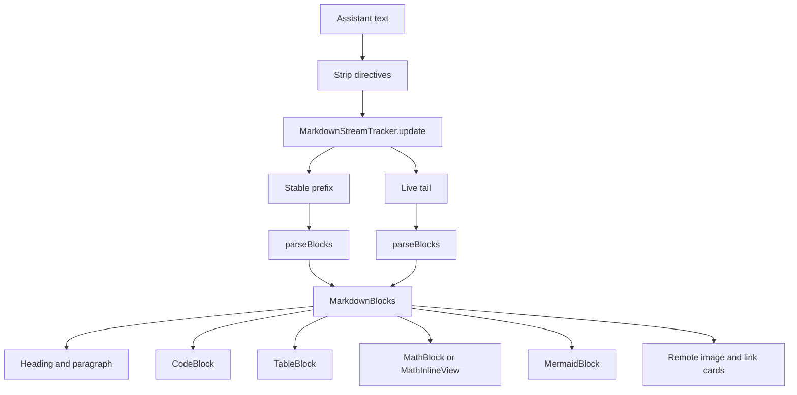

# Message Rendering and Markdown

> The markdown pipeline for assistant output: block parsing, incremental streaming windows, native table layout, code fence highlighting, LaTeX and Mermaid embedding, thinking blocks, and answer version display.

`MarkdownText` is a self-contained renderer with no third-party markdown dependency. It parses model output into a small sealed `Block` model, then renders each block with Compose. The streaming path is the interesting part: a `MarkdownStreamTracker` finds a stable prefix so completed blocks are parsed once and cached, while only the short live tail keeps inline formatting.

## Module Responsibilities

- **`MarkdownText.kt`**: parsing, styling, table rendering, code rendering, math and Mermaid dispatch, link handling.
- **`MarkdownStreaming.kt`**: `MarkdownStreamTracker`, which reports the stable end, any open fence, and a revision counter.
- **`MarkdownTableLayout.kt`**: pure functions for column widths, escaped-pipe cell splitting, and TSV export.
- **`ThinkingBlock.kt`**: the collapsed reasoning disclosure, delegating to `ChatActivity`.
- **`ChatAnswerVersions.kt`**: the previous/next answer control and read-only preview sheet.
- **`RichRenderView.kt`**: the sandboxed KaTeX and Mermaid renderer.

## Architecture and Flow



### Entry and directive stripping

`MarkdownText(text, streaming, onOpenUrl, media)` (lines 120 to 159) first removes agent directives with `FollowUpSuggestions.stripForDisplay`, and only runs `WebResourceExtractor.stripDirectives` when the text contains "preview". This keeps raw markup such as follow-up chips or a preview directive out of the visible text, including mid-stream.

`media = false` is used for external documents such as release notes. In that mode image and link blocks render as address text and math renders as source, because no remote fetch is allowed.

### The streaming window

`MarkdownStreamTracker` (lines 4 to 47) is stateful per `MarkdownText` composition. `update(text)`:

1. If the new text does not start with the previous text, it bumps `revision` and resets the scan.
2. It scans from the last scanned newline, tracking fenced code (```` ``` ````), `$$` math, `\[` math, and blank lines.
3. A blank line outside any fence or math advances `stableEnd`.
4. It detects a just-closed trailing fence so the closing backticks are not treated as part of the live code body.

The result is `Window(stableEnd, openFenceStart, fenceBodyStart, revision)`. `MarkdownText` slices `[0, stableEnd)` as stable text and parses it once per distinct prefix; the tail is parsed separately every frame.

Two caps protect the main thread:

- An open code fence longer than `STREAM_FENCE_CAP` (1,500 chars) keeps the fence header and preceding prose but replaces the body with the last 1,500 characters (lines 144 to 150). Copy still uses the full source through `codeCopy` (line 157).
- A live paragraph longer than `STREAM_INLINE_CAP` (4,000 chars) renders as plain `Text` with no inline styling (lines 464 and 540 to 544).

Both changes are positional only; when the message commits, `streaming` becomes false and the full text is parsed normally. Because both paths call the same `MarkdownBlocks`, composition identity is preserved, which keeps a table's scroll position and a math WebView alive across completion.

### Block parsing

`parseBlocks` (lines 255 to 447) is a line scanner that emits `Block` values:

- **Fenced code** (lines 309 to 328): any run of three or more backticks opens a fence; the info string is the language. `mermaid` becomes `Block.Mermaid`, everything else `Block.Code`.
- **Display math** (lines 330 to 382): `$$...$$` and `\[...\]` are supported both inline on one line and across lines.
- **Headings** (lines 384 to 389): 1 to 6 hashes are matched but the level is capped at 4 for display.
- **Rules** (lines 391 to 395): three or more `-`, `*`, or `_`.
- **Quotes** (lines 397 to 405): consecutive lines starting with `>` are grouped.
- **Tables** (lines 407 to 412): recognized only when the second line is a delimiter row whose cell count matches the header and every cell matches `:?-+:?` (`isTableStart`, lines 188 to 196).
- **Lists** (lines 414 to 432): one nesting level, detected by two spaces or a tab.
- **Paragraphs**: buffered lines are flushed through `splitRunOnParagraphs`, which inserts a paragraph break after a full sentence line of at least 80 characters (`RUN_ON_PARAGRAPH_CHARS`, line 253). This fixes models that separate paragraphs with single newlines without breaking addresses or verse.

Paragraph emission (lines 261 to 297) promotes a standalone image, a standalone link, a bare image URL, or a bare URL into a dedicated block, and splits a paragraph around inline images so prose order is preserved.

### Block rendering

`MarkdownBlocks` (lines 452 to 552) renders with `key(index)` and marks blocks at or after `liveFrom` as live. Live blocks deliberately degrade expensive media:

- `Block.Math` and `Block.Mermaid` render source text while live, then switch to the real renderer at commit (lines 502 to 514).
- `Block.LinkPreview` shows at most three preview cards, and none while live (lines 486 to 500).
- `Block.Image` can render a chat response image, a remote image card, or a link, depending on `LocalChatImagesEnabled` and `media` (lines 466 to 484).

Headings use a compressed scale rather than a full type ladder: 20/28 sp, 18/26 sp, then 16/24 sp for levels 3 and above (lines 515 to 532). Spacing between blocks is 20 dp before a heading, 8 dp after one, and 14 dp otherwise (lines 546 to 550).

`answerBodyStyle()` is `bodyLarge` with line height 1.6 (lines 723 to 726).

### Inline styling

`styled` (lines 990 to 1218) builds an `AnnotatedString` plus a map of `InlineTextContent` placeholders. The `walk` function handles, in priority order:

1. Markdown links, with nested spans recursed so a link inside bold still resolves. A workspace file reference becomes a `LinkAnnotation.Clickable` instead of a URL.
2. `**bold**`, `~~strikethrough~~`, `` `code` ``, and `*italic*`. Code spans use `HarnessMono` with the surface container background and hair spaces as padding.
3. Bare URLs, using `bareUrlAt` so trailing sentence punctuation is excluded and a balanced closing parenthesis is kept.
4. Inline math with `\(...\)` or `$...$`, validated by `isValidInlineMath`: nonblank, no leading or trailing whitespace, at most 2,000 characters (lines 1233 to 1234). `findDollarClose` stops at a newline so a stray dollar cannot swallow the answer (lines 1220 to 1231).

Citation handling is separated into `isCitationLink` (lines 936 to 944): a link that trails prose collapses to a chain icon, while a link that opens a line, follows a colon, or labels itself with the address stays as visible text.

Math placeholders measure themselves. `MathInlineView` reports width and height, and the paragraph keeps a `mutableStateMapOf<String, IntSize>` keyed by density, so one equation's measurement does not rebuild every paragraph (lines 1010 to 1057).

### Code fences and highlighting

`CodeBlock` (lines 826 to 924):

- Collapses at `CODE_BLOCK_COLLAPSED_LINES` (40 lines) with a "more lines" control.
- Skips tokenization above `CODE_BLOCK_HIGHLIGHT_LIMIT` (400 lines) and renders plain, because highlighting runs on the main thread.
- Uses `CodeTokenizer.langForName` and `CodeTokenizer.tokenizeLine`, the same tokenizer as the file editor, and `CodeTokenColors.of` for theme-aware token colors (lines 787 to 824).
- Renders in `HarnessMono`, `softWrap = false`, inside a horizontal scroll, and wraps the content in `LeftToRightContent` so code stays left-to-right in RTL locales.
- The language label defaults to "code" when the fence has no language.

### Tables

`TableBlock` (lines 614 to 721) uses `AnswerTableSurface` for the chrome. It shows a "columns · rows" label, an expand control that opens `ExpandedResponseTable`, and a copy control that writes TSV via `tableAsTsv` so a paste lands in spreadsheet columns.

Column widths come from `TableBlock` measuring every cell with `rememberTextMeasurer` and `softWrap = false`, plus 24 dp of padding, then calling `markdownColumnWidths` (`MarkdownTableLayout.kt` lines 4 to 24). That function:

- Clamps each natural width to `[minWidth, maxWidth]`, where min is 88 dp scaled by font scale capped at 1.6 and max is 280 dp.
- Gives a single-column table the full viewport.
- Special-cases a two-column label/value table: it fits the viewport by proportionally distributing the width beyond two minimum columns, so a phone does not force a swipe.
- Distributes leftover width evenly across all columns, with the remainder to the leftmost columns.

`splitTableRow` (lines 27 to 58) treats `\|` and `\\` as cell content, strips leading and trailing pipes, and keeps empty cells. Alignment comes from the delimiter row: a trailing colon means end, colons on both sides mean center, and anything else means start.

The table is inside a horizontal scroll when it does not fit. Semantics expose `CollectionInfo` and `CollectionItemInfo`, the header row is marked as a heading, and `AnswerTableScrollHint` appears when there is more width than the screen shows.

### LaTeX and Mermaid

`MathBlock`, `MathInlineView`, and `MermaidBlock` live in `ui/chat/components/RichRenderView.kt` (lines 58 to 140). They render through `SandboxedRenderView`, which loads `https://appassets.androidplatform.net/assets/richtext/index.html` from the APK assets via `WebViewAssetLoader` and intercepts requests so only `/assets/richtext/` is reachable (lines 170 to 276).

`MathBlock` starts at 64 dp, accepts measured heights from 40 to 600 dp, and falls back to plain source text if no measurement arrives within 3 seconds. `MermaidBlock` starts at 200 dp, accepts 120 to 800 dp, and falls back the same way. The inline math placeholder reserves measured width plus 6 dp and height plus 2 dp to avoid clipping superscripts.

### Thinking blocks

`ThinkingBlock` (lines 58 to 91) is a thin wrapper over `ChatActivity`. For a committed message it builds a synthetic assistant `ChatMessage` carrying the thinking text, duration, and reasoning tokens; for a live block it passes `streamingThinking` and a `ThinkingTiming`. Live blocks stay collapsed and show compact metrics, and expanding one mid-stream gives a height-capped, auto-following view that stops following when the reader scrolls up.

The timeline itself is built by `ChatActivityPresentation.timeline(messages, runningCalls, streamingThinking, streamId, streamingCommentary)` (`ChatActivity.kt` lines 72 to 74), so thinking, commentary, tool calls, and results appear in one chronological disclosure.

### Answer versions

`ChatAnswerVersions` (`components/ChatAnswerVersions.kt` lines 26 to 88) lists archived versions plus the current answer for the same user message, ordered by creation time then id. It renders nothing when there is only one version. Arrows call `onSelect(expectedUserId, versionId)` in normal mode; in `readOnly` mode they open a preview sheet instead, so browsing history in an older turn does not replace later history. The preview composes the same `ChatActivity` and `AssistantText` renderers and offers copy and source links.

`ChatViewModel.selectAnswerVersion` (lines 2067 to 2084) serializes with the run manager's `withIdleWorkspace`, checks that the session did not change, calls `sessions.selectChatAnswer`, and resets the message window start.

## Invocation Chain

1. `AssistantText` (`components/Bubbles.kt` line 177) calls `RichResponseContent`.
2. `RichResponseContent` calls `MarkdownText` for each markdown part (`rich/RichResponseContent.kt` line 66).
3. `MarkdownText` strips directives, runs the tracker, and parses stable and tail blocks.
4. `MarkdownBlocks` dispatches to `CodeBlock`, `TableBlock`, `QuoteBlock`, `ListBlock`, or a math or Mermaid renderer.
5. Inline text goes through `styled` and then `LinkedText`, which resolves taps by looking up `url` annotations.

## Key State and Data Structures

- **`Block`** (lines 168 to 184): the private parse model, with `Paragraph`, `Heading`, `Code`, `Quote`, `Rule`, `Bullets`, `Table`, `Image`, `LinkPreview`, `Math`, and `Mermaid`.
- **`ListItem`**: `marker`, `content`, and one level of `nested` items.
- **`MarkdownStreamTracker.Window`**: `stableEnd`, `openFenceStart`, `fenceBodyStart`, and `revision`.
- **`StyledResult`**: an `AnnotatedString` plus the `InlineTextContent` map for math and citation icons.
- **`ChatAnswerVersionEntity`** (`data/db/Database.kt` lines 64 to 71): `id`, `sessionId`, `groupKey`, `messagesJson`, `createdAt`.

## Boundary Conditions

- A fence that never closes is treated as a complete block at end of input; an open live fence is capped and marked with an ellipsis.
- `isValidInlineMath` rejects blank, whitespace-padded, or over-2,000-character inline math, leaving the source visible.
- `findDollarClose` never crosses a newline.
- Tables require a valid delimiter row with matching cell count; otherwise the text stays a paragraph.
- `MarkdownText` disables remote image fetching when `media = false`, so release notes never leak network requests.
- Code highlighting is skipped, not attempted, above 400 lines.
- Math and Mermaid fail soft after 3 seconds by showing the source.

## Extension Points

- Add a block type by extending the private `Block` sealed interface, handling it in `parseBlocks`, then adding a branch in `MarkdownBlocks`.
- Add a tokenizer language through `CodeTokenizer.langForName`; `CodeBlock` picks it up automatically.
- `LocalChatImagesEnabled` (line 102) controls whether images render at all; Chat sets it from the effective image frequency.
- `LocalResponseFileOpen` turns file references inside markdown into tappable links when a host provides it.

## Known gaps

- `FEATURES.md` line 90 says Markdown file previews use the chat renderer up to 400k characters. That limit lives in the file viewer, not in `MarkdownText`, which has no input length guard of its own. The streaming caps apply only while `streaming` is true.

Sources: [app/src/main/java/com/androidharness/app/ui/chat/MarkdownText.kt](../app/src/main/java/com/androidharness/app/ui/chat/MarkdownText.kt)#L120-L159), [app/src/main/java/com/androidharness/app/ui/chat/MarkdownStreaming.kt](../app/src/main/java/com/androidharness/app/ui/chat/MarkdownStreaming.kt)#L4-L47), [app/src/main/java/com/androidharness/app/ui/chat/MarkdownTableLayout.kt](../app/src/main/java/com/androidharness/app/ui/chat/MarkdownTableLayout.kt)#L4-L64), [app/src/main/java/com/androidharness/app/ui/chat/components/RichRenderView.kt](../app/src/main/java/com/androidharness/app/ui/chat/components/RichRenderView.kt)#L58-L140)

## Source files

- `app/src/main/java/com/androidharness/app/ui/chat/MarkdownText.kt`
- `app/src/main/java/com/androidharness/app/ui/chat/MarkdownStreaming.kt`
- `app/src/main/java/com/androidharness/app/ui/chat/MarkdownTableLayout.kt`
- `app/src/main/java/com/androidharness/app/ui/chat/components/ThinkingBlock.kt`
- `app/src/main/java/com/androidharness/app/ui/chat/components/ChatAnswerVersions.kt`
- `app/src/main/java/com/androidharness/app/ui/chat/components/RichRenderView.kt`
- `app/src/main/java/com/androidharness/app/ui/chat/components/Bubbles.kt`
- `app/src/main/java/com/androidharness/app/ui/chat/rich/RichResponseContent.kt`
