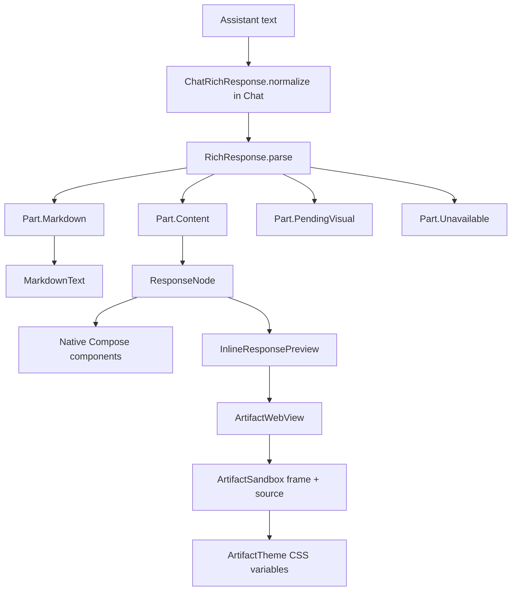

# Rich Responses and Interactive Components

> The assistant response protocol: `harness-ui` JSON components, raw `harness-svg` and `harness-html` visual fences, offline sandboxed rendering, artifacts, and the `visual_guide` tool.

`RichResponse` is a presentation protocol embedded in assistant text. A model writes markdown plus fenced blocks whose language is `harness-ui` (JSON components), `harness-svg` (a static SVG), or `harness-html` (a self-contained interactive document). Recognized fences become native Compose components or a sandboxed WebView; every other fence stays an ordinary code block.

## Module Responsibilities

- **`core/response/RichResponse.kt`** and **`ChatRichResponse.kt`**: fence scanning, JSON decoding and validation, the node model, plain-text fallback, follow-up construction, the model instructions, and Chat-only recovery for bare JSON or `::directive` lines.
- **`core/response/CalculatorMath.kt`**: bounded arithmetic parser for calculator expressions.
- **`ui/chat/rich/RichResponseContent.kt`** and the other `ui/chat/rich/*` files: part rendering, the `ResponseNode` dispatch, and every individual renderer and inline preview.
- **`artifacts/*`**: the sandbox, theme bridge, WebView host, and immutable artifact model.
- **`tools/ArtifactTools.kt`**, **`tools/VisualGuideTool.kt`**: the artifact lifecycle tools and the on-demand design guidance.

## Architecture and Flow



### Fence recognition and streaming

`RichResponse` declares the three languages and the limits (lines 8 to 14): 96,000 JSON characters and 64,000 visual characters. `hasRichFence` also treats streaming text containing "```harness" as rich (lines 26 to 27).

`parse` (lines 95 to 137) withholds a fence whose language is still being typed, such as `harness-h`, as `Part.Pending`; leaves unknown languages in the markdown buffer so a normal code fence is never reinterpreted; returns `Part.Unavailable` for a complete fence that fails validation or an unterminated fence that is not streaming; and returns `Part.PendingVisual(title, loading)` for an open visual fence, using `fenceAttributes` (lines 29 to 35, 114 to 129).

`fenceAttributes` accepts quoted attributes such as `title="Orbit" loading="Placing planets"`, or a bare title after the language, capped at 80 characters. `isBuildingVisual` (lines 86 to 92) reports whether the last `harness` fence is still open.

### JSON decoding and validation

`decode` (lines 139 to 141) rejects bodies over 96,000 characters and runs `Decoder` inside `runCatching`, so invalid JSON yields null and the block becomes unavailable instead of crashing.

`componentObject` (lines 143 to 175) recovers redundant closing brackets only after a complete object. It tracks quoting, escapes, and a bracket stack capped at 32 levels, then requires the trailing content to be at most 12 characters of `}` or `]`.

`Decoder.node` (lines 177 to 258) enforces depth 6 and 96 nodes, plus per-type limits: 6,000-character body text, 8 table columns, 100 rows, 120 chart points, 6 series, 8 profile facts, 6 sources, 6 calculator inputs and outputs, 12 steps and evidence items, and 400 lines per diff side. Gallery images are bounded by the total JSON size instead of a count. Web URLs must be `http` or `https` with a host and no user info; file paths must not contain control characters or `://`. Calculator ids must match `[a-zA-Z][a-zA-Z0-9_]*` and be unique, with `min < max`, `step > 0`, and a span at most 1e15, and every output expression must pass `CalculatorMath.isValid`. Chart series must share identical label order (line 192).

Values that fail validation do not partially render. The whole component becomes `Part.Unavailable`, and Chat offers a follow-up that asks for a simpler text version (`RichResponseContent.kt` lines 75 to 79).

### Raw visual fences

`visualNode` (lines 37 to 47) handles `harness-html` and `harness-svg`. An SVG body must start with `<svg` and end with `</svg>` and is wrapped in a `div class="hx-svg"`; an HTML body is passed through. Both become `Node.Preview(title, html)`, which `RichResponseContent` dispatches to `InlineResponsePreview`. The title defaults to "Diagram" for SVG and "Interactive visual" otherwise.

Visual fences are raw markup, not escaped JSON. Size is bounded at 64,000 characters, while a saved artifact is limited to 256 KB of UTF-8 HTML.

### Chat recovery

`ChatRichResponse.normalize` runs only in Chat and recovers bare `{"type": ...}` objects, objects whose `type` field is not first when the object decodes, and `::directive` lines (lines 15 to 64). It withholds incomplete component JSON during streaming. Code uses strict `RichResponse.parse`.

### Component rendering

`RichResponseContent` (lines 58 to 83) parses once with `remember(text, streaming)`, then renders parts in source order. Markdown parts are wrapped in `SelectionContainer`. A `Part.Pending` shows a spinner and "Preparing visual". `Part.PendingVisual` shows a fixed-height placeholder card with the fence's title and loading text, so the reply does not jump when the visual renders.

`ResponseNode` (lines 113 to 226) maps each node. Text, callout, card, and details render markdown inside a panel or tinted surface. Metrics use adaptive 1 or 2 columns at 360 dp times font scale (`AdaptiveItems`, lines 229 to 240). Charts, calculators, tables, tabs, galleries, profiles, evidence, diffs, and writing use the renderers below. Choices keep a remembered radio selection with a "Discuss selection" follow-up. Steps are numbered unless `checkable`, then offer "Continue from here". Link shows a host and open action, Preview uses `InlineResponsePreview`, Layout stacks or distributes children, and Divider draws a rule.

Interactive state changes flow through `LocalResponseContext` (declared in `ResponseDataComponents.kt` line 37 and provided in `ChatScreen.kt` lines 1374 to 1377). A control reports the latest meaningful state, Chat stores it as a `ResponseAttachment`, and the next user message carries it inside `[[harness-response]]` wrappers (`core/response/ResponseAttachment.kt` lines 13 to 29). The composer shows it as a removable chip; `UserMessageContent.visibleText` hides it from the editable text area.

### Charts and calculator

`ResponseChart` (lines 29 to 113) falls back to a single unnamed series from `chart.points`, uses six Material colors, and draws on a `Canvas` with `Path` for lines and round rects for bars around a zero baseline. Tapping selects the nearest point. A `RangeSlider` narrows the window while keeping at least two points, multi-series charts have toggle chips with at least one series visible, and a data view lists exact values. "Discuss chart" sends the range, selected point, and visible series.

`ResponseCalculator` (lines 22 to 71) keeps input text in `rememberSaveable`, accepts comma or dot decimals, and marks out-of-range values as errors. Sliders quantize to `step`. `CalculatorMath` (lines 5 to 15) is a recursive-descent parser limited to 300 characters and 1e15 magnitude, supporting `+ - * / ^`, parentheses, `min`, `max`, `abs`, `sqrt`, and `round`. It never evaluates scripts or URLs.

### Tables and data components

`ResponseTable` (lines 41 to 182) supports filter, sort, row selection, paging, CSV copy, and CSV share. Filtering and sorting use `ResponseTableData.indices`, and pages hold 10 rows. Selecting rows publishes them as context, and "Discuss rows" carries the filter, sort, and selection. Narrow screens with at most three columns and wide cells, or a large font scale, switch to stacked cards. `ExpandedResponseTable` (lines 186 to 201) reuses the component in a full-screen dialog.

`ResponseTabs` (lines 222 to 253) keeps per-tab state and scopes `LocalResponseContext` per tab. `ResponseGallery` (lines 65 to 114) pages images, loads through `RemoteContentLoader`, attaches context only after settling on a page, and opens `ImageViewerDialog`. `ResponseEvidence` (lines 121 to 139) shows status, an optional path with an open-file action, and sources. `ResponseWriting` (lines 142 to 158) collapses to 10 lines with copy and share. `ResponseDiffView` (lines 161 to 197) shows unified changes plus Before and After tabs. `ResponseProfile` (lines 40 to 113) renders a photo, facts, and sources, gated by `LocalChatImagesEnabled`.

### Inline previews

`InlineResponsePreview` (lines 33 to 103) creates an in-memory `ChatArtifact` from the node title and HTML, so an inline visual gets the same sandbox as a saved artifact. It uses `ArtifactWebView` with `responseLayout = true`, so the sandbox measures the document and reports its height and `harness.state` summary through the page title. Inline content is 100 to 900 dp tall from that measurement, starting at 220 dp, with a progress bar while loading, a reload action on error, and an unavailable state without WebView. Expanding opens a dialog over 92 percent of the screen and reparents the live page instead of reloading. The "Ask about this" follow-up sends the last summary.

### Artifacts

`ChatArtifact` is immutable and validated: UUID id, UUID revision, title of 1 to 80 characters, and at most 256,000 bytes of UTF-8 HTML (`artifacts/ChatArtifact.kt` lines 15 to 33). `CreateArtifactTool` (lines 11 to 40) is read-only, requires a session, rejects an `artifact_id` that is not in this chat, and returns `artifact_id`, `revision`, and `title` with the artifact attached to the result. `ReadArtifactTool` (lines 42 to 61) lists concepts when no id is given, otherwise returns the latest or a requested revision.

The artifact tool is Code-only. `ChatExperience.tools` omits it and its prompt states that Chat does not create or read separate artifacts (`core/ChatExperience.kt` lines 9 to 16 and 46), while `visual_guide` is in the Chat set. `ArtifactCard` (`components/ArtifactCard.kt` lines 56 to 224) still renders any message that carries `artifact`, with a version dropdown, Preview and Code tabs, reload, Revise, and Save HTML through `ActivityResultContracts.CreateDocument("text/html")`. Saved files come from `ArtifactSandbox.sourceDocument`, so they keep the theme variables. The expanded dialog removes dimming, matches the system bars, and reparents the same WebView.

### Sandbox and theme inheritance

`ArtifactSandbox.frameDocument` (lines 19 to 21) is the trusted outer document: an iframe with `sandbox="allow-scripts"`, `referrerpolicy="no-referrer"`, and the generated source in `srcdoc`. The iframe has an opaque origin, and `origin()` returns a per-concept, per-revision host name (line 55).

`sourceDocument` (lines 7 to 17) injects the CSP from line 5: no network, frames, workers, forms, or base URI, inline scripts and styles only, and `data:` or `blob:` for images, fonts, and media. It writes the theme into `:root` CSS variables (`--background` through `--danger`, `--c1` to `--c6`, `--radius`, `--radius-sm`, `--mono`), then the base styles and `DESIGN_KIT` with the `hx-*` classes.

Theme values come from `rememberArtifactTheme` (`ui/chat/rich/ArtifactThemeState.kt` lines 16 to 39), which reads the live `MaterialTheme.colorScheme` and `LocalStatusColors`, so previews follow presets, custom palettes, and Canvas colors in both light and dark. `ArtifactTheme.safe` (lines 24 to 32) accepts only `#rrggbb`, so no value can close the stylesheet block.

`ArtifactWebView` (lines 14 to 130) disables DOM storage, databases, file and content access, network loads, mixed content, popups, geolocation, permissions, file choosers, JavaScript dialogs, and downloads. It blocks every scheme except `data` and `blob`, cancels SSL errors, and reports JavaScript errors. `show` caches on revision, dark mode, response-layout mode, and theme hash.

### Visual guide

`VisualGuideTool` (lines 124 to 147) is read-only and available in both sections. It takes a `modules` array and returns `VisualGuide.read` (lines 13 to 30). `basics` is always included and covers fences, theme tokens, the `hx-*` kit, the `harness` helper, and phone-first rules. Optional modules are `diagram`, `chart`, `interactive`, `mockup`, and `art`. An unknown module raises `ToolFailure`.

## Invocation Chain

1. The assistant emits a `harness-ui`, `harness-svg`, or `harness-html` fence.
2. `AssistantText` calls `RichResponseContent` (`components/Bubbles.kt` line 214).
3. In Chat, `ChatRichResponse.normalize` runs first (`ChatScreen.kt` lines 1877 and 2258).
4. `RichResponse.parse` produces parts, and `ResponseNode` renders them.
5. `Node.Preview` reaches `InlineResponsePreview`, then `ArtifactWebView.show`, then `ArtifactSandbox.frameDocument`.
6. A saved artifact is rendered by `ArtifactCard` from `message.artifact` (`ChatScreen.kt` lines 1811 to 1826).

## Key State and Data Structures

- **`Part`** (lines 17 to 24): `Markdown`, `Content`, `Pending`, `PendingVisual`, and `Unavailable`.
- **`Node`** (lines 62 to 84): 20 component variants, from `Text` and `Callout` to `Preview`, `Calculator`, `Evidence`, `Diff`, and `Writing`.
- **`ChatArtifact`**: `id`, `revision`, `title`, `html`; immutable, with a 256 KB limit.
- **`ArtifactTheme`**: dark flag, 12 color fields, and a six-color `palette`; `safe()` restricts every value to `#rrggbb`.
- **`RichResponse.FollowUp`**: trimmed prompt, title capped at 100 characters, context capped at 1,400.

## Boundary Conditions

- Invalid or oversized JSON becomes `Part.Unavailable` and never partially renders.
- A complete visual fence over 64,000 characters is unavailable, and a saved artifact is rejected above 256,000 bytes or with an invalid UUID.
- An open visual fence is held with a placeholder until its closing fence arrives, and a missing WebView shows an unavailable card with reload.
- Request interception blocks every scheme except `data` and `blob`; there is no bridge to the generated page.
- `CalculatorMath` rejects expressions over 300 characters and results over 1e15.
- Charts require aligned labels across series.
- `InlineResponsePreview` clamps height to 100 to 900 dp, and the layout host clamps reported heights to 80 to 12,000.

## Extension Points

- Add a component type in `Decoder.node` and the `ResponseNode` dispatch, plus a prompt example in `RichResponse.INSTRUCTIONS`.
- Add a design module in `VisualGuide.modules`.
- Change the sandbox in `ArtifactSandbox.CSP`, the base styles, or `DESIGN_KIT`, keeping `VisualGuide.BASICS` in step.
- Change theme inheritance in `rememberArtifactTheme`; every preview and saved artifact follows it.

## Known gaps

- `FEATURES.md` line 13 says Chat does not create saved artifacts, and line 32 says existing artifacts remain available. Confirmed: `create_artifact` is absent from `ChatExperience.tools`, and `ArtifactCard` still renders stored `artifactJson`.
- `FEATURES.md` line 34 says a titled placeholder holds the space while a visual streams. Confirmed by `Part.PendingVisual` and `PendingVisualCard`.

Sources: [app/src/main/java/com/androidharness/app/core/response/RichResponse.kt](../app/src/main/java/com/androidharness/app/core/response/RichResponse.kt)#L8-L137), [app/src/main/java/com/androidharness/app/ui/chat/rich/RichResponseContent.kt](../app/src/main/java/com/androidharness/app/ui/chat/rich/RichResponseContent.kt)#L58-L226), [app/src/main/java/com/androidharness/app/ui/chat/rich/InlineResponsePreview.kt](../app/src/main/java/com/androidharness/app/ui/chat/rich/InlineResponsePreview.kt)#L33-L103), [app/src/main/java/com/androidharness/app/artifacts/ArtifactSandbox.kt](../app/src/main/java/com/androidharness/app/artifacts/ArtifactSandbox.kt)#L4-L55)

## Source files

- `app/src/main/java/com/androidharness/app/core/response/RichResponse.kt`
- `app/src/main/java/com/androidharness/app/core/response/ChatRichResponse.kt`
- `app/src/main/java/com/androidharness/app/core/response/CalculatorMath.kt`
- `app/src/main/java/com/androidharness/app/core/response/ResponseAttachment.kt`
- `app/src/main/java/com/androidharness/app/core/response/ResponseTableData.kt`
- `app/src/main/java/com/androidharness/app/core/response/ResponseDiff.kt`
- `app/src/main/java/com/androidharness/app/ui/chat/rich/RichResponseContent.kt`
- `app/src/main/java/com/androidharness/app/ui/chat/rich/ResponseChart.kt`
- `app/src/main/java/com/androidharness/app/ui/chat/rich/ResponseCalculator.kt`
- `app/src/main/java/com/androidharness/app/ui/chat/rich/ResponseDataComponents.kt`
- `app/src/main/java/com/androidharness/app/ui/chat/rich/ResponseMediaComponents.kt`
- `app/src/main/java/com/androidharness/app/ui/chat/rich/ResponseProfile.kt`
- `app/src/main/java/com/androidharness/app/ui/chat/rich/InlineResponsePreview.kt`
- `app/src/main/java/com/androidharness/app/ui/chat/rich/ArtifactThemeState.kt`
- `app/src/main/java/com/androidharness/app/artifacts/ArtifactSandbox.kt`
- `app/src/main/java/com/androidharness/app/artifacts/ArtifactTheme.kt`
- `app/src/main/java/com/androidharness/app/artifacts/ArtifactWebView.kt`
- `app/src/main/java/com/androidharness/app/artifacts/ChatArtifact.kt`
- `app/src/main/java/com/androidharness/app/ui/chat/components/ArtifactCard.kt`
- `app/src/main/java/com/androidharness/app/tools/ArtifactTools.kt`
- `app/src/main/java/com/androidharness/app/tools/VisualGuideTool.kt`
- `app/src/main/java/com/androidharness/app/core/ChatExperience.kt`
