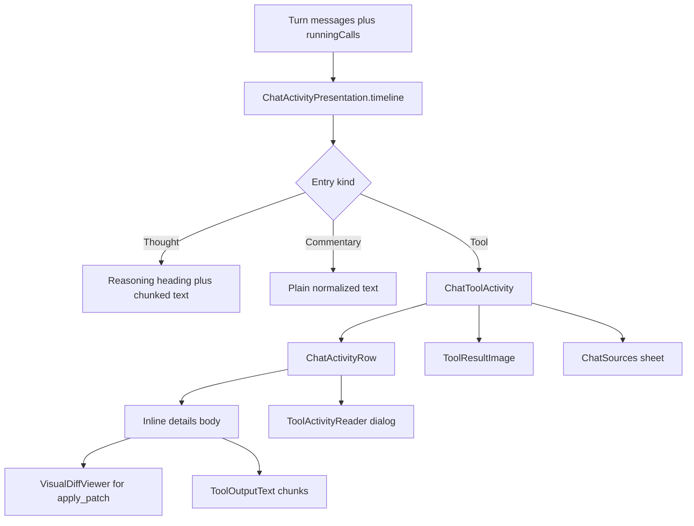

# Activity Timeline and Tool Cards

> Chat renders every thought, commentary line, and tool call of a turn as one expandable chronological disclosure, while the final answer stays outside it.

`ChatActivity` in `app/src/main/java/com/androidharness/app/ui/chat/components/ChatActivity.kt` is the single entry point for this disclosure. It does not inspect raw messages itself. It calls `ChatActivityPresentation.timeline` from `app/src/main/java/com/androidharness/app/core/ChatActivityPresentation.kt`, which turns this turn's assistant rows, tool results, and live streams into ordered `Entry` values. Each entry renders through `ChatToolActivity` or plain text rows, and any tool result can be opened in `ActivityReader` or `ToolActivityReader` for a full-screen, paged view. `ToolPresentation` supplies human titles for tool names, and `LiveCodeCard` shows code that is still being generated.

## Module Responsibilities

- **`ChatActivityPresentation`**: pure derivation of timeline entries, active calls, source list, image sources, and research counters. No Compose types, so it can be reasoned about and tested independently.
- **`ChatActivity`**: Compose disclosure. Owns the phase label, the 2 second tool notice, rumble cues, the expandable viewport, and the inline reader route.
- **`ToolCallCard`**: one compact row per tool call with status icon, progress bar, argument details, result text, images, and patch diffs.
- **`ToolGroupCard`**: rollup for three or more consecutive calls on the same assistant row, with aggregate done, failed, and running counts.
- **`ToolActivityState`**: `activeToolIds`, the small rule that decides which calls still count as running when a result has already arrived.
- **`ActivityReader` / `ToolActivityReader`**: full-screen dialog readers with a lazy list, Input and Output tabs, copy, and a jump to latest control.
- **`LiveCodeCard`**: a live write row for `write_file`, `edit_file`, `multi_edit`, and patch-like tools, with per-file line deltas and a bounded code preview.
- **`ToolPresentation`**: name to `ToolPresentation(title, action, detail, kind)` mapping, plus verification command detection.

## Architecture and Flow

`ChatActivity` computes entries once per change of messages, running calls, streaming thinking, stream id, or streaming commentary (`remember` at lines 72 to 74). It then derives the active call, research progress, and last tool entry (lines 77 to 81). The phase key is `id:running` for an active call or `id:finished` for the last completed tool, and a `LaunchedEffect` shows that phase for two seconds (lines 83 to 90). The title and rumble step are chosen from the live state at lines 93 to 108. Only a step change triggers `onStep`, so a row that merely scrolls back into view stays silent (lines 109 to 114).

`ChatActivityRow` owns the expand and follow behavior. It auto-opens a live expandable disclosure so streamed commentary is visible, then folds it when the turn ends (lines 253 to 262). While following, a snapshot flow keeps the newest item and its overflow in view (lines 281 to 305). A drag sets `following` false immediately, and releasing near the bottom with no forward scroll restores it (lines 306 to 321). The viewport height is `screenHeightDp * 0.5f` coerced to 220 to 420 dp (line 323), except when an image preview uses a compact 180 dp cap (line 360).

## Invocation Chain

1. `ChatScreen` declares `chatActivityItem` at `app/src/main/java/com/androidharness/app/ui/chat/ChatScreen.kt` lines 1736 to 1751 and calls `ChatActivity(messages, live = running, ...)`.
2. `ChatActivity` calls `ChatActivityPresentation.timeline(messages, runningCalls, streamingThinking, streamId, streamingCommentary)`.
3. `timeline` indexes this turn's `Role.TOOL` rows by `toolCallId`, finds parent assistant rows with no `toolCallId`, identifies the final answer index, and emits entries in order: thought, commentary, then each call, then streamed thought and commentary, then any running call not yet seen (lines 67 to 88).
4. `ChatToolActivity` maps the call to a title using `activityLabel` (lines 592 to 613), computes sources, images, and recall text, then calls `ChatActivityRow` with an inline body.
5. `ChatActivityRow` either renders the inline body in a nested column when `LocalActivityDepth` is greater than zero, or hosts a `LazyColumn` with `ActivityScrollFrame` and opens `ActivityReader` when the full view button is pressed (lines 344 to 374).
6. `ToolActivityReader` pretty prints `argumentsJson` on `Dispatchers.Default`, splits the selected text with `ToolOutputText.chunks`, and renders selection containers with a monospace font (lines 103 to 131).

## Key State and Data Structures

- **`ChatActivityPresentation.Entry`**: sealed interface with `Thought(key, text, milliseconds)`, `Commentary(key, text)`, and `Tool(key, call, result)`. Keys are stable (`message id` plus suffix, or `tool-<call id>`) so recomposition and Room commits preserve scroll state.
- **`ChatActivityPresentation.ResearchProgress`**: `sourcesUsed`, `sourcesMax`, `pagesRead`, `readsRequired`. Rendered under the header by `AnimatedCount` (ChatActivity lines 375 to 394).
- **`ChatActivityPresentation.Source`**: `title`, `url`, `host`, `read`. Built from successful web search and page read results, deduplicated by `canonicalResultUrl`, capped at 100 by default.
- **`ToolPresentation`**: `title`, `action`, `detail`, `kind` where kind is one of `READ`, `SEARCH`, `EDIT`, `COMMAND`, `VERIFY`, `WEB`, `QUESTION`, `SUBAGENT`, `MEMORY`, `OTHER` (ToolPresentation lines 10 to 17).
- **`ToolCallData`**: call id, name, arguments JSON, optional workspace id and name, captured code changes, and opaque response reasoning for replay. The workspace name is prefixed onto the title and action at ToolPresentation lines 244 to 245.
- **`LiveCodeDraft`**: `id`, `tool`, `stage`, `files`, `estimatedTokens`, `responseOutputTokens`, `comparisonAvailable`, `limited`, `workspaceName`. Stage is `GENERATING`, `READY`, `WRITING`, `SAVED`, or `FAILED` (`app/src/main/java/com/androidharness/app/agent/LiveCode.kt` line 12).

## Per-Call Status and Rollups

A call is running only when its id is in `runningIds` and no result exists for it. That is the whole body of `activeToolIds` in `ToolActivityState.kt` lines 7 to 13, and it prevents a delayed running update from flickering after a result is committed. `ChatActivityPresentation.activeCall` applies the same precedence across the current turn: it prefers the last running call whose id has no finished result row, then the last parent call whose id has no finished result row (lines 54 to 57).

`ToolCallCard` derives its status from `running && result == null` and `result.isError`. A `Crossfade` selects one of four keys: active, success, failure, or neutral, drawing a check or cross in the right slot (`ToolCallCard.kt` lines 208 to 234). While active it shows `ToolCallProgress` (lines 245 to 251). The detail disclosure prints the tool name, then either a `VisualDiffViewer` for an `apply_patch` payload or a monospace block of pretty arguments, then up to 4000 characters of result (lines 270 to 295). `grep`, `search_files`, and `web_search` results use clickable output so paths can open the file viewer (lines 289 to 293).

`ToolGroupCard` appears when `ChatScreen` sees three or more other calls on one assistant row and none are browser, package, GitHub pull request, or live-code tools (`ChatScreen.kt` lines 2148 to 2164). It counts `doneCount`, `failedCount`, and `activeIds`, and its header reads either "Spawned N subagents" when every call is `task`, "Running tools", or "Ran N tools" (lines 361 to 368). Expanding lists each call through `CardHistory` (lines 449 to 471). `CardHistory` composes a plain column for twelve or fewer rows and a height-bounded `LazyColumn` above twelve (`app/src/main/java/com/androidharness/app/ui/chat/components/CardHistory.kt` lines 14 to 38).

## Full-Screen Reader, Paging, and Diffs

`ToolActivityReader` starts on Output when a result exists, otherwise on Input. It pretty prints JSON with `Json { prettyPrint = true }` off the main thread, and it chunks the chosen text through `ToolOutputText.chunks` (2048-character targets, newline boundaries, surrogate pair guard). Each chunk is its own list item inside a `SelectionContainer`, so a very long log stays responsive and remains selectable. A copy action writes the full text to the clipboard and swaps its icon label to "Copied". The reader registers itself with `LocalChatDetailScroll` through `begin` and `end` so the parent transcript does not scroll under it (`ActivityReader.kt` lines 71 to 100).

`ChatFileDiffSheet` is a separate bottom sheet used from `ChatScreen` lines 643 to 650. It loads `viewModel.fileDiff(turnId, path)` in a `produceState`, handles cancellation explicitly, and renders `VisualDiffViewer` at 55 percent of screen height. Failure shows the exception message, and a toolbar action opens the current file (`app/src/main/java/com/androidharness/app/ui/chat/ChatFileDiffSheet.kt` lines 18 to 69).

`LiveCodeCard` shows the code write itself. Its action text depends on approval and stage: "Awaiting approval", "Not saved", "Write" or "Writing", "Edit" or "Editing" (lines 53 to 58). Each file row exposes added and removed counts with `AnimatedLineCount`, a chevron, and an expandable preview capped at 220 dp. The preview follows new lines while generating unless the user scrolls, tokenizes through `CodeTokenizer`, and shows estimated tokens plus a note when the comparison is unavailable or the preview is bounded (`LiveCodeCard.kt` lines 49 to 138). `codeLanguage` maps extensions to labels such as Kotlin, Python, and TypeScript (lines 191 to 199).

## Boundary Conditions

- Empty entries return early when the turn is not live (`ChatActivity` line 75), so a finished turn with nothing to show adds no row.
- `offer_code_handoff` is filtered out of the timeline and the step list (`ChatActivityPresentation.kt` lines 29 and 78), because it renders as its own handoff card outside the disclosure.
- Inline tool output is cut at 6000 characters, and a label switches to "Output preview" above that limit (`ChatActivity.kt` lines 179 and 213).
- The reader chunks at about 2048 characters; a single huge line still produces one large chunk, so the newline search has a bounded scan window.
- Source rows in an inline tool body show at most four before the "N sources" sheet link (lines 202 to 211).
- The activity viewport is bounded to half the screen and the follow effect stops when the user drags away, so streaming cannot fight a reader's scroll.
- `ToolCallCard` pretty prints its arguments off the UI thread and only accepts the finished details when the name and raw JSON still match (lines 132 to 146). Stale formatting is discarded.
- `ToolResultImage` decodes with an `inSampleSize` that keeps the longest side near 1024 px, and reads originals only when an `originals` copy exists (lines 584 to 624).
- A group row's summary colors itself with the error color whenever any call failed, even if others succeeded (lines 382 to 388).

## Extension Points

- Add a new human label by extending the `when (name)` in `activityLabel` (`ChatActivity.kt` lines 592 to 613) and the icon mapping in `ChatActivityGlyph` (lines 554 to 586).
- Add a new title and kind by adding a branch in `toolPresentation` (`ToolPresentation.kt` lines 42 to 243). Unknown tools fall back to title-cased names, so a tool without a branch still renders.
- `LocalActivityDepth` controls nesting: zero means a scrolling viewport, greater than zero means an inline disclosure inside another card (`ActivityReader.kt` line 45, ChatActivity line 247).
- `LocalActivityInteraction` lets nested cards pause the parent's follow behavior (ChatActivity lines 228 and 355).
- `ToolCallCard` delegates special tools before its generic body: `pkg_install`, `android_sdk_install`, `github_create_pull_request`, any browser tool, and any `LiveCodePreview.tools` entry each get a dedicated card (`ToolCallCard.kt` lines 99 to 122).

Sources: [app/src/main/java/com/androidharness/app/ui/chat/components/ChatActivity.kt](../app/src/main/java/com/androidharness/app/ui/chat/components/ChatActivity.kt)#L56-L146), [app/src/main/java/com/androidharness/app/core/ChatActivityPresentation.kt](../app/src/main/java/com/androidharness/app/core/ChatActivityPresentation.kt)#L59-L114), [app/src/main/java/com/androidharness/app/ui/chat/components/ToolCallCard.kt](../app/src/main/java/com/androidharness/app/ui/chat/components/ToolCallCard.kt)#L86-L475), [app/src/main/java/com/androidharness/app/ui/chat/components/ActivityReader.kt](../app/src/main/java/com/androidharness/app/ui/chat/components/ActivityReader.kt)#L71-L131)

## Source files

- `app/src/main/java/com/androidharness/app/ui/chat/components/ChatActivity.kt`
- `app/src/main/java/com/androidharness/app/ui/chat/components/ToolCallCard.kt`
- `app/src/main/java/com/androidharness/app/ui/chat/components/ActivityReader.kt`
- `app/src/main/java/com/androidharness/app/ui/chat/components/ToolActivityState.kt`
- `app/src/main/java/com/androidharness/app/ui/chat/components/LiveCodeCard.kt`
- `app/src/main/java/com/androidharness/app/ui/chat/components/CardHistory.kt`
- `app/src/main/java/com/androidharness/app/agent/ToolPresentation.kt`
- `app/src/main/java/com/androidharness/app/core/ChatActivityPresentation.kt`
- `app/src/main/java/com/androidharness/app/core/ToolOutputText.kt`
- `app/src/main/java/com/androidharness/app/ui/chat/ChatFileDiffSheet.kt`
- `app/src/main/java/com/androidharness/app/agent/LiveCode.kt`
- `app/src/main/java/com/androidharness/app/ui/chat/ChatScreen.kt`
