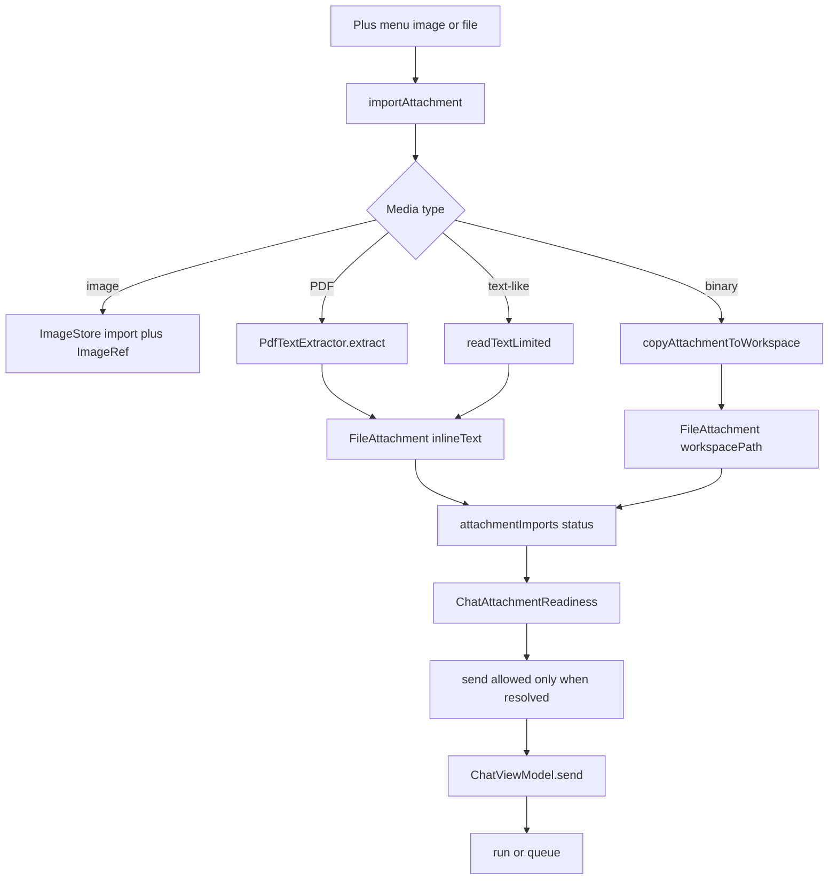

# Composer, Attachments, and Voice

> The Chat composer owns text input, send gating, image and file import, PDF text extraction, the two voice engines, and the queue used when the user types while a task is running.

`MessageComposer` is a stateless Compose surface: it receives the `TextFieldValue`, attachment counts, voice state, and callbacks from `ChatScreen`, and decides which action button to draw. The logic that actually accepts a message lives in `ChatViewModel.send`, which blocks on unresolved attachments and either starts a run or injects the text into the running task's queue. Attachment import is split between `FileAttachments` (format rules and message blocks), `PdfTextExtractor` (PDF text), and `ChatAttachmentReadiness` (per-item status rows). Voice input has two paths: Android `SpeechRecognizer` for the inbuilt engine, and `MediaRecorder` plus the Groq Whisper API for the Groq engine.

## Module Responsibilities

- **`MessageComposer`**: text field, focus and line growth, leading plus menu, send/stop/mic morph, Groq hold-to-talk gestures, queue button, and the optional `/btw` and Live Mode actions.
- **`FileAttachments`**: classification (PDF, text-like, binary), inline block format, workspace-copy note, display splitting, size formatting, and the `@` mention token parser.
- **`PdfTextExtractor`**: Android 15+ `PdfRenderer` text extraction with a pure Kotlin content-stream fallback, capped at 30 pages and 32,000 characters.
- **`ChatAttachmentReadiness`**: one row per pending import, picked image, or file attachment, with reading, ready, unsupported, too large, and failed labels plus a remove action.
- **`VoiceInputController`**: native speech recognition, Groq recording, amplitude sampling, cancellation, and transcription.
- **`VoiceRecorderCapsule`**: the waveform and timer that replace the text field while recording or transcribing.
- **`ChatResponseImage` / `ImageViewerDialog`**: inline answer images and the full-screen pinch, save, and share viewer.

## Architecture and Flow

## Invocation Chain

1. `ChatScreen` builds `MessageComposer` at `app/src/main/java/com/androidharness/app/ui/chat/ChatScreen.kt` lines 2489 to 2629, passing `sendAllowed = viewModel.attachmentBlockReason() == null` (line 2501) and the attachment slot (lines 2502 to 2518).
2. The plus menu in `ComposerLeadingButton` launches the gallery or file picker through the callbacks (`MessageComposer.kt` lines 880 to 957).
3. The launchers call `viewModel.attachImage(uri)` or `viewModel.attachFile(uri)`, both of which route to `importAttachment` (`ChatViewModel.kt` lines 1205, 1221, and 1297).
4. `importAttachment` reads the display name and MIME type, queries the size, and chooses the image, PDF, text, or binary path. It adds a temporary `AttachmentImport` row immediately so the composer shows "Reading" while work proceeds.
5. On success it removes the import row from `attachmentImports` and appends either an `ImageRef` to `attachments` or a `FileAttachment` to `fileAttachments`.
6. `send` trims the text, rejects unresolved imports, rejects images when the model has no confirmed image input, builds or queues the run, and clears state after a successful start.
7. `buildMessageSuffix` appends each attachment to the model payload as a fenced block or a workspace note (`FileAttachments.kt` lines 41 to 45).

## Attachment States and Limits

`AttachmentImportStatus` has exactly four values: `READING`, `FAILED`, `TOO_LARGE`, and `UNSUPPORTED` (`app/src/main/java/com/androidharness/app/ui/chat/AttachmentReadiness.kt` line 6). `ChatAttachmentReadiness` translates them to resource strings and marks an error color for everything except `READING`, which shows a small spinner (`ChatAttachmentReadiness.kt` lines 22 to 31). Picked images use `imageInputSupport()` to choose "Ready", "Model cannot view images", or "Image support unconfirmed" (lines 32 to 36). The helper returns null when the catalog has no provider-confirmed capability, and `send` treats null as allowed but false as blocked (`ChatViewModel.kt` lines 1211 to 1217).

Two numeric limits govern import:

- `FileAttachments.INLINE_CHAR_LIMIT` is 32,000 characters (`FileAttachments.kt` line 13). `readTextLimited` throws `TOO_LARGE` as soon as the accumulated bytes exceed it (ChatViewModel lines 1377 to 1394).
- `FileAttachments.COPY_BYTE_LIMIT` is 64 MB (`FileAttachments.kt` line 16). It is checked from the queried size before reading and again while copying (ChatViewModel lines 1234 and 1361).

A text file containing a NUL byte is treated as binary and rejected as `UNSUPPORTED` with a "requires Code" message. In a non-Chat (Code) conversation the same file is copied into the workspace instead, because shell tools can inspect it. PDF extraction failure in Chat raises `UNSUPPORTED` with either "PDF unreadable" or "file requires Code"; outside Chat the file falls through to the workspace copy (lines 1266 to 1269).

Workspace copies land in `.harness/attachments/` with a sanitized name, an `MMdd-HHmmss` stamp, and the first eight characters of the import id. The stored `workspacePath` is relative and is deleted when the user removes the chip (`ChatViewModel.kt` lines 1301 to 1309 and 1347 to 1372).

## PDF Text Extraction

`PdfTextExtractor.extract` first checks for a `%PDF-` header in the first 1024 bytes. On a real Android runtime at API 35 or newer it tries `android.graphics.pdf.PdfRenderer`, opens each page, concatenates `page.textContents`, and writes `--- Page N ---` separators. It stops after 30 pages or 32,000 characters. On older Android or under a JVM test runtime it falls back to `extractFromStreams` (`app/src/main/java/com/androidharness/app/ui/chat/PdfTextExtractor.kt` lines 34 to 55).

The fallback scans raw bytes for `stream` and `endstream`, detects `/FlateDecode`, honors an explicit `/Length`, and inflates zlib or raw deflate with a 512 KB output cap (`inflateSafely`, lines 186 to 201). `parseContentStream` then tracks `BT` and `ET`, reads literal and hex strings, honors `Tj`, `TJ`, `'`, and `"`, joins array elements, and inserts a space on large negative kerning. `cleanExtractedText` trims every line, drops blanks, and collapses more than two newlines (lines 224 to 451). A scanned image-only PDF returns null, which the caller reports as unreadable.

## Voice: Inbuilt and Groq Paths

`VoiceInputMode` distinguishes `INBUILT` and `GROQ_WHISPER` (`VoiceInput.kt` lines 35 to 38). The active engine and the Groq model come from `AppSettings.VOICE_ENGINE_INBUILT`, `VOICE_ENGINE_GROQ`, `GROQ_MODEL_WHISPER_V3`, and `GROQ_MODEL_WHISPER_TURBO` (`SettingsRepository.kt` lines 197 to 200).

The inbuilt path calls `SpeechRecognizer` with free-form language, partial results enabled, and one result. `onReadyForSpeech` flips `isListeningInbuilt`, `onRmsChanged` updates the level, `onPartialResults` streams text into the composer, and `onResults` commits the final text. `startNativeListening` destroys the previous recognizer first, and every error path clears state (VoiceInput lines 97 to 174). `ChatScreen` checks `RECORD_AUDIO` before starting and launches the permission request when needed (lines 2587 to 2600).

The Groq path records an M4A file in `cacheDir/audio_recordings` with AAC at 44.1 kHz and 128 kbps. State moves from `IDLE` to `HOLDING` or `LOCKED`, then to `TRANSCRIBING`. An amplitude coroutine samples `maxAmplitude` every 60 ms, normalizes it to 0..1, and keeps the last 40 levels (lines 180 to 231). `lockGroqRecording` only upgrades `HOLDING` to `LOCKED`. `stopAndTranscribeGroq` rejects clips shorter than 300 ms or 1024 bytes, requires a Groq API key, and deletes the file in `finally` (lines 248 to 302).

`MessageComposer` turns these states into gestures. Holding the mic for the long-press timeout starts recording. Dragging up past `LockDistance` (68 dp) locks it. Dragging left past `CancelDistance` (92 dp) arms cancel, and releasing cancels instead of transcribing (`MessageComposer.kt` lines 142 to 145 and 777 to 837). The button tracks window coordinates because the input height changes mid-gesture. While recording, the text field is replaced by `VoiceRecorderCapsule`, which crossfades between an interpolated waveform with a timer and a "Transcribing" spinner (`VoiceRecorderCapsule.kt` lines 35 to 115).

## Response Images and Viewer

`ChatResponseImage` reads `LocalChatResponseImages`, a composition local that is null outside normal Chat. That null is deliberate: a model cannot use the local to read a device path. The URL is mapped through `ChatResponseImages.imageId`, and an unknown id degrades to the caption text only (`ChatResponseImage.kt` lines 13 to 26). Known images render through `ToolResultImage` at up to 360 dp, filling width and opening full screen on tap.

`ImageViewerDialog` is a black full-screen dialog. It loads through `RemoteContentLoader.loadImage`, allows pinch zoom from 1x to 5x with pan only above 1x, and offers share, download, close, and open source. Share and download call `ChatImageActions` and show a toast for success or failure. The host name is shown at the bottom when a source URL exists (`ImageViewer.kt` lines 61 to 200).

## Queue and Send Gating

The composer's right-side slot has these states in `MessageComposer`: locked recording shows a Transcribe stop button; active Groq recording shows the mic; busy with sendable text shows an up-arrow queue button; busy with nothing to send shows Stop; idle with text shows Send; idle without text shows the mic (`MessageComposer.kt` lines 457 to 527). `canSend` is true when the text is non-blank, a skill is attached, or any attachment exists (line 218). The actual send callback is ignored when `sendAllowed` is false.

`ChatViewModel.send` returns false for a side question that cannot start, an active compaction, a blocked attachment state, an empty draft, an unknown slash command, or an attachment sent while the current chat is running (`ChatViewModel.kt` lines 816 to 934). A normal send while a task is running does not start a second run: it calls `runManager.inject` and waits for this chat's Run finished event (lines 922 to 931). Attachments are refused while a Chat run is active, with "wait for reply" (lines 923 to 926), because the queue carries text only.

`MessageQueueCard` renders `state.taskControl.queue` above the composer and wires edit, move, send now, and the steering label (`ChatScreen.kt` lines 2465 to 2470; `TaskControls.kt` line 85). When `steeringMode` is `AH_AUTO` and the chat is busy, the card is told that queued text is read at the next step (`readAtNextStep`). `sendQueuedNow` stops the run, moves the chosen item to the front, and starts it as a new turn (`ChatViewModel.kt` lines 950 to 967). The separate `AskAsideButton` sends the typed text to the `/btw` side question instead of the queue (MessageComposer lines 620 to 635).

## Boundary Conditions

- An unresolved import blocks sending with "resolve attachment" instead of silently dropping the file (`ChatViewModel.kt` line 1213).
- Images are refused at send time only when the active model's image capability is explicitly unsupported. A missing catalog entry leaves the decision open.
- A text file over 32,000 characters is a `TOO_LARGE` error, not a truncated inline block.
- A binary file over 64 MB is refused before any read; the streaming copy rechecks the cap so a wrong reported size cannot overrun it.
- An image with no `originals` copy falls back to the downscaled `images` directory (`ToolCallCard.kt` lines 588 to 592).
- A Groq recording with no API key stops with an error message and deletes the clip.
- Stopping `MediaRecorder` too quickly is caught and treated as an empty recording rather than a crash.
- The composer caps its visible growth at six lines and 140 or 180 dp depending on layout, while the text field still owns its own scrolling (`MessageComposer.kt` lines 327 to 336).

## Extension Points

- Add a text MIME or extension to `FileAttachments.textMimes` or `textExtensions` to make it inline instead of a workspace copy.
- Add a language fence with `langFor` so a new code type is highlighted in the model payload.
- Change the voice engine through Settings; `MessageComposer` only branches on `voiceEngine == AppSettings.VOICE_ENGINE_GROQ`.
- The transcription call is injectable: `VoiceInputController` takes a `transcribe: suspend (File, String, String) -> Result<String>` parameter defaulting to `GroqWhisperClient.transcribe`.
- Attachment readiness labels are resource-driven, so a new status requires both an enum value and a branch in `ChatAttachmentReadiness`.

Sources: [app/src/main/java/com/androidharness/app/ui/chat/components/MessageComposer.kt](../app/src/main/java/com/androidharness/app/ui/chat/components/MessageComposer.kt)#L157-L616), [app/src/main/java/com/androidharness/app/ui/chat/FileAttachments.kt](../app/src/main/java/com/androidharness/app/ui/chat/FileAttachments.kt)#L10-L145), [app/src/main/java/com/androidharness/app/ui/chat/ChatViewModel.kt](../app/src/main/java/com/androidharness/app/ui/chat/ChatViewModel.kt)#L1205-L1394), [app/src/main/java/com/androidharness/app/ui/chat/VoiceInput.kt](../app/src/main/java/com/androidharness/app/ui/chat/VoiceInput.kt)#L47-L325)

## Source files

- `app/src/main/java/com/androidharness/app/ui/chat/components/MessageComposer.kt`
- `app/src/main/java/com/androidharness/app/ui/chat/FileAttachments.kt`
- `app/src/main/java/com/androidharness/app/ui/chat/components/ChatAttachmentReadiness.kt`
- `app/src/main/java/com/androidharness/app/ui/chat/AttachmentReadiness.kt`
- `app/src/main/java/com/androidharness/app/ui/chat/PdfTextExtractor.kt`
- `app/src/main/java/com/androidharness/app/ui/chat/components/VoiceRecorderCapsule.kt`
- `app/src/main/java/com/androidharness/app/ui/chat/VoiceInput.kt`
- `app/src/main/java/com/androidharness/app/ui/chat/components/ChatResponseImage.kt`
- `app/src/main/java/com/androidharness/app/ui/chat/components/ImageViewer.kt`
- `app/src/main/java/com/androidharness/app/ui/chat/ChatScreen.kt`
- `app/src/main/java/com/androidharness/app/ui/chat/ChatViewModel.kt`
- `app/src/main/java/com/androidharness/app/data/SettingsRepository.kt`
