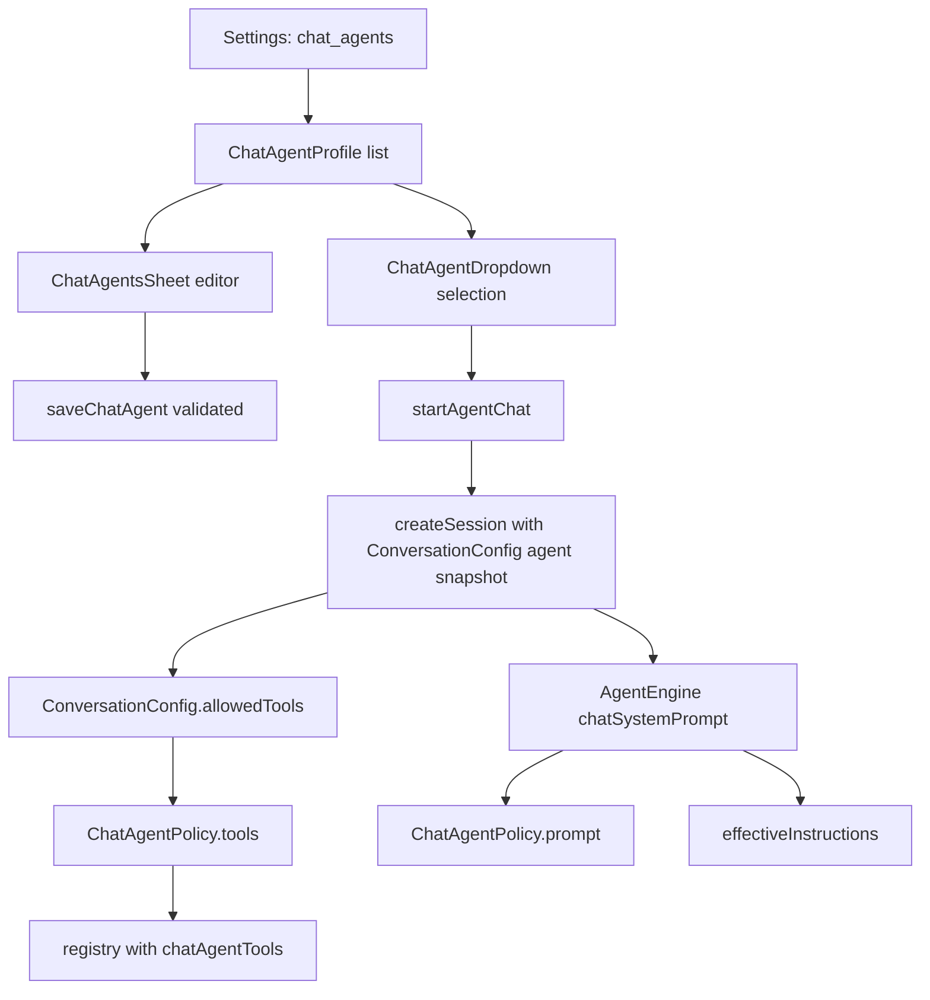

# Chat Agents and Personalization

> Saved Chat agents bundle instructions, voice, model choice, knowledge files, instruction-only skills, tool access, and a memory mode, and each conversation stores its own copy so later edits never rewrite old chats.

`ChatAgentProfile` in `app/src/main/java/com/androidharness/app/data/ChatAgents.kt` is the serializable definition. Profiles live in the app settings key `chat_agents` and are copied into a conversation's `ConversationConfig.agent` when a chat starts. Chat prompts are assembled in `AgentEngine.chatSystemPrompt`, tool access is narrowed by `ChatAgentPolicy.tools`, and knowledge and skill tools are built per profile by `ChatAgentTools`. The editor and picker live in `ChatAgentsSheet`, `ChatAgentDropdown`, and `ChatPersonalizationDropdown`. Global instructions are a separate settings value that a conversation can inherit, replace, or switch off with personalization.

## Module Responsibilities

- **`ChatAgentProfile`**: the saved definition plus `validated()` bounds and encode/decode helpers.
- **`ChatAgentPolicy`**: translates capability flags, memory mode, knowledge, and skills into a concrete tool set, decides cross-chat history access, and writes the agent's prompt block.
- **`AgentKnowledgeSearch`**: bounded local passage search over knowledge file text, no embeddings, network, or filesystem.
- **`ChatAgentTools`**: `SearchAgentKnowledgeTool` and `ChatAgentSkillTool`, created only when the profile has knowledge or skills.
- **`ChatAgentsSheet`**: list, start, duplicate, delete, and the full editor.
- **`ChatAgentDropdown` / `ChatPersonalizationDropdown`**: the start-of-chat selectors built on a shared `ChatStartDropdown`.
- **`ConversationConfig`**: per-conversation snapshot of the agent, instructions override, personalization switch, and image frequency.

## Architecture and Flow

## Invocation Chain

1. Settings loads `chatAgents` from `CHAT_AGENTS` (`SettingsRepository.kt` lines 319 to 320 and 449).
2. `ChatAgentsSheet` lists `settings.chatAgents` sorted by `updatedAt` descending and opens `ChatAgentEditor` on edit or create (`ChatAgentsSheet.kt` lines 105 to 211).
3. Saving calls `container.settings.saveChatAgent(next)`, which validates, removes the old id, and appends a copy with a fresh `updatedAt` (`SettingsRepository.kt` lines 1123 to 1129).
4. Selecting an agent calls `ChatViewModel.startAgentChat` (`ChatViewModel.kt` lines 1691 to 1712), which saves the current draft, then calls `AppContainer.startChatAgent`.
5. `startChatAgent` validates the profile and creates a `CHAT` session with `agent = profile`, initializes model selection, and marks the session active (`app/src/main/java/com/androidharness/app/HarnessApp.kt` lines 153 to 160).
6. At run time `AgentEngine` reads `conversation.agent` for the prompt block and adds `chatAgentTools(conversation.agent)` to the registry (`AgentEngine.kt` lines 373 and 2033).
7. `ConversationConfig.allowedTools` exposes `ChatAgentPolicy.tools(agent)` for any caller that needs the same set (`ConversationConfig.kt` line 44).

## Agent Definition and Validation

`ChatAgentProfile` fields are `id`, `name`, `avatar`, `description`, `instructions`, `persona`, `model`, `thinking`, `customThinkingLevels`, `capabilities`, `memory`, `sharedHistory`, `starters`, `knowledge`, `skills`, and `updatedAt` (`ChatAgents.kt` lines 24 to 41). `model` is a `ChatModelChoice(providerId, model)` or null, which means inherit the chat's current model. `capabilities` defaults to `WEB` and `IMAGES`.

`validated()` enforces every bound:

- id present and at most 100 characters, name 1 to 60.
- avatar must be one of `spark`, `study`, `write`, `research`, `idea`, or `travel`.
- description at most 240, persona at most 2,000, instructions at most 8,000.
- at most four starters, each non-blank and at most 200 characters.
- at most eight knowledge files, unique ids, each name at most 180 and text at most 32,000 characters, total knowledge at most 96,000.
- at most six skills, unique names, each content at most 8,000, total skill content at most 24,000.

`MAX_AGENTS` is 24, and `encodeList` refuses duplicate ids or an oversized library (`ChatAgents.kt` lines 57 to 70). `AgentSkill` is deliberately instruction-only: the comment at line 18 states that scripts and workspace files never become available in Chat.

## Tool Access and Memory Mode

`ChatAgentPolicy.tools` starts from `ChatExperience.tools`, removes the web, image, and GitHub groups, then adds them back only when the matching `AgentCapability` is present. If `memory == OFF`, it removes `MemoryRepository.toolNames`, which are `remember` and `recall` (`app/src/main/java/com/androidharness/app/data/MemoryRepository.kt` line 343). It adds `search_agent_knowledge` when knowledge exists, `skill_view` when skills exist, and always adds `search_chats`, `recent_chats`, and `read_chat_snippet` (`ChatAgents.kt` lines 73 to 88).

`AgentMemory` has three values:

- `PRIVATE`: memory tools are available, but history lookups are limited to chats with the same agent.
- `SHARED`: memory tools are available and `canReadHistory` allows reading ordinary Chat or Code chats.
- `OFF`: memory tools are removed from the registry.

`canReadHistory` returns true when both sides have the same agent id, or when the source agent has `sharedHistory` and the destination is plain, agent-less Chat (`ChatAgents.kt` lines 90 to 95). `HarnessApp.canRecallChat` combines that rule with `personalizationEnabled` for the chat (lines 162 to 168), and the recall tools call the injected `canAccess` predicate before returning any row.

## Prompt Assembly and Instructions

`ChatAgentPolicy.prompt` writes a "# Selected Chat agent" block containing name, description, instructions, optional persona, and a hard statement that instructions cannot grant tools or override app restrictions. When knowledge exists it lists each source with its id, tells the model to search with `search_agent_knowledge`, cite filename and passage number, and never claim a source said something without reading it. When skills exist it names them and tells the model to load one with `skill_view`. It closes with the history access rule (`ChatAgents.kt` lines 97 to 114).

`AgentEngine.chatSystemPrompt` appends that block after the base Chat prompt, research depth, and image guidance. It then handles personalization: when `conversation.personalizationEnabled` is true it appends `conversation.effectiveInstructions(chatInstructions)` under "# User instructions for this chat" and adds saved memory. When false it appends an explicit block telling the model not to use or save memory, not to follow personal instructions, and not to search other chats (`app/src/main/java/com/androidharness/app/agent/AgentEngine.kt` lines 2157 to 2193).

Global instructions are stored under `chat_instructions` and capped at `ConversationConfig.MAX_INSTRUCTIONS_CHARS`, which is 4,000 (`SettingsRepository.kt` lines 319 and 1120; `ConversationConfig.kt` line 48). `ConversationConfig.effectiveInstructions` returns an empty string for a non-Chat conversation or when personalization is off. Otherwise it returns either the global text or the per-chat text, depending on `useGlobalInstructions`. The default of `useGlobalInstructions` is `instructions.isBlank()`, so old chats with non-empty per-chat text remain overrides, and newer chats inherit (`ConversationConfig.kt` lines 33 to 41).

`ChatSettingsSheet` exposes the choice as two radio options labeled "Use global Chat instructions" and "Replace for this chat", and shows the global text read-only when inheriting. The save path is `ChatViewModel.setChatSettings`, which writes `instructions`, `personalizationEnabled`, `imageFrequency`, and `useGlobalInstructions` back to the session and rolls the state back on failure (`ChatViewModel.kt` lines 1715 to 1746).

## Knowledge Files and Local Search

The editor's file picker accepts `text/*`, `application/pdf`, and `application/json`. It rejects anything that is neither PDF nor text-like, reads at most 4 MB, extracts text from a PDF through `PdfTextExtractor` and rejects more than 30 pages or 32,000 characters, decodes text as UTF-8 with malformed input reported, strips a BOM, and requires the result to fit the per-file and per-agent totals (`ChatAgentsSheet.kt` lines 252 to 294).

`AgentKnowledgeSearch.passages` windows each file at 1,400 characters with a 1,200 character stride, numbered from 1. `search` filters by optional file id, scores each passage with `MemoryMatch.relevance` over the passage plus the filename, drops zero scores for non-blank queries, sorts by score, filename, and passage, and returns at most six hits (`ChatAgents.kt` lines 118 to 129). `SearchAgentKnowledgeTool` supports both search mode and direct reading with `file_id` plus `passage`, returning at most four passages and refusing ids outside the profile (`app/src/main/java/com/androidharness/app/tools/ChatAgentTools.kt` lines 10 to 34). There is no embedding provider and no filesystem access.

## Per-Conversation Snapshotting

The profile is serialized into `ConversationConfig.agent` at session creation. `ConversationConfig.decode` calls `config.agent?.validated()` and falls back to a Chat config on any parse failure, with a comment that damaged configuration must never unlock coding tools (`ConversationConfig.kt` lines 50 to 57). This copy is the reason editing or deleting a saved agent does not alter old chats: the conversation reads its embedded profile, not the settings list. The UI states this directly in the sheet footer string `chat_agents_snapshot` (`ChatAgentsSheet.kt` lines 192 to 193 and 454 to 455).

Deleting an agent removes only the settings entry (`SettingsRepository.kt` lines 1131 to 1135). Conversations keep their snapshot, their knowledge text, and their memory. Duplicating an agent copies the profile with a new UUID and a name built from `chat_agents_copy`, truncated to 60 characters (`ChatAgentsSheet.kt` lines 176 to 179).

## Selection UI and Start Gating

`ChatAgentDropdown` shows a "Regular Chat" row, every saved agent, "New agent" while under 24 profiles, and "Manage agents" when any exist. A selected agent that is no longer in the library is prepended so the current chat still displays it (`ChatAgentDropdown.kt` lines 50 to 67). The optional `setupCard` trigger is a full-width row used by the empty state.

`ChatPersonalizationDropdown` and `ChatAgentDropdown` share `ChatStartDropdown`, which sizes its menu to the window width minus 32 dp, clamps it to 320 dp, and caps height at 440 dp (`ChatPersonalizationDropdown.kt` lines 51 to 82). Both selectors appear only while the chat is empty and ready (`ChatScreen.kt` lines 241 to 242 and 1487 to 1507). Selecting a different agent always starts a new conversation; it does not rewrite the current one.

`startAgentChat` refuses while a conversation is saving, a run is starting, the chat is busy, or attachments are pending. It saves the current draft first, then opens the new session (`ChatViewModel.kt` lines 1691 to 1712).

## Boundary Conditions

- At most 24 agents. The "New" entry and the duplicate action are disabled at the cap.
- Knowledge is capped at eight files and 96,000 total characters. Text over 32,000 in one file is refused, and a PDF over 30 pages is refused.
- Skills are instruction text only, capped at six and 24,000 characters total. `ChatAgentSkillTool` returns the selected content and states it is instruction-only.
- History recall is denied by default when an agent has `sharedHistory` off and the destination chat belongs to a different agent or has no agent.
- Personalization off suppresses instructions and memory even when text is still stored in the conversation.
- A damaged `agent` payload in a stored conversation makes `ConversationConfig.decode` fall back to a plain Chat config instead of granting tools.
- The editor's discard dialog intercepts a back press whenever the profile or starter text differs from the initial value (`ChatAgentsSheet.kt` lines 251 and 519 to 522).

## Extension Points

- Add a capability by extending `AgentCapability` and adding its tool set to `ChatAgentPolicy.tools`.
- Add an avatar key to `ChatAgentProfile.AVATARS` and a matching branch in `agentIcon` and `agentIconLabel`.
- Add a knowledge tool parameter in `SearchAgentKnowledgeTool.parametersSchema`; the profile and passage search are already injectable.
- Global instructions can be written from Settings through `setChatInstructions`, and the agent settings search catalog exposes it as a sensitive setting (`AgentSettingsCatalog.kt` line 202).

Sources: [app/src/main/java/com/androidharness/app/data/ChatAgents.kt](../app/src/main/java/com/androidharness/app/data/ChatAgents.kt)#L24-L129), [app/src/main/java/com/androidharness/app/ui/chat/components/ChatAgentsSheet.kt](../app/src/main/java/com/androidharness/app/ui/chat/components/ChatAgentsSheet.kt)#L105-L523), [app/src/main/java/com/androidharness/app/data/ConversationConfig.kt](../app/src/main/java/com/androidharness/app/data/ConversationConfig.kt)#L21-L58), [app/src/main/java/com/androidharness/app/agent/AgentEngine.kt](../app/src/main/java/com/androidharness/app/agent/AgentEngine.kt)#L2157-L2193)

## Source files

- `app/src/main/java/com/androidharness/app/data/ChatAgents.kt`
- `app/src/main/java/com/androidharness/app/ui/chat/components/ChatAgentsSheet.kt`
- `app/src/main/java/com/androidharness/app/ui/chat/components/ChatAgentDropdown.kt`
- `app/src/main/java/com/androidharness/app/ui/chat/components/ChatPersonalizationDropdown.kt`
- `app/src/main/java/com/androidharness/app/data/ConversationConfig.kt`
- `app/src/main/java/com/androidharness/app/tools/ChatAgentTools.kt`
- `app/src/main/java/com/androidharness/app/data/SettingsRepository.kt`
- `app/src/main/java/com/androidharness/app/HarnessApp.kt`
- `app/src/main/java/com/androidharness/app/ui/chat/ChatViewModel.kt`
- `app/src/main/java/com/androidharness/app/ui/chat/components/ChatSettingsSheet.kt`
- `app/src/main/java/com/androidharness/app/agent/AgentEngine.kt`
