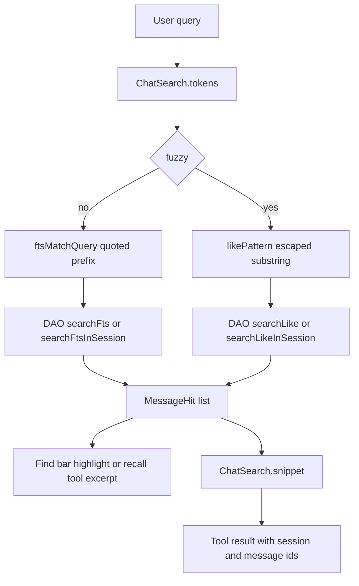

# Chat Search, Saved Answers, and Sharing

> Chat exposes an FTS4 message index to the agent and to in-chat find, keeps bookmark copies of answers in Room, and accepts shares from other apps through a destination sheet before any text enters a chat.

`ChatSearch` is a pure helper object that builds FTS4 MATCH expressions, LIKE patterns, and highlighted snippets without Android types. `SessionRepository` runs those helpers against the `message_fts` virtual table and the `messages` table, returning `MessageHit` rows for the drawer, the in-chat find bar, and the three recall tools in `ChatRecallTools`. Saved answers are a separate `saved_answers` table holding a full text copy keyed by message id. Sharing enters through `PendingShare.fromIntent`, waits in `AppContainer.pendingShare`, and is confirmed in `ShareToChatSheet` before `AppNav` creates or reuses a Chat session. Web sources are summarized by `ChatActivityPresentation.sources` and shown in `ChatSourceLibrarySheet`.

## Module Responsibilities

- **`ChatSearch`**: tokenization, FTS MATCH quoting, LIKE escaping, highlight needles, and snippet windows with merged ranges.
- **`MessageFtsEntity` and the DAO**: Room FTS4 index over `MessageEntity` with content sync, plus global and per-session queries.
- **`FindInChatBar`**: the in-chat search field with up, down, position, no-match state, and close.
- **`ChatRecallTools`**: `search_chats`, `recent_chats`, and `read_chat_snippet` for the model.
- **`SavedAnswerEntity` / `SavedAnswerRow`**: stored answer text and the bounded row used by the sidebar.
- **`SaveAnswerIconButton`**: the bookmark control with spring, tint, and ring animation.
- **`ChatSourceLibrarySheet`**: every web source in the chat, deduplicated across turns.
- **`PendingShare` and `ShareToChatSheet`**: share intent parsing and the destination, question, and suggestion UI.

## Architecture and Flow

## Invocation Chain

1. The drawer or in-chat find calls `SessionRepository.searchMessages` or `searchMessagesInSession` (`app/src/main/java/com/androidharness/app/data/SessionRepository.kt` lines 532 to 586).
2. Each method trims the query, builds either `ChatSearch.ftsMatchQuery` or `ChatSearch.likePattern`, and calls the matching DAO query (`Database.kt` lines 501 to 517).
3. Results drop assistant rows that carry a `toolCallId`, and for Chat sessions keep only `USER` and `ASSISTANT` roles. Assistant text is converted with `RichResponse.plainText`, user text with `UserMessageContent.visibleText`.
4. `ChatViewModel.findInConversation` calls the per-session search and returns hits oldest first (`ChatViewModel.kt` lines 2109 to 2113).
5. `FindInChatBar` receives `query`, `position`, `total`, and previous/next/close callbacks, requests focus on first composition, and submits IME Search as Next (`FindInChatBar.kt` lines 35 to 93).
6. The model path calls `SearchChatsTool.execute`, which searches 24 rows, filters out the current session, applies `canAccess`, ranks, deduplicates by session, and formats up to the requested limit (`ChatRecallTools.kt` lines 44 to 78).

## FTS Query Construction and Index

`ChatSearch.tokens` trims, splits on whitespace, and removes duplicates. `ftsMatchQuery` returns null for an empty query and otherwise joins every token as `"token"*`, with embedded quotes doubled. Prefix matching means "grad" finds "gradle", and quoting keeps punctuation from being parsed as FTS syntax (`ChatSearch.kt` lines 12 to 25). `likePattern` trims, escapes backslash, percent, and underscore, and wraps the whole query in percent signs so fuzzy mode treats it as one substring (lines 28 to 42). `highlightNeedles` returns the whole query in fuzzy mode and the tokens otherwise (lines 45 to 49).

The index is `message_fts`, an external-content FTS4 table over `MessageEntity` with the `unicode61` tokenizer (`Database.kt` lines 100 to 110). Room installs content-sync triggers, and migration 8 to 9 creates the virtual table with the exact column list Room expects and runs a `rebuild` to backfill existing history (`Database.kt` lines 980 to 992). The DAO queries join `message_fts f` to `messages m` on `m.rowid = f.docid`, exclude ids starting with `internal-chat-continuation-`, and order by `createdAt` descending globally or ascending inside one session. LIKE queries use `ESCAPE '\'` so the escaping from `likePattern` is honored (lines 501 to 517).

`ChatSearch.snippet` flattens newlines to spaces, finds the earliest needle, starts about one third of the window before it, and marks every needle inside the window. Overlapping ranges are merged, a leading and trailing ellipsis are added when the window clips, and range offsets shift by the prefix length. The default window is 180 characters (lines 52 to 107).

## Recall Tools

`SearchChatsTool` requires at least two characters, clamps `limit` to 1 through 8, defaults `fuzzy` to false, and searches with a fixed internal limit of 24 before filtering. Its ranking adds 6 when a title contains a token, 3 for a full-query match in the text, and 2 when at least two tokens appear. It then sorts by score and then newest, deduplicates by session, and formats one hit per chat with title, date, a 260-character snippet, and session and message ids. If more chats matched than were returned it appends a refinement hint (`ChatRecallTools.kt` lines 24 to 79).

`RecentChatsTool` lists up to 12 sessions sorted by `updatedAt`, skipping the current session, blank titles, and anything `canAccess` rejects. Each line includes date, Chat or Code kind, title, and session id (lines 82 to 113).

`ReadChatSnippetTool` requires `session_id`, checks access, and loads visible messages only. It drops tool rows, converts text the same way as search, collapses whitespace, and picks either a window around `message_id` or the latest messages. `around` is clamped to 0 through 3, `max_chars` to 500 through 3000, and the output stops once fewer than 20 characters remain. A missing hit falls back to the latest messages with an explicit note (lines 116 to 178).

## Saved Answers

`SavedAnswerEntity` is keyed by `messageId` and stores `sessionId`, full `text`, `answeredAt`, and `savedAt`, with indexes on `sessionId` and `savedAt`. Its comment states the text is a copy taken at save time, so it survives regenerating, editing, or rewinding the source chat (`Database.kt` lines 72 to 86). `SavedAnswerRow` carries only a bounded `excerpt` for the sidebar (lines 88 to 94).

`SessionRepository.saveAnswer` clamps the text with `MAX_PERSISTED_FIELD_CHARS` and writes the row; `unsaveAnswer` deletes by message id; `removeSavedAnswer` reads then deletes in one transaction so the UI can offer undo; `restoreSavedAnswer` reinserts the exact row (`SessionRepository.kt` lines 118 to 130). `savedAnswerIds` is a distinct-until-changed flow of the ids for one session (lines 109 to 111), and `savedAnswers` returns sidebar rows (line 113).

`ChatScreen` collects `savedAnswerIds` for the active session (lines 238 to 240). `toggleSavedAnswer` checks membership, saves or unsaves, shows a snackbar with Undo, and reverses the action if Undo is pressed (`ChatScreen.kt` lines 538 to 555). The action row calls `SaveAnswerIconButton(saved = id in savedAnswerIds, onToggle = ...)` only for messages that have an id (lines 1925 to 1927). The button animates only on a tap: a saved set that loads later snaps to its final state without replaying the pop (`SaveAnswerButton.kt` lines 42 to 95). Sidebar rows open `SavedAnswerSheet`, which reads the stored text, can open the chat at the message, and removes with undo (`AppNav.kt` lines 1056 to 1073).

## Quote Reply and Source Ledger

`QuoteReplySelection` replaces the text context menu's clipboard and toolbar providers. When the user taps Quote reply, it sets `quoting`, invokes the original Copy item, and captures the copied selection directly instead of reading a stale system clipboard value. The custom popup shows Quote reply, the original Copy label, and Select all (`QuoteReplySelection.kt` lines 62 to 104). `ChatScreen` turns the captured text into a `ResponseAttachment` titled "Quoted text", truncates it to 1500 characters, shows a shortened notice when truncation happened, focuses the composer, and opens the keyboard (lines 1887 to 1893).

The source ledger is built by `ChatActivityPresentation.sources`, which parses `web_search` results through `WebSearchText` and page reads through `ReadableWebPage` or the structured research receipt. Only http and https URLs with a host and no user info are admitted. URLs are deduplicated by `canonicalResultUrl`, and a later read upgrades an existing entry's `read` flag (`ChatActivityPresentation.kt` lines 90 to 114).

`ChatSourceLibrarySheet` loads on demand: `ChatScreen` sets `chatSources` to null, then calls `viewModel.loadChatSources()`, which reads all session messages and calls `sources(messages, limit = 500)` (`ChatScreen.kt` lines 658 to 661; `ChatViewModel.kt` lines 1749 to 1755). The sheet shows a spinner while loading, an empty message, or a count plus a lazy list keyed by URL with title, host, and read or found state (`ChatSourceLibrarySheet.kt` lines 36 to 110).

## Share Intents and the Destination Sheet

`PendingShare` holds `text`, `streams`, a random `id`, `targetSessionId`, and `mime`. `fromIntent` accepts only `ACTION_SEND` and `ACTION_SEND_MULTIPLE`, collects `EXTRA_STREAM` and clip data, requires every URI scheme to be `content`, and never reads arbitrary file paths. The body is `EXTRA_TEXT`, or the distinct clip texts joined by blank lines. The subject is prepended unless it equals the body (`PendingShare.kt` lines 9 to 56).

`MainActivity` parses the launch intent into `container.pendingShare` (line 332). `AppNav` collects that value and shows `ShareToChatSheet` only when setup is complete and no target session has been chosen yet. The destination list contains Chat sessions only, excluding archived ones (`AppNav.kt` lines 529 to 545). On Open, `AppNav` either creates a new Chat session or verifies that the chosen session is Chat, appends the optional question to the share text, and stores the target session id back into the pending share before opening the chat.

`ShareToChatSheet` lets the user review the text and attachments, pick New chat or an existing chat through a searchable dropdown, type an optional question, and tap a suggestion chip for summarize, explain, translate, or check. The Open button passes the selected chat id and non-blank question to `AppNav` (`ShareToChatSheet.kt` lines 33 to 84). Attachments preview through `SharedAttachmentPreview`, which samples an image to at most 256 px and otherwise shows a document icon and the display name (lines 87 to 121).

## Boundary Conditions

- An empty search returns an empty list before any query is built.
- FTS quoting prevents punctuation and FTS operators from crashing MATCH. Fuzzy mode uses LIKE with explicit `%`, `_`, and backslash escaping.
- `internal-chat-continuation-` rows are excluded at the SQL level, and assistant tool-call rows are filtered again in Kotlin.
- Chat searches keep only user and assistant roles, so tool payloads never surface as chat hits.
- A recalled snippet never returns a whole chat: search returns 260-character excerpts, and the snippet reader is bounded by `around`, `max_chars`, and a remaining-character check per message.
- Search tools exclude the calling session and honor the injected `canAccess`, which enforces agent history rules.
- A saved answer is keyed by message id, so saving the same answer twice leaves one row.
- Sharing rejects any URI whose scheme is not `content`; `isFor` also requires the destination conversation to be Chat and the target session id to match.
- The quote attachment is truncated at 1500 characters with a visible notice.
- The source ledger admits only http and https, rejects user info in the URL, and caps the list at 500 for the full-chat sheet and 100 by default elsewhere.

## Extension Points

- Use `ChatSearch.highlightNeedles` with the `Snippet.ranges` to render match highlighting anywhere a `MessageHit` is shown.
- Add a search mode by widening `SearchChatsTool.parametersSchema` and the branch on `fuzzy`.
- `SearchChatsTool`, `RecentChatsTool`, and `ReadChatSnippetTool` each expose a mutable `canAccess: suspend (String?, String) -> Boolean`, so the caller controls cross-chat policy without changing the tool.
- The action row reads `savedAnswerIds` and the sidebar reads `savedAnswers`, so a new surface can reuse either flow without duplicating storage.
- Share destinations are supplied by `AppNav`; any future filter only needs to change the `chats` argument of `ShareToChatSheet`.

Sources: [app/src/main/java/com/androidharness/app/data/db/ChatSearch.kt](../app/src/main/java/com/androidharness/app/data/db/ChatSearch.kt)#L9-L108), [app/src/main/java/com/androidharness/app/data/SessionRepository.kt](../app/src/main/java/com/androidharness/app/data/SessionRepository.kt)#L532-L586), [app/src/main/java/com/androidharness/app/tools/ChatRecallTools.kt](../app/src/main/java/com/androidharness/app/tools/ChatRecallTools.kt)#L24-L179), [app/src/main/java/com/androidharness/app/data/PendingShare.kt](../app/src/main/java/com/androidharness/app/data/PendingShare.kt)#L9-L57)

## Source files

- `app/src/main/java/com/androidharness/app/data/db/ChatSearch.kt`
- `app/src/main/java/com/androidharness/app/data/db/Database.kt`
- `app/src/main/java/com/androidharness/app/data/SessionRepository.kt`
- `app/src/main/java/com/androidharness/app/ui/chat/components/FindInChatBar.kt`
- `app/src/main/java/com/androidharness/app/ui/chat/components/SaveAnswerButton.kt`
- `app/src/main/java/com/androidharness/app/ui/chat/components/QuoteReplySelection.kt`
- `app/src/main/java/com/androidharness/app/ui/chat/components/ChatSourceLibrarySheet.kt`
- `app/src/main/java/com/androidharness/app/ui/chat/components/ShareToChatSheet.kt`
- `app/src/main/java/com/androidharness/app/data/PendingShare.kt`
- `app/src/main/java/com/androidharness/app/tools/ChatRecallTools.kt`
- `app/src/main/java/com/androidharness/app/ui/chat/ChatViewModel.kt`
- `app/src/main/java/com/androidharness/app/ui/chat/ChatScreen.kt`
- `app/src/main/java/com/androidharness/app/ui/AppNav.kt`
