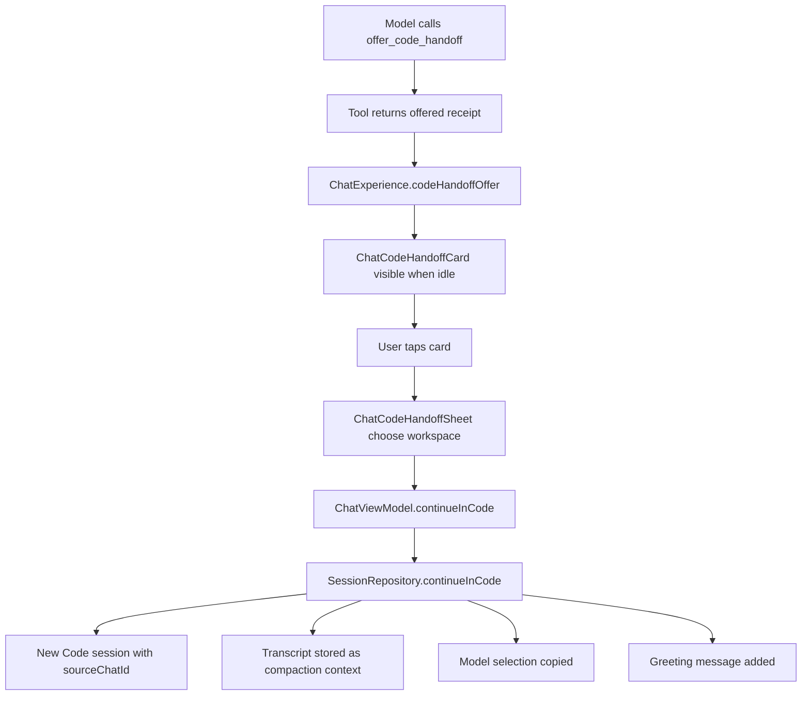

# Chat to Code Handoff and Chat Workspaces

> Chat can offer a Continue in Code card, carry the visible discussion into a new Code chat as reference context, and give a chat one or several workspaces with a primary root and per-project edit or read-only grants.

The handoff begins with the model-only `offer_code_handoff` tool. It never navigates or executes anything; it returns a success receipt and `ChatExperience.codeHandoffOffer` decides whether a card may appear. Accepting the card opens `ChatCodeHandoffSheet`, picks a workspace, and calls `SessionRepository.continueInCode`, which creates a Code session and stores the Chat transcript as compaction context. Workspace access is separate: `ChatWorkspaceSelection` and `ChatWorkspaceFs` bind a chat to one or more projects, and `WorkspaceManager` loads and validates those bindings. `RunManager.assignWorkspaces` serializes changes against running tasks, and `ChatWorkspaceFs` enforces edit or read-only rights on every node operation.

## Module Responsibilities

- **`ChatExperience`**: the offer model, the explicit handoff phrase detector, and the card-copy extractor.
- **`OfferCodeHandoffTool`**: the read-only tool that only validates a title and reason.
- **`ChatCodeHandoffCard`**: the offer card in the transcript.
- **`ChatCodeHandoffSheet`**: the workspace picker and Continue button.
- **`ChatFromChatBadge`**: the origin badge on the first Code message after a handoff.
- **`SessionRepository.continueInCode`**: creates the Code session, copies context, and adds the greeting.
- **`ChatWorkspaceSelection` / `ChatWorkspaceGrant`**: the persisted grant set with a primary project id.
- **`ChatWorkspaceFs`**: a `WorkspaceFs` implementation that routes `@workspaces/<id>/path` to the bound project and enforces grants.
- **`WorkspaceManager`**: loads, saves, and validates per-chat selections.
- **`WorkspaceSwitcher` / `ProjectEditorSheet`**: the workspace switcher used from the chat header, sidebar and Files screen, and the access editor for a project's workspaces.

## Architecture and Flow

## Invocation Chain

1. `AgentEngine` exposes `offer_code_handoff` as part of `ChatExperience.tools` and prompts the model to call it only when the user explicitly wants Code or the next step needs project editing or execution (`app/src/main/java/com/androidharness/app/core/ChatExperience.kt` line 39).
2. `OfferCodeHandoffTool.execute` validates a title of at most 80 characters and a required reason of at most 400, then returns a text receipt stating the user must choose before a Code conversation exists (`app/src/main/java/com/androidharness/app/tools/ChatTools.kt` lines 80 to 95).
3. `ChatScreen` computes `codeHandoff` from `ChatExperience.codeHandoffOffer` on every message change (`ChatScreen.kt` lines 245 to 248).
4. When not busy and an offer exists, the transcript adds a `ChatListContentType.Handoff` item rendering `ChatCodeHandoffCard` (lines 2332 to 2338).
5. Tapping the card sets `showCodeHandoff`, which opens `ChatCodeHandoffSheet` with all projects and the active workspace as the initial choice (lines 249 to 256).
6. Continue calls `viewModel.continueInCode(projectId)` (`ChatViewModel.kt` lines 1680 to 1689), which delegates to `SessionRepository.continueInCode`.
7. `continueInCode` creates the Code session, copies context and model selection, adds a greeting, and returns the new id, which is emitted as `NavEvent.OpenSession`.

## When the Offer Appears

`codeHandoffOffer` looks only at the latest user turn. It reads the visible user text before any attached file block, searches for an explicit phrase such as "continue in code", "move to code", "switch to code", or the Chinese equivalents, and rejects a match when a negation appears within the preceding 32 characters. It then scans this turn's assistant rows in reverse for an `offer_code_handoff` call whose id has a successful tool result (`ChatExperience.kt` lines 54 to 76). A call without a result, a failed call, or a call from an earlier turn supplies no card.

The returned copy is `CodeHandoffOffer(title, reason)`, both nullable. The title is collapsed whitespace, trimmed, and cut to 80 characters; the reason is cut to 400. The card substitutes resource defaults when either is null (`ChatCodeHandoff.kt` lines 83 to 85). Because the tool is filtered out of `ChatActivityPresentation.timeline` and `steps`, the call never appears as a normal tool row (`ChatActivityPresentation.kt` lines 29 and 78; `ChatActivity.kt` line 151).

## Carrying the Discussion into Code

`SessionRepository.continueInCode` runs in one `db.withTransaction`. It loads the source session, requires it to be a Chat, and creates a new session with the same title, the chosen project id, and a `ConversationConfig(sourceChatId = sourceId)`. That `sourceChatId` is how the Code session records where it came from. It then collects only `USER` and `ASSISTANT` rows that are not tool calls and have non-blank text, formats them as `role: text` pairs, keeps the last 32,000 characters, and writes that string plus a header saying it is reference context, not new instructions, through `setCompaction` (`app/src/main/java/com/androidharness/app/data/SessionRepository.kt` lines 243 to 256).

The same transaction copies `modelSelectionJson` when present, so the Code chat starts on the model the Chat used. It then inserts an assistant message beginning with `CONTINUED_IN_CODE_PREFIX`, which is `"Continuing in Code."`, and says the discussion was carried over as reference. No tool call, shell command, or file write runs during the handoff. `ChatFromChatBadge` is rendered on that first Code message and navigates back to the source chat (`ChatCodeHandoff.kt` lines 99 to 110; `ChatScreen.kt` line 2019).

The word "plan" in the user-facing feature description maps to this transcript copy, not to a separate plan object. `pendingPlan` is a different mechanism used inside a single chat by `PlanApprovalCard` (`ChatScreen.kt` lines 2321 to 2331).

## Workspace Selection Model

`ChatWorkspaceGrant(projectId, canEdit)` defaults `canEdit` to false. `ChatWorkspaceSelection(primaryId, grants)` requires at least one grant, unique non-blank project ids, and a primary id that is one of the grants. `validated()` throws on any violation, and `encode` always validates before writing (`app/src/main/java/com/androidharness/app/workspace/ChatWorkspaces.kt` lines 10 to 31). `ChatWorkspaceSelection.single(id)` produces one editable grant, which is the shape used by a chat that has never opened Workspaces.

`WorkspaceManager.selectionForChat` returns a single selection from the current project when the session id is null. For a real session it first ensures a project binding, then reads `workspaceSelectionJson`, decoding it when present and falling back to the saved `projectId`, or null when the stored JSON is present but invalid (`WorkspaceManager.kt` lines 74 to 83). `forChat` combines the session flow with the available project list and calls `scopedFs` on every change (lines 85 to 92).

`scopedFs` is the access checkpoint. A null selection returns the plain project filesystem. Otherwise it decodes the selection, requires that its primary id still equals the session's bound project, resolves every grant to an available project, requires the project to be present, and for shell kind projects requires the folder to still exist. Any failure throws a message that tells the user to open Workspaces (`WorkspaceManager.kt` lines 111 to 124).

## Primary, Read-Only, and Path Isolation

`ChatWorkspaceFs` holds a primary id and an ordered list of `ChatWorkspaceBinding(id, name, canEdit, fs)`. It validates that the bindings are non-empty, unique, include the primary, and use ids without slashes or dot segments (`ChatWorkspaces.kt` lines 36 to 42). Its `displayPath` lists the primary path first and then every binding as `id:edit|read:path`, so the model prompt sees exactly which roots are writable (lines 47 to 49).

Plain paths resolve against the primary binding. `target` also accepts the `@workspaces/<id>/<path>` form, rejects traversal before touching a tree, and returns the binding plus relative path (lines 62 to 73). `resolve` and `walk` map every child through `BoundNode`, and a synthetic `RootsNode` at `@workspaces` lists all bound roots (lines 80 to 91 and 143 to 165). `fileAccess` builds an unqualified view for tool execution that still calls `key` and `checkLocalPath` on every operation (lines 94 to 108).

`checkLocalPath` compares the current `shellRoot` with the canonical root captured at construction and requires the resolved path to stay under that captured root. This blocks a swapped or symlinked folder after the grant was made (lines 110 to 116). Every mutating `BoundNode` method calls `edit()`, which first reads, then checks `binding.canEdit`. A write to a read-only workspace fails with a message naming the workspace and telling the user to change access in Workspaces (line 125). Reads, streams, listings, and binary checks only call `read()`. `shellRoot` is null on purpose so Full access cannot replace the selected roots with an unbounded filesystem (line 45).

## Saving Selection and Isolation Between Chats

A normal Code chat holds one workspace. `WorkspaceSwitcher` (`ui/chat/components/WorkspaceSwitcherSheet.kt`) changes it through `runManager.assignWorkspace`, and offers New project and Move to a project where it used to offer more folders.

Several workspaces belong to a project (`WorkProjectEntity`, see [Workspace Manager and Routing](45-workspace-manager-and-routing.md)). `ProjectEditorSheet` is the access editor: it keeps a draft selection, shows a checkbox per workspace, a Read only or Can edit choice, a main workspace radio and missing grants with a remove action, and validates on Save. Saving calls `RunManager.assignProjectWorkspaces`, which applies the selection to every chat in the project or to none of them.

`RunManager.assignWorkspaces` takes `workspaceGuard` and refuses while the chat is running, has active subagents, or has a resumable task. If the chat has saved checkpoints or file changes, it requires the same primary and a superset of the existing project ids, so undo stays valid. It then calls `workspace.assignSelection` and clears the chat's cached allowed tools (`app/src/main/java/com/androidharness/app/agent/RunManager.kt` lines 164 to 181).

`assignSelection` validates the selection and writes `workspaceSelectionJson` plus the primary `projectId`, with `qualifyLegacy` true when no prior JSON existed (`WorkspaceManager.kt` lines 126 to 131). `validateSelection` resolves the whole selection as if loaded from storage and rejects any pair of bindings whose canonical workspace paths overlap, using `workspacePathsOverlap` (lines 133 to 145). That check keeps a chat from granting the same folder twice through nested projects.

Isolation beyond a single chat comes from two rules. Each session stores its own selection, so a change in one chat never edits another chat's JSON. And `RunManager.workspaceBusy` compares canonical paths across running sessions and active subagents, so a new task cannot share an overlapping root while another task is writing there (RunManager lines 159 to 163).

## Draft Chats

A chat before its first message has no session id. In that state `selectionForChat(null)` returns the current workspace as a single editable grant. Picking another workspace in the switcher sets the active workspace, and the session is created with it when the first message is sent, so switching does not clear what the user typed.

Switching a chat between sections or starting an agent chat explicitly saves the draft text into the current conversation before opening the next session (`ChatViewModel.kt` lines 1661 to 1678 and 1700 to 1704).

## Boundary Conditions

- A handoff card appears only when the chat is idle. The card's enabled state also requires that no conversation save is in progress.
- Only a successful `offer_code_handoff` in the current turn, or an explicit non-negated phrase in the latest user message, can produce card copy.
- The carried transcript is capped at the last 32,000 characters and includes only visible user and assistant text.
- The new Code session runs nothing until the user sends a message.
- A selection with no grants is invalid, a selection without a primary among its grants is invalid, and duplicate project ids are invalid.
- A stored selection whose JSON cannot be decoded, or whose primary no longer matches the session's project, refuses to load and asks the user to choose again.
- A read-only grant blocks every write, rename, delete, create, and mkdir, and Full access does not lift it because `ChatWorkspaceFs.shellRoot` is null.
- A local path that escapes the captured canonical root is blocked with "Path is outside <name> and was blocked."
- Workspace changes are refused while a task runs, while subagents are active, or while a task is resumable.
- After saved file changes, the primary and all existing projects must be kept; only new projects or wider access are allowed.
- Two selected projects with overlapping workspace paths are rejected.

## Extension Points

- `ChatWorkspaceGrant` is the only per-project permission bit. Adding another level of access means extending this type and the `edit()` gate in `ChatWorkspaceFs.BoundNode`.
- Qualified path routing is controlled by `ChatWorkspaceFs.PREFIX`, currently `@workspaces`, and by `target`, so a new path scheme belongs in those two places.
- `WorkspaceManager.validateSelection` is the single policy point for availability and overlap checks, used both by normal saves and restores.
- The handoff card copy is model-supplied through the tool's `title` and `reason` parameters; the sheet and destination behavior stay in `ChatCodeHandoffSheet` and `SessionRepository.continueInCode`.

Sources: [app/src/main/java/com/androidharness/app/core/ChatExperience.kt](../app/src/main/java/com/androidharness/app/core/ChatExperience.kt)#L54-L76), [app/src/main/java/com/androidharness/app/workspace/ChatWorkspaces.kt](../app/src/main/java/com/androidharness/app/workspace/ChatWorkspaces.kt)#L10-L176), [app/src/main/java/com/androidharness/app/workspace/WorkspaceManager.kt](../app/src/main/java/com/androidharness/app/workspace/WorkspaceManager.kt)#L62-L145), [app/src/main/java/com/androidharness/app/agent/RunManager.kt](../app/src/main/java/com/androidharness/app/agent/RunManager.kt)#L164-L181)

## Source files

- `app/src/main/java/com/androidharness/app/ui/chat/components/ChatCodeHandoff.kt`
- `app/src/main/java/com/androidharness/app/core/ChatExperience.kt`
- `app/src/main/java/com/androidharness/app/tools/ChatTools.kt`
- `app/src/main/java/com/androidharness/app/data/SessionRepository.kt`
- `app/src/main/java/com/androidharness/app/ui/chat/ChatViewModel.kt`
- `app/src/main/java/com/androidharness/app/ui/chat/ChatScreen.kt`
- `app/src/main/java/com/androidharness/app/workspace/ChatWorkspaces.kt`
- `app/src/main/java/com/androidharness/app/workspace/WorkspaceManager.kt`
- `app/src/main/java/com/androidharness/app/agent/RunManager.kt`
- `app/src/main/java/com/androidharness/app/ui/chat/components/WorkspaceSwitcherSheet.kt`
- `app/src/main/java/com/androidharness/app/ui/chat/components/ProjectEditorSheet.kt`
- `app/src/main/java/com/androidharness/app/data/db/Database.kt`
- `app/src/main/java/com/androidharness/app/ui/AppNav.kt`
