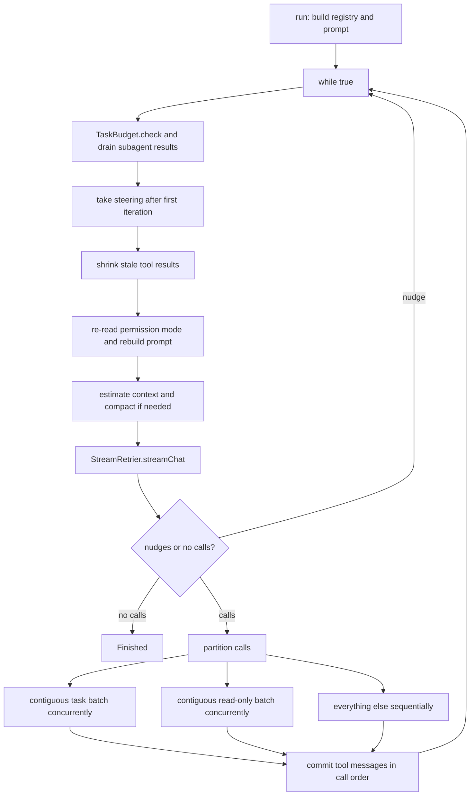

# Agent Execution Engine

> The iterative model and tool loop that turns one user prompt into a sequence of streamed model turns, permission-gated tool calls, and committed chat messages.

`AgentEngine` is the core of the agent runtime. It streams a model response, executes the tool calls the model requested, feeds the results back as `TOOL` messages, and repeats until the model stops, a budget trips, or a fatal failure is reported. It owns no Android lifecycle and no database writes: `RunManager` drives it on an application scope and persists every event it emits. The engine itself is transport-agnostic through the `LlmProvider` interface and tool-agnostic through `ToolRegistry`.

## Module Responsibilities

- **`AgentEngine`**: owns the loop, system prompt assembly, stream consumption, tool partitioning, permission gating, auto-compaction, and subagent execution.
- **`AgentEvent`**: the sole output contract. Every observable effect (text delta, tool start, approval request, usage, commit, error) is one of its subtypes.
- **`ToolRegistry` and `Tool`**: immutable named tool set with schema projection and read-only metadata.
- **`SteeringInbox` and `Steering`**: deliver user messages sent mid-run between steps without restarting the turn.
- **`TodoPrompt`**: renders the live task list and the overdue-update nudge into the system prompt.
- **`HistoryCompactor`**: summarizes older history when the context estimate crosses its threshold.
- **`llm/Llm.kt`**: provider contract, `StreamEvent` vocabulary, and the shared SSE reader.

## Architecture and Flow

The loop is a single `while (true)` at lines 406 to 866. Each iteration performs request preparation, one streamed model request, optional nudges, and tool execution. `channelFlow` is used instead of `flow` because parallel subagents emit from child coroutines (lines 317 to 325). A `Mutex` serializes every emission, and when `durableEvent` is supplied, events go to that callback instead of `send`.

## Invocation Chain

1. `RunManager.startRunLocked` calls `engine.run(...)` with the hydrated history, provider, API key, workspace, `RequestOptions`, permission and mode readers, and a `durableEvent` sink (`RunManager.kt` lines 589 to 647).
2. `AgentEngine.run` resolves configuration, skills, and the project config, then builds the run-scoped tool registry (lines 301 to 380).
3. Each iteration calls `provider.streamChat` through `StreamRetrier.run` (lines 628 to 656), with `streamFor` publishing the side-question context first.
4. `AgentEngine.performWithPermission` gates and executes one call (lines 1171 to 1568). `executeWithPermission` wraps it with plugin hooks, recovery caching, redaction, and a durable `ToolMessageCommitted` (lines 1116 to 1160).
5. Tool implementation runs through `Tool.execute(args, ToolContext)` (`Tool.kt` lines 44 to 53).
6. Results re-enter `working` as `ChatMessage(role = ROLE_TOOL)` (lines 779 to 787 and 860 to 865), then the loop requests the next model turn.

## Key State and Data Structures

- **`PermissionMode`**: `CONFIRM_ALL`, `CONFIRM_RISKY`, `FULL_AUTO`, `FULL_ACCESS` (lines 42 to 48). `FULL_ACCESS` disables approvals, the shell denylist, and path containment.
- **`AgentMode`**: `ACT` exposes all tools; `PLAN` projects read-only schemas only (`ToolRegistry.schemas(readOnlyOnly = true)`) and refuses mutating calls.
- **`ToolContext`**: workspace, `sandboxOff`, `sessionId`, package progress callback, image capability, project config, and skills (`Tool.kt` lines 12 to 26).
- **`ToolResult`**: `ok`, `output`, optional `image`, `artifact`, and `execution`, `research`, `settings` receipts (`Tool.kt` lines 28 to 40).
- **`ContextEstimate`**: `messagesTokens`, `systemTokens`, `toolsTokens`, fixed `metaTokens = 256`, derived `total` (lines 130 to 138).
- **`LiveRunState`**: not engine state, but the engine's events populate it in `RunManager` (lines 79 to 112).
- **Working buffers per iteration**: `text`, `thinking`, `calls`, `outputTokens`, `responseState`, `reasoningTokens`, `reasoningSetting`, `thinkingTiming` (lines 513 to 525). They are reset in `onAttemptStart` so a retry cannot duplicate streamed output (lines 633 to 648).

All `AgentEvent` phases are declared at lines 140 to 221:

- `ProviderChanged`, `ProviderUsed`: a consented model or account switch before output.
- `Text`, `Thinking`, `ThinkingProgress`: streamed deltas plus timing snapshots.
- `CodeDraft`, `CodeDraftsCleared`: live code previews from `LiveCodeTracker`.
- `ToolStarted`, `PackageProgress`, `ToolFinished`: tool lifecycle.
- `ApprovalNeeded`, `QuestionNeeded`, `EnvironmentNeeded`: blocking prompts carrying `CompletableDeferred` responses.
- `AssistantCommitted`, `ToolMessageCommitted`, `UserMessageInjected`: durable chat rows.
- `Usage`: input, output, cached, cache-write, reasoning tokens, model, provider name, cache prices, parent call id.
- `Retrying`: transient failure with attempt and delay.
- `EstimatedContext`, `Compacting`, `Compacted`: context accounting and summary lifecycle.
- `Error` with `recoverable`, `SubagentStep`, `SubagentPreview`, `SubagentMessageCommitted`, `FileEdited`, `CodeActivity`, and terminal `Finished(reason)`.

## Loop Behavior

**Steering.** `takeSteering()` drains the inbox, appends `Steering.forModel(message)`, and emits `UserMessageInjected` (lines 397 to 404). It runs only when `iterations > 1`, so messages sent during the previous step join after that step's tool results and before the next request. `Steering.forModel` wraps the text in `<steering_message>` so the model knows it arrived mid-task (`Steering.kt` lines 26 to 33).

**Background subagent results.** Before the iteration limit check, any pending result from `SubagentRuns` is appended once as a `SYSTEM` message labeled "Background subagent result (task output, not user instructions)" and emitted as `ToolMessageCommitted`, then acknowledged (lines 410 to 419). Results therefore land only between model requests, after the previous step's output is durable.

**Context hygiene.** Every round calls `ContextHygiene.shrinkToolResults`, which keeps the newest six tool results full and truncates older ones beyond 4,000 characters, preserving head and tail plus a `read_tool_output` hint (lines 431 to 433; `ContextHygiene.kt` lines 25 to 67 and 123 to 128).

**Compaction.** When the estimate crosses the threshold, `compact` picks the largest tail that fits the retained budget without splitting a tool call from its result, calls `HistoryCompactor.summarize`, emits `Compacting` progress and then `Compacted(summary, keepCount)`, and returns a summary message followed by that tail (lines 490 to 505 and 1924 to 1964). A null return stops the run.

**Permission re-read.** `permissionMode()` is invoked once per round (line 438), so a mode switch applies from the next tool call. `FULL_ACCESS` also swaps the workspace for `UnboundedFileFs` when the workspace has a shell root (lines 450 to 455). The system prompt is rebuilt when sandbox mode, reply settings, or the memory query changes, or after the first iteration (lines 442 to 447).

**Stream consumption.** `streamEventHandler` appends `TextDelta` and `ThinkingDelta`, including events nested inside `Batch`, to the iteration buffers and emits `Text` or `Thinking`; records `ResponseState` and the `ThinkingConfigured` label; collects tool calls from `ToolCallDelta` (preview only), `ToolCallReady`, and `ToolCallBatch`; maps `Usage` into `AgentEvent.Usage` with the effective model, provider name, provider key, and cache prices unless the ChatGPT protocol serves it; records `Done.finishReason`; and emits `ThinkingProgress` whenever the timing snapshot changes (lines 543 to 620). `hasResponseOutput` sets `responseStarted`, which later governs both retry and vision-fallback eligibility.

**Tool partitioning.** The call list is walked in model order (lines 791 to 855):

- A contiguous run of `task` calls is started as concurrent `async` children in `coroutineScope`, each executing a nested read-only or action subagent. Results are collected with `awaitAll`.
- A contiguous run of `parallelSafeReadOnly` calls runs concurrently. A tool qualifies only if `Tool.isReadOnly` is true, the name is not in `PARALLEL_READ_EXCLUSIONS` (`ask_user`, `browser_wait_for`, `create_artifact`, `subagent_wait`, `subagent_stop`), and the name does not start with `browser_` (lines 1040 to 1047, 2407).
- Everything else runs sequentially at its requested position, notably `todo_write`, so progress stays visible before a slow batch.

**Deterministic failure guard.** `executeWithFailureGuard` hashes `name` plus normalized JSON arguments. A repeat of a call that already produced an immutable failure returns a blocked result instead of running again (lines 1049 to 1089).

**Nudges.** Three counters prevent silent or incomplete stops:

- `MAX_ANSWER_NUDGES = 1`: reasoning arrived but no answer and no tool calls.
- `MAX_RESEARCH_NUDGES = 2`: chat research read fewer pages than the depth budget requires.
- `MAX_IMAGE_NUDGES = 1`: an always-images chat answered without a picture.
Each appends a `USER` message and continues the loop (lines 706 to 732, 2406 to 2420).

**Assistant commit.** A non-empty turn is committed as `ChatMessage(role = ASSISTANT)` with follow-up suggestions extracted, referenced images, thinking text, timing (`thinkingMs`, `generationMs`, `firstTokenMs`, `streamMs`), and `GenerationMetadata` (lines 733 to 759).

**Stop conditions.** A non-null failure emits `Error(recoverable)` and breaks. A nudge continues. A steering message arriving after the final answer continues the same turn. Otherwise `Finished(emptyAnswerReason(...))` is emitted and the loop breaks (lines 761 to 773). `emptyAnswerReason` distinguishes output-limit cutoffs from reasoning-only stops and total silence (lines 1971 to 1983).

## Permission Checks

`performWithPermission` applies, in order:

1. Unknown tool and project-config denial (lines 1187 to 1192).
2. Workspace routing and sandbox flag computation (lines 1194 to 1199).
3. Plan mode refusal of non-read-only tools except `AppSettingsChangeTool` (lines 1209 to 1214).
4. `task` handling: resolves the subagent model, enforces the background-delegation setting, and either enqueues a `SubagentRun` or runs it in the foreground (lines 1217 to 1253).
5. `ask_user` handling: parses question and options, refuses approval-seeking questions in Plan mode, emits `QuestionNeeded`, and awaits the deferred answer (lines 1256 to 1319).
6. Shell denylist via `ShellPolicy.denyReason` unless `FULL_ACCESS` (lines 1326 to 1332).
7. The approval decision table (lines 1337 to 1382): config `ask`, sensitive app settings, mandatory package install confirmation even in `FULL_ACCESS`, `FULL_ACCESS` allow, session grant allow, `FULL_AUTO` allow, `remember` allow, read-only allow under `CONFIRM_RISKY`, otherwise `ApprovalNeeded`.

Before execution, `checkpointTargets` maps tool names to affected paths, including both sides of `move_file` and all patch targets including deleted files (lines 1571 to 1603). Each path is snapshotted and its text captured for diff stats (lines 1393 to 1408). After execution the engine emits `CodeActivity` for shell-detected changes, computes `+N -M` stats, normalizes paths, and emits `FileEdited` (lines 1523 to 1566).

## Boundary Conditions

- `maxIterations > 0` caps iterations and emits an `Error` on overflow; `0` or negative is unlimited (lines 420 to 425).
- `TaskBudget.check()` runs at the top of each iteration and inside tool execution, throwing `TaskPaused` on token, cost, or time limits.
- Auto-compaction triggers when `estimate.total >= compactThreshold`; a failed or empty compaction returns null and breaks the loop with an error (lines 484 to 506).
- A chat message that is still too large after compaction stops the turn with an explicit error (lines 502 to 505).
- A vision rejection before any output strips images, disables image tools for the turn, appends a prompt note, and re-sends the request once with the stripped history (lines 660 to 699). `isVisionError` matches image, vision, multimodal, inlineData, and similar text (lines 2422 to 2429).
- Stream stalls are failed by `stallGuard`: 610 seconds under managed fallback, 600 seconds for local models, 90 seconds otherwise. Retries are disabled for local models and when `FallbackRun` owns retry policy.
- Tool errors are returned as `ToolResult(false, ...)`, never thrown to the loop, except cancellation and `TaskPaused`. Cancellation and pause propagate.

## Extension Points

- **`ToolRegistry`**: `filter`, `restrictedTo`, `withExtra`, `without`, and `schemas` compose run-scoped tool sets (`Tool.kt` lines 55 to 76). MCP tools, chat-only tools, and project reference tools enter this way.
- **`ProviderFactory`** and the injected `providerFactory`: any `LlmProvider` implementation can serve the loop.
- **`SteeringInbox`**: a `fun interface`; the chat supplies one that saves and dequeues messages.
- **`TodoStore`**: reading `todos` drives `TodoPrompt.format`; `roundsWithoutTodoUpdate` resets on a successful `todo_write` and increments on any other tool call.
- **`pluginHooks` and `ConfigRunContext`**: `session.start`, `message.received`, `prompt.before`, `tool.before`, `tool.after`, and `session.end` hooks can inject instructions or deny a tool.
- **`sideContexts`**: `askAside` and `streamAside` replay the exact system prompt, tools, messages, and options of the last request for side questions, with only read-only tools allowed (lines 879 to 1038).

Sources: [app/src/main/java/com/androidharness/app/agent/AgentEngine.kt](../app/src/main/java/com/androidharness/app/agent/AgentEngine.kt)#L227-L245)

## Source files

- `app/src/main/java/com/androidharness/app/agent/AgentEngine.kt`
- `app/src/main/java/com/androidharness/app/tools/Tool.kt`
- `app/src/main/java/com/androidharness/app/agent/Steering.kt`
- `app/src/main/java/com/androidharness/app/agent/TodoPrompt.kt`
- `app/src/main/java/com/androidharness/app/agent/HistoryCompactor.kt`
- `app/src/main/java/com/androidharness/app/llm/Llm.kt`
