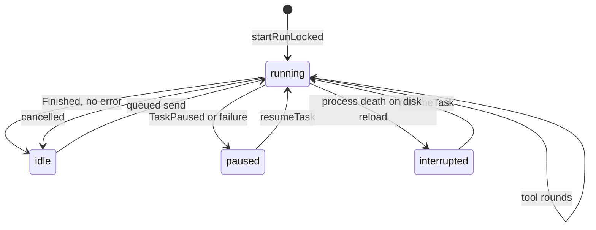

# Run Lifecycle, Recovery, and Verification

> Owns every agent run outside the ViewModel, persists enough state to survive process death, and decides what happens after a run ends.

`RunManager` starts runs on an application-wide coroutine scope, mirrors their live state into `StateFlow`, writes every chat message through `SessionRepository`, and coordinates cancellation, resumption, queued messages, and automatic continuation. `TaskControlStore` persists the run record to private app storage. `CheckpointStore` makes file edits undoable. `VerificationEvidence` derives a receipt of build and test outcomes from the transcript.

## Module Responsibilities

- **`RunManager`**: run registry, live state, event persistence, approvals, cancellation, resume, rewind, keepalive, and follow-up scheduling.
- **`TaskControlStore` and `TaskRecord`**: durable per-chat run state, queue, limits, and recovery settings.
- **`RunFollowUps`**: decides whether a finished run sends a queued message or auto-continues, exactly once.
- **`RunCompletionStore`**: writes the outcome of remote (Telegram) runs keyed by prompt id.
- **`CheckpointStore`**: pre-edit file snapshots, durable versions, and rewind.
- **`KeepaliveTracker`**: reference-counted wake lease shared with background services.
- **`VerificationEvidence`**: classifies shell commands and their exit codes into check statuses.
- **`NotificationActionReceiver`**: routes notification buttons to the same `RunManager` completors as in-app cards.

## Architecture and Flow

`TaskRecord.status` is the durable state. A run starts as `"running"`. A normal completion sets `"idle"` with `completed = true`. Cancellation also sets `"idle"`, because the user ended it deliberately. Any other end sets `"paused"` with a `reason`. When a record is loaded from disk and still says `"running"`, `TaskControlStore.flow` rewrites it to `"interrupted"`, which is the only way that state appears (`TaskControl.kt` lines 70 to 78). `resumable` covers `running`, `paused`, and `interrupted` (lines 63).

## Invocation Chain

1. `ChatViewModel` or `AgentService` calls `RunManager.startRun`, which takes `workspaceGuard` and delegates to `startRunLocked` (`RunManager.kt` lines 355 to 380).
2. `startRunLocked` cancels and joins any previous job for the session, resolves the provider, creates or reuses a turn id, updates the `TaskRecord`, and launches the job with `TaskBudget`, `RecoveryLedger`, and `FallbackRun` in its context (lines 383 to 538).
3. The job awaits `startSignal`, starts the 16 ms delta flusher, the 2.5 s usage writer, and a prompt mirror to `RuntimeNotifier`, then calls `engine.run(...)` (lines 545 to 647).
4. Every engine event reaches `handleEvent`, which updates `LiveRunState` and writes durable rows (lines 774 to 1010).
5. The `finally` block persists the terminal status, plan, and remote outcome, then releases keepalive (lines 656 to 723).
6. `job.invokeOnCompletion` schedules a successor that either sends a queued prompt or resumes (lines 725 to 762).

## Key State and Data Structures

- **`LiveRunState`**: `running`, `cancelled`, `turnId`, streaming text and thinking, `liveMessageId`, `lastCommittedId`, `runningCalls`, `codeDrafts`, `packageProgress`, pending approval, question, and environment requests, `subagentSteps`, `error`, `retryStatus`, `thinkingTiming`, `reasoningTokens`, `turnStartedAt`, `queuedMessage`, `pendingPlan`, `estimate`, `compactionNote` (lines 79 to 112).
- **`TaskRecord`**: status, reason, provider, fallback fields, workspace paths, mode, thinking, output and context limits, `autoCompactTokens`, `maxIterations`, `turnId`, initial prompt and id, `automationRunId`, `completed`, images, queue, pins, `summaryOverride`, `contextAfter`, limits, usage, `autoContinue`, `autoContinueLimit`, `autoContinueAttempts`, `resumePrompt` (`TaskControl.kt` lines 24 to 64).
- **`TaskLimits`**: tokens, cost in dollars, minutes (lines 19 to 22). `TaskBudget` accumulates input plus output tokens, cost, and elapsed time, and throws `TaskPaused` when any positive limit is reached (lines 102 to 126).
- **`QueuedPrompt`**: a UUID and text (lines 16 to 17).
- **`RunFollowUps.End`**: session id, run id, `finishedNotification`, `recoverableInterruption` (`RunFollowUps.kt` lines 7 to 12).
- **`RunCompletion`**: prompt id, session id, turn id, completed, cancelled, error (`RunCompletionStore.kt` lines 8 to 9).

`TaskControlStore.update` writes JSON to a temporary file, calls `fd.sync()`, then renames atomically (lines 79 to 92). `RunCompletionStore.save` uses the same temporary plus rename pattern (lines 21 to 27). Both reject ids outside their filename regex.

## Cancel, Resume, and Auto-Continue

**Cancel.** `stop` records the session in `stoppedSubagentSessions`, cancels subagent follow-ups, stops subagents, stops follow-ups, cancels the successor job, and cancels the main job (lines 1116 to 1123). `stopAndJoin` additionally awaits cleanup so a new run cannot race the old `finally` (lines 1148 to 1157). `stopAllAndJoin` does this for every active run (lines 1131 to 1142). Inside the job, cancellation sets `cancelled = true`, rethrows, and the `finally` block treats `completed || cancelled` as `"idle"`.

**Resume.** `resumeTask` requires no running job, `saved.resumable`, a saved provider, passing `TaskBudget.check()`, and the original workspace path. It calls `startRun` with `resume = true` and `onlyIfIdle = true` (lines 1262 to 1275). Chat-side `resumeTaskNow` handles a Harness free-limit notice by applying a newly chosen provider, resolves the API key, and fails when the key is blank (`ChatViewModel.kt` lines 969 to 999). A resume inserts a user message built from `RunRecovery.resolvePrompt`, which prefers the chat's prompt, then the app setting, then `CONTINUE_PROMPT` (`TaskControl.kt` lines 129 to 135; `RunManager.kt` lines 507 to 509).

**Auto-continue.** `RunFollowUps.next` runs only after the job completes, under the run-start mutex. It refuses if the run id is stale or already handled. A completed run with `finishedNotification` and `"idle"` status sends the first queued prompt. Otherwise continuation needs `recoverableInterruption`, status `"paused"` or `"interrupted"`, `autoContinue` on, and attempts below `autoContinueLimit` coerced to 1 through 5. It increments and persists attempts before returning `Continue` (lines 30 to 46). `RunManager` delays the successor by `RetryPolicy.delayMs(attempts + 1)` for recoverable interruptions (line 734), then starts a new run with `resume = true` and the previous provider. If starting fails, the chat is set to `"paused"` with an explanatory reason and a notification is posted (lines 750 to 755).

**Queued messages.** `inject` persists a `QueuedPrompt` through `TaskControlStore` on a tracked lazy job (lines 1204 to 1216). `steeringInbox` reads the queue only in `SteeringMode.AH_AUTO`, saves each message under `Steering.messageId(promptId)` before removing it from the queue, and returns the messages (lines 1180 to 1194). `dropDeliveredSteering` removes any queue entries whose steering id is already saved, so a crash between save and dequeue cannot double-send (lines 1196 to 1202).

## Verify Before Recovery

Recovery deliberately avoids replaying operations with unknown outcomes:

- `RunRecovery.missingResults` finds assistant tool calls with no `TOOL` result and synthesizes an error row: "Interrupted: outcome unknown. Inspect the current state before taking another action. Do not blindly repeat this operation." (`TaskControl.kt` lines 143 to 150).
- `RecoveryLedger`, placed in the run context, maps tool call signatures to prior calls and results. A successful prior result is returned with "Already completed before interruption; not repeated." An uncertain or missing outcome is returned as a failure telling the model to inspect state. `file_restore` is exempt because it rechecks its own preconditions (lines 164 to 184).
- The continue prompt states that completed tool results are authoritative and asks for inspection before further actions (line 130).

## Verification Cards

`VerificationEvidence.collect` scans transcript messages in order (`VerificationEvidence.kt` lines 19 to 46):

- `checkCommand` matches `gradlew`, `mvn`, `npm`, `pnpm`, `yarn`, `bun`, `pytest`, `python`, `cargo`, `go`, `make`, `npx`.
- `checkTask` matches `test`, `check`, `lint`, `build`, `assemble`, `verify`, `typecheck`, `tsc`, `pytest`.
- A `shell` call is a check only if the simplified command contains no pipes, semicolons, backticks, newlines, command substitution, or `echo`/`printf`, and matches both regexes.
- Exit code is read from `exit code: N`. `isError` or nonzero is `FAILED`, `0` is `PASSED`, no exit line is `UNKNOWN`.
- Any successful call in the `edits` set (`write_file`, `edit_file`, `multi_edit`, `apply_patch`, `move_file`, `delete_file`, `shell_background`, `device_owner_shell`, `task`, `git_checkout`, `git_pull`, `create_dir`) marks all previously `PASSED` checks `STALE`. A non-check shell call that succeeds also invalidates passing checks.

`ChatScreen` groups messages by turn and calls `VerificationEvidence.collect` per turn (lines 1601 to 1603), then renders `VerificationCard` under the turn (lines 2046 to 2047). The card summarizes counts per status, colors the summary red when any check failed, and expands to show each command with its status (`components/VerificationCard.kt` lines 25 to 63). The same evidence list feeds pull request bodies (`github/GitHubPullRequests.kt` lines 127 to 164).

## Completion Notification and Follow-Ups

`notifyFinished` builds a `RunResultNotification` with `ok = error == null`, summary `"Run finished"` or `"Stopped: ..."`, and posts it through `RuntimeNotifier` (lines 1566 to 1576). The `RunFollowUps.End.finishedNotification` flag is true only when the run completed and either notifications are off or the notification was accepted (lines 717 to 719). Supplying `notifyOnFinish = false` for a subagent continuation prevents duplicate notifications.

Remote runs use the same terminal block. If `record.initialPromptId` starts with `telegram-`, the outcome is saved to `RunCompletionStore` keyed by that prompt id, so a later turn in the same chat cannot make the result ambiguous (lines 665 to 668). A failed save sets a live error instead of silently losing the outcome.

Notification actions call the same completors as the UI: `approve` with or without remember, `deny`, environment install or skip, and `answerQuestion` (`NotificationActionReceiver.kt` lines 28 to 41). Approval and question resolution use compare-and-set loops keyed by turn id and call id, with optional fingerprint checks for delayed remote buttons, so a stale tap cannot resolve a newer prompt (`RunManager.kt` lines 1031 to 1059). Free-text answers come from `RemoteInput`; predefined options arrive in `EXTRA_ANSWER_TEXT`.

## Keepalive and Checkpoints

`KeepaliveTracker` separates active tasks from passive background holders. The active flag turns on when the first active task acquires and off when the last releases; the underlying lease is acquired on the first holder and released when both counters reach zero (`KeepaliveTracker.kt` lines 4 to 30). `RunManager` acquires on every run start (line 525) and releases in the `finally` block (line 721). `RuntimeNotifier` is set to idle when the last active task ends.

`CheckpointStore.snapshot` records at most one checkpoint per turn and path, keeping the earliest pre-turn content (`CheckpointStore.kt` lines 20 to 49). `rewind` first backs up current files, then restores in an order that handles directories first, then files by descending depth. Files that did not exist before are deleted, but a non-empty directory is refused to avoid deleting untracked work. Successful checkpoints are deleted; failures are counted and reported (lines 69 to 111). `RunManager.rewindFromTurn` replays affected turns newest first, stops on the first failed restore, truncates the chat at the first non-user message of the turn, deletes that turn's diff rows, and refreshes per-file change rows (lines 1314 to 1364).

## Boundary Conditions

- `workspaceBusy` scans running sessions and active subagents for overlapping workspace paths; `withIdleWorkspace`, `withIdleStorage`, and `withIdleProject` take the same mutex (lines 126 to 162).
- `assignWorkspace` and `assignWorkspaces` refuse while running, resumable, or holding saved file changes (lines 149 to 180).
- `isRunning` checks job activity; `hasPendingFollowUp` also counts active subagents and a live follow-up job (lines 321 to 328).
- `sessions.setPendingPlan` persists a Plan-mode plan so the approval card survives process death; `seedPendingPlan` restores it only when no live plan exists (lines 1160 to 1172).
- `rewindAndTruncate` refuses non-user messages, refuses when other tasks share the workspace, and keeps history if any restore failed (lines 1286 to 1304).
- A run start with `onlyIfIdle` throws `RunBusyException` instead of queueing (line 411).

## Extension Points

- `RunManager.controls` (`TaskControlStore`) is a `StateFlow` per session that the UI and `ChatViewModel` read and update directly.
- `RunFollowUps` is internal but is the single place to change post-run policy; queued sends and auto-continue both flow through it.
- `KeepaliveTracker` accepts any acquire, release, and active-change callbacks.
- `VerificationEvidence` is a pure function over `List<ChatMessage>`, also used by the GitHub pull request body and tool.

Sources: [app/src/main/java/com/androidharness/app/agent/RunManager.kt](../app/src/main/java/com/androidharness/app/agent/RunManager.kt)#L538-L770)

## Source files

- `app/src/main/java/com/androidharness/app/agent/RunManager.kt`
- `app/src/main/java/com/androidharness/app/agent/RunCompletionStore.kt`
- `app/src/main/java/com/androidharness/app/agent/RunFollowUps.kt`
- `app/src/main/java/com/androidharness/app/agent/TaskControl.kt`
- `app/src/main/java/com/androidharness/app/agent/KeepaliveTracker.kt`
- `app/src/main/java/com/androidharness/app/agent/VerificationEvidence.kt`
- `app/src/main/java/com/androidharness/app/data/CheckpointStore.kt`
- `app/src/main/java/com/androidharness/app/agent/NotificationActionReceiver.kt`
- `app/src/main/java/com/androidharness/app/ui/chat/components/VerificationCard.kt`
