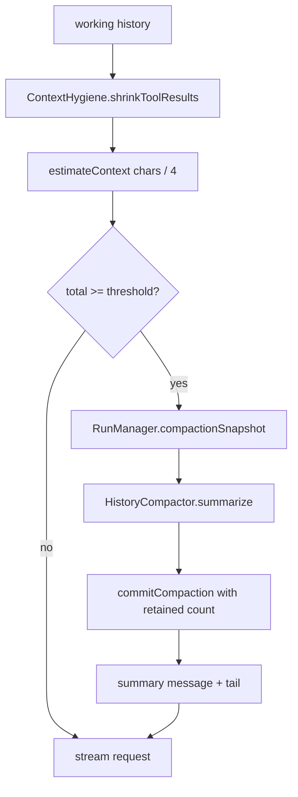

# Context Management and Compaction

> Keeps the model-facing history inside the context window by pruning stale tool output, estimating token cost, and summarizing older turns at configurable thresholds.

Three layers cooperate. `ContextHygiene` trims what is sent but never what is stored. `HistoryCompactor` produces a bounded summary using a second model request. `AutoCompaction` and `ChatContextPolicy` decide when that summary is needed. The chat UI surfaces the result through `ContextUsageDialog` and `ChatThinkingMetrics`.

## Module Responsibilities

- **`ContextHygiene`**: model-facing slice selection, stale tool truncation, image budget, image stripping, and summary message construction.
- **`HistoryCompactor`**: chunked, multi-round summarization with strict validation of the model output.
- **`AutoCompaction`**: parses the configured threshold and resolves the fallback 80% policy.
- **`ChatContextPolicy`**: chat-specific context ceiling and output reserve.
- **`ContextUsageDialog`**: context meter, prompt breakdown, session token totals, cache hit rate, and cost estimate.
- **`ChatThinkingMetrics`**: reasoning token and duration label above a turn.

## Architecture and Flow

Every iteration calls `shrinkToolResults` before building the request (`AgentEngine.kt` lines 431 to 433). `estimateContext` then runs on the pruned list (lines 484 to 485). The threshold comes from `ChatContextPolicy.compactAt` for chat or `AutoCompaction.threshold` for Code (lines 486 to 487). When crossed, `compact` summarizes and replaces the head of the working list. The stored transcript is untouched except for the compaction boundary and the user-visible notice.

## Token Estimation

`ContextEstimate` has four buckets (`AgentEngine.kt` lines 130 to 138):

- `messagesTokens`: sum of message text plus tool-call argument characters, divided by 4.
- `systemTokens`: system prompt length divided by 4.
- `toolsTokens`: tool description plus schema JSON characters, divided by 4.
- `metaTokens`: fixed 256.

`estimateContext` performs exactly that math (lines 1985 to 2001). It is a character heuristic, not a tokenizer. `estimateFor` reconstructs the same calculation outside the run loop for the `/compact` path: it rebuilds the tool set, environment block, and system prompt for the current mode, then calls `estimateContext` (lines 2008 to 2051).

`ChatUiState.contextUsed` prefers the latest `estimate.total` over `usage.lastInput`, because the estimate reflects compaction immediately while `lastInput` describes the previous request (`ChatViewModel.kt` lines 260 to 262). `RunManager` stores the emitted estimate in `LiveRunState.estimate` on every `EstimatedContext` event (`RunManager.kt` line 974), and re-emits a fresh estimate immediately after compaction so the panel updates without waiting for the next request (`AgentEngine.kt` lines 495 to 501).

## Thresholds

`ChatContextPolicy` (`ChatContextPolicy.kt` lines 4 to 17):

- `LIMIT = 250_000` is the hard chat ceiling, independent of the Code context setting.
- `limit(configured, modelLimit, local)` returns the minimum of 250,000, the configured value (only honored for local models, otherwise `LIMIT`), and the model catalog context length when positive.
- `compactAt(limit, output)` reserves `max(limit / 20, output)`, capped at half the limit, and returns `limit - reserve`.

`AutoCompaction` (`AutoCompaction.kt` lines 6 to 27):

- `parse("auto")` returns 0, meaning inherit the percentage policy.
- `parse` accepts a number with optional `k`, `m`, `thousand`, or `million` suffix, converts with `BigDecimal`, rejects values below 1,024, and rejects overflow.
- `threshold(configured, contextLimit, outputTokens)` returns 80% of the context limit when `configured <= 0`, otherwise the smaller of the configured value and `ChatContextPolicy.compactAt`.

Chat gets one extra rule: when the remaining history still exceeds the threshold after compaction, the turn stops with "The latest message is too large for the available context" (`AgentEngine.kt` lines 502 to 505).

## Context Hygiene

`ContextHygiene` keeps the stored transcript intact and only rewrites the working copy (`ContextHygiene.kt` lines 6 to 128):

- `RECENT_FULL_TOOLS = 6`: the newest six tool results stay verbatim.
- `STALE_TOOL_CHARS = 4_000`: older tool results larger than this keep `maxChars / 2` characters at the head and tail, with a marker that names `read_tool_output` and the tool call id. The marker length is subtracted before splitting.
- `MAX_CONTEXT_IMAGES = 2`: images are counted newest to oldest. Every image in the latest tool batch is retained regardless of the budget; older images beyond the quota are removed with an explanatory note so the model knows an attachment existed without receiving bytes.
- `stripImages`: removes all base64 payloads and appends a text placeholder naming the attachment, used for text-only models and for the vision-rejection retry.
- `forModel`: finds the last system message starting with `AgentEngine.COMPACTION_PREFIX`, slices from there, applies `shrinkToolResults`, then applies `Steering.forModel` to wrap mid-run user messages consistently.
- `summaryMessage` produces `SYSTEM` text with the compaction prefix. `compactionNotice` produces the user-visible `[Context compacted: ...]` marker.

`RunRecovery.context` uses `forModel` plus the persisted `contextAfter` timestamp and `summaryOverride` to rebuild the exact model-facing history on resume (`TaskControl.kt` lines 151 to 160).

## Snapshot and Commit Compaction

Compaction is two phase so a concurrent edit cannot be summarized and then silently applied to different history.

`SessionRepository.compactionSnapshot` captures, inside a transaction: all message ids, the last message timestamp, the current summary, the current `compactionBefore` boundary, and the full model-facing history (`SessionRepository.kt` lines 181 to 187).

`commitCompaction` requires a non-blank summary and then checks that the session summary, boundary, and message id list are all unchanged. If any differs it fails with "The chat changed while summarizing. History was kept. Retry /compact." (`SessionRepository.kt` lines 190 to 202). It computes the new boundary from the first retained message's `createdAt`, or `min(lastMessageAt + 1, now)` when nothing is retained, then calls `setCompaction` and inserts the compaction notice. Original messages are never deleted; the boundary is what hides them from the model-facing slice.

`RunManager` takes the snapshot on the first `Compacting` event and commits on `Compacted`, passing `retainedMessageCount` (`RunManager.kt` lines 975 to 987). A `ProviderChanged` system notice created during compaction is appended to the snapshot id list so a known, non-conversational notice does not invalidate the snapshot (lines 957 to 962). An `Error` during compaction removes the snapshot and persists the error as a system row (lines 989 to 993).

## In-Run Compaction

`AgentEngine.compact` (`AgentEngine.kt` lines 1924 to 1964):

1. Start with `keepCount = min(8, size)`.
2. `retainedBudget` is half the context limit for chat, half the compact threshold for Code.
3. Reduce `keepCount` while the estimated tail still exceeds that budget, never below one message.
4. Expand `keepCount` while the boundary message is a `TOOL` row, so a tool call and its result are not split.
5. If nothing is older, emit a size error and return null.
6. Emit `Compacting("Summarizing earlier messages...")`, call `HistoryCompactor.summarize`, then emit `Compacted(summary, keepCount)`.
7. Return `ContextHygiene.summaryMessage(summary)` followed by the retained tail.

Errors are wrapped: chat says the message is too large, Code says the chat is too large and suggests `/compact`, and both keep the existing history.

`HistoryCompactor` (`HistoryCompactor.kt` lines 12 to 121):

- `MAX_INPUT_CHARS = 24_000`.
- Output budget is `min(1500, maxContextTokens / 8)`.
- Input limit is `min(24_000, (maxContextTokens - output - 1_024) / 3)`, requiring at least 1,024 tokens.
- Each chunk is summarized with `ThinkingLevel.OFF` and the session cache key. Tool-call output is rejected as a failure. A summary over 12,000 characters fails.
- `Done` is required, and the finish reason must not be `length`, `max_tokens`, `content_filter`, `tool_calls`, or `tool_use`.
- Multiple chunks are merged in rounds of at most 8. Each round must reduce either the chunk count or total characters, otherwise compaction fails rather than looping.
- `transcriptChunks` skips prior compaction notices and error rows, tags each message with its role and tool name, emits tool call arguments, and replaces image bytes with a marker. The chunker avoids splitting surrogate pairs.

## Chat-Specific Policy

Chat uses `ChatContextPolicy` for both the limit and the trigger (`AgentEngine.kt` lines 330 to 331 and 486). Chat compaction is allowed even when the working list has a single message, because a single oversized user message still needs summarizing; Code requires more than one message (line 489). Chat compaction output is generated with `isChat = true`, which changes the retained budget to the full context limit rather than the compact threshold.

The chat system prompt also differs. `chatSystemPrompt` adds research depth, image frequency, optional agent policy, user instructions inside the personalization switch, the web search backend note, and the saved memory block (`AgentEngine.kt` lines 2152 to 2189).

## Context Meter Data

`ContextUsageDialog` (`ContextPanel.kt` lines 35 to 202) renders:

- Used vs maximum tokens and a percentage, with a progress bar. The maximum is `ChatContextPolicy.limit` for chat or `state.maxContextTokens` for Code.
- Breakdown percentages for messages, tools and skills, system prompt, and meta context, using `estimate` and its total.
- Session tokens: fresh input (`totalInput - totalCached - totalCacheWrite`), cached hits, cache writes when nonzero, output, and request count.
- Overall cache hit rate from `usage.avgCacheHitRate`, with a note that it updates after each completed turn.
- Estimated cost. With ChatGPT plan providers it shows "ChatGPT plan" and hides a dollar figure. Otherwise it sums `ModelPrices.estimateSplit` across `sessionModelUsage`, falling back to `ModelPrices.estimate` for the active model.

## `/compact` and `/autocompact`

`SlashCommands.resolve` maps `/compact` to `Kind.COMPACT` and `/autocompact`, `/auto-compact`, `/auto_compact`, or `/compact <value>` to `Kind.AUTO_COMPACT` with an argument (`SlashCommands.kt` lines 154 to 159).

`/compact` refuses while busy, then launches `forceCompact` on `viewModelScope` (`ChatViewModel.kt` lines 844 to 850). `forceCompact` (lines 2129 to 2199):

1. Requires a ready model selection.
2. Acquires keepalive.
3. Resolves the API key and refuses a blank key.
4. Takes `sessions.compactionSnapshot` and requires at least four messages.
5. Wraps the call in `FallbackRun` so the summary can follow the chat's fallback policy.
6. Calls `HistoryCompactor.summarize` with progress and stream events mapped to usage, provider changes, and retry notes.
7. Calls `commitCompaction` with the snapshot, then stores `summaryOverride` and `contextAfter` on the task record.
8. Recomputes the panel estimate with `engine.estimateFor`.

A cancellation before commit writes "Compaction stopped. History was kept." A failure writes either a success-with-refresh-warning or "Compaction failed ... History was kept." as a system message.

`/autocompact` with no argument only reports the effective threshold, formatted with digit grouping (lines 852 to 857). `default` or `reset` clears the per-chat override by storing null. Any other value must parse, otherwise the UI reports an invalid value. The parsed or null value is written to `TaskRecord.autoCompactTokens`, and the confirmation reports the resulting threshold from the per-chat value or the app setting (lines 858 to 884). `RunManager` passes `autoCompactTokens` as a live lambda that prefers `controls.flow(sid).value.autoCompactTokens` over the app setting (`RunManager.kt` lines 607 to 608), so the next iteration picks up a change without restarting the run.

## Thinking Metrics

`ChatThinkingMetrics` renders a single compact label (`components/ChatThinkingMetrics.kt` lines 20 to 49). It recomposes only the label every 200 ms while reasoning or a turn clock is active. `chatThinkingTotals` in `core/ChatThinkingMetrics.kt` sums parent assistant messages plus the current streaming reasoning. For each message it keeps the larger of the streamed estimate and the provider-reported `reasoningTokens` (lines 10 to 38). A `tokenFloor` prevents the visible total from dropping when an estimate is replaced by a reported count or when a live message is committed. When `turnStartedAt` exists, elapsed time is one wall clock covering thinking plus tools; otherwise summed `thinkingMs` spans are used. `compactThinkingTokenCount` formats one decimal with unit promotion (lines 41 to 51).

## Boundary Conditions

- Compaction is skipped for local models when agent context is disabled (line 489).
- Compaction failure keeps history and ends the current run with an error rather than sending an oversized request.
- A summary that arrives after any message, summary, or boundary change is refused at commit time.
- The retained tail may include fewer than `keepCount` messages if ids are missing; the boundary then uses `lastMessageAt + 1` capped at the current time.
- `/compact` requires at least four messages and a selected model.
- `/autocompact` values below 1,024 tokens or unparsable strings are rejected.

## Extension Points

- `TaskRecord.autoCompactTokens`: null follows the app setting, zero explicitly selects the 80% policy, a positive value is a token threshold.
- `HistoryCompactor.summarize` accepts `progress` and `event` callbacks, so any caller can surface chunk progress and usage.
- `ContextHygiene.shrinkToolResults` accepts `recentFull`, `maxChars`, and `maxImages` overrides for tests or future policies.
- `AgentEngine.estimateFor` is public and used by the `/compact` path to recompute the panel estimate.

Sources: [app/src/main/java/com/androidharness/app/agent/ContextHygiene.kt](../app/src/main/java/com/androidharness/app/agent/ContextHygiene.kt)#L11-L128)

## Source files

- `app/src/main/java/com/androidharness/app/agent/ContextHygiene.kt`
- `app/src/main/java/com/androidharness/app/agent/HistoryCompactor.kt`
- `app/src/main/java/com/androidharness/app/agent/AutoCompaction.kt`
- `app/src/main/java/com/androidharness/app/agent/ChatContextPolicy.kt`
- `app/src/main/java/com/androidharness/app/ui/chat/ContextPanel.kt`
- `app/src/main/java/com/androidharness/app/ui/chat/components/ChatThinkingMetrics.kt`
- `app/src/main/java/com/androidharness/app/core/ChatThinkingMetrics.kt`
- `app/src/main/java/com/androidharness/app/data/SessionRepository.kt`
