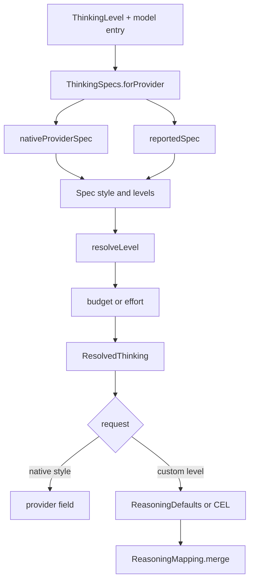

# Reasoning and Thinking Levels

> Resolves one stored reasoning intent into a provider-native control, a request field, and a display label for every model.

`ThinkingLevel` is the persisted intent shared across models. `ThinkingSpecs` maps it to whatever a specific provider and model actually accept: a native effort string, a token budget, an on/off toggle, an adaptive mode, or no control at all. `CustomReasoning` adds per-connection custom vocabularies and an optional CEL expression that rewrites the request body. `ModelReasoning` reports where the capability knowledge came from.

## Module Responsibilities

- **`ThinkingLevel`**: the eight-level intent ladder and default token budgets.
- **`ThinkingSpecs`**: provider and model capability detection, level clamping, style selection, and request resolution.
- **`CustomReasoning`**: keying, normalization, default level lists, synonyms, and custom resolution.
- **`ReasoningDefaults`**: inherited CEL expressions per provider and style.
- **`ReasoningMapping`**: bounded CEL evaluation, validation, and JSON merge.
- **`ModelReasoning`**: provenance of a model's reasoning capability.
- **`CustomReasoningSheet`**: level list editing, detection, mapping editing, and request preview.

## Architecture and Flow

`forProvider` first computes the protocol and model-family default, then overlays any provider-reported reasoning metadata, then widens `reasoningSupported` (`ThinkingSpecs.kt` lines 104 to 109). The resulting `Spec` drives both the picker and every transport, so the UI cannot offer a level the request cannot express.

## The Level Ladder

`ThinkingLevel` (`ThinkingLevel.kt` lines 7 to 35) declares `OFF`, `MINIMAL`, `LOW`, `MEDIUM`, `HIGH`, `XHIGH`, `MAX`, `ULTRA`. `rank` is the enum ordinal, which is the basis for nearest-weaker clamping. `budgetTokens` returns 0, 512, 1,024, 4,096, 16,384, 24,576, 32,768, and 32,768. `ULTRA` remains readable so older saved settings still deserialize.

## Detection Order

`ThinkingSpecs.nativeProviderSpec` decides the base behavior in this order (lines 130 to 172):

1. `kilo-auto/` model ids become `AUTOMATIC`.
2. A model entry or ModelsDev entry with `reasoning == false` becomes `NONE`.
3. ChatGPT protocol providers use `ChatGptThinking.levels`, with `EFFORT` or `AUTOMATIC` plus `outputLimitManaged`.
4. `local://` base URLs and `LocalModelCatalog.isLocal` become `TOGGLE` with `OFF` and `HIGH`.
5. By provider type:
   - `ANTHROPIC`: Claude 3 and older become `NONE`; Claude 4.6 and later, Claude 5, Mythos, and Fable become `ADAPTIVE`; specific Claude 4 and 3.7 models, or catalog `budgetTokens`, become `BUDGET`; otherwise `AUTOMATIC`.
   - `GEMINI`: `gemini-2.5` becomes `BUDGET` with family-specific floors and ceilings; `gemini-3` and `gemini-4` become `EFFORT` with image/flash variants; unknown becomes `AUTOMATIC` or `NONE`.
   - `OPENAI_RESPONSES`: `ADAPTIVE` is downgraded to `EFFORT`; `BUDGET` and `TOGGLE` are downgraded to `AUTOMATIC`.
   - `OPENAI_COMPAT`: local hosts become `AUTOMATIC`; router hosts keep the family spec; DeepSeek models on non-DeepSeek gateways with no catalog effort values become `AUTOMATIC`; an effort spec whose catalog says the model is toggle-only loses `OFF`; budget, adaptive, and toggle specs without a native toggle field become `AUTOMATIC`.

`reportedSpec` then applies catalog `reasoningEfforts` (lines 111 to 128). It is skipped when `reasoning == false` or the model is local. An empty reported list yields `AUTOMATIC` with an empty `reportedLevels`. Otherwise each reported name is mapped through `CustomReasoning.native`, duplicates are removed, and the style becomes `ADAPTIVE` for Anthropic or `EFFORT` otherwise. `OFF` is added only when the native spec offered it and either a toggle field exists or the style is adaptive. The catalog default effort is used when it maps to an available level.

`forModel` adds family rules for endpoints without a catalog (lines 248 to 292): Kimi K3 and K2.7, GLM 5.3, DeepSeek toggles, `deepseek-v4` and `deepseek-flash`, OpenAI reasoning families, `o1`/`o3`/`o4`, `gpt-oss`, `grok-3-mini`, `muse-spark`, and delegates to the Anthropic and Gemini rules. Unknown models end at `AUTOMATIC`, which never renders a level dial.

## Clamping and Resolution

`resolveLevel` keeps the user's cross-model intent (lines 81 to 89):

- `NONE` and `AUTOMATIC` always resolve to `OFF`.
- A level already present in the spec is kept.
- `MAX` and `ULTRA` become the highest enabled level.
- `OFF` becomes the spec default if enabled, else the first enabled level.
- Any other unavailable level becomes the nearest weaker enabled level, else the first.

`resolve` also computes output limits (lines 174 to 187). The output is clamped by `spec.outputMax`. For `BUDGET`, a positive budget raises the output to at least `budget + ANSWER_RESERVE` (4,096), again capped by `outputMax`. Effort and adaptive styles produce a wire string; budget style produces a clamped integer through `budgetFor` (lines 189 to 195). `ResolvedThinking` carries the requested level separately from the effective level, so the UI can say "Requested X, using Y" (lines 57 to 62).

## Custom Level Lists

`CustomReasoningConfig` is a list of level names plus an optional mapping (`CustomReasoning.kt` lines 8 to 9). `CustomReasoning.key` hashes the routed provider id, type, base URL without trailing slash, and model with SHA-256, so a custom vocabulary applies to one connection and model and never to an unrelated fallback (lines 14 to 19). `ReasoningDefaults.isLocal` and `ThinkingSpecs.routedConfig` mean a Harness pool route is keyed by the real upstream transport.

`wire` lowercases, collapses whitespace, underscores, and hyphens, and maps synonyms: `off`, `none`, `disabled` become `disabled`; `x high`, `x highest`, `extra high`, and similar become `xhigh` (lines 21 to 22). `label` produces `Disabled`, `X-High`, or a title-cased name. `native` maps `disabled` to `OFF`, `on` or `enabled` to `HIGH`, and otherwise matches an enum name.

`normalized` enforces one to sixteen levels, each 1 to 32 characters with no control characters, unique after `wire`, and trims the mapping (lines 36 to 45). `defaultLevels` uses `reportedLevels` when present, otherwise the spec levels, with `TOGGLE` non-off choices shown as `On`, and an empty result becomes `["On"]` (lines 47 to 49).

`resolve` then picks the selected custom level, then a level matching the requested native level, then the model's default effort, then a non-disabled level for `OFF`, then a non-disabled level for `MAX` or `ULTRA`, then a level matching the clamped base level, then the last level (lines 51 to 64). For local models it returns the base spec with `HIGH` unless the choice is `disabled`, and keeps `customConfig` and `customLevel`, but no mapping (lines 66 to 68).

## Mapping Expressions

`ReasoningDefaults.inherited` produces a CEL expression when the user has not supplied one (lines 16 to 60). The variable is `reasoningLevel`, a lowercased wire string.

- Routers (`openrouter.ai`, `api.kilo.ai`, `ai-gateway.kilo.ai`): budget style sets `reasoning.max_tokens`; toggle style sets `reasoning.enabled`; other styles set `reasoning.effort`, with `enabled` for `on` and `enabled`.
- `OPENAI_COMPAT`: a native toggle field wraps `{"type": "enabled"}` or `{"type": "disabled"}`, with provider extras `clear_thinking: false` for Z.ai and `keep: "all"` for Kimi K2.6. Without a toggle, effort becomes `reasoning_effort`.
- `OPENAI_RESPONSES`: effort plus `reasoning.summary: "auto"` and `include: ["reasoning.encrypted_content"]`.
- `ANTHROPIC`: `thinking.type` is `adaptive` for Claude, `enabled` for DeepSeek routes, with `display: "summarized"` for Claude; effort goes into `output_config.effort`, and budget style uses `budget_tokens`.
- `GEMINI`: `thinkingConfig.thinkingBudget` plus `includeThoughts`, or `thinkingLevel` plus `includeThoughts`.

`budgetExpression` builds a JSON object of every level name to its clamped budget and indexes it with `[reasoningLevel]`, so a budget expression is a lookup rather than a chain of conditionals (lines 74 to 78). `budgetFor` clamps enum budgets to the spec minimum and maximum (lines 63 to 72).

`ReasoningMapping` evaluates real CEL with hard limits: 8,192 code points, parse recursion 64, 2,048 expression nodes, 1,000 comprehension iterations, and regex program size 1,000 (lines 14 to 26). Compiled programs are cached in a 16-entry LRU. `evaluate` requires a JSON object result no larger than 32,768 characters and wraps any error in "Reasoning mapping: ...". `merge` recursively merges the patch into the request body, where an explicit JSON null removes a field (lines 52 to 63). `toJson` converts CEL values with a depth limit of 32 and rejects non-finite numbers (lines 65 to 80). `validate` normalizes, refuses a mapping for local models, requires an effective expression, and evaluates every custom level (lines 39 to 50).

`RequestOptions.applyReasoningMapping` binds this to a request: it resolves thinking, validates the custom config, requires a mapping, and merges the evaluated result into the body (`Llm.kt` lines 108 to 115).

## Local Model Thinking

Local models are deliberately narrow. `ThinkingSpecs` gives them `TOGGLE` with `OFF` and `HIGH` (lines 142 to 143). `CustomReasoning.resolve` forces the effective level to `HIGH` or `OFF` and never sets `requestMapping`. `ReasoningDefaults.inherited` returns null for local configs (line 18). `ReasoningMapping.validate` rejects any mapping with "Local models use native thinking controls; CEL request mapping is unavailable." The composer disables the mapping field when `ReasoningDefaults.isLocal(config)` is true (`CustomReasoningSheet.kt` lines 233 to 236).

## Display and Provenance

`ResolvedThinking.label` returns the custom level label or the style label: `On` or `Thinking` for automatic, `Off` for none, `On` or `Off` for toggle, and the level label otherwise (lines 37 to 42). `active` is false only for a disabled custom level or an off level in a non-automatic style (line 45). `detail` explains the control: native on/off, inherited model or provider mapping, custom CEL mapping, or a reasoning mapping that is still required (lines 46 to 63). For effort and budget styles it lists the selected level, a mismatch note, the thinking token ceiling, and the output ceiling.

`ModelReasoning.of` classifies capability provenance in a fixed order (`ModelReasoning.kt` lines 8 to 17): a custom model explicitly marked as reasoning is `CUSTOM`; a Gemini catalog that has no reported flag is `INFERRED` from the family name or `UNKNOWN`; `reasoning == true` is `REPORTED`; `reasoning == false` is `UNSUPPORTED`; a family-name match is `INFERRED`; otherwise `UNKNOWN`. `reasoningCapable` matches OpenAI o-series and GPT-5, DeepSeek R1 and v4 or later, Claude, Gemini 2.x and 3.x, Qwen3, GLM 4 and 5, MiniMax M2, Nemotron, and Kimi families (`ModelCatalog.kt` lines 44 to 53).

`ModelReasoningIcon` shows a brain icon for `REPORTED`, `CUSTOM`, and `INFERRED` only. The tint is muted for inferred knowledge and accent-colored for reported or custom, and the tooltip and dialog text name the source (`ModelReasoningIcon.kt` lines 19 to 41).

The provider also reports the configured label through `StreamEvent.ThinkingConfigured(label)` (`Llm.kt` lines 122 to 123). `AgentEngine` stores it as `reasoningSetting` and writes it into `GenerationMetadata` on the committed assistant message (`AgentEngine.kt` lines 563 and 748 to 754), so the transcript records which reasoning setting produced the answer.

## Custom Reasoning Sheet

`CustomReasoningSheet` (`CustomReasoningSheet.kt` lines 51 to 296) seeds the list from the saved config or `CustomReasoning.defaultLevels(spec)`. Users can rename, reorder, remove, and add levels up to sixteen, with 32 characters per name. Optional auto-detection calls `onDetectLevels`, normalizes the result, and preserves the selected index where possible. The advanced section shows the inherited mapping when no custom mapping exists, lets the user copy it for editing, and previews the resulting request JSON for the selected level with a 300 ms debounce. Save runs `ReasoningMapping.validate` on the draft and only calls `onSave` if it succeeds; "Use defaults" saves null. When validation fails on a mapping or CEL error, the advanced section opens automatically.

## Boundary Conditions

- Unknown models resolve to `AUTOMATIC` and never show a level dial.
- A saved level that the current model cannot express clamps down; `MAX` and `ULTRA` clamp to the highest native level.
- A budget style raises the output allowance by 4,096 tokens over the budget, capped by the model output maximum.
- CEL expressions over 8,192 characters, results over 32,768 characters, results that are not JSON objects, and results nested deeper than 32 are rejected.
- Custom vocabularies are capped at sixteen levels, each 1 to 32 characters, case-insensitively unique.
- Local models cannot use a CEL mapping.

## Extension Points

- **Catalog `reasoningEfforts` and `defaultReasoningEffort`**: the primary way to teach the app a new vocabulary without code changes (`ModelCatalog.kt` lines 34 to 35).
- **`CustomReasoningConfig.mapping`**: per-connection CEL override, inherited when blank.
- **`ReasoningDefaults.inherited`**: the single place to add a new provider-level default expression.
- **`CustomReasoningSheet.onDetectLevels`**: a suspend callback supplied by the caller to query a provider for its levels.
- **`RequestOptions.customReasoning` and `customThinkingLevels`**: maps keyed by `CustomReasoning.key`, carried across transport-only redirects by `forTransportRoute` (`Llm.kt` lines 95 to 106).

Sources: [app/src/main/java/com/androidharness/app/agent/ThinkingSpecs.kt](../app/src/main/java/com/androidharness/app/agent/ThinkingSpecs.kt)#L104-L187)

## Source files

- `app/src/main/java/com/androidharness/app/agent/ThinkingLevel.kt`
- `app/src/main/java/com/androidharness/app/agent/ThinkingSpecs.kt`
- `app/src/main/java/com/androidharness/app/agent/CustomReasoning.kt`
- `app/src/main/java/com/androidharness/app/llm/ModelReasoning.kt`
- `app/src/main/java/com/androidharness/app/llm/ReasoningDefaults.kt`
- `app/src/main/java/com/androidharness/app/llm/ReasoningMapping.kt`
- `app/src/main/java/com/androidharness/app/ui/chat/components/CustomReasoningSheet.kt`
- `app/src/main/java/com/androidharness/app/ui/common/ModelReasoningIcon.kt`
