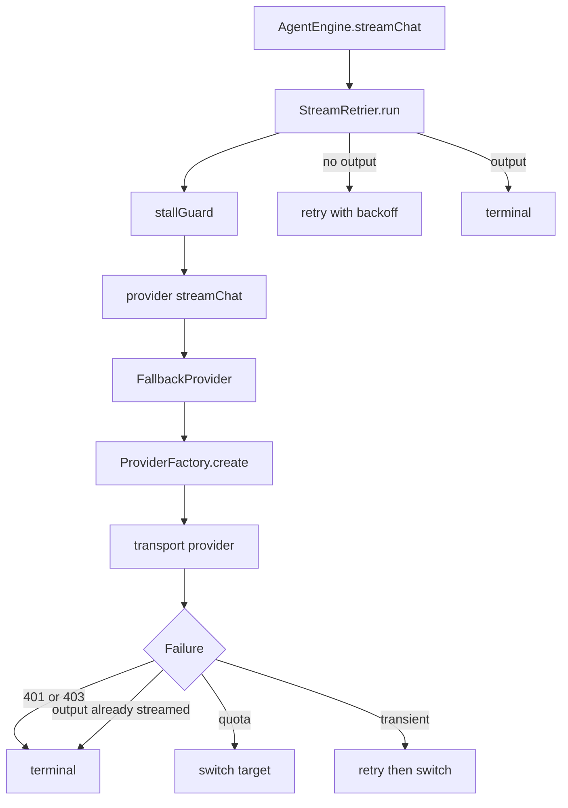

# Streaming Retries and Fallback

> Makes streamed model requests survive transient failures and route to another configured model when the current one cannot continue.

Every streamed request in the app passes through `StreamRetrier`, which owns stall detection and transient retry with backoff. Above it, `FallbackProvider` owns cross-model routing when a `FallbackRun` consent object is present. The two layers do not both retry the same request: when managed fallback is active, `StreamRetrier` disables its own retries and lets the fallback loop classify the failure.

## Module Responsibilities

- **`StreamRetrier`**: the shared retry wrapper for main turns, subagent turns, side questions, and compaction.
- **`RetryPolicy`**: retry classification and exponential backoff.
- **`FallbackPolicy` and `FallbackMode`**: persisted target list, retry count, and per-chat mode.
- **`FallbackProvider`**: ordered target traversal, quota versus transient handling, and provider-switch events.
- **`PromptCachePolicy`**: which endpoints accept explicit cache routing keys.
- **Providers**: emit in-band `StreamEvent.Failure` values with codes and error codes.

## Architecture and Flow

## Invocation Chain

1. `AgentEngine` calls `StreamRetrier.run` with `streamFor`, `onAttemptStart`, `hasOutput`, and a `handleEvent` sink (`AgentEngine.kt` lines 628 to 656).
2. `streamFor` calls `providerFactory(config).streamChat(...)`. `HarnessApp.routedProvider` wraps `FallbackProvider` around `ProviderFactory::create` (`HarnessApp.kt` lines 277 to 298, 301).
3. `FallbackProvider` reads the `FallbackRun` from the coroutine context. Without it, the request passes straight through (lines 48 to 52).
4. A transport provider such as `OpenAiCompatProvider` opens the SSE stream through `ProviderFactory.sseJson` (`Llm.kt` lines 236 to 284).
5. A non-2xx response becomes `ApiException` with the status and a parsed `Retry-After` (`Llm.kt` lines 164 to 171, 252 to 256). In-band error payloads become `StreamEvent.Failure`.
6. `StreamRetrier` decides retry or terminal, then returns the failure string or null.

## Retry Classes

`RetryPolicy` (`RetryPolicy.kt` lines 11 to 49):

- `MAX_RETRIES = 3`, base delay 1,000 ms.
- `isRetryableCode` accepts 408, 429, and 500 through 599.
- `isRetryable` checks an explicit in-stream code first, then walks the cause chain. `ApiException` is tested before `IOException` because it subclasses it, so an HTTP 400 is not retried. Any plain `IOException` is retried. Otherwise a message regex matches overloaded, rate limit, timeout, temporarily, try again, connection reset or refused, ECONNRESET, socket closed, and "JSON error injected into SSE stream".
- `delayMs(attempt)` uses `1000 shl (attempt - 1)` capped at 16 seconds, plus or minus 30 percent jitter.

`StreamRetrier.run` retries only when all of these hold (lines 101 to 108): retries allowed, the in-band failure did not set `retryable = false`, a failure exists, `attempt < MAX_RETRIES`, the attempt produced no output, and `RetryPolicy.isRetryable` agrees. On retry it increments the attempt, computes the delay, emits `AgentEvent.Retrying`, and sleeps. On terminal failure it calls `onTerminalFailure` with whether the failure was retryable in principle, which the engine turns into `AgentEvent.Error(recoverable)`.

`stallGuard` is a flow `timeout` (lines 20 to 21). A `TimeoutCancellationException` is caught before the general `CancellationException` branch and converted into a failure message, either the 90-second constant or a message naming the actual window (lines 87 to 93). Real cancellation still propagates.

## Partial Response Rules

A retry must never duplicate text the UI already showed, so each call site defines `hasOutput`:

- Main turn: `responseStarted` or non-empty text, thinking, or calls (`AgentEngine.kt` line 649). `responseStarted` is set by `StreamEvent.hasResponseOutput`.
- Side question and live mode: same three buffers (`AgentEngine.kt` line 952).
- Subagent: text or calls only, because subagent reasoning is not streamed to the UI, so thinking does not block a retry (line 1795).
- Compaction: text only (`HistoryCompactor.kt` line 51).

`StreamEvent.hasResponseOutput` treats every non-empty text or thinking delta, any tool call event, `Usage`, `Done`, and a `Batch` containing any of those as output (`FallbackProvider.kt` lines 187 to 194). Once output exists, both layers make the failure terminal.

Per attempt, `onAttemptStart` clears buffers, resetting text, thinking, calls, usage counts, response state, reasoning setting, timing, and finish reason (`AgentEngine.kt` lines 633 to 648). The assistant message is only committed after a complete attempt, so a failed attempt leaves no partial row.

## Quota versus Rate Limit

`fallbackFailureKind` classifies a failure into `QUOTA`, `TRANSIENT`, or `TERMINAL` (`FallbackProvider.kt` lines 19 to 33):

- 401 or 403 is `TERMINAL`.
- A quota error code from the set including `HarnessFreeLimit.QUOTA_CODE`, `insufficient_quota`, `quota_exceeded`, `credit_balance_too_low`, `subscription_sharing_usage_limit_exceeded`, `usage_limit_reached`, and `billing_hard_limit_reached` is `QUOTA`. The same applies to HTTP 402, or to HTTP 429 or a missing code with quota text such as "insufficient quota", "credit balance low", or "usage limit reached".
- `retryable == false` is `TERMINAL`.
- A rate-limit transient error code (`rate_limit_exceeded`, `rate_limit_error`, `resource_exhausted`, `overloaded_error`, `unavailable`, `deadline_exceeded`) or any `RetryPolicy` match is `TRANSIENT`.
- Everything else is `TERMINAL`.

The practical difference: `TRANSIENT` consumes the fallback policy's `retries` budget on the same target before moving on. `QUOTA` skips that loop and moves to the next target immediately (lines 144 to 150). A partial response makes either kind terminal regardless of classification (line 138).

`HarnessFreeLimit` normalizes only HTTP 429 responses and failures with no status code from the anonymous Harness transport (`HarnessFreeLimit.kt` lines 15 to 24). It detects `PROMOTION_MODEL_LIMIT_REACHED` or free-model quota text, rewrites the message to a friendly notice, forces code 429, and sets either `harness_free_quota_exhausted` with `retryable = false` or `harness_free_rate_limited` while preserving retryability. `suppressRecovery` recognizes both new notices and older raw Kilo 429 text, and `TaskProgressCard` uses it to hide a pointless Resume button (`ui/chat/TaskControls.kt` lines 41 to 42).

## Fallback Ordering

`FallbackPolicy` allows at most four unique targets and zero to five retries, with an optional `sameProviderOnly` restriction (`FallbackPolicy.kt` lines 8 to 33). `FallbackMode` is `DEFAULT`, `CUSTOM`, or `OFF`. `effectiveFallback` resolves this against app settings and the per-chat override: `DEFAULT` uses the app policy when enabled and valid, `CUSTOM` uses the chat policy or an empty one, and `OFF` returns an empty policy (lines 39 to 43). `RunManager` installs `FallbackRun(record.fallbackPrimary)` with a live policy reader so disabling routing takes effect on the next check (`RunManager.kt` lines 534 to 537).

`FallbackProvider` keeps `primary`, `managedChanged`, and a `tried` set (lines 44 to 55). The primary and the initially requested model are always allowed; any other target must be listed in the live policy and satisfy `allowed`, which also honors `sameProviderOnly` by matching provider id and destination base URL (lines 61 to 64). Destinations are base URLs without trailing slash, lowercased; a Harness pool model uses its upstream base URL instead (`HarnessApp.kt` lines 294 to 298).

The loop enforces these invariants:

- `TaskBudget.check()` runs each iteration.
- Every iteration re-reads the live policy. If it is no longer enabled, the last failure is emitted as terminal.
- If the current model is not the original, it must still be in the live target list and allowed; otherwise the stream stops with "Fallback routing changed."
- A blank API key for the current target stops the run with "credentials are unavailable."
- The primary must match the approved primary provider id and destination, and any other candidate must be an explicitly configured target; `sameProviderOnly` removes the configured-target branch. This prevents a redirect from silently changing accounts.

Target selection walks `policy.targets` after the current index when `managedChanged` is true, otherwise from the start. It skips targets already tried, targets removed from the live policy, targets that do not resolve to an enabled provider with that exact model in the catalog, targets disallowed by `allowed`, and targets with a blank key (lines 151 to 162). If none qualifies, the failure is emitted as "No allowed fallback model could continue." Otherwise it sets the new current target, marks `managedChanged`, adds it to `tried`, resets `attempts`, and emits `StreamEvent.ProviderChanged` with `persistSelection = false` and a reason of "Quota exhausted" or "Temporary failure after retries" (lines 169 to 175). Not persisting the selection means the chat's saved model is unchanged.

Each target request resolves thinking for that target's own model with `ThinkingSpecs.resolvedForModel` before sending (line 111). The stall timeout is 600 seconds for local targets and the configured value otherwise (line 108).

## Provider Streaming Behavior

Each transport emits a single in-band failure and stops:

- OpenAI-compatible: error payloads become `StreamEvent.Failure` with code and error code, plus `retryAfterSeconds` from the payload (lines 261 to 263). The stream stops consuming after a failure event. At clean end it drains accumulated tool-call fragments and emits `Done` when `[DONE]` was seen without a finish reason (lines 90 to 121).
- Anthropic: an `error` event becomes a failure with status and code; `message_stop` emits `Done(stopReason)`. Usage is cumulative, so only the final snapshot is emitted (lines 243 to 265).
- Gemini: an `error` object emits a failure and stops that chunk; each chunk can emit a batch of text, thinking, and function calls; final usage includes thought tokens, then `ResponseState`, then `Done(finishReason)` (lines 64 to 130).
- OpenAI Responses: error payloads emit failures with status and code; completion emits `Done(reason)` (lines 245 to 256, 328).
- Harness: catches `ApiException` and passes it through `HarnessFreeLimit.normalize` (lines 232 to 234).

`ProviderRetryAfter` parses explicit `retry_after_seconds` or `retryAfterSeconds` fields recursively through `error`, `metadata`, and `details`, and parses an HTTP `Retry-After` header as seconds or as an RFC 1123 date (`ProviderRetryAfter.kt` lines 9 to 31). It never infers a reset time from a generic 429.

## Prompt Cache Reuse

`RequestOptions.cacheKey` is a stable per-session identifier (`Llm.kt` lines 71 to 88). `AgentEngine` sets it to the session id before every request (`AgentEngine.kt` line 383), and compaction reuses the same key (`HistoryCompactor.kt` line 44). `FallbackProvider` copies options to the target but does not change the cache key.

`PromptCachePolicy.supportsKey` allows explicit routing only for `api.openai.com` and `openrouter.ai` (`PromptCachePolicy.kt` lines 6 to 14). Other gateways may cache automatically but can reject the field:

- `OpenAiCompatProvider` adds `prompt_cache_key` truncated to 64 characters when supported, and marks the last cacheable content block with `cache_control: ephemeral` (lines 161 to 179).
- `OpenAiResponsesProvider` adds the same key (lines 118 to 120).
- `AnthropicProvider` sends the key as `metadata.user_id`, truncated to 64 characters (lines 113 to 114), and anchors `cache_control: ephemeral` on the last cacheable block, skipping thinking blocks because Anthropic rejects cache control on them (lines 298 to 322).
- `HarnessProvider.withSession` forwards the session on the request builder. The free transport generates a random cache key when none is supplied, so unrelated requests are not forced onto one shard (lines 247 to 249).
- Gemini reports `cachedContentTokenCount` but does not accept the routing key.

Because the key is the session id, consecutive requests in one chat, including retries, compaction, and side questions, are routed to the same cache shard. `Usage.cachedInputTokens` and `cacheWriteTokens` report the result, and `ContextUsageDialog` computes hit rate and cost from them.

## Boundary Conditions

- A stall is a failure, not an infinite wait: 90 seconds by default, 600 seconds for local endpoints, 610 seconds for managed fallback in the engine.
- `MAX_RETRIES = 3` per `StreamRetrier` call. Fallback policy retries are separate and capped at 5.
- No retry after any text, thinking, tool call, usage, or done event.
- Managed fallback disables `StreamRetrier` retries so failures are classified once.
- Credentials are resolved per target. A target with a blank key is skipped; the primary with a blank key stops the stream.
- A policy that changes during a run is re-checked before and after every attempt. Removing a target mid-stream stops the run rather than continuing on an unapproved route.
- `sameProviderOnly` restricts routing to the approved provider id and destination host.
- Fallback target resolution requires the target model to exist in the provider's catalog; a missing model is skipped.

## Extension Points

- **`FallbackPolicy.targets`**: ordered list, at most four, each a provider id and model.
- **`FallbackMode`**: per-chat `DEFAULT`, `CUSTOM`, or `OFF`.
- **`FallbackRun`**: run-owned consent carrying the primary config and a suspend policy reader; any code that wants routing must place it in the coroutine context.
- **`FallbackProvider` constructor**: injectable `factory`, `resolve`, `keyFor`, `destination`, `sleep`, and `stallTimeoutMs` for tests.
- **`StreamRetrier.run`**: injectable `sleep`, `stallTimeoutMs`, and `allowRetries`.
- **`PromptCachePolicy.supportsKey`**: the single switch for adding another endpoint that accepts explicit cache routing.

Sources: [app/src/main/java/com/androidharness/app/llm/FallbackProvider.kt](../app/src/main/java/com/androidharness/app/llm/FallbackProvider.kt)#L46-L177)

## Source files

- `app/src/main/java/com/androidharness/app/agent/StreamRetrier.kt`
- `app/src/main/java/com/androidharness/app/agent/RetryPolicy.kt`
- `app/src/main/java/com/androidharness/app/llm/FallbackProvider.kt`
- `app/src/main/java/com/androidharness/app/llm/FallbackPolicy.kt`
- `app/src/main/java/com/androidharness/app/llm/PromptCachePolicy.kt`
- `app/src/main/java/com/androidharness/app/llm/ProviderRetryAfter.kt`
- `app/src/main/java/com/androidharness/app/llm/HarnessFreeLimit.kt`
- `app/src/main/java/com/androidharness/app/llm/Llm.kt`
- `app/src/main/java/com/androidharness/app/llm/OpenAiCompatProvider.kt`
- `app/src/main/java/com/androidharness/app/llm/AnthropicProvider.kt`
- `app/src/main/java/com/androidharness/app/llm/GeminiProvider.kt`
- `app/src/main/java/com/androidharness/app/llm/OpenAiResponsesProvider.kt`
- `app/src/main/java/com/androidharness/app/llm/HarnessProvider.kt`
