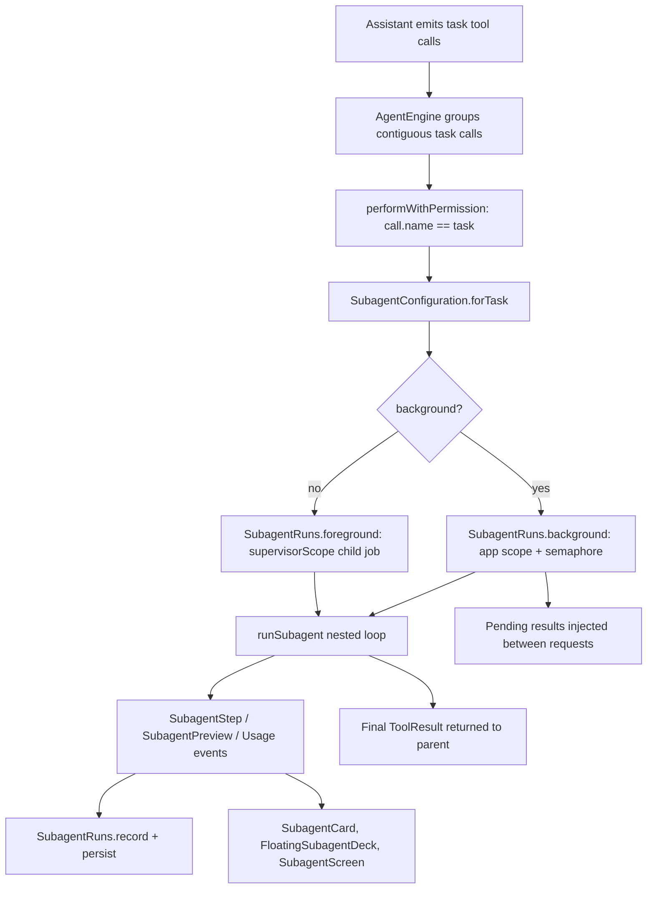

# Subagents, Parallel Delegation, and Model Resolution

> The `task` tool spawns nested agent runs with isolated context, runs them in parallel or in the background, and surfaces their progress in chat and in a floating deck.

The subagent subsystem lets the main agent delegate a well-scoped question or piece of work without dragging raw exploration output into its own context. The `TaskTool` in `tools/SubagentTools.kt` is only a schema and a description; `AgentEngine` intercepts the call, builds a `SubagentRun`, and executes a nested loop through `runSubagent`. `SubagentRuns` owns the jobs, durable status, and completion delivery, `SubagentConfiguration` and `SubagentModelResolver` decide which provider and model the delegate uses, and the Compose layer renders live steps in `SubagentCard`, a draggable `FloatingSubagentDeck`, and a full conversation page in `SubagentScreen`.

## Module Responsibilities

- **`TaskTool`** (`tools/SubagentTools.kt`): declares the `task` contract. Arguments are `prompt` (required), `name`, `title`, `background`, `agent`, and `model`. It reports `isReadOnly = true`, and its `execute` only returns an error, because the engine handles it.
- **`subagentControlTools`** (`tools/SubagentControlTools.kt`): builds three session-bound tools, `subagent_status`, `subagent_wait`, and `subagent_stop`, by closing over one `SubagentRuns` and one `sessionId`. A `task_id` from another chat cannot be inspected or cancelled.
- **`SubagentRuns`** (`agent/SubagentRuns.kt`): the application-owned job registry. It persists runs to a JSON file, converts orphans to `INTERRUPTED`, enforces the background semaphore, and exposes flows for the UI.
- **`SubagentModelResolver`** (`agent/SubagentModelResolver.kt`): resolves a requested model id against one memoized catalog fetch and returns a sealed `SubagentModelResolution`. `SubagentModels.match` holds the pure matching rules.
- **`SubagentConfiguration`** (`agent/SubagentConfiguration.kt`): applies the priority order (user configuration first, then task override, then the parent connection) and produces a `SubagentConnection` carrying config plus key.
- **UI**: `ui/chat/components/SubagentCard.kt` is the inline task card, `FloatingSubagentDeck.kt` the background bubble and panel, `SubagentBubbleState.kt` and `SubagentBubblePositionStore.kt` its lifecycle and placement, and `ui/subagent/SubagentScreen.kt` the full delegated conversation.

## Architecture and Flow

- Grouping: in the tool round, `AgentEngine` walks contiguous calls whose name is `task` and starts one `async` per call inside a `coroutineScope`, then `awaitAll` (`agent/AgentEngine.kt` lines 793-830). Emits go through a `Mutex` because `FlowCollector.emit` is not concurrency safe.
- Execution: each call reaches `performWithPermission`, which parses arguments and calls `SubagentConfiguration.forTask` (`agent/AgentEngine.kt` lines 1217-1244). The child context may be narrowed by an `agent` profile from `harness.json` through `runConfig.child(name)`.
- Isolation: foreground delegates use `supervisorScope` plus a child `Job`, so `subagent_stop` cancels the delegate and not the main run (`agent/SubagentRuns.kt` lines 144-169). Background delegates launch on the application scope with `Dispatchers.IO` and acquire a keepalive (`agent/SubagentRuns.kt` lines 172-209).
- Output: `runSubagent` returns only the final assistant text. Intermediate tool messages and assistant rounds are persisted with the parent call id, but the parent model receives a single tool result.

## Invocation Chain

1. The model emits one or more `task` calls; `TaskTool.parametersSchema` defines the accepted fields (`tools/SubagentTools.kt` lines 28-47).
2. `AgentEngine` groups adjacent task calls and logs the batch under the `HarnessSpawn` tag (`agent/AgentEngine.kt` lines 793-815).
3. `executeWithPermission` reaches `performWithPermission`; the task branch checks `prompt`, derives `title` (`name` or `title`, truncated to 40 characters), and rejects `background` when `Allow background delegation` is off (`agent/AgentEngine.kt` lines 1217-1227).
4. `SubagentConfiguration.forTask` resolves the connection (`agent/SubagentConfiguration.kt` lines 25-53).
5. `SubagentRuns.foreground` registers the run as `RUNNING`, starts the child, awaits the result, and finishes it. `SubagentRuns.background` registers as `QUEUED`, launches, then flips to `RUNNING` once a semaphore slot is free (`agent/SubagentRuns.kt` lines 154-157 and 181-191).
6. `runSubagent` builds a system prompt for research or coding mode and drives `provider.streamChat` through `StreamRetrier` (`agent/AgentEngine.kt` lines 1694-1865).
7. The result lands in `results[call.id]`, is committed as a tool message in the model's original call order, and the next round begins (`agent/AgentEngine.kt` lines 860-865).

## Key State and Data Structures

- **`SubagentStatus`**: `QUEUED`, `RUNNING`, `COMPLETED`, `FAILED`, `STOPPED`, `INTERRUPTED`; `active` is true only for `QUEUED` and `RUNNING` (`agent/SubagentRuns.kt` lines 20-24).
- **`SubagentRun`**: `sessionId`, `turnId`, `call`, `name`, `prompt`, `model`, `providerId`, `background`, `workspacePaths`, `status`, timestamps, `steps`, `preview`, `output`, `delivered`. `id` is the parent `ToolCallData.id`. `report()` renders name, status, task excerpt, latest step, and result (`agent/SubagentRuns.kt` lines 26-54).
- **Persistence**: `RunManager` constructs the registry with `File(context.noBackupFilesDir, "subagent-runs.json")` (`agent/RunManager.kt` lines 202-204). Saves write a `.next` file, call `fd.sync()`, then rename atomically (`agent/SubagentRuns.kt` lines 94-102).
- **Restart recovery**: `ready` is an `async(Dispatchers.IO)` load. Any run still active on disk becomes `INTERRUPTED` with the text "Interrupted when the app process stopped. Start a new task to retry." (`agent/SubagentRuns.kt` lines 75-84).
- **Retention**: `register` keeps every active run plus the last 39 finished runs per session (`agent/SubagentRuns.kt` lines 113-124). Output is capped at 32,000 characters, steps at the last 6 lines of 240 characters, previews at the last 360 characters (`agent/SubagentRuns.kt` lines 126-141, 211-215).
- **`SubagentConnection`**: `ProviderConfig` plus `apiKey`; credentials are never logged (`agent/SubagentConfiguration.kt` line 8).

## Concurrency and Parallelism

- The background semaphore defaults to `parallelism: Int = 2` (`agent/SubagentRuns.kt` line 64), so queued delegates admit two at a time. Foreground delegates are not bounded by this semaphore.
- `jobs` and `earlyStops` are concurrent maps. `stop` cancels a running job; if the job is not registered yet it records an early stop, and `background` consumes that marker after registering (`agent/SubagentRuns.kt` lines 206-207, 227-232).
- `record` updates the `StateFlow` under a `Mutex`, and `durable = false` is used for previews so high-frequency text does not hit disk (`agent/SubagentRuns.kt` lines 104-141).
- `waitFor` suspends on `forSession(sessionId).first { ... }` with `withTimeoutOrNull`, clamped to 1 to 30 seconds, returning the last known run on timeout (`agent/SubagentRuns.kt` lines 219-225).
- Background completion delivery is durable: `pending` returns finished, undelivered background runs, `AgentEngine` inserts a `SYSTEM` message with id `subagent-result-<id>`, and only then calls `acknowledge` (`agent/SubagentRuns.kt` lines 241-243; `agent/AgentEngine.kt` lines 408-420).

## Model Resolution Priority

1. A user selection in Sub-Agent settings wins. `SubagentConfiguration.configured` reads `settings.subagentProviderId`, finds that provider, and uses `settings.subagentModel` or the provider's own model (`agent/SubagentConfiguration.kt` lines 11-23).
2. Otherwise an explicit `model` argument is resolved through `SubagentModelResolver`, a single catalog fetch per run that is memoized after the first success and retried after failure (`agent/SubagentModelResolver.kt` lines 52-66; `agent/RunManager.kt` lines 575-586).
3. Otherwise the parent connection is reused unchanged (`agent/SubagentConfiguration.kt` lines 34-35).

Matching accepts exact ids, case-insensitive ids (catalog casing wins), and an unqualified tail when exactly one vendor-qualified id ends with `/<wanted>` (`agent/SubagentModelResolver.kt` lines 30-43). Unknown ids are refused with up to 25 available ids; a failed catalog fetch is refused with a retry message (`agent/SubagentConfiguration.kt` lines 37-51).

## Action Tools and Permission Inheritance

`actionTools` is true only when the delegate is foreground, the run is in `AgentMode.ACT`, and `subagentFullAccess` is enabled (`agent/AgentEngine.kt` line 1240). Background delegates are always read-only. The nested loop receives the parent's `PermissionMode` and the same `sessionAllowedTools`, and each tool call goes through `executeWithPermission` with `AgentMode.ACT` or `AgentMode.PLAN` (`agent/AgentEngine.kt` lines 1883-1897). The exposed schema set is filtered with `readOnlyOnly = !actionTools` and removes `ask_user`, `task`, `remember`, and every `subagent_*` tool (`agent/AgentEngine.kt` lines 1676-1690). A provider-invented call outside that set returns "`name` is not available to subagents."

## UI Deck and Persistence

`FloatingSubagentDock` observes `manager.subagents.forSession(sessionId)` and renders a popup anchored above the composer (`ui/chat/components/FloatingSubagentDeck.kt` lines 60-146). `SubagentBubbleLifecycle` tracks only runs observed active in this screen and keeps the bubble visible for `COMPLETION_MS = 2_000L` after the last finish (`SubagentBubbleState.kt` lines 8-30). Dragging updates a normalized `SubagentBubblePosition` in the `subagent-bubble-position` `SharedPreferences` file under keys `x` and `y` (`ui/chat/components/SubagentBubblePositionStore.kt` lines 6-13). The expanded deck lists runs, shows the latest non-boilerplate step, and offers Open chat and Stop (`FloatingSubagentDeck.kt` lines 238-267). The inline `SubagentCard` keeps the last `VISIBLE_TRAIL = 4` steps on its face while running and expands to the full trail and answer (`ui/chat/components/SubagentCard.kt` lines 236-315). `SubagentScreen` replays the parent prompt as a user bubble and the persisted inner rounds with the normal chat components (`ui/subagent/SubagentScreen.kt` lines 63-90).

## Boundary Conditions

- Missing `prompt` is refused before any connection work.
- A blank or missing subagent provider raises "Subagent provider is unavailable"; a blank key raises "Subagent provider needs authentication" (`agent/SubagentConfiguration.kt` lines 16-20).
- `background: true` without the setting is refused with a pointer to Sub-Agent settings (`agent/AgentEngine.kt` lines 1225-1227).
- `subagent_wait` accepts 1 to 30 seconds and defaults to 15 (`tools/SubagentControlTools.kt` lines 29-33).
- `subagent_status` lists at most the last 20 runs and prints "No subagents in this chat." when empty (`tools/SubagentControlTools.kt` lines 27-28).
- A run with blank text and no calls fails with a reasoning-specific message instead of an empty success (`agent/AgentEngine.kt` lines 1840-1860).
- Foreground cancellation rethrows the parent cancellation after finishing the run as `STOPPED`, so the main run is not silently swallowed (`agent/SubagentRuns.kt` lines 159-162).

## Extension Points

- Settings: `subagent_full_access`, `background_subagents`, `subagent_completion_notifications`, `subagent_provider_id`, `subagent_model` (`data/SettingsRepository.kt` lines 238-242, 360-362).
- Project config: an `agent` argument selects a named profile in `harness.json`, including its tool restrictions.
- Runtime: any code holding `RunManager.subagents` can call `stop`, `stopSession`, `stopSessionAndJoin`, `stopAllAndJoin`, `waitFor`, `pending`, and `acknowledge`.
- Notifications: `onFinished` posts a `RunResultNotification` when completion notifications are enabled (`agent/RunManager.kt` lines 227-235).

Sources: [app/src/main/java/com/androidharness/app/tools/SubagentTools.kt](../app/src/main/java/com/androidharness/app/tools/SubagentTools.kt)#L10-L52)

## Source files

- `app/src/main/java/com/androidharness/app/tools/SubagentTools.kt`
- `app/src/main/java/com/androidharness/app/tools/SubagentControlTools.kt`
- `app/src/main/java/com/androidharness/app/agent/SubagentRuns.kt`
- `app/src/main/java/com/androidharness/app/agent/SubagentModelResolver.kt`
- `app/src/main/java/com/androidharness/app/agent/SubagentConfiguration.kt`
- `app/src/main/java/com/androidharness/app/agent/AgentEngine.kt`
- `app/src/main/java/com/androidharness/app/agent/RunManager.kt`
- `app/src/main/java/com/androidharness/app/ui/chat/components/SubagentCard.kt`
- `app/src/main/java/com/androidharness/app/ui/chat/components/FloatingSubagentDeck.kt`
- `app/src/main/java/com/androidharness/app/ui/chat/components/SubagentBubbleState.kt`
- `app/src/main/java/com/androidharness/app/ui/chat/components/SubagentBubblePositionStore.kt`
- `app/src/main/java/com/androidharness/app/ui/subagent/SubagentScreen.kt`
- `app/src/main/java/com/androidharness/app/data/SettingsRepository.kt`
