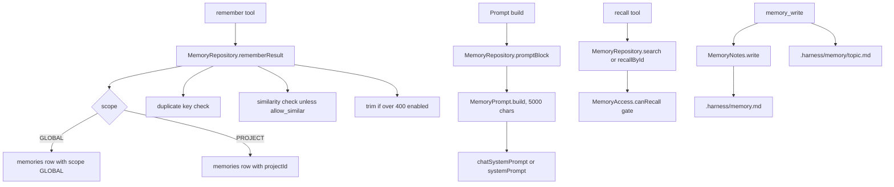

# Universal Memory, Recall, and Project Notes

> Stores durable facts in a shared database with section and scope rules, injects a bounded block into prompts, and keeps long-form workspace notes on disk.

Memory has two storage tiers. The universal memory is an app-owned Room table (`memories`) used by both Chat and Code, written with `remember` and read with `recall`. Workspace notes are plain files under `.harness/`, written with `memory_write` and read with `memory_read` or `memory_search`. `MemoryRepository` owns the table and its policies, `MemoryPrompt` builds the prompt block, and `MemorySection` exposes settings, digests, and backups.

## Module Responsibilities

- **`MemoryRepository`** (`data/MemoryRepository.kt`): CRUD, duplicate and similarity checks, consolidation, recall, cross-section access, enabled-entry trimming, and backup import.
- **`MemoryPrompt`**: deterministic selection and truncation of entries into a character budget.
- **`MemoryText`**: normalization, per-entry limits, and query-centered excerpts.
- **`MemoryPolicy`** (`data/MemoryPolicy.kt`): `MemorySection`, `MemoryAccess` gating, `MemoryMatch` keys and similarity, `MemoryConsolidation` digests.
- **`RememberTool` / `RecallTool`** (`tools/UniversalMemoryTools.kt`): the model-facing `remember` and `recall` tools.
- **`MemoryWriteTool`** (`tools/InteractiveTools.kt`): core note and topic writes on disk.
- **`MemoryNotes` / `MemoryTopics`** (`agent/`): core note cap and truncation, topic naming and safe paths.
- **`ProjectMemory`** (`workspace/ProjectMemory.kt`): raw editor read and conflict-checked save of `.harness/memory.md`.
- **`MemorySection`** (`ui/settings/MemorySection.kt`): toggles, list management, edit dialog, consolidation dialog.
- **`ChatMemoryReceipt`** (`ui/chat/components/ChatMemoryReceipt.kt`): the saved/updated receipt and inline editor.
- **`MemoryBackup`** (`data/MemoryBackup.kt`): portable entry schema and merge rules for settings and chat backups.

## Architecture and Flow

- Write path: `RememberTool` resolves scope, then `rememberResult` runs inside a Room transaction, checks duplicates and near duplicates, inserts, and trims.
- Read path: `promptBlock` filters by section, owner, enabled state, and project, sorts, builds the block, and marks used ids.
- Recall path: `search` and `recallById` enforce the cross-section switch and the agent-private owner rule.
- Notes path: `memory_write` appends or replaces with a hard cap, while `memory_read` and `memory_search` bypass the prompt truncation.

## Invocation Chain

1. `RememberTool.execute` rejects when `memory.isEnabled(sessionId)` is false, parses `scope`, and defaults PROFILE and PREFERENCE facts to GLOBAL (`tools/UniversalMemoryTools.kt` lines 41-53).
2. `MemoryRepository.rememberResult` opens `db.withTransaction`, loads available entries, and dispatches to update or create (`data/MemoryRepository.kt` lines 165-204).
3. New entries pass `checkedText`, duplicate by `MemoryMatch.key`, optional similarity, then `save`, which inserts and calls `trim` (`data/MemoryRepository.kt` lines 210-225).
4. The result string carries `[memory_id:...]` and `[memory_action:...]`, which the UI parses for the receipt (`tools/UniversalMemoryTools.kt` lines 61-67; `core/ChatActivityPresentation.kt` lines 41-51).
5. Prompt assembly calls `universalMemory?.promptBlock(sessionId, memoryQuery, onUsed)` in both chat and code prompts (`agent/AgentEngine.kt` lines 2183-2187, 2300-2305).
6. `RecallTool` either returns one full entry by id or renders search hits with excerpts (`tools/UniversalMemoryTools.kt` lines 86-121).

## Entry Schema and Storage

`MemoryEntity` is the `memories` table row (`data/db/Database.kt` lines 119-138):

- `id` primary key, `text`, `category` (default `FACT`), `scope` (default `GLOBAL`), `projectId`, `sourceSessionId`
- `pinned`, `enabled`, `createdAt`, `updatedAt`, `lastUsedAt`, `useCount`
- `section` (default `SHARED`), `consolidatedInto`, `isSummary`, `agentId`

`MemoryScope` is `GLOBAL` or `PROJECT`; `MemoryCategory` is `PROFILE`, `PREFERENCE`, `PROJECT`, `DECISION`, `FACT` (`data/MemoryRepository.kt` lines 10-25). `MemorySection` is `CHAT`, `CODE`, or the legacy `SHARED`, and unknown stored values fall back to `SHARED` (`data/MemoryPolicy.kt` lines 8-13).

The DAO filters active rows with `enabled = 1 AND consolidatedInto IS NULL AND (scope = 'GLOBAL' OR (scope = 'PROJECT' AND projectId = :projectId))` (`data/db/Database.kt` lines 682-683). `markMemoriesUsed` increments `useCount` and sets `lastUsedAt` for prompt entries (`data/db/Database.kt` lines 712-713).

## Scopes, Sections, and Ownership

- The `memory` argument maps `global` and `project` directly. Anything else becomes GLOBAL for PROFILE or PREFERENCE, or when the conversation has no project; otherwise it becomes PROJECT (`tools/UniversalMemoryTools.kt` lines 46-53).
- A project-scoped request degrades to GLOBAL when no project id exists (`data/MemoryRepository.kt` lines 190-191).
- Section comes from the session's `ConversationConfig`: chat sessions are CHAT, everything else CODE (`data/MemoryRepository.kt` lines 129-130).
- Cross-section recall requires `chatRecallCodeMemory` or `codeRecallChatMemory` and the target section being enabled (`data/MemoryPolicy.kt` lines 22-27).
- A chat agent profile with `AgentMemory.PRIVATE` assigns `agentId` and hides project scoping; such entries are only visible to that agent and only in the CHAT section (`data/MemoryRepository.kt` lines 132-143, 309).
- `isEnabled` also requires the session's `personalizationEnabled` (`data/MemoryRepository.kt` lines 138-141).

## Injection Limits and Selection

`MemoryPrompt.build` filters enabled, non-consolidated entries and sorts by pinned, then query relevance, then PROFILE or PREFERENCE, then project scope, then `updatedAt`, then id (`data/MemoryRepository.kt` lines 77-85). It appends entries until `MAX_CHARS = 5_000` is reached; anything that does not fit is counted and summarized as `- N more saved memories: recall(query).` if the note itself fits (`data/MemoryRepository.kt` lines 73, 104-114). `approxTokens(chars)` returns `chars / 4` with a floor of 1, and the settings screen displays that figure (`data/MemoryRepository.kt` line 117; `ui/settings/MemorySection.kt` line 220).

Long entries are replaced by a query-centered excerpt and labeled `excerpt, recall(memory_id) for full text`. Digests contribute individual non-blank lines that are not headings, ranked by relevance and capped at the remaining budget (`data/MemoryRepository.kt` lines 91-103). Every injected line starts with the entry id, category, digest marker when applicable, and the note about fetching the full text.

The query is the last three user messages, each truncated to 2,000 characters (`agent/AgentEngine.kt` lines 2149-2150). Prompt injection happens only when memory is enabled, the conversation allows personalization, and the tool set has not been stripped. When memory is off, the registry removes `remember`, `recall`, `memory_write`, `memory_read`, and `memory_search` (`agent/AgentEngine.kt` lines 253-255, 374-380).

## Per-Entry Limit

The default maximum is `DEFAULT_MAX_ENTRY_CHARS = 600` (`data/MemoryRepository.kt` line 28). `memoryEntryUnlimited` disables the check; otherwise `memoryEntryMaxChars` applies, and a digest uses `max(limit, MemoryConsolidation.MAX_CHARS)` so organizing memories never forces a smaller cap (`data/MemoryRepository.kt` lines 35-40). `MemoryText.checked` normalizes whitespace for normal entries, trims digests, and raises "Memory is limited to N characters" when the limit is exceeded (`data/MemoryRepository.kt` lines 42-50). Backup import deliberately does not shorten older entries (`data/MemoryBackup.kt` lines 81-84).

## Duplicates, Updates, and Conflicts

New writes compare `MemoryMatch.key`, which is NFKC-normalized, lowercased, whitespace-collapsed, and stripped of trailing punctuation. An exact duplicate returns `UNCHANGED` without inserting. Unless `allow_similar` is set, a `similar` result (token overlap of at least 0.8, at least 3 shared tokens, and a size ratio of at least 0.65) is refused with the near entry's id and text (`data/MemoryPolicy.kt` lines 33-53; `data/MemoryRepository.kt` lines 192-201).

Updating requires `memory_id` and `previous_text` equal to the current text. A mismatch raises "Memory changed or previous_text is missing. Recall it again before updating." A replacement whose key matches a different entry in the same scope is refused, and identical text plus category returns `UNCHANGED` (`data/MemoryRepository.kt` lines 176-187). The Settings editor uses a similar optimistic check: `update` requires the same `updatedAt`, text, and non-consolidated state (`data/MemoryRepository.kt` lines 230-240).

## Recall Behavior

`search` filters active entries by section, owner, and project, scores relevance, and returns 20 entries for a blank query or 40 for a query. Sorting is relevance, pinned, `updatedAt` (`data/MemoryRepository.kt` lines 316-328). `RecallTool` prints up to 12,000 characters of results. Each normal entry is excerpted to 4,000 characters; a digest is reduced to its 12 highest-relevance lines and 4,000 characters (`tools/UniversalMemoryTools.kt` lines 105-120). The model is told to call `recall(memory_id)` for full text when the output was partial.

## Digests and Restore

`MemoryConsolidation.plans` groups enabled, non-summary entries by section, scope, project, and agent, then builds batches of at least two entries whose generated text stays under 20,000 characters (`data/MemoryPolicy.kt` lines 57-87). `consolidate` verifies each original is unchanged, requires a single group, creates a summary row with `isSummary = true`, and sets `consolidatedInto` on the originals (`data/MemoryRepository.kt` lines 242-256). `restoreOriginals` clears the pointer; it deletes the summary when the text still equals the generated digest, otherwise disables the summary so later edits stay available for review (`data/MemoryRepository.kt` lines 258-267). Deleting an original while it is consolidated is refused until originals are restored (`data/MemoryRepository.kt` lines 269-276).

## Receipts

`ChatMemoryReceipt` scans the turn's successful `remember` tool results. `ChatActivityPresentation.memoryAction` returns `updated`, `saved`, or `unchanged` from `[memory_action:...]`, and `savedMemoryIds` extracts `[memory_id:...]` (`core/ChatActivityPresentation.kt` lines 41-51). The receipt renders a single label row; opening it lists the saved entries with their section and text, and allows editing or deleting through `MemoryEditDialog`, blocked while the run is busy (`ui/chat/components/ChatMemoryReceipt.kt` lines 27-90). Supplied-memory ids are merged into the list without exposing the injection metadata in the transcript.

## Backup and Restore

`BackupMemory` is the portable form with all entry fields (`data/MemoryBackup.kt` lines 9-26). `MemoryBackupMerge.plan` refuses to overwrite: entries are skipped when their id or normalized fact key already exists, where the key includes text, scope, project, section, parent summary, summary flag, and agent (`data/MemoryBackup.kt` lines 59-76, 120-121). `normalize` drops entries with unknown sections, invalid agent ids, blank ids, or empty text, and converts a project scope to GLOBAL when its project is missing (`data/MemoryBackup.kt` lines 78-99).

Settings backup exports memories at `data/SettingsBackup.kt` line 232 and imports with `importMissing` against the currently available projects (`data/SettingsBackup.kt` line 302). Chat backup includes memories at `data/ChatBackup.kt` line 168 and applies the same merge plan with a project remap at lines 306-311.

## Project Notes on Disk

The core note lives at `.harness/memory.md` with `MAX_CHARS = 8_000` (`agent/MemoryNotes.kt` line 9). `load` truncates a long note by keeping the head and tail around a `[truncated N chars of memory]` marker, so both early rules and recent additions survive (`agent/MemoryNotes.kt` lines 11-18). `write` appends by default or replaces, and keeps the tail when the result exceeds the cap (`agent/MemoryNotes.kt` lines 20-37).

Topic notes live at `.harness/memory/<topic>.md` with `MAX_TOPIC_CHARS = 40_000` (`agent/MemoryTopics.kt` lines 11-14). `sanitize` allows lowercase letters, digits, hyphen, and underscore, up to 48 characters. Reads use the lenient `topicPath`, while writes use `strictTopicPath`, which refuses names that are not already canonical instead of silently renaming them (`agent/MemoryTopics.kt` lines 20-38). Only topic names are listed in the system prompt; bodies stay on disk and are fetched with `memory_read` or `memory_search` (`agent/AgentEngine.kt` lines 2309-2312; `tools/MemoryTools.kt` lines 29-130).

When a project configuration is present, `memory_write` caps the core file to `memory.maxLines` lines from the tail and honors a custom `memory.file` or `memory.topics` path (`tools/InteractiveTools.kt` lines 83-91).

`ProjectMemory.save` is the editor path. It requires `content.length <= MemoryNotes.MAX_CHARS`, compares the current file against the caller's `expected` snapshot, and throws "Memory changed. Your draft is kept; reload the latest notes before saving." on a mismatch (`workspace/ProjectMemory.kt` lines 12-16). The caller holds `RunManager`'s workspace guard so an agent write cannot race the save.

## Boundary Conditions

- Memory off for the section makes both `remember` and `recall` throw "Memory is off for this section in Settings > Memory." (`tools/UniversalMemoryTools.kt` lines 42, 87).
- `MAX_ENABLED = 400`. New saves beyond that disable the oldest unpinned entries by `lastUsedAt`, then `updatedAt`; nothing is deleted (`data/MemoryRepository.kt` lines 331-343).
- Updating a disabled entry is refused until it is enabled in Settings (`data/MemoryRepository.kt` lines 180, 216).
- `remove` on a summary deletes its consolidated children as well (`data/MemoryRepository.kt` lines 269-276).
- Topic writes reject traversal (`../../etc`) and multi-segment names outright.
- Import never turns Live Mode on and never overwrites local memories; duplicates are reported only as a skipped count (`data/MemoryBackup.kt` lines 53-58).

## Extension Points

- Settings keys: `memory_enabled`, `memory_entry_unlimited`, `memory_entry_max_chars`, `chat_memory_enabled`, `code_memory_enabled`, `chat_recall_code_memory`, `code_recall_chat_memory` (`data/SettingsRepository.kt` lines 171-177, 328-334).
- Setters: `setSectionMemoryEnabled`, `setCrossSectionMemory`, `setMemoryEnabled`, `setMemoryEntryUnlimited`, `setMemoryEntryMaxChars` (`data/SettingsRepository.kt` lines 1149-1166).
- Tools are registered per run and removed when memory or personalization is off.
- Backup formats accept a project remap function, so other callers can restore into a mapped workspace.

Sources: [app/src/main/java/com/androidharness/app/data/MemoryRepository.kt](../app/src/main/java/com/androidharness/app/data/MemoryRepository.kt)#L124-L157)

## Source files

- `app/src/main/java/com/androidharness/app/tools/UniversalMemoryTools.kt`
- `app/src/main/java/com/androidharness/app/tools/MemoryTools.kt`
- `app/src/main/java/com/androidharness/app/tools/InteractiveTools.kt`
- `app/src/main/java/com/androidharness/app/data/MemoryRepository.kt`
- `app/src/main/java/com/androidharness/app/data/MemoryPolicy.kt`
- `app/src/main/java/com/androidharness/app/data/MemoryBackup.kt`
- `app/src/main/java/com/androidharness/app/data/SettingsRepository.kt`
- `app/src/main/java/com/androidharness/app/data/db/Database.kt`
- `app/src/main/java/com/androidharness/app/agent/MemoryNotes.kt`
- `app/src/main/java/com/androidharness/app/agent/MemoryTopics.kt`
- `app/src/main/java/com/androidharness/app/workspace/ProjectMemory.kt`
- `app/src/main/java/com/androidharness/app/ui/settings/MemorySection.kt`
- `app/src/main/java/com/androidharness/app/ui/chat/components/ChatMemoryReceipt.kt`
- `app/src/main/java/com/androidharness/app/core/ChatActivityPresentation.kt`
- `app/src/main/java/com/androidharness/app/agent/AgentEngine.kt`
