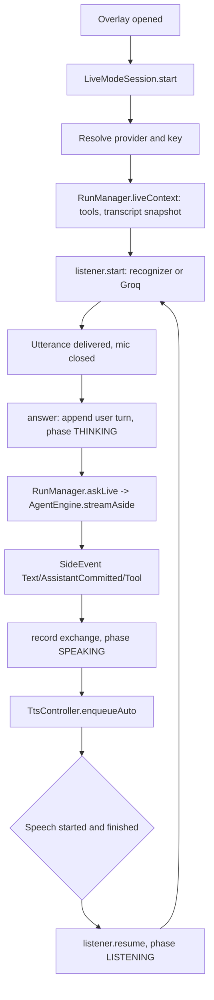

# Live Mode: Hands-Free Voice Conversation

> An experimental, tap-free voice loop that listens, asks a lighter model, speaks the reply, and saves the conversation into the chat as one transcript message.

Live Mode runs beside the chat on the side-question engine. `LiveModeSession` owns the whole loop (microphone, request, speech output, persistence), `LiveListener` hides the difference between the Android recognizer and Groq Whisper, and `LiveModeOverlay` is the full-screen UI. The conversation is never part of the main agent's turn: it is stored as a `<live_mode_conversation>` user message that later turns read as ordinary history.

## Module Responsibilities

- **`LiveMode`** (`agent/LiveMode.kt`): constants, the access-specific system prompt, the `start_task` tool schema, request-message assembly with the chat transcript, and `LiveTranscript` format, parse, and id rules.
- **`LiveModeSession`** (`ui/chat/LiveModeSession.kt`): state machine, provider selection, request streaming, tool interception, TTS handoff, and transcript saving.
- **`LiveListener`** (`ui/chat/LiveListener.kt`): microphone lifecycle, two recognition paths, levels, partial text, and error recovery.
- **`LiveModeOverlay`** (`ui/chat/LiveModeOverlay.kt`): full-screen dialog, conversation list, status line, pause control, orb, and Send plan button.
- **`LiveTranscriptCard`** (`ui/chat/LiveTranscriptCard.kt`): the collapsible saved conversation inside chat history.
- **`LiveModeSettings`** (`data/LiveModeSettings.kt`): device-local preferences and the `LiveModeAccess` enum.
- **`LiveModeSection`** (`ui/settings/LiveModeSection.kt`): enable switch, model picker, access radios, speak toggle, silence slider, and engine summary.
- **Audio layer** (`data/audio/`): `TtsController`, `SpeechText`, `TtsTextChunker`, `GroqTtsClient`, and `GroqWhisperClient`.

## Architecture and Flow

- Capture: `LiveListener` calls `onUtterance` only after closing the microphone, so the model is never answered while the mic is still recording.
- Request: `answer` appends the user turn, calls `runManager.askLive` with `LiveMode.requestMessages(transcript, conversation)`, and folds tool results back into its own `conversation`.
- Output: the final assistant text is recorded, saved, and spoken, then the microphone reopens.
- Interruption: `interrupt`, `pause`, `resume`, and `close` cancel the turn `Job`, stop TTS, and reset phase and partial state.

## Invocation Chain

1. `ChatViewModel.openLive` creates the session when Live Mode is enabled, ensures a session id, and calls `session.start()` (`ui/chat/ChatViewModel.kt` lines 1142-1160).
2. `LiveModeSession.start` reads settings, resolves the live provider, checks the key, and calls `runManager.liveContext(...)` (`ui/chat/LiveModeSession.kt` lines 83-108).
3. `RunManager.liveContext` selects the tool registry for the access level, adds `start_task` for `START_TASKS`, builds a bounded chat transcript, and returns a cold `SideContext` with `cacheKey = "live-$sessionId"` (`agent/RunManager.kt` lines 1471-1510).
4. `listen` starts `LiveListener` with the Groq flag, Whisper model, and configured silence window (`ui/chat/LiveModeSession.kt` lines 119-128).
5. A finished utterance reaches `answer`, which calls `runManager.askLive` (`ui/chat/LiveModeSession.kt` lines 156-203).
6. `askLive` runs `engine.streamAside` with a Live Mode refusal message and the session's `intercept` callback, recording usage under `LiveMode.TURN_PREFIX = "live:"` (`agent/RunManager.kt` lines 1538-1560).
7. `speakThenListen` enqueues speech, waits for playback, then reopens the microphone (`ui/chat/LiveModeSession.kt` lines 219-236).

## State Machine

`LivePhase` has five states (`ui/chat/LiveModeSession.kt` line 36):

- `STARTING`: provider and context are being resolved.
- `LISTENING`: microphone open; `LiveListener.hearing` refines this to `WAITING`, `HEARING`, or `TRANSCRIBING`.
- `THINKING`: a request is in flight; `LiveUi.tool` holds the active tool name.
- `SPEAKING`: TTS is playing.
- `PAUSED`: microphone closed, turn canceled, TTS stopped. `resume` reopens or restarts from `STARTING` when no context exists.

`interrupt` is the orb action: from `LISTENING` it pauses, from `STARTING` it does nothing, and from any other phase it resumes (`ui/chat/LiveModeSession.kt` lines 148-154).

## Listening Paths

`LiveListener.start` chooses one of two paths (`ui/chat/LiveListener.kt` lines 80-90):

- **Android recognizer**: `openRecognizer` creates a `SpeechRecognizer`, sets `EXTRA_PARTIAL_RESULTS`, `EXTRA_MAX_RESULTS = 1`, and both silence extras to `silenceMs`. `onReadyForSpeech` sets `WAITING`, `onBeginningOfSpeech` sets `HEARING`, `onRmsChanged` maps dB to the 0 to 1 level as `(dB + 2) / 12`. `onResults` delivers the best text or the last partial. A new session is started on every pause, which is why the recognizer is recreated in a loop (`ui/chat/LiveListener.kt` lines 123-190).
- **Groq Whisper**: `openRecorder` records 16 kHz mono AAC at 64 kbps into `cacheDir/audio_recordings/live_<millis>.m4a`, samples `maxAmplitude` every 50 ms, and tracks a noise floor. A segment starts after 150 ms above `max(1500, noiseFloor * 2.5)` and ends after `silenceMs` of quiet, at 120 seconds maximum, or with no speech for 20 seconds when the file is recycled. `finishSegment` skips clips under 350 ms, uploads through `GroqWhisperClient.transcribe`, deletes the file, and drops likely Whisper hallucinations when less than 1.2 seconds were voiced (`ui/chat/LiveListener.kt` lines 207-284, 323-336).

Errors: missing permission, no recognizer, missing Groq key, microphone start failure, and network failure are converted to user-facing strings. Three consecutive recognizer network errors close the listener; busy recognizers are destroyed and retried after 400 ms; ordinary no-match or timeout errors restart after 150 ms (`ui/chat/LiveListener.kt` lines 152-190). A `generation` counter ignores late callbacks from a closed session.

## Speech Output

`LiveModeSession.speakThenListen` checks `liveMode.speakReplies` and `SpeechText.isSpeakable(SpeechText.forSpeech(RichResponse.plainText(reply)))`. When speakable, it enqueues `c.tts.enqueueAuto("live-$liveId-$n", reply)`, waits up to 20 seconds for `TtsPhase.PREPARING` or `SPEAKING`, then waits for `IDLE` (`ui/chat/LiveModeSession.kt` lines 219-236, 278).

`TtsController.speak` converts rich content to plain text, sets `PREPARING`, and picks the engine from settings: `ttsEngine = "groq"` uses `GroqTtsClient`, anything else uses Android `TextToSpeech` (`data/audio/TtsController.kt` lines 176-194). The system path chunks by `getMaxSpeechInputLength` and queues chunks with `QUEUE_FLUSH` then `QUEUE_ADD`; the Groq path chunks by the model limit and keeps two synthesis requests in flight with a `Semaphore(2)` (`data/audio/TtsController.kt` lines 196-280). `TtsState` exposes only `messageId` and `phase`, and `TtsPhase` is `IDLE`, `PREPARING`, or `SPEAKING` (`data/audio/TtsController.kt` lines 42-48).

## Access Levels and Tools

`LiveModeAccess` has three values (`data/LiveModeSettings.kt` lines 7-14):

- `TALK`: no tools, fastest replies.
- `READ`: read-only tools from the latest chat run, or `engine.asideRegistry()` when there is none.
- `START_TASKS`: read-only tools plus the `start_task` tool.

`RunManager.liveContext` applies these rules: `TALK` gets an empty `ToolRegistry`, `READ` and `START_TASKS` get `registry.filter(SideQuestion::allows)`, and `START_TASKS` appends `LiveMode.startTaskSchema()` (`agent/RunManager.kt` lines 1482-1490). `streamAside` enforces `SideQuestion.allows` for every call.

`start_task` is intercepted by the session, not executed. `intercept` rejects it outside `START_TASKS`, requires a non-blank `brief`, and calls `handOff` (`ui/chat/LiveModeSession.kt` lines 238-246). `handOff` sends the brief plus the formatted transcript when a task is running, otherwise saves the transcript first and sends the brief through `sendToAgent`, which is `ChatViewModel.send` (`ui/chat/LiveModeSession.kt` lines 256-267). The overlay's Send plan button calls `sendPlan` with the default brief string.

## The Chat Transcript in the Request

`LiveMode.requestMessages` prefixes the first user message with the chat's saved transcript in `<chat_transcript>` tags, so the request never starts with two user messages and the prefix stays stable for prompt caching (`agent/LiveMode.kt` lines 88-100). The transcript snapshot is built by `liveContext` from saved history with subagent turns removed and a character budget of `(maxContext - 2048 - 4096) * 3`, clamped to 8,000 through `MAX_TRANSCRIPT_CHARS = 60_000` (`agent/RunManager.kt` lines 1486-1490).

## Transcript Persistence

`LiveTranscript` uses `ID_PREFIX = "live-"` and wraps the body in `<live_mode_conversation>` tags with a note that speech recognition can mishear words (`agent/LiveMode.kt` lines 108-129). `format` writes each exchange as `User:` and optional `Assistant:` paragraphs with blank lines between them; `parse` reverses it and is tolerant of a user line without a reply. `titleSource` returns the first user line, so a transcript-first chat takes its title from that line (`agent/LiveMode.kt` lines 147-151).

`saveLiveTranscript` defers the write until `state.running` is false, performs it under `NonCancellable` and a `Mutex`, and rewrites the existing card only while it is the newest message. Once the chat has moved on, the next save starts a new card at the current exchange offset (`agent/RunManager.kt` lines 1513-1536). This keeps a working agent from being interrupted and prevents a stale card from absorbing later conversation.

`ChatScreen` checks `LiveTranscript.isTranscript(message)` and renders `LiveTranscriptCard` instead of a user bubble (`ui/chat/ChatScreen.kt` lines 1837-1841). The card is collapsed by default, shows the first user line, and expands to every exchange (`ui/chat/LiveTranscriptCard.kt` lines 38-84).

## Settings and Persistence

`LiveModeSettings` holds `enabled` (default false), `providerId` and `model` (null means the chat's own model), `access` (default `READ`), `speakReplies` (default true), and `silenceMs` (default 1,200, range 600 to 3,000) (`data/LiveModeSettings.kt` lines 20-35). The whole object is serialized to JSON under the preference key `live_mode`; `updateLiveMode` decodes, applies the transform, and clamps `silenceMs` before writing (`data/SettingsRepository.kt` lines 303, 767-778). Live Mode is device-local and intentionally excluded from settings backups.

`LiveModeSection` renders the enable toggle, the model picker with a "chat's model" reset, the three access radios, and a voice panel with the speak switch and a silence slider quantized to 100 ms steps. The engine line reports the current `voiceEngine` and links to the general Voice settings (`ui/settings/LiveModeSection.kt` lines 55-274).

## Entry and Lifecycle

The overlay opens from the empty message box or the + menu when `liveMode.enabled` is true. ChatScreen releases the other voice controller, checks `RECORD_AUDIO`, requests it when missing, and then calls `openLive` (`ui/chat/ChatScreen.kt` lines 1331-1339). `LiveModeOverlay` is a full-screen `Dialog` with `decorFitsSystemWindows = false`. `LifecycleEventEffect(ON_STOP)` pauses the session because the microphone cannot stay open in the background without a foreground service (`ui/chat/LiveModeOverlay.kt` lines 71-90). `closeLive` and `onCleared` both call `session.close()`, which cancels the turn, releases the listener, and stops TTS (`ui/chat/LiveModeSession.kt` lines 269-275).

## Boundary Conditions

- No provider or blank key raises the usual no-key error before listening starts.
- A local model refuses Live Mode while its chat is running (`agent/RunManager.kt` lines 1541-1543).
- If the user stops mid-reply, `answer` keeps the streamed text, rolls back the incomplete tool round, and records a partial exchange so the transcript stays truthful (`ui/chat/LiveModeSession.kt` lines 186-196).
- `rollBack` removes every conversation entry beyond the pre-request size, because a half-finished tool round cannot be replayed (`ui/chat/LiveModeSession.kt` lines 205-208).
- A failed live request with no reply sets `PAUSED` and the error text; it does not reopen the microphone.
- `MAX_OUTPUT_TOKENS = 2_048` bounds each reply. `MAX_TRANSCRIPT_CHARS = 60_000` bounds the saved chat context.
- Whisper hallucinations such as "thank you" or "bye" are discarded when less than 1.2 seconds were voiced.

## Extension Points

- Settings: `live_mode` JSON holds model, access, speech, and silence; the general Voice settings supply the recognizer engine, Whisper model, TTS engine, voice, and speed.
- Access levels are an enum, so a new level needs a prompt branch, a tool-registry rule, and a label.
- `LiveListener` accepts an injected `transcribe` function, which makes the Whisper path testable without network calls.
- `LiveModeSession` takes `chatProvider` and `sendToAgent` callbacks, so it can be hosted by another screen without changing the loop.
- `start_task` is an ordinary tool schema produced by `LiveMode.startTaskSchema()`, and its result is controlled by the intercept callback.

Sources: [app/src/main/java/com/androidharness/app/ui/chat/LiveModeSession.kt](../app/src/main/java/com/androidharness/app/ui/chat/LiveModeSession.kt)#L83-L236)

## Source files

- `app/src/main/java/com/androidharness/app/agent/LiveMode.kt`
- `app/src/main/java/com/androidharness/app/ui/chat/LiveListener.kt`
- `app/src/main/java/com/androidharness/app/ui/chat/LiveModeSession.kt`
- `app/src/main/java/com/androidharness/app/ui/chat/LiveModeOverlay.kt`
- `app/src/main/java/com/androidharness/app/ui/chat/LiveTranscriptCard.kt`
- `app/src/main/java/com/androidharness/app/ui/chat/ChatScreen.kt`
- `app/src/main/java/com/androidharness/app/ui/chat/ChatViewModel.kt`
- `app/src/main/java/com/androidharness/app/data/LiveModeSettings.kt`
- `app/src/main/java/com/androidharness/app/ui/settings/LiveModeSection.kt`
- `app/src/main/java/com/androidharness/app/data/audio/TtsController.kt`
- `app/src/main/java/com/androidharness/app/data/audio/TtsTextChunker.kt`
- `app/src/main/java/com/androidharness/app/data/audio/SpeechText.kt`
- `app/src/main/java/com/androidharness/app/data/audio/GroqTtsClient.kt`
- `app/src/main/java/com/androidharness/app/data/audio/GroqWhisperClient.kt`
- `app/src/main/java/com/androidharness/app/agent/RunManager.kt`
- `app/src/main/java/com/androidharness/app/data/SettingsRepository.kt`
