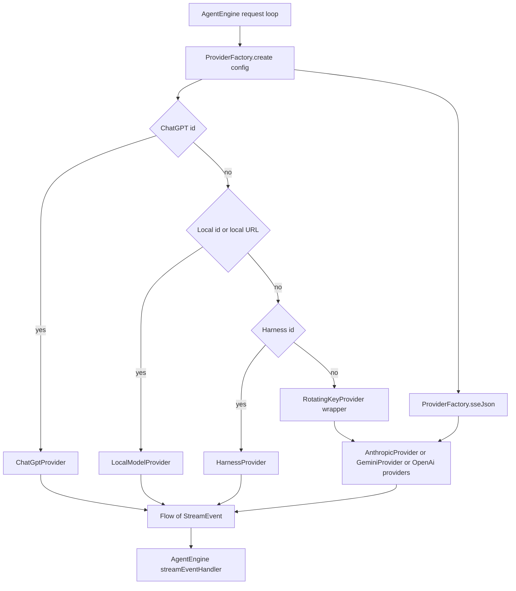

# LLM Core Contracts

> Defines the provider-neutral streaming contract, request configuration, event vocabulary, error taxonomy, and capability flags used by every model connection in the app.

`Llm.kt` is the seam between the agent runtime and the network. It declares one provider method, `LlmProvider.streamChat`, a small request model (`ProviderConfig`, `RequestOptions`, `ToolSchema`), the stream event vocabulary (`StreamEvent`), and a factory that selects a concrete transport. Provider implementations translate these neutral types into Anthropic, Gemini, OpenAI Chat Completions, or OpenAI Responses wire formats, then translate the wire response back into the same `StreamEvent` sequence. The agent engine consumes only that sequence, so adding a provider does not change the execution loop.

## Module Responsibilities

- **Transport-neutral provider boundary**: `LlmProvider` exposes a single cold `Flow<StreamEvent>` and accepts credentials, system prompt, history, tool schemas, and generation options. No provider exposes HTTP details to callers.
- **Connection identity**: `ProviderConfig` carries the stable id, display name, wire `type`, base URL, selected model, picker visibility, and custom headers. The id is what settings, chats, fallback chains, and model catalogs reference.
- **Generation policy**: `RequestOptions` carries output limit, thinking selection, cache routing key, catalog snapshot, and per-model reasoning overrides.
- **Event normalization**: `StreamEvent` collapses text, reasoning, tool fragments, final tool calls, usage, errors, recovery notices, and termination into one sealed interface.
- **Transport plumbing**: `ProviderFactory` owns the shared `OkHttpClient` and the server-sent event reader, including its cancellation behavior.
- **Capability reporting**: `ModelCapabilities` and `ModelReasoning` distinguish provider-reported capability from directory data, user overrides, and family-name guesses.

## Architecture and Flow

The factory is the only place that resolves a `ProviderConfig` to a runtime object. ChatGPT and local inference are special because their providers are constructed once at app startup and stored in `ProviderFactory.chatGptProvider` or `ProviderFactory.localProvider`. Harness is special because it owns its own routing and identity headers. All other connections are created by wire type and wrapped in `RotatingKeyProvider`, which retries with another saved key only before any answer content exists.

`ProviderFactory.sseJson` is the shared SSE bridge. It enqueues an OkHttp call, suspends until headers arrive, rejects non-2xx responses as `ApiException` with up to 2000 characters of body, then reads `data:` lines and emits each JSON payload. A `[DONE]` line calls the optional `onDone` callback and stops. Malformed keep-alive JSON is skipped rather than terminating the stream. Collector cancellation cancels the call and the reader coroutine through `awaitClose`.

`readSseLine` is deliberately not `BufferedReader.readLine`. It splits on newline only, removes one preceding carriage return for CRLF framing, and preserves interior carriage returns. Some gateways emit raw CR inside streamed JSON strings, including tool arguments; a conventional line reader silently removes them and corrupts files written through `write_file`.

## Invocation Chain

1. `AgentEngine` builds the working `List<ChatMessage>`, tool schemas, and `RequestOptions`, then calls `provider.streamChat(config, apiKey, systemPrompt, messages, tools, options)` at `app/src/main/java/com/androidharness/app/agent/AgentEngine.kt#L631` (retry path at line 673, subagent path at line 1784).
2. `ProviderFactory.create(config)` at `Llm.kt#L215` checks ChatGPT, local, and Harness identity, and otherwise calls `RotatingKeyProvider.wrap(config, create(config.type))` at line 221.
3. `create(type)` at `Llm.kt#L224` instantiates `OpenAiCompatProvider`, `OpenAiResponsesProvider`, `AnthropicProvider`, or `GeminiProvider` with the shared client and `Json { ignoreUnknownKeys = true }`.
4. The concrete provider serializes messages, builds an OkHttp `Request`, and returns a flow. Most providers call `ProviderFactory.sseJson(request, ProviderHeaders.client(config, client))`.
5. `sseJson` at `Llm.kt#L236` emits one `JsonElement` per `data:` payload and reports HTTP failures as `ApiException`.
6. The provider's parser maps JSON chunks to `TextDelta`, `ThinkingDelta`, `ToolCallDelta`, `ToolCallReady`, `ToolCallBatch`, `Batch`, `Usage`, `Failure`, `ResponseState`, and finally `Done`.
7. `AgentEngine.streamEventHandler` at `AgentEngine.kt#L543` converts each event to an `AgentEvent`, accumulates text and thinking, tracks first and last token timing, and turns `ToolCallReady` or `ToolCallBatch` into executable calls. `ProviderChanged` and `Retrying` are forwarded as agent events.

## Key State and Data Structures

- **`ProviderType`** (`Llm.kt#L24`): `OPENAI_COMPAT`, `OPENAI_RESPONSES`, `ANTHROPIC`, `GEMINI`. Each carries a display `label` and `defaultBaseUrl`. `endpointPath` (`Llm.kt#L42`) is a display-only extension returning `/chat/completions`, `/v1/responses`, `/v1/messages`, or `:streamGenerateContent`.
- **`ProviderConfig`** (`Llm.kt#L50`): `id`, `name`, `type`, `baseUrl`, `model`. `enabled` is transient and controls picker visibility only; saved chats and running work keep their connection. `headers` is transient because it is loaded from encrypted storage and excluded from provider JSON, task JSON, and chat exports.
- **`effectiveApiKey`** (`Llm.kt#L37`): uses a non-blank stored key, otherwise `OpenAiCompatProvider.LOCAL_KEY` for a local host, otherwise an empty string. This prevents an empty `Authorization` header on local servers while still letting a proxy key through.
- **`ToolSchema`** (`Llm.kt#L65`): `name`, `description`, and `parametersJson` as a `JsonObject`. Providers choose their own schema envelope: Anthropic `input_schema`, Gemini `parametersJsonSchema`, OpenAI `function.parameters`.
- **`RequestOptions`** (`Llm.kt#L79`): `maxOutputTokens` defaults to 32768. `thinking` is a `ThinkingLevel`. `cacheKey` is the session id and is used for OpenAI `prompt_cache_key` and Anthropic `metadata.user_id`. `modelCatalogs` maps provider id to catalog entries. `customReasoning` and `customThinkingLevels` are keyed by `CustomReasoning.key(config)`. Three methods matter:
  - `resolveThinking` resolves the requested level against `ThinkingSpecs`.
  - `forTransportRoute` carries custom reasoning overrides across an internal transport-only redirect and requires the same id, model, and normalized base URL.
  - `applyReasoningMapping` validates and evaluates a custom CEL mapping, merging the result into the request body.
- **`StreamEvent`** (`Llm.kt#L118`) has thirteen variants:
  - `TextDelta(text)` and `ThinkingDelta(text)` are incremental output.
  - `ResponseState(state)` carries opaque provider-native items for later replay.
  - `ThinkingConfigured(label)` is request configuration, not model output; a retry can replace it before output arrives.
  - `ToolCallDelta(id, name, arguments, replace)` is display-only and never authorizes execution. `replace` marks a complete JSON object snapshot.
  - `ToolCallReady(call)` and `ToolCallBatch(calls)` are executable calls.
  - `Batch(events)` groups events produced by one chunk.
  - `Usage(inputTokens, outputTokens, cachedInputTokens, cacheWriteTokens, cacheReported, reasoningTokens)` is emitted once per request. `inputTokens` is the total prompt size, so cache hit rate is `cachedInputTokens / inputTokens`. `cacheWriteTokens` is separate because Anthropic bills cache writes at a premium.
  - `Failure(message, code, errorCode, retryable, retryAfterSeconds)` reports an in-band failure, including an SSE stream over HTTP 200.
  - `ProviderChanged(config, reason, persistSelection)` is emitted by fallback routing after the user has consented to an account or model change, before response output.
  - `Retrying(attempt, delayMs, reason)` is emitted by key rotation or fallback before a retry.
  - `Done(finishReason)` is the single terminal event; the reason is the provider's raw code.
- **`ChatMessage`** (`app/src/main/java/com/androidharness/app/core/Models.kt#L53`): role (`SYSTEM`, `USER`, `ASSISTANT`, `TOOL`), text, `toolCalls`, `toolCallId`, `toolName`, `isError`, thinking text and timing, token counts and timing, `images` (persisted refs), `imageData` (resolved bytes, never persisted), turn id, database id and timestamp, artifact, and `generation`.
- **`ToolCallData`** (`Models.kt#L8`): `id`, `name`, `argumentsJson`, opaque `responseReasoning`, `responseProviderId`, measured `codeChanges`, and workspace presentation fields. Only id, name, and arguments are sent as tool arguments.
- **`ProviderMessageState`** (`app/src/main/java/com/androidharness/app/core/GenerationMetadata.kt#L10`): provider id, endpoint hash, model, format, opaque JSON items, and an optional content digest. `matches` checks all four identity fields, so native state is never replayed to a different endpoint. `of` computes the endpoint hash from the trimmed base URL.
- **`ModelEntry`** (`app/src/main/java/com/androidharness/app/llm/ModelCatalog.kt#L27`): id, tri-state `reasoning`, context tokens, custom flag, note, display name, reasoning efforts, default effort, `reasoningReported`, and tri-state `tools` and `imageInput`.

## Error Taxonomy

There is no separate sealed `LlmError` type. Errors take three forms:

1. **`ApiException`** (`Llm.kt#L164`) for a non-2xx HTTP response. It extends `IOException`, parses `Retry-After` through `retryAfterHeaderSeconds`, and extracts an error code through `providerErrorCode` from `error.code`, `error.type`, or `error.status`.
2. **`StreamEvent.Failure`** for an error object inside a 200 stream. Providers populate `code` with `providerErrorStatus` (a 400 to 599 value found in `code` or `status`) and `errorCode` with `providerErrorCode` (a non-numeric value among `code`, `type`, `status`).
3. **Retry metadata**: `retryAfterSeconds` accepts only explicit delays found by `providerRetryAfterSeconds` in `retry_after_seconds`, `retryAfterSeconds`, `error`, `metadata`, or `details`, up to four levels deep. Generic 429 responses do not invent a reset time. Headers accept seconds or an RFC 1123 date.

## Capability Flags

`ModelCapabilities` (`ModelCapabilities.kt#L4`) holds three `Capability` values for thinking, tools, and images. Each capability pairs a nullable `supported` Boolean with a `Source`: `PROVIDER`, `DIRECTORY`, `CUSTOM`, `FAMILY`, or `UNKNOWN`. The source is presentation metadata and never a runtime permission. `ModelReasoning.of` (`ModelReasoning.kt#L8`) distinguishes `REPORTED`, `CUSTOM`, `INFERRED`, `UNKNOWN`, and `UNSUPPORTED`, with a special case for older cached Gemini catalogs whose boolean was a family guess. `ModelCatalog.reportedTools` and `reportedImageInput` return null unless the endpoint explicitly reported the capability.

## Boundary Conditions

- The shared client uses a 30 second connect timeout, a 60 second write timeout, and a zero read timeout because SSE streams are long-lived (`Llm.kt#L206`).
- Cancelling the collector cancels the HTTP call (`awaitClose` at line 280).
- Malformed SSE JSON is skipped; `CancellationException` is rethrown; other reader exceptions close the flow with an error.
- Non-2xx bodies are truncated to 2000 characters for the exception message.
- `JsonElement?.jsonObjectOrAbsent` and `jsonArrayOrAbsent` treat explicit JSON `null` as absent. Strict accessors would throw on gateways that emit `"usage": null` or `"delta": null`.
- `ProviderConfig.enabled` and `headers` are `@Transient`, so serializing a task or provider list cannot leak header values or copy picker visibility into saved work.
- `ProviderFactory.create` fails fast with an `IllegalStateException` if a ChatGPT or local connection is used before the app initializes its provider, rather than silently sending the request elsewhere.

## Extension Points

- Implement `LlmProvider.streamChat` and add a `ProviderType` value plus a branch in `ProviderFactory.create(type)`.
- Wrap a provider with `RotatingKeyProvider` (default) or `FallbackProvider` without changing the caller.
- Set `RequestOptions.cacheKey` to enable endpoint-specific cache routing; `PromptCachePolicy.supportsKey` gates the fields per host.
- Add capability fields to `ModelEntry` and map them in `ModelCapabilities.of`; keep null meaning "not reported".
- Use `ProviderHeaders` to add up to 20 custom headers. Managed headers such as `authorization`, `x-api-key`, `host`, and `content-type` are rejected, and redirects are disabled when any custom header is enabled.
- Emit `ProviderChanged` or `Retrying` only from wrappers that own recovery policy, not from wire parsers.

## Known gaps

- `endpointPath` includes `/v1` for Responses and Anthropic while the concrete builders append `/responses` or `/v1/messages` to `baseUrl`. The property is display text, not a URL builder, so it should not be used to construct requests.
- `StreamEvent.ProviderChanged` and `StreamEvent.Retrying` are never emitted by the four wire providers in `llm/`; they come from `FallbackProvider` and `RotatingKeyProvider`. A reader looking only at provider files may conclude they are unused.

Sources: [app/src/main/java/com/androidharness/app/llm/Llm.kt](../app/src/main/java/com/androidharness/app/llm/Llm.kt)#L24-L309), [app/src/main/java/com/androidharness/app/core/Models.kt](../app/src/main/java/com/androidharness/app/core/Models.kt)#L5-L78), [app/src/main/java/com/androidharness/app/core/GenerationMetadata.kt](../app/src/main/java/com/androidharness/app/core/GenerationMetadata.kt)#L8-L41), [app/src/main/java/com/androidharness/app/llm/ModelCapabilities.kt](../app/src/main/java/com/androidharness/app/llm/ModelCapabilities.kt)#L3-L39), [app/src/main/java/com/androidharness/app/llm/ModelReasoning.kt](../app/src/main/java/com/androidharness/app/llm/ModelReasoning.kt)#L3-L19), [app/src/main/java/com/androidharness/app/llm/ProviderRetryAfter.kt](../app/src/main/java/com/androidharness/app/llm/ProviderRetryAfter.kt)#L8-L32), [app/src/main/java/com/androidharness/app/llm/ProviderHeaders.kt](../app/src/main/java/com/androidharness/app/llm/ProviderHeaders.kt)#L8-L56), [app/src/main/java/com/androidharness/app/llm/PromptCachePolicy.kt](../app/src/main/java/com/androidharness/app/llm/PromptCachePolicy.kt)#L5-L15)

## Source files

- `app/src/main/java/com/androidharness/app/llm/Llm.kt`
- `app/src/main/java/com/androidharness/app/core/Models.kt`
- `app/src/main/java/com/androidharness/app/core/GenerationMetadata.kt`
- `app/src/main/java/com/androidharness/app/llm/ModelCapabilities.kt`
- `app/src/main/java/com/androidharness/app/llm/ModelReasoning.kt`
- `app/src/main/java/com/androidharness/app/llm/ModelCatalog.kt`
- `app/src/main/java/com/androidharness/app/llm/ProviderRetryAfter.kt`
- `app/src/main/java/com/androidharness/app/llm/ProviderHeaders.kt`
- `app/src/main/java/com/androidharness/app/llm/PromptCachePolicy.kt`
- `app/src/main/java/com/androidharness/app/agent/AgentEngine.kt`
