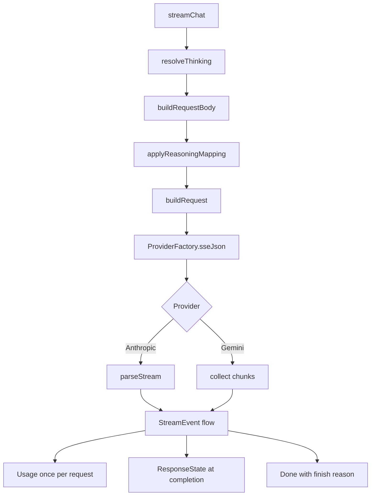

# Anthropic and Gemini Providers

> Translates the neutral `LlmProvider` contract into Anthropic Messages and Google Gemini streaming requests, including their different thinking controls, tool schemas, image formats, and usage accounting.

`AnthropicProvider` targets `POST {baseUrl}/v1/messages` with content blocks, `tool_use` and `tool_result`, and explicit prompt cache breakpoints. `GeminiProvider` targets `POST {baseUrl}/models/{model}:streamGenerateContent?alt=sse` with `contents`, `functionDeclarations`, and `inlineData`. Both return the same `StreamEvent` flow, so the agent loop does not branch on vendor. The two files are separate because almost nothing maps one-to-one: system prompt placement, assistant replay, tool result grouping, reasoning fields, and usage counters all differ.

## Module Responsibilities

- **Anthropic request mapping**: model, `max_tokens`, streaming flag, thinking style, cached system prompt, message conversion, sorted tool schemas, session routing metadata, and optional CEL reasoning mapping.
- **Anthropic stream parsing**: content block start, text and thinking deltas, input JSON fragments, tool assembly, cumulative usage, stop reason, in-band errors, and native state capture.
- **Anthropic prompt caching**: up to two conversation breakpoints in addition to the system and tool breakpoints, chosen to maximize prefix reuse.
- **Gemini request mapping**: `systemInstruction`, `contents`, `parametersJsonSchema` tool declarations, `generationConfig`, thinking config, and optional reasoning mapping.
- **Gemini stream parsing**: candidates, parts, thought parts, function calls, cumulative `usageMetadata`, finish reason, in-band errors, and native part capture.
- **Gemini message conversion**: image `inlineData`, native assistant parts, grouped `functionResponse`, and system messages as user content.

## Architecture and Flow

Both providers emit `ThinkingConfigured` before any network event. This lets the agent record the resolved thinking level even when the request later fails. Neither provider emits `Retrying` or `ProviderChanged`; those belong to key rotation and fallback wrappers.

## Invocation Chain

1. `AgentEngine` calls `provider.streamChat(...)` with the selected `ProviderConfig` and `RequestOptions` (`AgentEngine.kt#L631`).
2. `ProviderFactory.create(type)` constructs `AnthropicProvider` or `GeminiProvider` with the shared OkHttp client (`Llm.kt#L224`).
3. `streamChat` calls `options.resolveThinking(config)` and passes the resolved spec into `buildRequestBody`.
4. `buildRequestBody` serializes messages and tools, then calls `options.applyReasoningMapping(config, body)`.
5. `buildRequest` or the inline Gemini request builder attaches credentials, version headers, OpenCode session headers when applicable, and custom headers.
6. `ProviderFactory.sseJson(request, ProviderHeaders.client(config, client))` returns the JSON payload flow (`Llm.kt#L236`).
7. `AnthropicProvider.parseStream` or the Gemini collection loop maps payloads to `StreamEvent`, emits `Usage` and `ResponseState`, and ends with `Done`.
8. `AgentEngine.streamEventHandler` consumes the events at `AgentEngine.kt#L543`.

## Key State and Data Structures

- **`ThinkingSpecs.ResolvedThinking`**: `level`, `spec`, `requested`, `effort`, `budget`, `maxOutputTokens`, and `detail`. Anthropic reads `spec.style`, `effort`, and `budget`; Gemini reads `style`, `effort`, and `budget`. The resolved output limit is already cap-adjusted.
- **Anthropic `toolBlocks`**: `TreeMap<Int, Triple<String, String, StringBuilder>>` keyed by content block index, holding call id, name, and accumulated `partial_json`. Removed at `content_block_stop`.
- **Anthropic `nativeBlocks`**: `TreeMap<Int, MutableMap<String, JsonElement>>` holding text, thinking, signature, and parsed input for each block. Converted to `ProviderMessageState` with format `anthropic`.
- **Anthropic counters**: `uncachedTokens`, `outputTokens`, `cachedTokens`, `cacheWriteTokens`, `cacheReported`, `pendingUsage`, and `stopReason`. Usage is a cumulative snapshot, never a sum.
- **Gemini `nativeParts`**: every candidate part in order, stored as `ProviderMessageState` with format `gemini`.
- **Gemini counters**: `inputTokens`, `outputTokens`, `thoughtTokens`, `cachedTokens`, `cacheReported`, `finishReason`, and `callCounter`. Only one `Usage` is emitted per request.
- **`ProviderMessageState`**: persisted with the assistant message. `matches` requires the same provider id, endpoint hash, model, and format before native blocks are replayed.

## Anthropic Request Mapping

`buildRequestBody` (`AnthropicProvider.kt#L59`) produces:

- `model` and `max_tokens`. The limit comes from `thinking.maxOutputTokens`, which already reflects provider caps and reasoning budget reserve.
- `stream: true`.
- Thinking configuration selected by `thinking.spec.style`:
  - `ADAPTIVE`: a `thinking` object with type `disabled` when the level is `OFF`, `enabled` when the host is DeepSeek, otherwise `adaptive`. For non-off Claude models it adds `display: "summarized"`. A non-off level also adds `output_config.effort`.
  - `BUDGET`: `thinking.type` is `disabled` for a zero budget, otherwise `enabled`, with `budget_tokens` when positive.
  - Other styles add nothing.
- `system` as a one-element array of `{type: "text", text, cache_control: {type: "ephemeral"}}`. The system prompt and tool schemas are stable across turns, so they are always cacheable.
- `messages` from `serializeMessages`, then `applyCacheBreakpoints`.
- `tools` sorted by name, each with `name`, `description`, `input_schema`, and `cache_control` on the last tool.
- `metadata.user_id` when `cacheKey` is present, truncated to 64 characters.
- Finally `options.applyReasoningMapping`, which can add a custom CEL-mapped object.

`buildRequest` (`AnthropicProvider.kt#L451`) appends `/v1/messages` to the trimmed base URL, sets `x-api-key`, always sets `anthropic-version: 2023-06-01`, adds OpenCode session headers when `HarnessProvider.isOpenCode(config)`, and applies custom headers through `ProviderHeaders.apply`. Custom headers are disabled for managed provider ids by `ProviderHeaders.editable`.

## Anthropic Message Conversion

`serializeMessages` (`AnthropicProvider.kt#L333`) walks the list and preserves contiguous tool results:

- **`USER`**: plain string content when no images; otherwise a content array of `image` blocks with `source.type = "base64"`, `media_type`, and `data`, followed by a text block.
- **`ASSISTANT`**: if `generation.state` matches this provider id, endpoint hash, model, and `anthropic` format, the native `items` are sent as `content`. Otherwise it builds text and `tool_use` blocks. Invalid stored arguments fall back to `{}` rather than failing the request.
- **`TOOL`**: consecutive tool messages are grouped into one user message whose content is an array of `tool_result` blocks. Each has `tool_use_id`, either a string `content` or a content array with optional text and image blocks, and `is_error: true` when set. Anthropic requires this grouping.
- **`SYSTEM`**: converted to a user message. The real system prompt travels separately.

The native state path matters for signed thinking blocks. Anthropic returns `thinking` and `signature` content that must be replayed unchanged; `ResponseState` captures those blocks in `parseStream` and attaches them to the assistant message via `ProviderMessageState.of(config, "anthropic", ...)`.

## Anthropic Prompt Caching

`applyCacheBreakpoints` (`AnthropicProvider.kt#L284`) places at most two conversation breakpoints:

1. A rolling breakpoint on the final message. Each request writes the whole conversation prefix into the cache; the next request reads it back for the entire prefix.
2. A stable breakpoint on the first user message when it is not already the last message. If the rolling entry expires after roughly five minutes idle, the prefix through the first user message remains cached and degrades to a partial hit.

`withCacheBreakpoint` (`AnthropicProvider.kt#L299`) converts a string content into a text block array so it can carry `cache_control`. For an array it anchors on the last block that is not `thinking` or `redacted_thinking`, because Anthropic rejects cache control on thinking blocks. Existing `cache_control` is preserved. `TOOL` results and images are valid anchors.

## Anthropic Stream Parsing

`parseStream` (`AnthropicProvider.kt#L121`) uses two `TreeMap<Int, ...>` structures: `toolBlocks` for executable tool calls and `nativeBlocks` for the opaque state returned at completion. It also tracks `uncachedTokens`, `outputTokens`, `cachedTokens`, `cacheWriteTokens`, `cacheReported`, `pendingUsage`, and `stopReason`.

- `message_start` updates usage from `message.usage`.
- `content_block_start` with type `tool_use` records id, name, and a buffer, then emits `ToolCallDelta(id, name, "")`. A missing id becomes `toolu_<nanoTime>`.
- `content_block_delta` maps `text_delta` to `TextDelta`, `thinking_delta` to `ThinkingDelta`, and `input_json_delta` to `ToolCallDelta` while appending `partial_json`. The same block also accumulates `text`, `thinking`, and `signature` into `nativeBlocks`.
- `content_block_stop` parses accumulated tool arguments and emits `ToolCallReady` with `{}` for empty arguments. It also stores parsed input on the native block.
- `message_delta` records `stop_reason` and replaces usage with the cumulative final snapshot. Counts are never added across chunks.
- `message_stop` emits `Done(stopReason)`.
- `error` emits `Failure` with `providerErrorStatus` and `providerErrorCode`.

`updateUsage` (`AnthropicProvider.kt#L134`) reads `input_tokens`, `output_tokens`, `cache_read_input_tokens`, and either `cache_creation_input_tokens` or the nested `cache_creation` object with `ephemeral_5m_input_tokens` and `ephemeral_1h_input_tokens`. Total input is `uncached + cached + cacheWrite`. The pending usage is emitted immediately before `Done`, and once more after the stream in case a gateway closed without `message_stop`. `ResponseState` is emitted only when `config` is non-null and native blocks exist.

## Gemini Request Mapping

`streamChat` (`GeminiProvider.kt#L32`) builds the URL as `baseUrl + "/models/" + model + ":streamGenerateContent?alt=sse"`, sets `x-goog-api-key`, and applies custom headers. `buildRequestBody` (`GeminiProvider.kt#L134`) produces:

- `systemInstruction.parts[0].text`.
- `contents` from `serializeMessages`.
- `tools[0].functionDeclarations`, sorted by name, each with `name`, `description`, and `parametersJsonSchema`.
- `generationConfig.maxOutputTokens`.
- `generationConfig.thinkingConfig` only for `EFFORT` or `BUDGET` styles, with `thinkingLevel`, `thinkingBudget`, and `includeThoughts` equal to the level not being `OFF`.
- Optional custom reasoning mapping.

`parametersJsonSchema` is the #80 fix. Gemini's older typed `parameters` field rejects JSON Schema constructs that the app's tools use, notably `additionalProperties` in dictionary arguments such as HTTP headers. Sending the full schema through `parametersJsonSchema` preserves nested schemas and dictionaries instead of failing the request. The changelog entry is at `CHANGELOG.md#L50` and the change landed in commit `f331dd0`.

There are no `temperature`, `topP`, `topK`, candidate count, or safety settings in the body. The app relies on endpoint defaults and does not expose those controls.

## Gemini Message Conversion

`serializeMessages` (`GeminiProvider.kt#L179`) first collects `nativeCallIds`: function call ids present in any assistant `generation.state` that matches this provider, endpoint, model, and `gemini` format. Then:

- **`USER`**: role `user`, parts gathered from `imageData` as `inlineData` with `mimeType` and `data`, then a text part. The text part is always added, even when blank.
- **`ASSISTANT`**: role `model`. Native matching state is sent as `parts` unchanged. Otherwise text and `functionCall` objects with `name` and parsed `args` are built. The function call id is not sent on replay, because Gemini identifies calls by order and name in this path.
- **`TOOL`**: consecutive tool messages are grouped into one user content. Each becomes `functionResponse` with `id` only when the tool call id appears in `nativeCallIds`, `name` from `toolName` or `unknown`, and `response: {output: text}`. Tool images are appended as separate `inlineData` parts.
- **`SYSTEM`**: a user content with a text part.

The `nativeCallIds` gate avoids inventing ids that the original Gemini response never returned. A synthetic id is generated on the live stream for internal tracking, but replaying it into `functionResponse` would break call correlation.

## Gemini Stream Parsing

`GeminiProvider.streamChat` (`GeminiProvider.kt#L64`) collects `JsonObject` chunks directly rather than using a separate pure parser. It tracks input tokens, output tokens, thought tokens, cached tokens, cache reporting, finish reason, and `nativeParts`.

- An `error` object emits `Failure` with message, status, and code, then stops processing that chunk.
- `usageMetadata` is cumulative. The parser overwrites `promptTokenCount`, `candidatesTokenCount`, `thoughtsTokenCount`, and `cachedContentTokenCount` rather than summing.
- `candidates[0].finishReason` is read before parts because a final chunk may carry the reason with no content.
- Each part is appended to `nativeParts`. A part with `thought: true` and text emits `ThinkingDelta`; other text emits `TextDelta`. `functionCall` emits `ToolCallReady` with the provider id when present or `gemini_<name>_<counter>` otherwise. Args are stringified JSON.
- Multiple events from one chunk are wrapped in `StreamEvent.Batch`; a single event is emitted directly. This preserves ordering for a chunk that carries text and a call.
- At the end, if `inputTokens > 0`, one `Usage` is emitted. `outputTokens` includes `thoughtTokens`, and `reasoningTokens` is set separately. This avoids both per-chunk inflation and truncation when a usage-only chunk arrives after the final candidate.
- If native parts exist, `ResponseState` is emitted with format `gemini`.
- `Done(finishReason)` is always emitted last.

## Boundary Conditions

- HTTP errors are raised by `ProviderFactory.sseJson` as `ApiException` with `Retry-After` parsing. In-band errors become `Failure` events, so a 200 response does not hide a provider error.
- Anthropic may close without `message_stop`; pending usage is flushed after collection. Gemini always emits `Done` itself.
- Anthropic tool blocks with a blank name are dropped at `content_block_stop`. Empty arguments become `{}`. Gemini function calls without a name are skipped in the loop.
- Anthropic usage is overwritten on `message_delta`, never accumulated, because the counts are cumulative.
- Gemini thought tokens are added to output for billing display but kept as `reasoningTokens` for reporting.
- Both parsers use `jsonObjectOrAbsent` and `jsonArrayOrAbsent` so explicit JSON nulls from gateways do not throw.
- Native state is only replayed when the endpoint hash, provider id, model, and format all match. A model switch or base URL edit falls back to the plain text and tool representation.

## Extension Points

- `ThinkingSpecs` controls which style a model receives. Add a model family there rather than branching inside a provider.
- `options.applyReasoningMapping` runs after the native body is built, so a CEL expression can add or override fields without editing the provider.
- `ProviderHeaders.apply` adds per-connection headers before the request is posted.
- Native state capture can be extended by adding fields to the content block accumulators; keep the `format` string stable because `ProviderMessageState.matches` depends on it.
- `HarnessProvider.isOpenCode` adds session headers for Anthropic requests through an OpenCode-compatible relay. The same hook exists in every provider.

## Known gaps

- Gemini does not implement explicit prompt caching fields. It reports `cachedContentTokenCount` when the endpoint provides it but never creates or references a cache.
- No Gemini safety settings or sampling parameters are exposed in the request body or the UI, so those behaviors are endpoint defaults and cannot be adjusted per connection.
- Anthropic `metadata.user_id` is capped at 64 characters by truncation, not hashing. Two long session ids sharing a 64-character prefix would share the routing hint, though this is unlikely with UUID session ids.

Sources: [app/src/main/java/com/androidharness/app/llm/AnthropicProvider.kt](../app/src/main/java/com/androidharness/app/llm/AnthropicProvider.kt)#L30-L466), [app/src/main/java/com/androidharness/app/llm/GeminiProvider.kt](../app/src/main/java/com/androidharness/app/llm/GeminiProvider.kt)#L26-L275), [CHANGELOG.md](../CHANGELOG.md)#L50), [app/src/main/java/com/androidharness/app/llm/Llm.kt](../app/src/main/java/com/androidharness/app/llm/Llm.kt)#L236-L284), [app/src/main/java/com/androidharness/app/llm/ProviderHeaders.kt](../app/src/main/java/com/androidharness/app/llm/ProviderHeaders.kt)#L41-L55)

## Source files

- `app/src/main/java/com/androidharness/app/llm/AnthropicProvider.kt`
- `app/src/main/java/com/androidharness/app/llm/GeminiProvider.kt`
- `app/src/main/java/com/androidharness/app/llm/Llm.kt`
- `app/src/main/java/com/androidharness/app/llm/ProviderHeaders.kt`
- `app/src/main/java/com/androidharness/app/llm/HarnessProvider.kt`
- `CHANGELOG.md`
