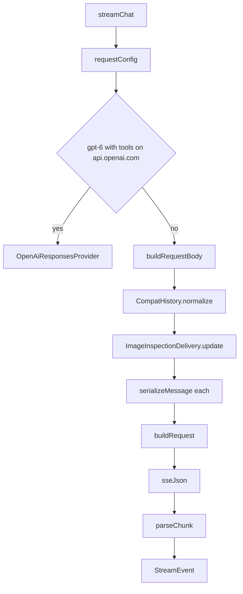

# OpenAI Compatible and Responses Providers

> Implements the OpenAI Chat Completions and OpenAI Responses wire protocols, including message and history repair, tool call assembly, reasoning deltas, usage aliases, and custom endpoint headers.

`OpenAiCompatProvider` handles `/chat/completions` for OpenAI, OpenRouter, Groq, Together, DeepSeek, Ollama, LM Studio, and any compatible gateway. `OpenAiResponsesProvider` handles `/responses`, where reasoning is a first-class object and tool calls are standalone items. `CompatHistory` repairs only the request view of interrupted or legacy tool exchanges, leaving saved chat history untouched. The two providers share the neutral contract but almost no JSON shape: chat completions nests tools under `function`, Responses flattens them, and Responses has no equivalent of a grouped tool message.

## Module Responsibilities

- **Chat Completions body building**: model, streaming, token limit field selection, router or toggle reasoning, cache routing fields, usage accounting, system message, normalized history, image delivery, tools, and custom reasoning mapping.
- **Chat Completions stream parsing**: error shapes, usage aliases, text and reasoning deltas, tool call fragments keyed by call id, argument snapshots, finish reasons, and defensive flushing.
- **Responses body building**: stateless request (`store: false`), `instructions`, `max_output_tokens`, `input` items, flat function tools, reasoning effort and summary, encrypted reasoning include, and cache key.
- **Responses stream parsing**: output text, reasoning summary deltas, function call item lifecycle, completed and incomplete responses, usage, and finish reason.
- **History normalization**: convert invalid or orphaned tool exchanges into plain text before sending, without mutating stored messages.
- **Connection controls**: custom base URLs, provider headers, OpenCode session headers, OpenRouter attribution headers, and local key suppression.

## Architecture and Flow

`requestConfig` (`OpenAiCompatProvider.kt#L548`) is a transport-only redirect. When the connection type is `OPENAI_COMPAT`, the host is exactly `api.openai.com`, tools are present, and the model (after the last `/`) starts with `gpt-6`, it changes the type to `OPENAI_RESPONSES`. `options.forTransportRoute(config, routed)` carries custom reasoning overrides across the route.

## Invocation Chain

1. `AgentEngine` calls `provider.streamChat(...)` with the selected config, key, system prompt, history, tools, and options (`AgentEngine.kt#L631`).
2. `ProviderFactory.create(type)` returns `OpenAiCompatProvider` or `OpenAiResponsesProvider` (`Llm.kt#L224`).
3. `OpenAiCompatProvider.streamChat` calls `requestConfig`, then either delegates to `OpenAiResponsesProvider` or continues with Chat Completions.
4. `buildRequestBody` calls `CompatHistory.normalize`, `ImageInspectionDelivery.update`, `serializeMessage`, and `applyReasoningMapping`.
5. `buildRequest` appends the endpoint path, adds authorization and OpenCode or OpenRouter headers, and applies custom headers.
6. `ProviderFactory.sseJson` emits JSON payloads; `parseChunk` or `parseEvent` converts each payload to one or more `StreamEvent`.
7. `AgentEngine.streamEventHandler` consumes the events at `AgentEngine.kt#L543`.

## Key State and Data Structures

- **Chat Completions accumulator**: `LinkedHashMap<String, Triple<StringBuilder, StringBuilder, StringBuilder>>` keyed by call id, with `(id, name, arguments)`. `indexToId` maps a stream index to an id for fragments without an id.
- **Responses accumulator**: `LinkedHashMap<String, Triple<String, String, StringBuilder>>` keyed by item id, with `(call_id, name, arguments)`. It is always cleared after draining.
- **`pendingUsage`**: the last `Usage` seen. Emitted once after collection so per-chunk or repeated usage blocks do not inflate totals.
- **Reasoning state**: `reasoningDetails` collects `reasoning_details` objects; `reasoningText` collects `reasoning_content` or `reasoning`. Both are merged into `ProviderMessageState` with format `chat_completions`.
- **Responses reasoning items**: a `LinkedHashMap<String, JsonObject>` keyed by item id, used to build `ProviderMessageState` with format `responses`.
- **`CompatHistory` repair**: request-scoped only. The stored `List<ChatMessage>` is never mutated.

## Chat Completions Request Mapping

`buildRequestBody` (`OpenAiCompatProvider.kt#L124`) constructs:

- `model` and `stream: true`.
- `max_completion_tokens` when the host is `api.openai.com` or the model matches `^(o\d|gpt-5)`, otherwise `max_tokens`. Older OpenAI models and many gateways reject `max_completion_tokens`; newer reasoning models reject `max_tokens`.
- Reasoning fields:
  - For routers (`openrouter.ai`, `api.kilo.ai`, `ai-gateway.kilo.ai`), a `reasoning` object with `effort`, `enabled`, and `max_tokens` as available.
  - Otherwise, the spec's toggle field, with type `disabled` or `enabled`. Zhipu and ZAI hosts add `clear_thinking: false` when enabled. Moonshot Kimi K2.6 adds `keep: "all"`.
  - A `reasoning_effort` field unless the effort is `none` and a toggle field already exists.
- `prompt_cache_key` and `user: pc_<key>` when `cacheKey` is set and `PromptCachePolicy` allows the host. Only `api.openai.com` and `openrouter.ai` are allowed, because other gateways may reject unknown fields.
- `stream_options.include_usage: true` for every non-local host. Local llama.cpp, Ollama, and LM Studio builds may reject unknown fields.
- A system message. For OpenRouter with a Claude or Anthropic model, the system message uses a content array with `cache_control: ephemeral`. Everywhere else it is a plain string.
- `messages` built from `CompatHistory.normalize(messages)`, then `ImageInspectionDelivery.update` on each message.

Tool images need special handling. Chat Completions accepts image parts in user messages, but strict endpoints reject image parts in a `tool` message. For a `TOOL` message with images, the provider emits the text-only tool message and collects the images into a synthetic user message after the contiguous tool block ends. That user message lists labels with `tool_call_id`, `tool_name`, attachment index, and selected metadata, then attaches the images in order. The text instructs the model to match `attachment_id` and `tool_call_id`. This keeps the tool result valid while still giving the model the bytes.

Tools are sorted by name and emitted as `{type: "function", function: {name, description, parameters}}`. `parameters` is the raw `parametersJson` schema.

## Chat Completions Message Conversion

`serializeMessage` (`OpenAiCompatProvider.kt#L468`):

- **`USER`**: string content when no images; otherwise a content array with a text part followed by `image_url` parts whose URL is a `data:<mime>;base64,<data>` URI.
- **`ASSISTANT`**: `content` is always the text. If native state matches `chat_completions`, the first state item's fields are copied onto the message, which restores `reasoning_content` and `reasoning_details`. If the host is DeepSeek and no native state exists, an empty `reasoning_content` is added because the API requires the field on assistant messages. Tool calls become `{id, type: "function", function: {name, arguments}}` where arguments stay a JSON string.
- **`TOOL`**: `role: tool`, `tool_call_id`, and string or content array. The content array supports text and image parts for gateways that accept them; the earlier synthetic split still applies.
- **`SYSTEM`**: `{role: system, content: text}`.

Native state is only used when `ProviderMessageState.matches` confirms provider id, endpoint hash, model, format `chat_completions`, and the optional content digest.

## Chat Completions Stream Parsing

`streamChat` (`OpenAiCompatProvider.kt#L44`) accumulates in a `LinkedHashMap<String, Triple<StringBuilder, StringBuilder, StringBuilder>>` keyed by call id. A parallel `indexToId` map links fragments that carry no id. Keying by id rather than stream index is deliberate: some gateways stream parallel calls with every fragment at index 0, and index keying merges them into one garbled call.

`parseChunk` (`OpenAiCompatProvider.kt#L239`) handles:

- **Errors**: `{"error": "text"}`, `{"error": {"message": ...}}`, a choice-level error, or `finish_reason == "error"`. It clears the accumulator so incomplete arguments cannot execute, and emits `Failure` with code, error code, and any explicit retry delay.
- **Usage**: reads `prompt_tokens`, `completion_tokens`, many cached-token aliases (`cached_tokens`, `cache_read_input_tokens`, `cache_read_tokens`, `cached_prompt_tokens`, `prompt_cache_hit_tokens`, and others), cache write aliases, and reasoning tokens from `completion_tokens_details` or `output_tokens_details`. It emits `Usage` without skipping the rest of the chunk, because usage often rides on the finish chunk.
- **Text**: string content becomes `TextDelta`. Explicit null is ignored. Array content is joined from its `text` fields, which some gateways use.
- **Reasoning**: `reasoning_content` or `reasoning` becomes `ThinkingDelta`. If neither exists, `reasoning_details` items contribute `text` or `summary`. The same details are also collected by `streamChat` for native state.
- **Tool calls**: each entry reads `index`, `id`, and `function.name` and `function.arguments`. String arguments append and emit `ToolCallDelta`. Object arguments are treated as a complete snapshot, clear the buffer, and emit `ToolCallDelta(..., replace = true)`. Any other argument shape clears the accumulator and fails the stream as unsupported.
- **Finish**: `finish_reason` drains accumulated calls into `ToolCallReady` or `ToolCallBatch`, then emits `Done(finish)`.

`streamChat` keeps only the last `Usage` it sees and emits it once after collection. Some gateways attach usage to every chunk; summing would multiply session totals. `takeWhile` stops consuming after a `Failure`. If the SSE reader saw `[DONE]` but no finish chunk and no failure, it emits `Done()` and flushes any leftover call fragments. This covers gateways that close after `[DONE]` without a finish reason.

`mergeReasoningDetails` (`OpenAiCompatProvider.kt#L453`) groups reasoning detail fragments by `type` plus `index` or `id`, concatenating `text`, `summary`, and `data` strings so encrypted signatures survive. The merged array is stored in `ProviderMessageState` with format `chat_completions`.

## Responses Request Mapping

`buildRequestBody` (`OpenAiResponsesProvider.kt#L104`) wraps the body in `options.applyReasoningMapping`. It sets:

- `model`, `stream: true`, `store: false`, `max_output_tokens`, and `instructions` from the system prompt. Statelessness is explicit because the app resends full history.
- `prompt_cache_key` and `user: pc_<key>` for supported hosts.
- `reasoning: {effort, summary: "auto"}` when an effort exists and is not `none`, plus `include: ["reasoning.encrypted_content"]` so reasoning can be replayed across stateless calls.
- `input`, where each `ChatMessage` becomes zero or more items.
- Flat tools: `{type: "function", name, description, parameters, strict: false}`.

`serializeMessage` (`OpenAiResponsesProvider.kt#L153`):

- **`USER`**: a user item with `input_text` parts and `input_image` parts carrying data URIs.
- **`ASSISTANT`**: first any matching native state items, then an assistant item with `output_text` when text exists, then one `{type: "function_call", call_id, name, arguments}` per tool call.
- **`TOOL`**: a `{type: "function_call_output", call_id, output}` item. If images exist, a separate user item with `input_image` parts follows. Tool outputs are string-only, and a top-level image item is rejected by strict gateways.
- **`SYSTEM`**: a user item with `input_text`, because `instructions` already carries the main system prompt.

`buildRequest` (`OpenAiResponsesProvider.kt#L89`) appends `/responses`, sets `Bearer`, adds OpenCode session headers when applicable, and applies custom headers.

## Responses Stream Parsing

`parseEvent` (`OpenAiResponsesProvider.kt#L237`) switches on the SSE `type`:

- An `error` object becomes `Failure`.
- `response.failed` reads `response.error.message`, status, and code.
- `response.output_text.delta` becomes `TextDelta`.
- `response.reasoning_summary_text.delta` and `response.reasoning_text.delta` become `ThinkingDelta`.
- `response.output_item.added` for a `function_call` opens an accumulator entry keyed by item id, storing `call_id`, `name`, and an arguments buffer, and emits an empty `ToolCallDelta`.
- `response.function_call_arguments.delta` appends to that entry and emits a fragment. If no item was added first, the fragment is ignored rather than creating a call with no name.
- `response.output_item.done` fills in full arguments when the server never streamed deltas.
- `response.completed` and `response.incomplete` emit `Usage`, drain calls, and emit `Done`. Completed uses `stop`; incomplete uses `incomplete_details.reason` or `incomplete`.

`streamChat` (`OpenAiResponsesProvider.kt#L36`) also collects reasoning items from `response.output_item.done` and from `response.output` to build `ResponseState` with format `responses`. It holds usage until the stream ends, then emits it once, followed by the state and a defensive `drainAccumulated`.

## Compat History Repair

`CompatHistory.normalize` (`CompatHistory.kt#L10`) runs only for Chat Completions. Responses does not call it. It walks messages and validates every assistant tool-call block:

- All call ids must be non-blank, unseen in an earlier block, and distinct.
- Every call must have a non-blank name and arguments that parse as a JSON object.
- The number of following `TOOL` messages must equal the number of calls, and their `toolCallId` set must equal the call id set.

A valid block is passed through with its tool results. An invalid block keeps the assistant text, drops the tool calls, and appends a bracketed note listing tool names, argument JSON, and recorded outcomes. If fewer results exist than calls, it adds a line saying some outcomes are unknown and instructs inspection before acting. An orphan `TOOL` message outside a valid block is converted to a `USER` message with the tool name and text, and its tool id and name cleared.

The repair is request-scoped. Stored history, the chat transcript, and the database are not modified. This prevents one interrupted exchange from poisoning every later request while keeping the user's record intact.

## Boundary Conditions

- Custom headers are limited to 20, cannot override managed authentication or connection headers, must be unique and single-line, and are excluded for managed provider ids. When any header is enabled, redirects are disabled so credentials cannot follow a redirect.
- `LOCAL_KEY` is a sentinel, not a credential. `buildRequest` omits `Authorization` when the key is blank or equals `LOCAL_KEY`, because some local servers reject an empty bearer.
- OpenRouter requests add `HTTP-Referer: https://github.com/Sanuu7/AndroidHarness` and `X-Title: Android Harness`.
- A `Failure` clears accumulated tool calls, so partial arguments never execute even if `[DONE]` follows.
- Object-shaped tool arguments replace earlier fragments rather than appending, which supports gateways that send one complete JSON snapshot.
- Responses usage is held until completion and emitted once, so a usage-only event cannot inflate totals.

## Extension Points

- Add a new usage alias to `parseChunk` rather than branching in the agent engine.
- `PromptCachePolicy.supportsKey` is the single gate for cache routing fields across both providers.
- `ProviderHeaders` applies to both transports and is stored encrypted per provider.
- `requestConfig` is the place to add another transport-only redirect, but it must preserve id, model, and base URL so `forTransportRoute` can carry overrides.
- `CompatHistory.normalize` is internal to the module; callers cannot opt out. A new history repair rule should stay request-scoped for the same reason.

## Known gaps

- `parseChunk` contains a `println("HarnessUsage: ...")` diagnostic at `OpenAiCompatProvider.kt#L297`. It prints the raw usage object on every request that reports usage, so log output can be noisy in debug builds.
- Responses has no `CompatHistory` equivalent. A malformed tool exchange from an older chat may be sent as-is to `/responses`, which relies on `function_call_output` pairing.

Sources: [app/src/main/java/com/androidharness/app/llm/OpenAiCompatProvider.kt](../app/src/main/java/com/androidharness/app/llm/OpenAiCompatProvider.kt)#L39-L575), [app/src/main/java/com/androidharness/app/llm/OpenAiResponsesProvider.kt](../app/src/main/java/com/androidharness/app/llm/OpenAiResponsesProvider.kt)#L31-L353), [app/src/main/java/com/androidharness/app/llm/CompatHistory.kt](../app/src/main/java/com/androidharness/app/llm/CompatHistory.kt)#L8-L41), [app/src/main/java/com/androidharness/app/llm/PromptCachePolicy.kt](../app/src/main/java/com/androidharness/app/llm/PromptCachePolicy.kt)#L5-L15), [app/src/main/java/com/androidharness/app/llm/ProviderHeaders.kt](../app/src/main/java/com/androidharness/app/llm/ProviderHeaders.kt)#L13-L55)

## Source files

- `app/src/main/java/com/androidharness/app/llm/OpenAiCompatProvider.kt`
- `app/src/main/java/com/androidharness/app/llm/OpenAiResponsesProvider.kt`
- `app/src/main/java/com/androidharness/app/llm/CompatHistory.kt`
- `app/src/main/java/com/androidharness/app/llm/PromptCachePolicy.kt`
- `app/src/main/java/com/androidharness/app/llm/ProviderHeaders.kt`
- `app/src/main/java/com/androidharness/app/llm/ProviderNetwork.kt`
