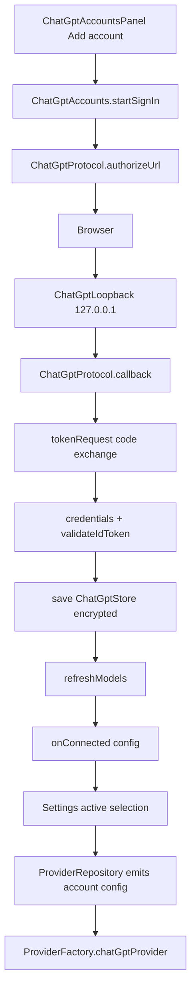

# ChatGPT Accounts

> Connects ChatGPT subscription accounts through OpenAI's OAuth flow, stores rotating credentials in encrypted preferences, lists plan models, and exposes each account as a managed Responses provider.

The ChatGPT subsystem lets a user run requests against a ChatGPT plan instead of an API key. `ChatGptProtocol` owns endpoint constants, OAuth URL construction, loopback callback validation, OIDC ID token verification, model parsing, and error text. `ChatGptAccounts` owns the account store, sign-in job, token refresh, model discovery, account switching, and sign-out. `ChatGptProvider` adapts the managed account to `LlmProvider` on top of `OpenAiResponsesProvider`, with namespaced tools and strict terminal validation. The account is never written into the normal provider list; it is assembled at read time from account state.

## Module Responsibilities

- **Account identity**: one `ChatGptRegistration` per OpenAI client id, with issuer, subject, email, access token, refresh token, id token, expiry, earliest refresh time, scopes, catalog models, and verified models.
- **Sign-in**: dynamic client registration, PKCE, nonce, state, loopback redirect, code exchange, and ID token verification.
- **Credential lifecycle**: persist all rotating credentials atomically, refresh shortly before expiry, wipe tokens on invalid grant or invalid client, and revoke the refresh token on sign-out.
- **Model catalog**: fetch `/v1/models` from the ChatGPT resource, filter visible slugs, parse reasoning efforts, and optionally verify newer documented models with a tiny inference request.
- **Account switching**: select a connected account, refresh its models, keep the current model if offered, otherwise use its first model, and make it the active provider.
- **Provider integration**: expose each connected account as a `ProviderConfig` whose id starts with `chatgpt:`, whose type is `OPENAI_RESPONSES`, and whose base URL is the ChatGPT resource.
- **UI**: list accounts, start or cancel sign-in, refresh models, check newer models, reconnect, sign out, and open the usage page.

## Architecture and Flow

Every step is serialized by a `Mutex` where it touches the store. Sign-in holds a 300 second timeout. Cancellation closes the loopback socket. A failed sign-in publishes an error string but does not discard an already issued registration: the code keeps the client id so a later attempt can reconnect to the same account.

## Invocation Chain

1. `ConnectedAccountsSection` calls `container.chatGpt.startSignIn { openOAuthBrowser(...) }` (`ConnectedAccountsSection.kt#L42`).
2. `ChatGptAccounts.startSignIn` creates state, nonce, and PKCE verifier, opens a loopback receiver, and builds the authorization URL (`ChatGptAccounts.kt#L85`).
3. `ChatGptProtocol.authorizeUrl` opens the browser; `ChatGptLoopback.receive` accepts the callback; `ChatGptProtocol.callback` validates state, code, and client id.
4. `tokenRequest` exchanges the code; `credentials` verifies the ID token with `ChatGptProtocol.validateIdToken` and merges tokens.
5. `replace` writes `ChatGptStore`; `refreshModels` fills the catalog; `onConnected` sets the active selection.
6. At request time `ProviderFactory.create` returns `ProviderFactory.chatGptProvider` (`Llm.kt#L215`); `ChatGptProvider.streamChat` obtains `accessToken` and posts to `RESOURCE + "/responses"`, then uses `OpenAiResponsesProvider.parseEvent`.

## Key State and Data Structures

- **`ChatGptStore`**: `hostId`, `accounts`, and `welcomeSeen`. Serialized as one JSON record in encrypted preferences.
- **`ChatGptRegistration`**: `clientId`, issuer, subject, email, access, refresh, and id tokens, expiry, earliest refresh time, scopes, models, and verified models. `connected` requires an access token and the `chatgpt.tokens.use.direct` scope.
- **`ChatGptAccount`**: `providerId`, label, connected flag, and models. `config()` builds the managed `ProviderConfig`.
- **`ChatGptAccountState`**: accounts, `signingIn`, error, `showWelcome`, `checkingModelsFor`, and per-account model check results. Exposed as a `StateFlow`.
- **`ChatGptProvider` diagnostics**: `lastFailureType` and `lastResponseSummary` carry event type names and output item types only, never credentials or bodies.

## Sign-In Flow

`startSignIn` (`ChatGptAccounts.kt#L85`) refuses a second concurrent attempt, sets `signingIn`, and launches on `Dispatchers.IO`. Inside `withTimeout(300_000)`:

1. If reconnecting, the existing registration is loaded under the lock so `id_token_hint` and `login_hint` can be sent.
2. Three 32-byte random values are generated: `state`, `nonce`, and PKCE `verifier`.
3. `ChatGptLoopback` binds `ServerSocket(0, 4, 127.0.0.1)` and exposes `http://127.0.0.1:<port>/auth/callback`.
4. `ChatGptProtocol.authorizeUrl` builds the URL with `response_type=code`, SCOPES, `resource`, `state`, `nonce`, and an S256 challenge. A new account uses `dynamic_agent_client`; a reconnect uses its client id and hints.
5. The browser opens on `browserDispatcher`, default `Dispatchers.Main`.
6. `receive` accepts loopback connections with a 1 second accept timeout and a 3 second socket timeout, reads the request line, and requires `GET /auth/callback?`. Malformed or wrong-state callbacks get a 400 page and do not consume the attempt.
7. `ChatGptProtocol.callback` requires one state value, compares it in constant time, rejects an `error`, requires one `code`, and accepts at most one `client_id` that must match the reconnect registration.
8. The registration is saved before token exchange, so a later expiry still leaves a known client id.
9. The token request posts `grant_type=authorization_code`, `client_id`, `code`, `code_verifier`, `redirect_uri`, and `resource` to `TOKEN`.
10. `credentials` verifies the identity and merges the token fields.
11. `refreshModels` must return a non-empty list.
12. `onConnected` receives `ChatGptAccount.config()`, which sets the active provider and model.
13. The first successful connection sets `showWelcome`, unless `welcomeSeen` is already true.

## Identity and Token Validation

`ChatGptProtocol.validateIdToken` (`ChatGptProtocol.kt#L76`) requires a three-part JWT, header `alg` equal to `RS256`, and a matching JWKS key with `kty=rsa`, `use=sig` or absent, and `alg=RS256` or absent. It reconstructs the RSA public key from `n` and `e`, verifies `SHA256withRSA` over the first two segments, and then checks:

- `iss` equals `https://auth.openai.com`.
- The client id is in `aud`, and either it is the only audience or `azp` equals it.
- `exp` is in the future.
- `nbf` is at most 30 seconds in the future.
- `nonce` matches, when one was supplied during sign-in.

The JWKS URL comes from OIDC discovery at `https://auth.openai.com/.well-known/openid-configuration`, which must report the expected issuer. Every authentication URL is checked by `trustedAuthUrl`: HTTPS, host `auth.openai.com`, port 443, and no username or password. This blocks SSRF through a manipulated discovery document.

`credentials` (`ChatGptAccounts.kt#L300`) also requires token type `Bearer`, a non-blank access token, an `expires_in` value in 1 to 86400 seconds, and either a new ID token or an existing verified identity. It refuses a different subject or issuer, with the message "Add it as a new account." Refresh tokens and scopes are inherited when the response omits them.

## Token Storage and Refresh

The store is a `ChatGptStore` (`ChatGptProtocol.kt#L154`) serialized as one JSON record: `hostId`, `accounts`, and `welcomeSeen`. It is read and written through callbacks passed by the container. In `HarnessApp.kt#L114`, those callbacks are `KeyStoreManager.chatGptCredentials` and `putChatGptCredentials`, which use the key `chatgpt_accounts` in the `api_keys` EncryptedSharedPreferences file (`KeyStoreManager.kt#L14`). The file is wrapped by an Android Keystore AES256-GCM master key. `putChatGptCredentials` uses `commit()` and throws if the secure write fails.

`save` writes the whole updated store before publishing it, so all rotating credentials move together.

`accessToken` (`ChatGptAccounts.kt#L160`) holds the lock and:

- Rejects a registration that is not connected.
- Returns the current token when it expires more than 60 seconds from now and no forced refresh is requested.
- Returns the current token when `earliestRefreshAt` is in the future and the token is still valid.
- Otherwise posts `grant_type=refresh_token`, `client_id`, `refresh_token`, and `resource`.
- Persists the new registration and checks that plan access is still present.
- On `OAuthException` with code `invalid_grant` or `invalid_client`, removes all tokens and throws.

`ChatGptProvider` calls `accessToken(providerId, retry)`, and a 401 before any stream data triggers one forced-refresh retry.

Sign-out (`ChatGptAccounts.kt#L252`) cancels sign-in, wipes tokens locally, notifies `onDisconnected`, then attempts revocation through the discovery document's `revocation_endpoint`, checked by `trustedAuthUrl`. It sends the refresh token with `token_type_hint=refresh_token` and the client id, tries twice with a one second delay, and treats only HTTP 200 as revoked.

## Model Listing and Discovery

`refreshModels` (`ChatGptAccounts.kt#L183`) obtains a token, calls `RESOURCE + "/models"` with `Bearer`, and parses with `ChatGptProtocol.models`. The parser keeps only entries whose `visibility` is `list` and whose `slug` is non-blank. It reads supported reasoning levels from `supported_reasoning_levels` or `supported_reasoning_efforts`, accepting objects with `effort` or plain strings. Reasoning is `supports_reasoning` when present, otherwise whether any effort is not `none`, otherwise whether `ChatGptThinking.levels` returns a non-empty list.

Before publishing, the method rechecks that the registration is still connected with the same token, so a logout or reconnect race cannot resurrect an old catalog. It merges fetched models with `verifiedModels` and deduplicates by id.

`discoverModels` (`ChatGptAccounts.kt#L201`) runs under a separate `discoveryLock` so a model check cannot interleave with another check. It first refreshes the catalog, then considers three documented candidates absent from it: `gpt-6.1-sol`, `gpt-6-sol`, and `gpt-6-luna`. For each, it sends a 45 second inference request containing "Reply exactly OK." with thinking `LOW`. A candidate is verified only if the stream contains `Done`, contains no `Failure`, and has at least one non-blank `TextDelta`. Successful candidates are stored in `verifiedModels` with note "Verified with ChatGPT plan" and merged into `models`.

## Account Switching and Provider Integration

`ChatGptAccount.config()` (`ChatGptAccounts.kt#L25`) creates a `ProviderConfig` with id `chatgpt:<clientId>`, name `ChatGPT · <label>`, type `OPENAI_RESPONSES`, base URL `https://api.openai.com/v1`, and the first model in the account list. The label is `<email or "Account"> · <index + 1>`.

`selectAccount` (`ChatGptAccounts.kt#L149`) refreshes models without verified entries, requires the account to be connected, keeps the requested model when the account offers it, otherwise takes the first offered model, and returns a config with that model. `ConnectedAccountsSection` calls it and then `settings.setActiveSelection(config.id, config.model)`.

`ProviderRepository.providers` (`ProviderRepository.kt#L42`) combines DataStore, local models, and `chatGpt.state`. It emits all connected accounts with non-empty model lists first, then the Harness provider, then saved API providers and local models. Saved entries whose id is a ChatGPT provider are filtered out, so a managed account cannot be duplicated or edited as a normal connection. `catalogs` inserts account models under each `chatgpt:` id and removes any stale catalog with that prefix. `apiKey` returns `"managed-oauth"` for a connected account and null otherwise.

`ProviderFactory.create` (`Llm.kt#L215`) checks `ChatGptProtocol.isProvider(config.id)` first and returns the singleton `chatGptProvider`, which `HarnessApp.kt#L129` constructs with `chatGpt::accessToken` and a model lookup from the current account state. `ModelCatalog.listModels` delegates to `ModelCatalog.chatGptModels`, which `HarnessApp.kt#L131` binds to `chatGpt.refreshModels`.

`onDisconnected` in `HarnessApp.kt#L117` stops every running session or active subagent that used the account id, including sessions where the id appears in `usedProviderIds`.

## ChatGPT Provider Behavior

`ChatGptProvider.body` (`ChatGptProvider.kt#L29`) starts from `OpenAiResponsesProvider.buildRequestBody`, removes `max_output_tokens`, `user`, and `reasoning`, then adds `reasoning.effort` and `summary: "auto"` from the resolved thinking level. It always includes `reasoning.encrypted_content`. For legacy messages with no native state, it replays stored `responseReasoning` onto matching `function_call` items when `responseProviderId` matches the account. Tools are wrapped in one namespace item: `{type: "namespace", name: "harness", description: ..., tools: [...]}`. Each replayed function call gets `namespace: "harness"`.

`streamChat` (`ChatGptProvider.kt#L60`) posts to `RESOURCE + "/responses"` with a fresh access token. It rejects any function call whose namespace is not `harness`, any call id that is blank, any name not present in the requested tool list, and any arguments that do not parse as a JSON object. On `response.completed`, terminal output is authoritative. If `response.output` is empty, completed items from `response.output_item.done` are used instead. Reasoning items with non-blank `encrypted_content` become `ResponseState`. Tool calls are released only after successful completion, never from an interrupted stream. A completed response with status other than `completed` fails.

`failure` maps error codes through `ChatGptProtocol.requestError` and `errorStatus`, and marks the usage-limit code as not retryable.

## UI

`ChatGptAccountsPanel` (`ChatGptAccountsPanel.kt#L23`) renders a title, subtitle, Add account button, sign-in progress and cancel action, error text, and one row per account. A connected row selects the account on tap; a disconnected row opens reconnect. The overflow menu offers Refresh models, Check newer models, Reconnect or Sign in again, and Sign out. The footer opens `ChatGptProtocol.USAGE_URL` in the browser. `ChatGptUsageLimits` (`ChatGptUsageLimits.kt#L17`) repeats the usage link in the picker and context panel; it does not read live limits.

`ConnectedAccountsSection` (`ConnectedAccountsSection.kt#L19`) tracks a `selecting` id and a pending sign-out, and shows the welcome and sign-out dialogs. Known account errors keep their exact text; anything else becomes a generic update failure.

## Backup and Data Handling

ChatGPT credentials live only in the encrypted `api_keys` preferences file, never in DataStore and never in chat exports. Android backup excludes `sharedpref/api_keys.xml` in both `backup_rules.xml#L13-L21` (cloud backup for Android 9 to 11) and `data_extraction_rules.xml#L13-L34` (cloud backup and device transfer for Android 12+).

The app-level settings backup has a second layer. `SettingsBackupPolicy.canExport` returns false for any `chatgpt:` config, `exportSettings` strips provider ids and every selection referencing them, and import validation rejects a file containing a ChatGPT provider with `SettingsBackupProblem.PROVIDERS` (`SettingsBackup.kt#L47`, `#L71-L75`, `#L163`). `ChatGptRegistration.toString` prints only client id and connected state, never tokens.

## Boundary Conditions

- ID token validation rejects a non-RS256 algorithm, unknown signing key, wrong issuer, wrong audience or authorized party, expired or not-yet-valid token, and nonce mismatch.
- A 401 from the Responses endpoint triggers one token refresh retry only when no stream data has arrived.

## Known gaps

- There is no periodic background token refresh. Connected accounts are refreshed once in `ChatGptAccounts.init` and then on demand through `accessToken`, model refresh, or a provider 401.
- `ChatGptUsageLimits` and the panel's Limits & usage link open the ChatGPT settings page. The app does not read or display remaining plan limits or reset times from an API.

Sources: [app/src/main/java/com/androidharness/app/chatgpt/ChatGptAccounts.kt](../app/src/main/java/com/androidharness/app/chatgpt/ChatGptAccounts.kt)#L25-L362), [app/src/main/java/com/androidharness/app/chatgpt/ChatGptProtocol.kt](../app/src/main/java/com/androidharness/app/chatgpt/ChatGptProtocol.kt)#L22-L215), [app/src/main/java/com/androidharness/app/chatgpt/ChatGptProvider.kt](../app/src/main/java/com/androidharness/app/chatgpt/ChatGptProvider.kt)#L15-L165), [app/src/main/java/com/androidharness/app/chatgpt/ChatGptThinking.kt](../app/src/main/java/com/androidharness/app/chatgpt/ChatGptThinking.kt)#L7-L50), [app/src/main/java/com/androidharness/app/ui/settings/ChatGptAccountsPanel.kt](../app/src/main/java/com/androidharness/app/ui/settings/ChatGptAccountsPanel.kt)#L22-L115), [app/src/main/java/com/androidharness/app/ui/settings/ConnectedAccountsSection.kt](../app/src/main/java/com/androidharness/app/ui/settings/ConnectedAccountsSection.kt)#L18-L74), [app/src/main/java/com/androidharness/app/data/KeyStoreManager.kt](../app/src/main/java/com/androidharness/app/data/KeyStoreManager.kt)#L9-L42), [app/src/main/java/com/androidharness/app/data/SettingsBackup.kt](../app/src/main/java/com/androidharness/app/data/SettingsBackup.kt)#L43-L75), [app/src/main/res/xml/backup_rules.xml](../app/src/main/res/xml/backup_rules.xml)#L12-L21), [app/src/main/res/xml/data_extraction_rules.xml](../app/src/main/res/xml/data_extraction_rules.xml)#L13-L34)

## Source files

- `app/src/main/java/com/androidharness/app/chatgpt/ChatGptAccounts.kt`
- `app/src/main/java/com/androidharness/app/chatgpt/ChatGptProtocol.kt`
- `app/src/main/java/com/androidharness/app/chatgpt/ChatGptProvider.kt`
- `app/src/main/java/com/androidharness/app/chatgpt/ChatGptThinking.kt`
- `app/src/main/java/com/androidharness/app/ui/settings/ChatGptAccountsPanel.kt`
- `app/src/main/java/com/androidharness/app/ui/settings/ConnectedAccountsSection.kt`
- `app/src/main/java/com/androidharness/app/ui/common/ChatGptUsageLimits.kt`
- `app/src/main/java/com/androidharness/app/data/KeyStoreManager.kt`
- `app/src/main/java/com/androidharness/app/data/ProviderRepository.kt`
- `app/src/main/java/com/androidharness/app/data/SettingsBackup.kt`
- `app/src/main/java/com/androidharness/app/HarnessApp.kt`
- `app/src/main/res/xml/backup_rules.xml`
- `app/src/main/res/xml/data_extraction_rules.xml`
