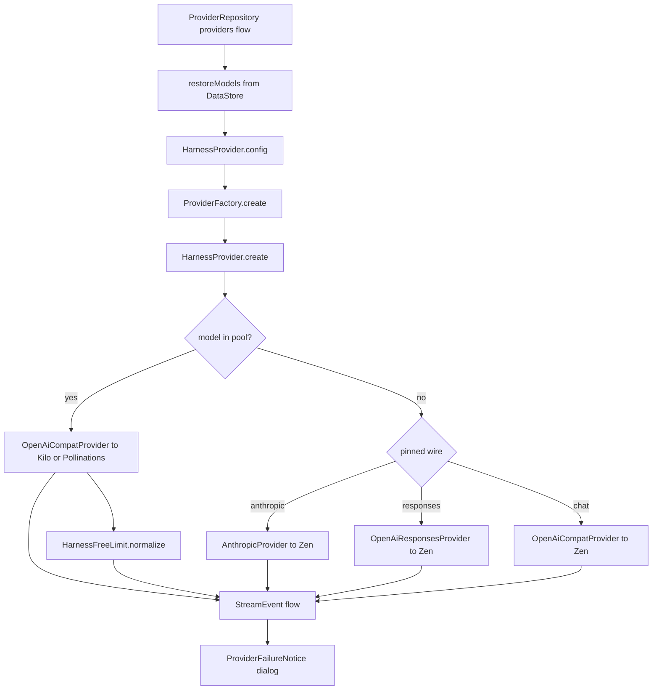

# Harness Keyless Provider

> Provides the built-in anonymous model pool: a code-defined Harness connection, Kilo's live free-model catalog, the kilo-auto router default, a Pollinations fallback, protocol probing, and free-limit notices with a provider switch.

The Harness provider is the app's zero-configuration starting point. It has no user-entered API key, no editable base URL, and no entry in the saved provider list. `HarnessProvider` declares the connection, routes pooled models to Kilo or Pollinations on the Chat Completions wire, and falls back to the OpenCode Zen relay for custom model ids. `HarnessFreeLimit` turns Kilo quota and rate-limit responses into stable, user-facing notices. `ModelCatalog` fetches Kilo's `/models` list, and `ProviderRepository` persists the result with a catalog source marker so older Zen snapshots are not reused.

## Module Responsibilities

- **Built-in connection**: stable id `harness`, display name `Harness`, wire type `OPENAI_COMPAT`, base URL `https://opencode.ai/zen/v1`, default model `kilo-auto/free`.
- **Anonymous pool**: Kilo free models and the Pollinations `openai-fast` model, each with a rate-limit note.
- **Live catalog**: fetch Kilo's catalog, keep only models marked free with tool support, and append Pollinations.
- **Routing**: pooled models go directly to their upstream on Chat Completions. Custom Zen models use a learned wire, either Chat Completions, Anthropic Messages, or OpenAI Responses.
- **Identity headers**: every request to an OpenCode endpoint carries the session header set expected by the relay.
- **Free-limit normalization**: convert Kilo quota and rate-limit failures into `harness_free_quota_exhausted` or `harness_free_rate_limited`.
- **User recovery**: show a dialog with an optional wait time and offer Switch Provider instead of a raw error.
- **Persistence**: store the catalog and learned wires in DataStore and restore them at startup.

There is no `config/provider/zcode-builtin` file, XML resource, or asset in this repository. The built-in provider is defined entirely by `HarnessProvider.kt`; its model list is remote. A search for provider configuration resources finds only research fixtures under `research/`, not shipped configuration.

## Architecture and Flow

`ProviderRepository` always prepends the Harness config to the provider list, even when no provider has been saved. `HarnessProvider.sanitize` replaces a saved model that is no longer in the pool or the custom set with `kilo-auto/free` when available, otherwise the first non-Pollinations pooled model, otherwise `openai-fast`. The provider therefore always has a valid selection.

## Invocation Chain

1. `ProviderRepository.providers` restores the catalog and prepends `HarnessProvider.config` (`ProviderRepository.kt#L42`).
2. `ProviderFactory.create` matches `config.id == HarnessProvider.ID` and calls `HarnessProvider.create()` (`Llm.kt#L220`).
3. `HarnessProvider.create().streamChat` checks the pool first, then the custom model set and the learned wire.
4. Pooled models call `OpenAiCompatProvider` with the upstream base URL; custom models call the provider selected by `wire`.
5. `OpenAiCompatProvider.buildRequest` adds the endpoint path, authorization when a real key exists, and custom headers.
6. `ProviderFactory.sseJson` emits JSON payloads; the chosen provider maps them to `StreamEvent`.
7. Kilo failures pass through `HarnessFreeLimit.normalize` before reaching `AgentEngine` and the limit dialog.

## Key State and Data Structures

`HarnessProvider` (`HarnessProvider.kt#L22`) constants:

| Name | Value |
| --- | --- |
| `ID` | `harness` |
| `BASE_URL` | `https://opencode.ai/zen/v1` |
| `KILO_BASE_URL` | `https://api.kilo.ai/api/gateway` |
| `KILO_NOTE` | `Kilo · ~200 req/hour per IP` |
| `CATALOG_SOURCE` | `kilo-free-v1` |
| `DEFAULT_MODEL` | `kilo-auto/free` |
| `KEYLESS` | `harness-keyless` |
| `SESSION_HEADER` | `x-opencode-session` |
| `USER_AGENT` | `AndroidHarness` |

`config` is `ProviderConfig(ID, "Harness", OPENAI_COMPAT, BASE_URL, DEFAULT_MODEL)`. The model field is replaced at read time by `ProviderRepository` with the sanitized saved or default model.

The pool has two sources:

- **Kilo**: every model returned by `parseKiloCatalog`. The note is `Kilo · ~200 req/hour per IP`.
- **Pollinations**: a single `ModelEntry("openai-fast", note = "Pollinations · ~4 req/min per IP")` (`HarnessProvider.kt#L37`).

`fallbackModels` is `kilo-auto/free` plus Pollinations. It is used when there is no cached catalog or the cache source marker does not match `kilo-free-v1`. `availableModels` is a `@Volatile` list; `pooledModels` exposes it, and `pool` maps each model id to a `Pool(baseUrl, note)`. Pollinations maps to `https://text.pollinations.ai/openai`; every other model maps to `KILO_BASE_URL`. `restoreModels` replaces the in-memory list from DataStore, and `cachedModels` decodes a raw JSON list only when the source marker matches, returning the fallback otherwise.

`customModelIds` is a separate `@Volatile` set loaded from the provider's custom model list. It lets a user add a model id manually and route it through Zen rather than the pool. `sanitize(model, custom)` accepts a model only if it is in the pool or the custom set.

## Live Catalog from Kilo

`ModelCatalog.listModels` (`ModelCatalog.kt#L89`) special-cases the Harness id. It calls `buildRequest`, which for Harness is a `GET https://api.kilo.ai/api/gateway/models` with only `User-Agent: AndroidHarness` and no key (`ModelCatalog.kt#L119`). The body is passed to `HarnessProvider.parseKiloCatalog`.

`parseKiloCatalog` (`HarnessProvider.kt#L65`) requires a root `data` array. For each object it keeps the entry only when:

- `isFree` is exactly `true`.
- `supported_parameters` is an array containing the string `tools`.

A `:free` suffix alone is not enough; Kilo must declare the model free. The allowed ids are used to filter `ModelCatalog.parseCatalog(OPENAI_COMPAT, body)`, which supplies context window, reasoning capability, efforts, tool reporting, and image reporting where present. Every surviving entry gets the Kilo note. `require(entries.isNotEmpty())` throws "Kilo has no free models with tool support available" if the filter removes everything, which the catalog flow reports as a connection failure rather than silently offering an empty list.

`models(entries)` (`HarnessProvider.kt#L82`) removes any Pollinations entry from the fetched list, applies the Kilo note to the rest, appends the single Pollinations entry, and deduplicates by id.

The `kilo-auto/free` router is the default model id. In code it is an ordinary pooled entry routed to `KILO_BASE_URL`; the app does not inspect which model answers. `ThinkingSpecs.nativeProviderSpec` special-cases any model whose id starts with `kilo-auto/` and returns an automatic thinking spec, so the app does not claim a specific reasoning ladder for a router (`ThinkingSpecs.kt#L134`). The router remains available in `fallbackModels` even when the live catalog has not been fetched.

`ProviderRepository` persists the catalog under `catalog_harness` and records `harness_catalog_source = kilo-free-v1` in `saveCatalog` (`ProviderRepository.kt#L225`). At startup, `harnessModels` reads both keys and calls `HarnessProvider.cachedModels`, so a snapshot written by an older Zen-based version is ignored. The `catalogs` flow always sets `catalogMap[HarnessProvider.ID]` from this restored list.

## Routing and Wire Probing

`HarnessProvider.create` (`HarnessProvider.kt#L213`) returns an anonymous `LlmProvider` whose `streamChat` decides the route:

1. If `pool[config.model]` exists, copy the config to `OPENAI_COMPAT` with the upstream base URL and call `OpenAiCompatProvider(pooledClient, json)` with `LOCAL_KEY`. Pooled models skip Zen probing and session headers.
2. If the upstream is not Kilo, return that stream unchanged. Pollinations failures are not rewritten as Harness free-limit notices.
3. If the upstream is Kilo, map each `Failure` through `HarnessFreeLimit.normalize`, and convert a thrown `ApiException` into a normalized `Failure`.
4. If the model is not pooled and not in `customModelIds`, return a single `Failure`: "<model> is no longer available in Harness. Refresh the model list and choose an available model."
5. Otherwise take the real key, the learned wire, and route to Zen. An Anthropic wire removes the trailing `/v1` from the base URL; other wires keep it.
6. If `cacheKey` is blank, generate a random UUID so the session header and prompt-cache routing still have a stable id.
7. Use `keyedClient` when a real key exists, otherwise the anonymous client. Select `AnthropicProvider`, `OpenAiResponsesProvider`, or `OpenAiCompatProvider` by wire, and pass the key or `KEYLESS`.

`wire(model)` reads the in-memory `pins` map. `ProviderRepository` persists pins under `wire_harness_<model>` in DataStore and exposes them as `harnessWires`. On first use of a custom Harness model, `ChatViewModel` checks that no pin exists, that the model is not pooled, and that it is in the custom list, then calls `HarnessProvider.probeWire(model, harnessApiKey)` (`ChatViewModel.kt#L1518`). A non-null result is written with `pinWire` and added to `HarnessProvider.pins`, so later requests route directly.

`probeWire` (`HarnessProvider.kt#L127`) runs on `Dispatchers.IO` with a fresh UUID session. It posts a tiny prompt with `max_tokens` 16 (or `max_output_tokens` 16 for Responses) to:

1. `BASE_URL/chat/completions`.
2. `BASE_URL` with `/v1` removed, then `/v1/messages`.
3. `BASE_URL/responses`.

The first successful response wins. A probe counts only if HTTP succeeds and the body is not an Anthropic error. If none succeeds, the result is null and the default Chat Completions wire remains. Keyed probes are used when a key is available because anonymous probes can be rejected and pin the wrong protocol.

## Anonymous Identity and Headers

`withSession` (`HarnessProvider.kt#L171`) sets five headers on every Zen request:

- `x-opencode-session`: the supplied session id or a random UUID.
- `x-opencode-request`: a fresh UUID per request.
- `x-opencode-client`: `harness`.
- `x-opencode-project`: `default`.
- `User-Agent`: `AndroidHarness`.

Missing identity headers can cause `FreeTierError` or HTTP 500 from the relay. Pooled requests strip `Authorization` at the client. The anonymous Zen client removes `Authorization` and `x-api-key`, adds `HTTP-Referer` and `X-Title`, and reapplies the session headers. The keyed client keeps `Authorization` and has no stripping interceptor.

`realKey` treats a blank value and the `KEYLESS` sentinel as no key. `ProviderRepository.harnessApiKey` first checks a key saved under `harness`, then reuses the key of any OpenCode-branded provider, and finally returns `KEYLESS`. This supports Zen custom models while keeping the pool keyless.

## Free Limits, Rate Limits, and Recovery

`HarnessFreeLimit` (`HarnessFreeLimit.kt#L4`) defines two stable codes:

- `harness_free_quota_exhausted` for an exhausted free allowance.
- `harness_free_rate_limited` for temporary rate limiting.

`normalize` returns the failure unchanged when it has a non-429 status. Otherwise it treats a failure as a quota exhaustion when:

- `errorCode` is `PROMOTION_MODEL_LIMIT_REACHED` or `harness_free_quota_exhausted`.
- The message matches `free model limit reached` or `exceeded`, `rate limit exceeded for free models`, or a free-model quota phrase.

If the failure is quota, the result keeps HTTP 429, gets `harness_free_quota_exhausted`, and becomes non-retryable. A temporary 429 gets `harness_free_rate_limited` and keeps its retryability. The message names the hourly renewal or a short retry and suggests switching providers.

`notice(message)` recognizes the two stable titles after a failure has passed through retry, recovery, or notification code. `suppressRecovery(reason, provider)` also recognizes a raw saved Kilo 429 from before the friendly messages existed. It checks `PROMOTION_MODEL_LIMIT_REACHED`, confirms the provider is Harness and the model routes to Kilo, extracts a 4xx or 5xx status from the text, and returns true when normalization yields either stable code. `TaskControls.kt#L42` and `ChatAnswerVersions.kt#L100` use this to avoid offering recovery actions for a limit that a retry cannot fix.

The dialog is `ProviderFailureNotice` (`ProviderFailureNotice.kt#L22`). It looks up `HarnessFreeLimit.notice(error)`. A non-limit error still goes to the snackbar and is dismissed. A limit error shows `HarnessFreeLimitDialog`, with a quota or rate title and body from `strings.xml`, an optional wait time rendered as seconds or rounded-up minutes, a confirm button labelled "Switch Provider", and a dismiss button labelled "I'll wait". `ChatScreen.kt#L1168` wires `onSwitchProvider` to open the provider manager for the current selection target. `ChatViewModel.resumeTaskNow` (`ChatViewModel.kt#L969`) also applies a manual provider choice made after a Harness limit notice when the user resumes an interrupted task. The fallback chain treats the quota code as an immediate switch rather than a retry (`FallbackProvider.kt#L21`).

## Boundary Conditions

- The built-in provider cannot be deleted or edited. `ProviderRepository.delete` returns early for `harness`, and `updateConnection` only saves a sanitized model.
- Kilo responses that cannot produce a free, tool-capable model fail the catalog refresh instead of returning an empty list.
- Pooled models always use Chat Completions, even if the same id exists on Zen with another wire.
- Pollinations failures are surfaced as-is, because the free-limit notice is defined only for the Kilo transport.
- The catalog cache is source-gated. A snapshot without `kilo-free-v1` is discarded, so old Zen models cannot reappear.
- Protocol probes have a 90 second read timeout and a 30 second connect timeout. A failed probe leaves the default wire in place.

## Extension Points

- Add another anonymous upstream by extending `fallbackModels`, `pool`, and the `models` merge.
- Add a free-model filter rule in `parseKiloCatalog`, but keep the `isFree` and tool checks because retired or paid models must not be offered as free.
- Add a provider-switch target in the filter-aware selector that the dialog opens.
- `HarnessProvider.pins` and `ProviderRepository.harnessWires` provide a persistent per-model wire cache; a new wire type needs a `ProviderType` value and a branch in `wire`.
- The keyless sentinel `KEYLESS` is the contract for "no credential"; do not send it as a bearer token.

## Known gaps

- There is no checked-in provider configuration resource for the built-in provider. `config/provider/zcode-builtin` does not exist here, so the only source of truth is `HarnessProvider.kt` plus the remote Kilo catalog.
- The `kilo-auto/free` behavior itself is owned by Kilo. The app only routes the id to `KILO_BASE_URL` and treats its thinking spec as automatic; it cannot report which backing model answered.
- The live catalog is fetched when the catalog refresh runs and restored from DataStore at startup. Offline on first launch, only the two fallback entries exist until a refresh succeeds.

Sources: [app/src/main/java/com/androidharness/app/llm/HarnessProvider.kt](../app/src/main/java/com/androidharness/app/llm/HarnessProvider.kt)#L22-L259), [app/src/main/java/com/androidharness/app/llm/HarnessFreeLimit.kt](../app/src/main/java/com/androidharness/app/llm/HarnessFreeLimit.kt)#L3-L57), [app/src/main/java/com/androidharness/app/llm/ModelCatalog.kt](../app/src/main/java/com/androidharness/app/llm/ModelCatalog.kt)#L73-L146), [app/src/main/java/com/androidharness/app/data/ProviderRepository.kt](../app/src/main/java/com/androidharness/app/data/ProviderRepository.kt)#L42-L56), [app/src/main/java/com/androidharness/app/data/ProviderRepository.kt](../app/src/main/java/com/androidharness/app/data/ProviderRepository.kt)#L225-L238), [app/src/main/java/com/androidharness/app/data/ProviderRepository.kt](../app/src/main/java/com/androidharness/app/data/ProviderRepository.kt)#L339-L372), [app/src/main/java/com/androidharness/app/ui/chat/components/ProviderFailureNotice.kt](../app/src/main/java/com/androidharness/app/ui/chat/components/ProviderFailureNotice.kt)#L20-L67), [app/src/main/java/com/androidharness/app/agent/ThinkingSpecs.kt](../app/src/main/java/com/androidharness/app/agent/ThinkingSpecs.kt)#L91-L134)

## Source files

- `app/src/main/java/com/androidharness/app/llm/HarnessProvider.kt`
- `app/src/main/java/com/androidharness/app/llm/HarnessFreeLimit.kt`
- `app/src/main/java/com/androidharness/app/llm/ModelCatalog.kt`
- `app/src/main/java/com/androidharness/app/llm/OpenAiCompatProvider.kt`
- `app/src/main/java/com/androidharness/app/data/ProviderRepository.kt`
- `app/src/main/java/com/androidharness/app/agent/ThinkingSpecs.kt`
- `app/src/main/java/com/androidharness/app/ui/chat/components/ProviderFailureNotice.kt`
- `app/src/main/java/com/androidharness/app/ui/chat/ChatScreen.kt`
- `app/src/main/java/com/androidharness/app/ui/chat/ChatViewModel.kt`
- `app/src/main/java/com/androidharness/app/llm/FallbackProvider.kt`
- `app/src/main/res/values/strings.xml`
