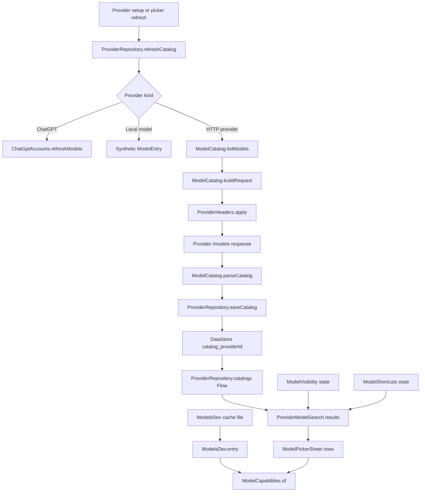

# Model Catalog and Capabilities

> Fetches, parses, caches and filters the model lists each provider exposes, then annotates each row with capability provenance.

The catalog layer answers three separate questions. `ModelCatalog` talks to a provider endpoint and turns the response into `ModelEntry` rows. `ModelsDev` downloads the community models.dev directory and supplies metadata that no provider API reports, such as reasoning vocabularies, context limits and prices. `ModelCapabilities` merges those sources into a badge model that distinguishes what the provider said, what the directory says, what the user marked, and what a model-name heuristic guessed. Visibility and shortcut state live in device preferences and never alter a saved chat selection.

## Module Responsibilities

- **`ModelCatalog`**: one GET to a provider's model endpoint, protocol-specific headers, pure JSON parsing, and a `Result.Models`/`Result.Failed` return. It also serves as the connection test used by provider setup.
- **`ModelEntry`**: the normalized row consumed by pickers, stats and capability checks. It carries `id`, tri-state `reasoning`, `contextTokens`, `custom`, `note`, `displayName`, `reasoningEfforts`, `defaultReasoningEffort`, `reasoningReported`, `tools` and `imageInput`.
- **Family heuristics**: `reasoningCapable` and `visionCapable` regex tables guess capability when an endpoint reports nothing. They are hints, never claims from the provider.
- **`ModelsDev`**: daily-refreshed directory cache with per-provider model maps, thinking vocabularies, context limits, tool/image flags and cost data.
- **`ModelCapabilities`**: converts an entry plus directory row into three `Capability` values, each with a `Source` of `PROVIDER`, `DIRECTORY`, `CUSTOM`, `FAMILY` or `UNKNOWN`.
- **`ModelVisibility`**: per-provider allow-list of model IDs, persisted in SharedPreferences. A missing provider means unfiltered; an explicitly empty set hides every model.
- **`ModelShortcuts`**: device-local favourites and recents, capped at 50 recent entries and scoped by provider ID.
- **`ProviderModelSearch`**: combines provider order, enablement, visibility, favourites, recents, thinking-only filtering and free-text search into picker rows.

## Architecture and Flow

The fetch path starts in `ProviderRepository.refreshCatalog`, which serializes per-provider work with a `Mutex` from `catalogRefreshLocks`. It strips the provider name and model from the connection object so that catalog refresh is a pure connectivity check, then tries each enabled pooled key in rotation order. Only 401, 402, 403 and 429 responses advance to the next key; a successful but empty list returns "No model capabilities reported". Results are persisted through `saveCatalog` under a `catalog_<providerId>` DataStore key.

`ModelCatalog.buildRequest` selects the path and auth header by `ProviderType`: `/models` with `Authorization: Bearer` for OpenAI compatible and Responses, `/v1/models` with `x-api-key` and `anthropic-version: 2023-06-01` for Anthropic, `/models` with `x-goog-api-key` for Gemini. The built-in Harness provider bypasses typed auth entirely and uses the Kilo endpoint plus its own user agent. `ProviderHeaders.apply` adds user-defined headers last, except for non-editable providers.

Parsing differs by shape. OpenAI, Responses and Anthropic responses read `data[]`, taking `id`, reported reasoning from `reasoning`, `capabilities.reasoning`, reported effort arrays or `supported_parameters`, and a context window from `context_length`, `max_tokens`, `context_window` or `context_window.tokens`. Gemini reads `models[]`, strips the `models/` prefix and reads the `thinking` boolean. Every list is sorted by ID.

The models.dev merge happens at read time, not at fetch time. `ModelCapabilities.of` calls `ModelsDev.providerKeyFor(provider.baseUrl)` and `ModelsDev.entry(providerKey, entry.id)`. `providerKeyFor` first maps known hosts (OpenRouter, Kilo, OpenAI, Anthropic, Google, DeepSeek, Groq, Mistral, Moonshot, Kimi, Zhipu, Z.AI, Alibaba, Together, xAI, OpenCode), then prefers the most specific matching API path published by the directory, so `/coding/` products and `opencode-go` resolve separately from their parent hosts. `ModelsDev.entry` tries an exact model ID, then the suffix after the last slash, then a suffix scan in either direction.

## Invocation Chain

1. `ProviderModelSearch.results` builds `available` from `providers` filtered by `enabled`, or by a non-blank query when `includeDisabled` is null.
2. For each provider it calls `ProviderModelSearch.models`, which prepends the configured model when the catalog omitted it, deduplicates by ID, and drops blank IDs.
3. Rows in the `All` collection are stable-sorted so favourites come first. `Favourites` and `Recent` collections map saved `ModelShortcut` keys back to catalog rows, synthesizing an unavailable `ModelEntry` when the provider still exists but the model does not.
4. Visibility is applied through `ModelVisibilityState.includes`, then `matches` filters by provider name, model ID and display name.
5. `thinkingOnly` keeps rows where the catalog says reasoning is true or `reasoningCapable` matches the ID.
6. `ModelPickerSheet` renders `ModelCapabilityLabels`, which calls `ModelCapabilities.of` for thinking, tools and images.
7. The model details dialog repeats the three labels with the full `Capability.description` text.

## Key State and Data Structures

- **`ModelEntry`**: serializable and persisted inside the DataStore catalog JSON. `reasoning` is null when unknown, which is different from false, and `reasoningReported` records whether a real effort list arrived.
- **`ModelVisibilityState`**: `selected: Map<String, Set<String>>` encoded as JSON under the `state` key of the `model-visibility` SharedPreferences file. `includes` defaults to true for providers that were never customized.
- **`ModelShortcutState`**: `favourites` and `recent` lists of `ModelShortcut(providerId, modelId)`, stored under `state` in `model-shortcuts`. Only IDs are stored, never credentials.
- **`ModelsDev.Entry`**: `reasoning`, `effortValues`, `budgetTokens`, `budgetMax`, `toggle`, `contextTokens`, `cost`, `cachePrices`, `tools`, `imageInput`, `outputTokens` and `budgetMin`.
- **`ModelsDev.revision`**: a `StateFlow<Long>` incremented on every load, refresh or test replacement. Compose screens key their capability calculations on it so a directory refresh redraws badges without reopening the picker.
- **`ModelCapabilities.Capability`**: `supported: Boolean?` plus `source`. `description` produces user-facing provenance text, for example "Reported by this provider" or "Unconfirmed model-family hint".

## Boundary Conditions

- The catalog client uses a 15 second connect timeout and a 20 second read timeout. A failure becomes `Result.Failed` with an HTTP status when one exists.
- Automatic refresh results are cached for five minutes per connection object (`automaticCatalogChecks`, compared in nanoseconds). Failures are cached too, so repeatedly opening the picker does not hammer a broken endpoint.
- A manual refresh bypasses that cache. `detectReasoningLevels` uses this path and then asserts the connection did not change before returning levels.
- `refreshCatalog` returns early for local providers. Local models synthesize a single `ModelEntry` from the installed spec and never call HTTP.
- ChatGPT providers require the `ModelCatalog.chatGptModels` hook, installed by `HarnessApp`. If it is missing, the catalog reports a message asking the user to connect an account.
- `ModelVisibility` deliberately treats an empty saved set as "hide everything". Removing a provider through `ProviderRepository.delete` also removes its visibility entry.
- `ProviderModelSearch.results` can include disabled providers when a search query is present, so a user can still find a model on a provider they turned off. The picker then offers "Enable and use" before committing.
- Gemini cached catalogs that predate `reasoningReported` are treated as unconfirmed: `ModelReasoning.of` maps them to `INFERRED` or `UNKNOWN`, never `REPORTED`.
- `ModelCatalog.parseCatalog` tolerates missing or malformed JSON by returning an empty list. It never throws into the settings screen.
- `reportedEfforts` rejects more than 16 levels, names over 32 characters, blank names and control characters.

## Extension Points

- Add a provider protocol in `ModelCatalog.buildRequest` and `parseCatalog`, then add its `@ai-sdk` hint to `ModelsDev.protocolFor` if models.dev publishes it.
- Add host mappings in `ModelsDev.providerKeyFor`; the fallback path already matches directory `api` URLs by host, scheme, port and longest path prefix.
- Extend the family tables in `reasoningCapable` and `visionCapable`. Both are pure functions and unit-testable without HTTP.
- Add a capability source only by extending `ModelCapabilities.Source` and the `description` mapping. `AttachmentReadiness` already trusts only `PROVIDER` and `CUSTOM` for image input.
- `ModelsDev.replaceForTesting` swaps the in-memory directory without touching disk, which is the supported test hook.
- `ModelVisibilitySheet` accepts an `onRefreshCatalog` suspend lambda, so both Settings and the chat picker reuse the same editor with their own refresh implementation.

## Known gaps

- No "model_usage" style table is involved here. Catalog persistence is DataStore JSON, not Room.
- `ModelsDev.speakableProviders` is a curated list of hosts and IDs intended for the add-provider directory. This page does not cover the directory UI beyond that filter.

Sources: [app/src/main/java/com/androidharness/app/llm/ModelCatalog.kt](../app/src/main/java/com/androidharness/app/llm/ModelCatalog.kt)#L20-L222), [app/src/main/java/com/androidharness/app/llm/ModelCapabilities.kt](../app/src/main/java/com/androidharness/app/llm/ModelCapabilities.kt)#L3-L38), [app/src/main/java/com/androidharness/app/llm/ModelReasoning.kt](../app/src/main/java/com/androidharness/app/llm/ModelReasoning.kt)#L3-L18), [app/src/main/java/com/androidharness/app/llm/ModelsDev.kt](../app/src/main/java/com/androidharness/app/llm/ModelsDev.kt)#L141-L249), [app/src/main/java/com/androidharness/app/data/ModelVisibility.kt](../app/src/main/java/com/androidharness/app/data/ModelVisibility.kt)#L10-L50), [app/src/main/java/com/androidharness/app/data/ModelShortcuts.kt](../app/src/main/java/com/androidharness/app/data/ModelShortcuts.kt)#L10-L49), [app/src/main/java/com/androidharness/app/llm/ProviderModelSearch.kt](../app/src/main/java/com/androidharness/app/llm/ProviderModelSearch.kt)#L10-L45), [app/src/main/java/com/androidharness/app/ui/settings/ModelVisibilitySheet.kt](../app/src/main/java/com/androidharness/app/ui/settings/ModelVisibilitySheet.kt)#L37-L139), [app/src/main/java/com/androidharness/app/data/ProviderRepository.kt](../app/src/main/java/com/androidharness/app/data/ProviderRepository.kt)#L73-L154), [app/src/main/java/com/androidharness/app/ui/chat/components/ModelPickerSheet.kt](../app/src/main/java/com/androidharness/app/ui/chat/components/ModelPickerSheet.kt)#L140-L170)

## Source files

- `app/src/main/java/com/androidharness/app/llm/ModelCatalog.kt`
- `app/src/main/java/com/androidharness/app/llm/ModelCapabilities.kt`
- `app/src/main/java/com/androidharness/app/llm/ModelReasoning.kt`
- `app/src/main/java/com/androidharness/app/llm/ModelsDev.kt`
- `app/src/main/java/com/androidharness/app/data/ModelVisibility.kt`
- `app/src/main/java/com/androidharness/app/data/ModelShortcuts.kt`
- `app/src/main/java/com/androidharness/app/llm/ProviderModelSearch.kt`
- `app/src/main/java/com/androidharness/app/ui/settings/ModelVisibilitySheet.kt`
- `app/src/main/java/com/androidharness/app/data/ProviderRepository.kt`
- `app/src/main/java/com/androidharness/app/ui/chat/components/ModelPickerSheet.kt`
- `app/src/main/java/com/androidharness/app/ui/common/ModelReasoningIcon.kt`
