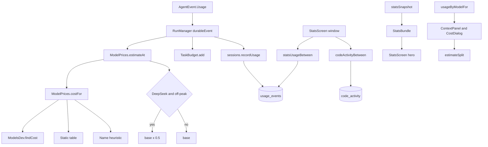

# Pricing, Cost and Usage

> Looks up a price for a model, applies DeepSeek peak windows, records per-request token usage and aggregates it into the Usage screen.

Cost tracking has two halves. `ModelPrices` turns a model ID and token counts into US dollars using live models.dev rates, a shipped fallback table and name heuristics. `SessionRepository.recordUsage` writes one `usage_events` row per completed request, tagged with provider and model, and the stats layer groups those rows by window and model. The UI never stores a single running cost total for a chat; it recomputes from token rows so provider changes and cache reads stay attributable.

## Module Responsibilities

- **`ModelPrices`**: static family table, `costFor`, `estimate`, `estimateAt` and `estimateSplit`.
- **`ModelsDev.findCost`**: live per-million-token pricing from the directory, with "prefer a charged row" selection.
- **`usage_events`**: the per-request usage ledger. One row holds input, output, cached and cache-write tokens, a timestamp, provider, model, turn ID, cache reporting flag and up to three explicit price fields.
- **`SessionRepository.recordUsage`**: inserts a `UsageEventEntity` and stores the `ModelsDev.CachePrices` snapshot supplied by the usage event.
- **`StatsData`**: pure aggregation of usage rows into `StatsBundle` and `ModelUsagePojo` lists.
- **`StatsScreen`**: window selector, hero totals, code activity, token breakdown and per-model sorting by tokens, price or requests.
- **`GenerationMetadata`**: per-answer provenance (provider message state, reasoning token count, supplied memories, execution receipts, catalog model ID, follow-ups) persisted alongside a message.

## Architecture and Flow

At request time, `RunManager` computes a price only when the provider name does not start with "ChatGPT · ". It passes model, input, output, cached, cache-write, provider key and `System.currentTimeMillis()` into `ModelPrices.estimateAt`. A null price with a cost limit configured pauses the run with "Cost unavailable for this model". The same event then reaches `handleEvent`, which calls `sessions.addUsage` for cumulative session totals and `sessions.recordUsage` for the per-model ledger.

`ModelPrices.costFor` resolves in three stages. First, local model IDs return a zero cost immediately. Second, `ModelsDev.findCost` is consulted. Third, the static table is scanned with punctuation normalized (`:` and `/` become `-`) and prefix containment in either direction. If nothing matches, keyword heuristics price anything named free, flash/mini/nano/8b, opus/large/max/405b, pro/sonnet/r1/70b, or a default of 0.50 input and 2.00 output.

`estimate` computes four components separately: uncached input, cache reads, cache writes and output. Cache-read and cache-write multipliers come from the resolved `Cost`. Uncached input is clamped at zero if cached plus cache-write tokens exceed total input.

DeepSeek has two shaping rules. `estimateAt` doubles the price during the peak window and halves it outside, via `deepSeekOffPeak` using `java.time` in UTC. `estimateSplit` does the opposite operation for aggregates: it computes the list-price total for all tokens, computes the price of the off-peak subset, and subtracts half of that subset from the total, so peak tokens pay full list and off-peak tokens pay half. `PEAK_WINDOW_SQL` encodes the same rule in SQLite: weekday numbers 1 through 5 and UTC hours 1, 2, 3, 6, 7, 8, 9 are peak. SQLite's `unixepoch` keeps the split independent of the device timezone.

## Invocation Chain

1. `RunManager` receives `AgentEvent.Usage` from a provider stream.
2. `ModelPrices.estimateAt` calls `estimate`, which calls `costFor`.
3. `costFor` calls `ModelsDev.findCost(providerKey, model)`.
4. `findCost` tries a direct entry under the provider key, an exact ID across all providers, a suffix match, and finally a normalized substring match. Every candidate passes through a `charged` filter.
5. `estimateAt` multiplies by 0.5 when `isDeepSeek(model)` and `deepSeekOffPeak(atMillis)` are both true.
6. `RunManager` adds the result to `TaskBudget` and calls `SessionRepository.recordUsage`.
7. `recordUsage` inserts `UsageEventEntity` with `cachePrices.input`, `cachePrices.read` and `cachePrices.write` when the catalog reported explicit rates.
8. Later, `StatsScreen` observes `statsUsageBetween(window.since, window.until)` and `codeActivityBetween`.
9. `statsSnapshot` sums token columns, groups by session for the session count, computes the best per-session cache hit rate, and groups by provider and model for the model list.
10. `StatsScreen` calls `ModelPrices.estimateSplit` once per model row and sums only non-null prices.

## Key State and Data Structures

| Table | Purpose | Columns that matter |
|---|---|---|
| `usage_events` | One row per model request | `sessionId`, `providerName`, `model`, `inputTokens`, `outputTokens`, `cachedTokens`, `cacheWriteTokens`, `createdAt`, `turnId`, `cacheReported`, `inputPrice`, `cacheReadPrice`, `cacheWritePrice` |
| `file_edits` | Per tool-call line changes | `sessionId`, `turnId`, `relPath`, `added`, `removed`, `createdAt` |
| `code_activity` | Aggregate code churn that survives chat deletion | `fileKey`, `added`, `removed`, `createdAt` |

- **`UsageEventEntity`**: Room entity with an auto-generated `rowId`. Price columns were added in migration 12 to 13, `turnId` and `cacheReported` in 11 to 12.
- **`StatsUsagePojo`**: window query result retaining `sessionId`, provider, model and sums, plus the four peak columns.
- **`ModelUsagePojo`**: provider/model aggregate with `totalTokens = inputTokens + outputTokens`.
- **`StatsBundle`**: `input`, `output`, `cached`, `cacheWrite`, `requests`, `sessionCount`, `peakHitRate`, and a derived `freshInput` that subtracts cached and cache-write tokens.
- **`StatsRange`**: `DAY`, `WEEK`, `MONTH`, `LIFETIME`. Windows start at local midnight `count - 1` days back and end at the next local midnight. `LIFETIME` uses `0` to `Long.MAX_VALUE`.
- **`GenerationMetadata`**: serialized onto messages. `reasoningTokens` is nullable so "not reported" stays distinct from a real zero. `model` records the catalog ID for provenance, not for pricing.

## Boundary Conditions

- `findCost` never returns a free promo row when a paid row exists. It keeps the first zero-cost match in `freeMatch`, keeps scanning for any row with input or output greater than zero, and only returns the free match when the model is free everywhere. This prevents a reseller listing at $0/$0 from pinning a whole session to $0.00.
- `exactCachePrices` matches only the exact provider endpoint (host, scheme, port and path prefix) and only the exact model ID. It never borrows another provider's cache rates, and it returns null when several equally specific endpoints disagree.
- Cache prices are per million tokens. `costFor` converts them into multipliers against input, defaulting to 0.25 read and 1.0 write when input is zero.
- `estimateSplit` returns the base price for non-DeepSeek models. For DeepSeek with no off-peak tokens it also returns the base, avoiding a subtraction loop.
- `statsSnapshot` accepts `lifetimeSessions` only for the `LIFETIME` range. Older installs that saved only session totals are included there without inventing dates.
- The cache hit rate shown in the hero is `cached / input` for the whole window, not `peakHitRate`. `peakHitRate` is calculated from the best session but is not read by `StatsScreen`.
- `StatsScreen` shows "Unavailable" when no model row produced a price. It shows a footnote when some rows have known prices and others do not, and per-row "Price unavailable" text.
- `ContextPanel` suppresses the cost entirely for ChatGPT plan accounts, detected either from the active provider or from any `ChatGPT · ` provider row.
- `recordUsage` drops rows with a blank model, so anonymous or failed requests do not pollute the ledger.
- `code_activity` stores a hashed or relative `fileKey`, added and removed counts, and a timestamp. It deliberately has no file contents.

## Extension Points

- Add a static family price in the `table` list in `ModelPrices`. Prefixes are matched after lowercasing and replacing `:` and `/`.
- Improve live coverage by mapping a new host in `ModelsDev.providerKeyFor`; `findCost` then sees that provider's rows.
- Change token accounting by extending `statsUsageBetween` and `StatsUsagePojo`, then updating `statsSnapshot`.
- Add a new stats range in `StatsRange`; the window calculation and segmented control both iterate `entries`.
- `estimateAt` is the single hook for time-sensitive pricing. New providers with time-of-day rates can be added next to `deepSeekOffPeak`.
- `GenerationMetadata.encode` omits the value when it equals the default instance, so adding fields stays cheap for messages that do not use them.

## Known gaps

- The requested table names `model_usage`, `turn_usage` and `tool_usage` do not exist in the repository. The actual implementation uses `usage_events`, `file_edits` and `code_activity`. There is no per-turn or per-tool usage table; `turnId` is a column on `usage_events` and `file_edits`.
- `StatsBundle.peakHitRate` is computed and never consumed by the current UI. Only the aggregate `cached / input` rate is displayed.
- `GenerationMetadata` has no price field. Prices are recomputed from token rows and current rates, so historical costs change when catalog prices change unless explicit `inputPrice`, `cacheReadPrice` and `cacheWritePrice` were saved on the usage row.

Sources: [app/src/main/java/com/androidharness/app/llm/ModelPrices.kt](../app/src/main/java/com/androidharness/app/llm/ModelPrices.kt)#L3-L159), [app/src/main/java/com/androidharness/app/llm/ModelsDev.kt](../app/src/main/java/com/androidharness/app/llm/ModelsDev.kt)#L251-L313), [app/src/main/java/com/androidharness/app/data/db/Database.kt](../app/src/main/java/com/androidharness/app/data/db/Database.kt)#L159-L200), [app/src/main/java/com/androidharness/app/data/db/Database.kt](../app/src/main/java/com/androidharness/app/data/db/Database.kt)#L238-L278), [app/src/main/java/com/androidharness/app/data/db/Database.kt](../app/src/main/java/com/androidharness/app/data/db/Database.kt)#L603-L656), [app/src/main/java/com/androidharness/app/data/SessionRepository.kt](../app/src/main/java/com/androidharness/app/data/SessionRepository.kt)#L583-L618), [app/src/main/java/com/androidharness/app/ui/stats/StatsData.kt](../app/src/main/java/com/androidharness/app/ui/stats/StatsData.kt)#L9-L65), [app/src/main/java/com/androidharness/app/ui/stats/StatsScreen.kt](../app/src/main/java/com/androidharness/app/ui/stats/StatsScreen.kt)#L47-L184), [app/src/main/java/com/androidharness/app/agent/RunManager.kt](../app/src/main/java/com/androidharness/app/agent/RunManager.kt)#L625-L646), [app/src/main/java/com/androidharness/app/core/GenerationMetadata.kt](../app/src/main/java/com/androidharness/app/core/GenerationMetadata.kt)#L46-L69)

## Source files

- `app/src/main/java/com/androidharness/app/llm/ModelPrices.kt`
- `app/src/main/java/com/androidharness/app/llm/ModelsDev.kt`
- `app/src/main/java/com/androidharness/app/data/db/Database.kt`
- `app/src/main/java/com/androidharness/app/data/SessionRepository.kt`
- `app/src/main/java/com/androidharness/app/ui/stats/StatsData.kt`
- `app/src/main/java/com/androidharness/app/ui/stats/StatsScreen.kt`
- `app/src/main/java/com/androidharness/app/agent/RunManager.kt`
- `app/src/main/java/com/androidharness/app/ui/chat/ContextPanel.kt`
- `app/src/main/java/com/androidharness/app/ui/chat/ChatScreen.kt`
- `app/src/main/java/com/androidharness/app/core/GenerationMetadata.kt`
