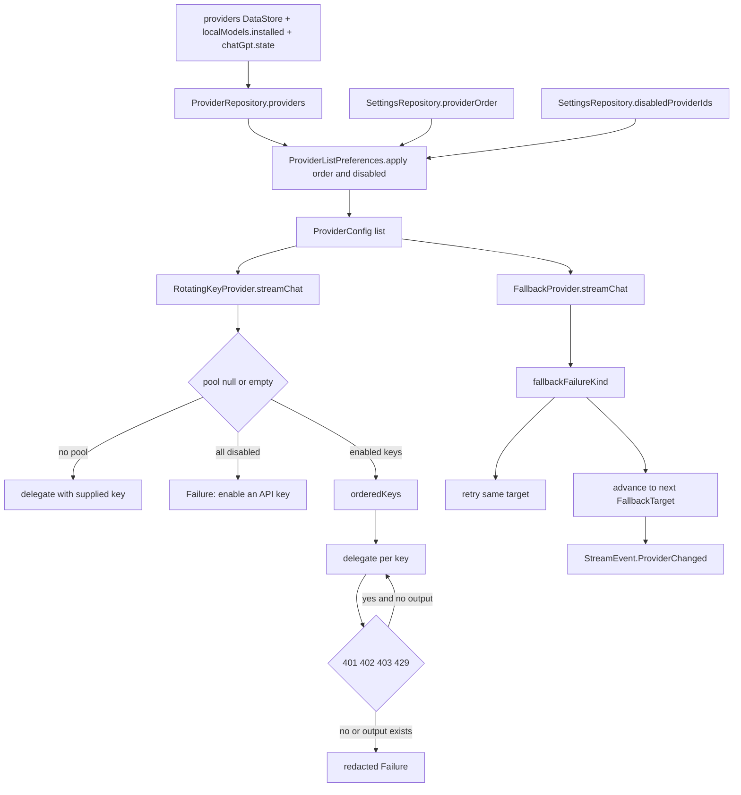

# Provider Controls and Fallback Chains

> Stores provider connections, credentials, proxies and headers, and routes a failed request through an ordered, user-approved fallback chain.

Providers are not just base URLs. `ProviderRepository` merges saved API connections with ChatGPT accounts, the built-in Harness provider and installed local models into one ordered list. Credentials live in encrypted storage through `KeyStoreManager`, not in `ProviderConfig`. `RotatingKeyProvider` wraps every request with a key pool cursor, and `FallbackProvider` decides whether a failure is retryable, quota-related or terminal before moving to the next approved model.

## Module Responsibilities

- **`ProviderRepository`**: DataStore-backed provider list, catalog snapshots, custom models, key pools, proxies, headers and learned Harness wire protocols.
- **`ProviderListPreferences`**: one sort order and one disabled set covering API connections, connected accounts, built-in and installed providers.
- **`ProviderControls`**: `ProviderApiKey`, `ProviderKeyPool`, `ProviderProxy`, `ProviderProxyMode` and `ProviderProxyType`.
- **`ProviderHeaders`**: validation, normalization and application of custom HTTP headers, plus redirect suppression for credential-bearing headers.
- **`RotatingKeyProvider`**: per-request key selection and failover across enabled keys.
- **`FallbackPolicy`**: serializable chain with enabled flag, up to four targets, retry count and same-provider restriction.
- **`FallbackProvider`**: runtime chain execution with live consent rechecks on every switch.
- **`FallbackEditorSheet`**: default-chain and per-chat editor, including a nested model picker and provider manager.
- **`ProviderManagerSheet`, `ProviderListCard`, `ProviderBulkActions`, `ProviderKeysEditor`, `ProviderControlsSheet`**: settings UI for ordering, enablement, deletion, pools and proxies.

## Architecture and Flow

`ProviderRepository.providers` is a `combine` of three flows. It restores Harness model snapshots first, decodes the saved `provider_list` JSON, then orders the list as ChatGPT accounts, the built-in Harness config, saved non-Harness connections, and installed local models. A second `combine` with settings applies `ProviderListPreferences.apply`, which sorts by the saved order and sets `enabled = id !in disabled`. Header-only edits are re-read through `keys.providerHeaders` so the metadata JSON does not need to change.

`ProviderRepository.catalogs` decodes every `catalog_` and `custom_models_` DataStore key. Custom models are merged on top of fetched entries: a custom ID that the provider also reports inherits the reported reasoning and note, and the fetched duplicate is removed. Local provider IDs get a synthetic catalog, after which any ChatGPT catalog entries stored on disk are removed and replaced with the connected accounts' model lists.

Adding or editing a connection validates the key pool first. `ProviderKeyPool.error()` enforces at most 20 keys, unique IDs, labels of at most 80 characters, values of 1 to 8192 printable ASCII characters, and distinct values. Saving writes headers to encrypted storage, stores the pool and proxy through `putProviderControls`, and appends the config to the provider list. Local, ChatGPT and Harness connections take separate paths: local and ChatGPT edits are ignored, and Harness saves only a sanitized model choice.

## Invocation Chain

1. `ProviderListCard` toggles a provider. `ProviderManagerSheet` calls `onEnabledChange`, which reaches `ProviderRepository.setEnabled` and then `SettingsRepository.setProviderEnabled`.
2. Moving a provider calls `ProviderRepository.move`, which reads the full current ID list and calls `SettingsRepository.moveProvider`.
3. `ProviderListPreferences.move` builds a complete order, restricts movement to the visible IDs, swaps the provider with its neighbor, and returns the complete list.
4. A request enters `RotatingKeyProvider.streamChat` when `ProviderHeaders.editable(config)` is true.
5. `RotatingKeyProvider` asks `pools(config)` for the pool, filters enabled keys, and chooses a start index from an `AtomicLong` cursor when `pool.rotate` is true.
6. On `StreamEvent.Failure` with 401, 402, 403, 429 or a known quota error code, and only if no response output was emitted, it tries the next key and emits `StreamEvent.Retrying`.
7. `FallbackProvider` reads `FallbackRun` from the coroutine context. Without it, the request goes straight to the factory.
8. `fallbackFailureKind` classifies 401 and 403 as `TERMINAL`, 402 and quota codes or quota text as `QUOTA`, non-retryable failures as `TERMINAL`, and known transient codes or `RetryPolicy.isRetryable` as `TRANSIENT`.
9. `TRANSIENT` failures retry the same target until `policy.retries` is exhausted. `QUOTA` and exhausted transient failures advance to the next target after rechecking the live policy.
10. A switch emits `StreamEvent.ProviderChanged(..., persistSelection = false)`, so a background fallback does not rewrite the chat's saved model.

## Key State and Data Structures

| Type | Fields | Persistence |
|---|---|---|
| `ProviderApiKey` | `id`, `label`, `value`, `enabled` | Encrypted prefs under `provider_keys:<providerId>` |
| `ProviderKeyPool` | `keys`, `rotate` | Same JSON blob; `MAX_KEYS = 20` |
| `ProviderProxy` | `mode`, `type`, `host`, `port`, `username`, `password` | `provider_proxy:<id>` or `global_provider_proxy`; INHERIT removes the key |
| `ProviderHeader` | `name`, `value`, `enabled` | `provider_headers:<id>` |
| `FallbackPolicy` | `enabled`, `targets`, `retries`, `sameProviderOnly` | Settings key `FALLBACK_POLICY`; also inside `TaskRecord` for per-chat overrides |
| `TaskRecord` | `fallbackMode`, `fallbackOverride`, `fallbackPrimary` | `filesDir/task-controls/<sessionId>` |

- **`ProviderListPreferences.apply`**: deduplicates by ID, sorts unknown IDs to the end, and forces `enabled` from the disabled set.
- **`ProviderKeyPool.replaceDefault`**: older single-key editors replace or enable one key without deleting the rest.
- **`ProviderProxy.error`**: rejects hosts with schemes, paths, credentials or whitespace, ports outside 1 to 65535, control characters in credentials, and credentials on SOCKS5.
- **`ProviderHeaders.MAX_HEADERS`**: 20. Managed names are rejected: authorization, proxy-authorization, x-api-key, x-goog-api-key, host, content-type, content-length, connection, transfer-encoding, upgrade and trailer.
- **`FallbackTarget`**: `providerId` and `model`. `FallbackPolicy.MAX_TARGETS` is 4, retries must be 0 through 5, targets must be unique and non-blank.
- **`FallbackMode`**: `DEFAULT`, `CUSTOM`, `OFF`. `effectiveFallback` returns the default only when enabled and valid, a custom chain when valid, and an empty policy for OFF.
- **`RotatingKeyProvider.cursors`**: a `ConcurrentHashMap<String, AtomicLong>` keyed by provider ID, so rotation position survives individual requests but not process death.

## Boundary Conditions

- Pools refuse blank or whitespace-containing keys. A pool where every key is disabled produces "Enable an API key in provider controls before using this connection" instead of a network call with an empty key.
- Rotation only happens after a rejection and only before any response output. Once text, thinking, a tool call, usage or a done event has been emitted, the failure is passed through with all key values replaced by `[redacted]`.
- `RotatingKeyProvider` also redacts every saved key value from the final failure message, not just the last attempted key.
- Custom headers disable redirect following entirely. `ProviderHeaders.client` calls `ProviderNetwork.client` and then sets `followRedirects(false)` and `followSslRedirects(false)` when any header is enabled, so credentials cannot leak to a redirect target.
- Header values must be a single printable line up to 8192 characters, with tabs allowed. Duplicate names are rejected case-insensitively.
- `FallbackProvider` allows only the approved primary destination and the explicitly configured targets. When `sameProviderOnly` is true, only the approved provider ID and destination are allowed.
- The live policy is reread before retries and before each switch. Disabling fallbacks mid-run stops routing and returns the last failure as non-retryable.
- A missing key on the primary or a candidate skips that candidate. If no allowed candidate remains, the error names the last failure and points to Fallbacks in the model picker.
- The fallback stall timeout is 90 seconds, except local models, which get 600 seconds.
- `FallbackProvider` re-resolves thinking levels per target with `ThinkingSpecs.resolvedForModel` using the target's own provider key.
- Provider deletion removes the key, proxy, headers, catalog, custom models and visibility entry, but never deletes the built-in Harness provider or a ChatGPT account.
- `ProviderRepository.resolveHarnessConfig` refuses a resumed run when the provider type or base URL changed after the run started, unless no custom headers are enabled.

## Extension Points

- Add a proxy mode or type in `ProviderControls` and handle it in `ProviderNetwork`; validation already lives next to the data class.
- Adjust rotation policy in `RotatingKeyProvider`. The status set is local to `streamChat`, and the quota error-code set is local to `canRotate`.
- Add fallback classification rules in `fallbackFailureKind`. The function is internal and pure apart from `RetryPolicy`.
- Add a provider field by extending `ProviderConfig` and the DataStore JSON; `ignoreUnknownKeys` keeps old backups readable.
- The fallback editor accepts `chatMode`, `customPolicy` and `selectedProviderId`, so the same sheet serves global settings, a chat, and a subagent context.
- `SettingsBackupPolicy.canExport` controls portability. Extend it if another provider kind becomes exportable.

## Backup portability

`SettingsBackupFile` version 4 includes `providers: List<BackupProvider>` and a global `providerProxy`. Each `BackupProvider` carries `config`, `customModels`, `apiKey`, `headers`, `keyPool` and `proxy`. Export filters provider order, disabled IDs, active, planning, execution and subagent selections, chat agent models, and fallback targets to the exported provider IDs.

Local models and ChatGPT connections are explicitly excluded. `withoutLocalModels` strips older v1 files that reference `local://` or `local-model:` IDs, and `exportSettings` forces `localModelExperimental = false`. Validation rejects more than 100 providers, duplicate provider IDs, invalid pools or proxies, invalid headers, and provider references that point at providers missing from the file.

## Known gaps

- There is no separate "backup portability" subsystem. Portability is implemented by `SettingsBackupPolicy` and `BackupProvider` inside the general settings backup.
- Proxy and key pool values are encrypted at rest, but the backup file itself is only protected by the general backup format. This page does not claim additional encryption for provider credentials beyond what `SettingsBackup` and `BackupEncryption` provide.

Sources: [app/src/main/java/com/androidharness/app/data/ProviderRepository.kt](../app/src/main/java/com/androidharness/app/data/ProviderRepository.kt)#L27-L154), [app/src/main/java/com/androidharness/app/data/ProviderRepository.kt](../app/src/main/java/com/androidharness/app/data/ProviderRepository.kt)#L240-L327), [app/src/main/java/com/androidharness/app/data/ProviderListPreferences.kt](../app/src/main/java/com/androidharness/app/data/ProviderListPreferences.kt)#L7-L34), [app/src/main/java/com/androidharness/app/llm/ProviderControls.kt](../app/src/main/java/com/androidharness/app/llm/ProviderControls.kt)#L6-L75), [app/src/main/java/com/androidharness/app/llm/ProviderHeaders.kt](../app/src/main/java/com/androidharness/app/llm/ProviderHeaders.kt)#L8-L56), [app/src/main/java/com/androidharness/app/llm/RotatingKeyProvider.kt](../app/src/main/java/com/androidharness/app/llm/RotatingKeyProvider.kt)#L11-L83), [app/src/main/java/com/androidharness/app/llm/FallbackPolicy.kt](../app/src/main/java/com/androidharness/app/llm/FallbackPolicy.kt)#L8-L48), [app/src/main/java/com/androidharness/app/llm/FallbackProvider.kt](../app/src/main/java/com/androidharness/app/llm/FallbackProvider.kt)#L35-L178), [app/src/main/java/com/androidharness/app/ui/settings/FallbackEditorSheet.kt](../app/src/main/java/com/androidharness/app/ui/settings/FallbackEditorSheet.kt)#L33-L270), [app/src/main/java/com/androidharness/app/ui/settings/ProviderManagerSheet.kt](../app/src/main/java/com/androidharness/app/ui/settings/ProviderManagerSheet.kt)#L42-L187)

## Source files

- `app/src/main/java/com/androidharness/app/data/ProviderRepository.kt`
- `app/src/main/java/com/androidharness/app/data/ProviderListPreferences.kt`
- `app/src/main/java/com/androidharness/app/llm/ProviderControls.kt`
- `app/src/main/java/com/androidharness/app/llm/ProviderHeaders.kt`
- `app/src/main/java/com/androidharness/app/llm/ProviderModelSearch.kt`
- `app/src/main/java/com/androidharness/app/llm/RotatingKeyProvider.kt`
- `app/src/main/java/com/androidharness/app/llm/FallbackPolicy.kt`
- `app/src/main/java/com/androidharness/app/llm/FallbackProvider.kt`
- `app/src/main/java/com/androidharness/app/ui/settings/FallbackEditorSheet.kt`
- `app/src/main/java/com/androidharness/app/ui/settings/ProviderManagerSheet.kt`
- `app/src/main/java/com/androidharness/app/ui/settings/ProviderSheet.kt`
- `app/src/main/java/com/androidharness/app/ui/settings/ProviderListCard.kt`
- `app/src/main/java/com/androidharness/app/ui/settings/ProviderBulkActions.kt`
- `app/src/main/java/com/androidharness/app/ui/settings/ProviderKeysEditor.kt`
- `app/src/main/java/com/androidharness/app/ui/settings/ProviderControlsSheet.kt`
- `app/src/main/java/com/androidharness/app/data/KeyStoreManager.kt`
- `app/src/main/java/com/androidharness/app/data/SettingsBackup.kt`
- `app/src/main/java/com/androidharness/app/agent/TaskControl.kt`
