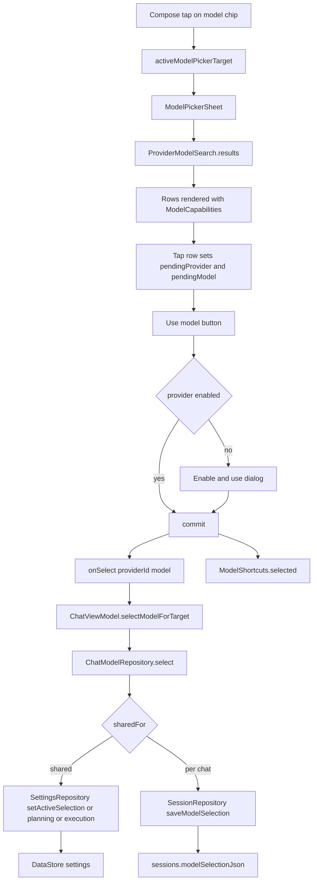

# Model Picker and Per-Chat Models

> Lets a user browse every provider's models, stage a choice, and save it either globally or only for the current chat.

The picker is provider-first: the user narrows the list to one provider or searches all, then stages a provider/model pair and confirms it with a button. Staging exists so browsing, switching providers and opening settings never changes the active model by accident. `ChatModelRepository` then writes the choice either to app settings (shared mode) or to the session's `modelSelectionJson` column (per-chat mode), including the thinking level and separate planning and execution slots.

## Module Responsibilities

- **`ModelPickerSheet`**: provider chooser, all-provider search, collections (All, Recent, Favourites), hidden-model toggle, custom model add/delete, detail dialog and the confirm button.
- **`ProviderModelSearch`**: shared row construction and filtering for the picker, provider manager and fallback editor.
- **`ChatModelSelection`**: serializable snapshot of `active`, `planning`, `execution`, `thinking` and `customThinkingLevels`.
- **`ChatModelRepository`**: reads and writes selections, enforces the shared-versus-per-chat scope, serializes edits with a `Mutex`, and repairs unreadable snapshots.
- **`ModelShortcuts`**: favourites and recents, device-local and provider-scoped.
- **`ModelVisibility`**: list customization shared with the settings sheet.
- **`ChatViewModel`**: maps picker targets to `ACTIVE`, `PLANNING` or `EXECUTION`, validates missing providers and local models, and exposes `sameModelAcrossChats`.
- **`SessionRepository`**: persists `modelSelectionJson` and initializes it from the shared defaults.

## Architecture and Flow

`ModelPickerSheet` receives `activeProviderId` and `activeModel`, plus optional `browseProviderId`. `listedId` starts as the browse provider, otherwise the active provider unless `searchAllProvidersInitially` is true. The "Switch provider" control opens a dedicated provider list with an All providers row and per-provider counts. Selecting a provider resets the query and collection and returns to the model list.

The model list is built by `ProviderModelSearch.results`. In shared mode the user is choosing a global default; the sheet labels the action "Use in all chats" when `sameModelAcrossChats` is true. In per-chat mode it labels the action "Use model" and the subtitle "For this chat". A scope dialog changes the mode through `onModelScopeChange`, which reaches `ChatModelRepository.setShared`.

Staging is deliberately local to the sheet. A row tap only assigns `pendingProvider` and `pendingModel`. The confirm button is disabled when the selection is unchanged (`pendingModel == null` and the initial shared flag equals the current one), and it shows "Current model" with a check icon. Selecting a disabled provider's model opens an `AlertDialog` that offers "Enable and use"; confirming calls `onEnableProvider` and then commits.

On commit, `ChatViewModel.selectModelForTarget` calls `ChatModelRepository.select` with the target mapped to `ChatModelTarget.ACTIVE`, `PLANNING` or `EXECUTION`. It also triggers an automatic catalog refresh for the chosen provider. If the picker was changing the active model while `dualPlanning` was on, the ViewModel turns dual planning off and shows a toast, because a new active model supersedes the planning/execution pair.

## Invocation Chain

1. `ModelPickerSheet` renders rows from `ProviderModelSearch.results`.
2. A row sets `pendingProvider` and `pendingModel`; no persistence occurs.
3. The confirm button calls `commit(chosenProvider.id, chosenModelId)`.
4. `commit` calls `onSelect`, then `shortcuts.selected(ModelShortcut(...))`, then `onDismiss`.
5. `ChatViewModel.selectModelForTarget` computes `sid = sessionId` in shared mode or `ensureSession()` in per-chat mode.
6. `ChatModelRepository.select` takes `edits.withLock`.
7. `sharedFor` returns true when `sameModelAcrossChats` is on and the conversation has no agent profile.
8. In shared mode the target selects `setActiveSelection`, `setPlanningModel` or `setExecutionModel`.
9. In per-chat mode the repository decodes the existing snapshot, applies `choose(target, choice)`, and calls `SessionRepository.saveModelSelection`.
10. `SessionRepository.initializeModelSelection` inserts the shared snapshot on first access if the column is null.

## Key State and Data Structures

- **`ChatModelChoice`**: `providerId` and `model`. Model IDs are resolved at save time, so editing a provider's default later does not change an existing chat.
- **`ChatModelSelection`**: `active`, `planning`, `execution`, `thinking: ThinkingLevel`, `customThinkingLevels: Map<String, String>`. Encoded as JSON in `sessions.modelSelectionJson`.
- **`ChatModelState`**: combined settings, providers, selection, optional error and `agentChat` flag. `observe` emits this for the chat screen.
- **`ChatModelRepository.edits`**: a `Mutex` that serializes initialize, select, thinking and provider-change writes.
- **`ModelShortcutState`**: favourites plus recent, with recent capped at 50. The Recent collection displays only the first 10 after filtering.
- **`sameModelAcrossChats`**: stored in settings. Default is true. When false, each chat keeps its own snapshot. Agent conversations always keep their own model regardless of the flag.
- **`SessionEntity.modelSelectionJson`**: nullable TEXT column added by schema migration. Null means "not initialized yet".

## Boundary Conditions

- Selecting an unchanged model is blocked at the UI level. The button reads "Current model" and is disabled.
- A disabled provider cannot be committed directly. The enable dialog is the only path, and it rechecks that the provider still exists before committing.
- If the listed provider disappears from `providers`, a `LaunchedEffect` resets `listedId` to null (all providers), so the sheet does not stay pinned to a deleted connection.
- `ProviderModelSearch.results` synthesizes an unavailable `ModelEntry` for a favourite or recent entry whose model is missing from a still-present provider. The row says "Unavailable. Refresh or choose another model" and cannot be selected.
- A favourite or recent entry whose provider itself is gone is dropped from the collection rather than shown as a phantom row.
- `ChatModelRepository.select` throws "This provider is no longer available. Choose another provider." when the provider ID is missing.
- `ChatViewModel` refuses to start a run when a per-chat provider is missing, a selected local model was removed, or a pinned Harness model no longer exists. Each error is specific: "This chat's provider is unavailable", "The selected local model was removed", "This chat's model is no longer available".
- Unreadable `modelSelectionJson` is reported as "This chat's saved models could not be read. Choose a model again." An explicit new pick rewrites the snapshot without touching messages.
- `setShared` refuses for agent conversations with "Agent conversations keep their own model."
- `sharedFor` requires a session when the mode is per-chat. Passing a null session ID throws "Open a chat before choosing its model."
- `ChatModelSelection.from` falls back from a missing provider to the first provider, and from a missing model to the provider's default or the fallback choice. It can leave slots null when no provider or model can be resolved.
- `ModelShortcuts` stores only provider and model IDs. Removing a provider does not scrub old shortcuts, but `results` filters them out because the provider is absent.
- Thinking mode is saved separately. `setThinking` writes the global `ThinkingLevel` in shared mode, or updates `selection.thinking` per chat. `setCustomThinking` edits the custom map and removes a key when the level is null.
- `providerChanged` only rewrites a selection whose provider and model still match the run that changed accounts, so a background rotation cannot overwrite a newer manual pick.
- `ModelPickerSheet` caps concurrent catalog refreshes at three with a `Semaphore` and reports the first failure, with a count when several providers fail.

## Extension Points

- Add a collection by extending the `collections` list and handling it in `ProviderModelSearch.results`. The current keys are `All`, `Recent` and `Favourites`.
- Add a target role by extending `ChatModelTarget` and `ModelSelectionTarget`. Both enums are converted by name in `selectModelForTarget`.
- Change the scope rule in `sharedFor`. The agent exception and the global flag are both checked there.
- `ModelPickerSheet` accepts `onAddProvider`, `onManageProviders`, `onEnableProvider`, `onEditFallbacks`, `modelShortcuts`, `modelVisibility` and `manageModelsInitially`, so hosts can reuse it for settings, fallback editing and first-run flows.
- `ModelVisibilitySheet` opens from the picker's Manage models action and edits the same `ModelVisibility` state used by row filtering.
- Custom models added from the picker go through `ProviderRepository.addCustomModel` with an optional reasoning flag.

## Known gaps

- The picker does not have a separate persisted "staging" object. Staging is `rememberSaveable` UI state inside the sheet and disappears on dismissal without a commit.
- `ModelShortcuts` is device-local and is not part of `SettingsBackup`. Favourites and recents do not travel with a settings backup.

Sources: [app/src/main/java/com/androidharness/app/ui/chat/components/ModelPickerSheet.kt](../app/src/main/java/com/androidharness/app/ui/chat/components/ModelPickerSheet.kt)#L74-L170), [app/src/main/java/com/androidharness/app/ui/chat/components/ModelPickerSheet.kt](../app/src/main/java/com/androidharness/app/ui/chat/components/ModelPickerSheet.kt)#L262-L398), [app/src/main/java/com/androidharness/app/data/ChatModelSelection.kt](../app/src/main/java/com/androidharness/app/data/ChatModelSelection.kt)#L14-L170), [app/src/main/java/com/androidharness/app/data/ModelShortcuts.kt](../app/src/main/java/com/androidharness/app/data/ModelShortcuts.kt)#L10-L50), [app/src/main/java/com/androidharness/app/llm/ProviderModelSearch.kt](../app/src/main/java/com/androidharness/app/llm/ProviderModelSearch.kt)#L10-L45), [app/src/main/java/com/androidharness/app/data/ProviderListPreferences.kt](../app/src/main/java/com/androidharness/app/data/ProviderListPreferences.kt)#L7-L34), [app/src/main/java/com/androidharness/app/data/SessionRepository.kt](../app/src/main/java/com/androidharness/app/data/SessionRepository.kt)#L208-L229), [app/src/main/java/com/androidharness/app/ui/chat/ChatViewModel.kt](../app/src/main/java/com/androidharness/app/ui/chat/ChatViewModel.kt)#L2244-L2261), [app/src/main/java/com/androidharness/app/ui/chat/ChatViewModel.kt](../app/src/main/java/com/androidharness/app/ui/chat/ChatViewModel.kt)#L1440-L1488), [app/src/main/java/com/androidharness/app/ui/chat/ChatScreen.kt](../app/src/main/java/com/androidharness/app/ui/chat/ChatScreen.kt)#L749-L794)

## Source files

- `app/src/main/java/com/androidharness/app/ui/chat/components/ModelPickerSheet.kt`
- `app/src/main/java/com/androidharness/app/data/ChatModelSelection.kt`
- `app/src/main/java/com/androidharness/app/data/ModelShortcuts.kt`
- `app/src/main/java/com/androidharness/app/data/ModelVisibility.kt`
- `app/src/main/java/com/androidharness/app/data/ProviderListPreferences.kt`
- `app/src/main/java/com/androidharness/app/llm/ProviderModelSearch.kt`
- `app/src/main/java/com/androidharness/app/data/SessionRepository.kt`
- `app/src/main/java/com/androidharness/app/data/SettingsRepository.kt`
- `app/src/main/java/com/androidharness/app/ui/chat/ChatViewModel.kt`
- `app/src/main/java/com/androidharness/app/ui/chat/ChatScreen.kt`
- `app/src/main/java/com/androidharness/app/ui/settings/FallbackEditorSheet.kt`
