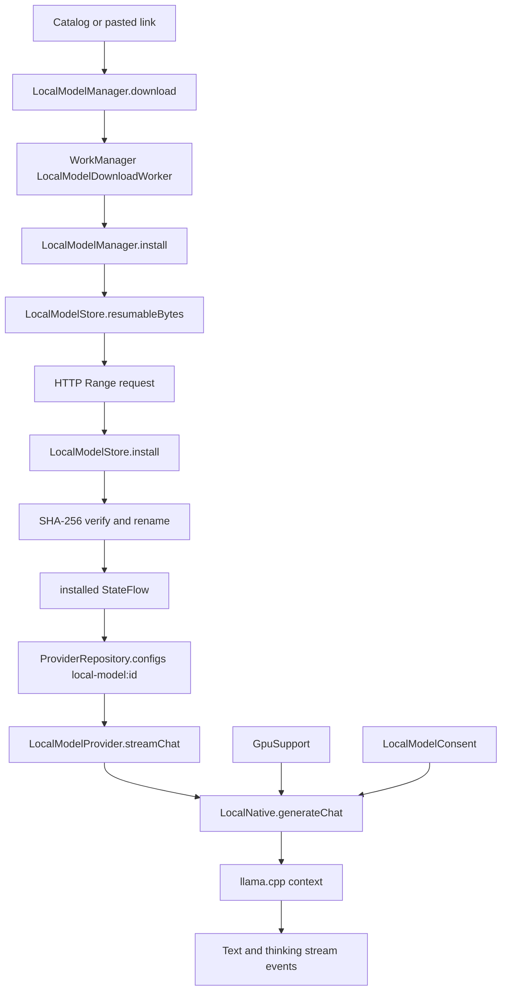

# Local Models and 9Router

> Runs GGUF models on the device through a llama.cpp JNI engine, imports and resumes model downloads, and installs a local 9Router gateway as an OpenAI-compatible provider.

The local stack has two independent halves. `local/` manages model files and on-device inference: a catalog of pinned GGUF specs, custom model import, WorkManager downloads with range resume, SHA-256 verification, safetensors to Q4 GGUF conversion, a `LocalModelProvider` that streams through `LocalNative`, optional Vulkan offload, benchmarks, device telemetry and consent prompts. `router/` manages 9Router: it installs the npm package into the Linux toolchain, starts a Node server on `127.0.0.1:20128`, and registers its `/v1` endpoint as a provider.

## Module Responsibilities

- **`LocalModelCatalog`, `LocalModelRecommendations`**: pinned model specs with repository, revision, filename, byte size, SHA-256, minimum RAM, KV bytes per token and max context. `PROVIDER_PREFIX` is `local-model:`.
- **`LocalModelManager`**: lifecycle owner for install, resume, pause, remove, load, generate and benchmark. Serializes mutations with a `lifecycle` mutex and inference with an `inference` mutex.
- **`LocalModelStore`**: on-disk layout, partial files, SHA verification, resume offsets, projector files and storage reporting.
- **`LocalModelDownloadWorker`**: foreground WorkManager worker with progress, pause and bounded network retries.
- **`LocalModelDocuments`, `CustomModelResolver`, `GgufMetadata`**: file and Hugging Face link import, bounded header probing and context/KV estimation.
- **`LocalNative`**: JNI surface for load, generate, chat, benchmark, cancellation and safetensors conversion.
- **`LocalModelProvider`**: adapts the local engine to the `LlmProvider` stream contract.
- **`GpuSupport`, `GpuRuntimePackage`, `GpuDeliveryFactory`**: optional Vulkan backend delivery, either as a Play dynamic feature or as a verified downloaded `.so`.
- **`DeviceTelemetry`, `LocalModelSuggestions`, `LocalModelConsent`**: device profiling, chip-tier recommendations and warning consent.
- **`NineRouterManager`, `NineRouterControl`, `NineRouterRelease`, `NineRouterNodeRuntime`**: install, start, update, stop, provider registration and uninstall for 9Router.
- **`LinuxEnvironmentManager`**: provides the Linux prefix, package installation, shell process builders and environment used by 9Router.

## Architecture and Flow

The provider representation of an installed model is synthetic. `LocalModelManager.configs` emits `ProviderConfig(id = "local-model:<id>", name = "Local · <title>", type = OPENAI_COMPAT, baseUrl = "local://<id>", model = <id>)`. `ProviderRepository` merges those configs into the normal provider list and `ModelCatalog.listModels` short-circuits local IDs with a single `ModelEntry`, so no HTTP call is made.

`LocalModelProvider.streamChat` checks that `config.model == config.id`, so a local provider cannot run a remote model ID. It reads `LocalModelLimits.thinkingMode`, resolves the requested thinking level, builds a `LocalChatCodec.request`, collects image bytes, and calls `LocalModelManager.generateChat` with the request bytes, images, output cap and `options.cacheKey`. Native events are parsed into `StreamEvent`s by `LocalReasoningStream` and `LocalChatCodec.finish`.

## Invocation Chain

1. The user downloads from the card or pastes a Hugging Face link. `LocalModelManager.download` enqueues unique WorkManager work tagged `local-model-download` and `model:<id>` with `ExistingWorkPolicy.KEEP` and a connected-network constraint.
2. `LocalModelDownloadWorker.doWork` checks `runtimePolicy.canRun()`, installs a foreground notification with a Pause action, and calls `manager.install`.
3. `install` takes the lifecycle lock, chooses the safetensors path or the GGUF path, reads `store.resumableBytes`, and starts `transfer`.
4. `transfer` sends `Range: bytes=<offset>-` when resuming, accepts a 206 only when `Content-Range` starts at the offset and the total matches, and restarts from zero on 416 or a mismatched partial.
5. `LocalModelStore.install` streams into `<id>.gguf.part`, hashes the whole file including previously stored bytes, checks the GGUF magic, verifies SHA-256, and renames to `<id>.gguf`.
6. The managed lifecycle then publishes `installed`, and `ProviderRepository` exposes a local config.
7. A chat request reaches `LocalModelProvider.streamChat`, which calls `generateChat`.
8. `generateChat` takes the inference lock, confirms consent, chooses GPU or CPU, creates a native handle, and streams native JSON events through a `Channel<ByteArray>` of capacity 32.
9. If GPU generation throws before any output, `LocalAccelerationPolicy.retryOnCpu` allows one CPU retry and sets a fallback status.
10. `NineRouterSection` calls `NineRouterManager.install`, `start`, `addProvider`, `update` or `uninstall`, each wrapped in `work(...)` so only one lifecycle mutation runs at a time.

## Key State and Data Structures

- **`LocalModelSpec`**: `id`, `title`, `repository`, `revision`, `filename`, `bytes`, `sha256`, `minimumRamGiB`, `kvBytesPerToken`, `maxContext`, `format`, `assets`, `projector`, `custom`, `localFile`, `abliterated`. `estimatedMemory(context)` is weights plus projector plus 640 MB overhead plus context times KV bytes.
- **`LocalModelLimits`**: `context`, `input`, `output`, `threads`, `backend` (`AUTO`, `CPU`, `GPU`), `promptThreads`, `thinkingMode` (`AUTO`, `THINKING`, `DIRECT`). Stored as `<id>.json` with `AtomicFile`.
- **`LocalDeviceProfile`**: total and available RAM, free storage, ABI, cores and low-memory flag. `fits` requires a supported 64-bit ABI, at least 90 percent of minimum RAM, and estimated memory under 55 percent of total RAM. `canLoad` additionally rejects low-memory devices and requires 256 MB headroom.
- **`LocalModelStore` layout**: `<id>.gguf`, `<id>.gguf.part`, `<id>-mmproj.gguf`, `<id>-source/` for safetensors, `<id>.json` limits and `file-import-*` staging directories.
- **`GgufMetadata.Estimate`**: `kvBytesPerToken` and `maxContext`, derived from `general.architecture`, `context_length`, `block_count`, attention head counts, embedding length and key/value lengths. It reads at most 2 MB and rejects split GGUFs.
- **`LocalBenchmarkProgress`**: backend, phase, thread counts, live tokens per second, answers, samples, errors, recommendations and finished/stopped flags.
- **`NineRouterState`**: phase, detail, error, installed and latest versions, file presence, auto-start, provider-added and update flags.
- **`GpuInstallState`**: phase, downloaded bytes, total bytes, error and library path. `busy` and `progress` are derived.

## Persistence and runtime state

- Installed model IDs are derived from the files on disk at startup, not from a database. `LocalModelManager.init` discards stale partials, removes files that do not match their expected size, deletes leftover `file-import-*` directories and republishes `installed`.
- A paused download keeps its `.part` or safetensors `.part` files. A verified but unconverted safetensors source is kept so conversion can be retried without re-downloading. The conversion output itself is never resumable.
- The converted safetensors model is registered in `CustomModelRegistry` and the spec is rewritten with the real GGUF size, `kvBytesPerToken` and `maxContext` from `GgufMetadata`.
- 9Router stores its files under `filesDir/9router`, its version in a `.installed` marker, and `autoStart` plus `latestVersion` in the `nine_router` SharedPreferences file.
- A 9Router install is staged in `.update`, the previous `node_modules` is renamed to `.previous_modules`, and the new tree is activated with a rename. If activation fails the backup is restored. The marker is written with `AtomicFile`.
- The Node process runs with `DATA_DIR` under the 9Router root, `HOSTNAME=127.0.0.1`, `PORT=20128`, `NODE_PATH` pointing at the installed modules, and a lifecycle preload that exits when the parent process changes.

## Boundary Conditions

- Downloads require network connectivity. `LocalModelDownloadWorker` retries `IOException` while `runAttemptCount` is below 5 and then fails with an error; other exceptions fail immediately. `UnsatisfiedLinkError` during conversion produces a message telling the user to download a preconverted GGUF.
- A 416 response, a 206 whose `Content-Range` does not match, or a damaged partial restarts the transfer from zero rather than trusting bad bytes.
- Expected-size overflow, checksum mismatch, missing GGUF magic and cancelled transfers delete the partial file. A dropped connection before verification keeps it for resume.
- `install` refuses to overwrite an already installed model. The user must remove it first.
- `GgufMetadata` rejects files shorter than 24 bytes, GGUF versions outside 2 to 3, zero tensors, more than 100,000 metadata entries and split models.
- `LocalDeviceProfile` only supports `arm64-v8a` and `x86_64`. A 32-bit device gets "Unsupported architecture" and inference may fail even if downloading succeeds.
- GPU use requires the experimental setting, a non-CPU backend preference, and a loaded backend that reports a device. `GpuSupport.device` never unloads a registered backend because worker threads can outlive a request.
- Play distribution ships the GPU backend as an on-demand dynamic feature `local_gpu`; the GitHub channel downloads a `gpu-<abi>-<sha>.so.gz`, verifies the SHA-256 and exposes the extracted library path.
- 9Router install requires the Linux toolchain and the `nodejs` and `npm` packages. Startup refuses to run when port 20128 is already open, and waits up to 90 seconds for the port to accept connections.
- A 9Router update stops a running server, installs the new version, and restarts it only if it was running before. Version parsing accepts semver with an optional prerelease and compares numerically.
- Uninstall stops the server, deletes the router provider, releases the `9Router` package requirement from managed Linux tools, removes the root directory and clears preferences.
- `LocalModelConsent` deduplicates warnings by a resource key that includes model ID, context, input, output, threads, prompt threads, backend, download state, low-memory state and projector URL. Accepting one key does not suppress a different configuration.
- `LocalModelWarningDialog` is the UI side of `LocalModelConsent.warning`; inference blocks in `confirm` until the user answers or cancels.

## Benchmarks, telemetry and recommendations

- `LocalBenchmarkMode` is `CPU`, `GPU` or `BOTH`. `localBenchmarkThreadCounts` tests 1, 2, 4, the core count capped at 8, the current generation threads and the current prompt threads.
- Each phase runs three times and averages. Generation threads are swept first, then prompt threads with the best generation count, then a final verification run. `LocalBenchmarkRecommendation` carries the winning pair and both throughput values. `LocalBenchmarkScreen` applies the best recommendation back to the model limits.
- The benchmark keeps the screen awake and stops the model when the screen leaves composition.
- `DeviceTelemetry.sample` reports total and available RAM, free RAM, total and available storage, app PSS, app and system CPU, per-core online state, current and max frequency and load, plus neural driver names on API 29 and above. `LocalPerformanceSection` samples it on a lifecycle-aware loop.
- `ChipClassifier.classify` maps manufacturer, SoC, hardware, board, max core frequency and core count to a `ChipTier` of `FLAGSHIP`, `UPPER_MID`, `MID`, `ENTRY` or `UNKNOWN`. `LocalModelSuggestions.suggest` returns `BEST`, `CODING`, `FAST` and `LIGHT` picks that fit the device.
- `localModelWarnings` is advisory only. It lists warnings for unsupported ABI, memory over budget, context beyond training length, input plus output beyond context, more threads than cores, and insufficient storage for download or conversion. The user can still proceed after consent.
- `LocalModelCard` exposes download, pause, resume, remove, limits, benchmark, projector install, details and chat actions. `resumableBytes` drives the Resume affordance.

## Extension Points

- Add a model by appending a `LocalModelSpec` to `LocalModelCatalog.models` or `LocalModelRecommendations.models`. Keep revision, byte size and SHA-256 pinned.
- Add a quantization or format in `LocalModelFormat` and handle it in `install`, `importFromFiles` and `CustomModelResolver`.
- Change native behavior by extending `LocalNative` and the corresponding C++ entry points in `app/src/main/cpp/local_model.cpp`, `local_chat.cpp` and `safetensors_import.cpp`.
- Add a GPU delivery channel in `GpuDeliveryFactory` variants under `app/src/playDelivery` and `app/src/githubDelivery`. The `GpuDelivery` interface also has `prepareForLoad` and `confirm`.
- Extend benchmark phases in `LocalBenchmarkPhase` and the sweep in `LocalModelManager.benchmark`.
- Change 9Router version, port or API URL in `NineRouterManager`'s companion object. Update checks read the npm registry `9router/latest`.
- `NineRouterControl` uses the same local CLI credential protocol as the 9Router terminal. `integrationKey` reuses an active key named `AndroidHarness` or creates one.
- `LinuxEnvironmentManager.install`, `shellProcessBuilder`, `processEnv`, `ensureShims` and `ensureScratchDirs` are the integration points for other Linux-hosted tools.

## Known gaps

- The KV and prompt cache implementation is native. Kotlin passes a `cacheKey` into `LocalNative.generateChat`, and `app/src/main/cpp/local_chat.cpp` keeps a cached `llama_context`, a cached session key and cached tokens, reuses the longest common token prefix, and removes the remaining sequence range with `llama_memory_seq_rm`. Caching is disabled when a vision projector is used.
- Telemetry does not leave the device. `DeviceTelemetry` reads `/proc` and Android APIs locally; there is no remote upload path in these files.
- 9Router's Node runtime shim is generated by `NineRouterNodeRuntime.preload`. This page does not document the shim contents beyond its use of the platform linker and `--require` preloads.

Sources: [app/src/main/java/com/androidharness/app/local/LocalModelCatalog.kt](../app/src/main/java/com/androidharness/app/local/LocalModelCatalog.kt)#L5-L125), [app/src/main/java/com/androidharness/app/local/LocalModelManager.kt](../app/src/main/java/com/androidharness/app/local/LocalModelManager.kt)#L49-L342), [app/src/main/java/com/androidharness/app/local/LocalModelManager.kt](../app/src/main/java/com/androidharness/app/local/LocalModelManager.kt)#L367-L451), [app/src/main/java/com/androidharness/app/local/LocalModelManager.kt](../app/src/main/java/com/androidharness/app/local/LocalModelManager.kt)#L493-L746), [app/src/main/java/com/androidharness/app/local/LocalModelDownloadWorker.kt](../app/src/main/java/com/androidharness/app/local/LocalModelDownloadWorker.kt)#L18-L75), [app/src/main/java/com/androidharness/app/local/LocalModelStore.kt](../app/src/main/java/com/androidharness/app/local/LocalModelStore.kt)#L18-L180), [app/src/main/java/com/androidharness/app/local/LocalNative.kt](../app/src/main/java/com/androidharness/app/local/LocalNative.kt)#L6-L52), [app/src/main/java/com/androidharness/app/local/GpuSupport.kt](../app/src/main/java/com/androidharness/app/local/GpuSupport.kt)#L7-L47), [app/src/main/java/com/androidharness/app/router/NineRouterManager.kt](../app/src/main/java/com/androidharness/app/router/NineRouterManager.kt)#L18-L262), [app/src/main/java/com/androidharness/app/router/NineRouterControl.kt](../app/src/main/java/com/androidharness/app/router/NineRouterControl.kt)#L14-L56), [app/src/main/cpp/local_chat.cpp](../app/src/main/cpp/local_chat.cpp)#L322-L358)

## Source files

- `app/src/main/java/com/androidharness/app/local/LocalModelCatalog.kt`
- `app/src/main/java/com/androidharness/app/local/LocalModelManager.kt`
- `app/src/main/java/com/androidharness/app/local/LocalModelStore.kt`
- `app/src/main/java/com/androidharness/app/local/LocalModelDownloadWorker.kt`
- `app/src/main/java/com/androidharness/app/local/LocalModelDocuments.kt`
- `app/src/main/java/com/androidharness/app/local/CustomModelResolver.kt`
- `app/src/main/java/com/androidharness/app/local/GgufMetadata.kt`
- `app/src/main/java/com/androidharness/app/local/LocalNative.kt`
- `app/src/main/java/com/androidharness/app/local/LocalModelProvider.kt`
- `app/src/main/java/com/androidharness/app/local/LocalChatCodec.kt`
- `app/src/main/java/com/androidharness/app/local/LocalModelConsent.kt`
- `app/src/main/java/com/androidharness/app/local/GpuSupport.kt`
- `app/src/main/java/com/androidharness/app/local/GpuRuntimePackage.kt`
- `app/src/main/java/com/androidharness/app/local/LocalAccelerationPolicy.kt`
- `app/src/main/java/com/androidharness/app/local/LocalBenchmark.kt`
- `app/src/main/java/com/androidharness/app/local/DeviceTelemetry.kt`
- `app/src/main/java/com/androidharness/app/local/LocalModelSuggestions.kt`
- `app/src/main/java/com/androidharness/app/local/LocalModelRecommendations.kt`
- `app/src/main/java/com/androidharness/app/ui/settings/LocalModelsSection.kt`
- `app/src/main/java/com/androidharness/app/ui/settings/LocalBenchmarkScreen.kt`
- `app/src/main/java/com/androidharness/app/ui/settings/LocalGpuSupportCard.kt`
- `app/src/main/java/com/androidharness/app/ui/settings/NineRouterSection.kt`
- `app/src/main/java/com/androidharness/app/router/NineRouterManager.kt`
- `app/src/main/java/com/androidharness/app/router/NineRouterControl.kt`
- `app/src/main/java/com/androidharness/app/router/NineRouterRelease.kt`
- `app/src/main/java/com/androidharness/app/router/NineRouterNodeRuntime.kt`
- `app/src/main/java/com/androidharness/app/data/env/LinuxEnvironment.kt`
- `app/src/main/cpp/local_chat.cpp`
- `app/src/playDelivery/java/com/androidharness/app/local/GpuDeliveryFactory.kt`
- `app/src/githubDelivery/java/com/androidharness/app/local/GpuDeliveryFactory.kt`
- `local_gpu/src/main/AndroidManifest.xml`
