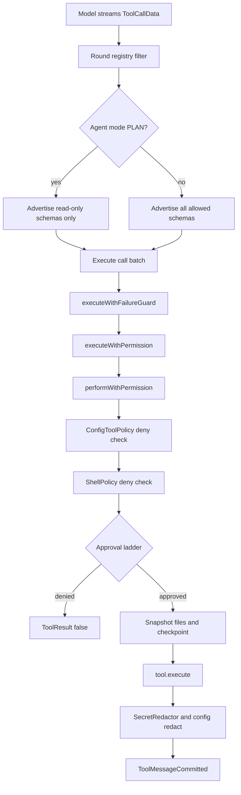

# Tool Framework, Dispatch, and Permissions

> Defines the `Tool` contract, builds the per-run tool registry, dispatches model tool calls, and gates every call through permission modes, approvals, and remembered grants.

Every capability the agent can invoke implements `Tool` in `app/src/main/java/com/androidharness/app/tools/Tool.kt`. The engine in `AgentEngine.kt` turns the model's `ToolCallData` stream into executions: it filters the registry, decides which calls may run concurrently, runs each call through a permission ladder, snapshots files before mutating them, and returns a redacted `ToolResult`. The permission layer is deliberately separate from the tool implementations, so a tool cannot approve itself or quietly widen its sandbox.

## Module Responsibilities

- **`Tool` contract**: name, description, JSON parameters schema, `isReadOnly`, optional `isAvailable`, and `execute`.
- **`ToolRegistry`**: immutable-by-copy lookup and filtering by name, run scope, and availability. `schemas()` advertises the model-facing tool list.
- **`WorkspaceToolRouting`**: validates workspace selection, injects `workspace_id`, and resolves the concrete filesystem for a call.
- **`AgentEngine.executeWithPermission`**: the single checkpoint all tool calls cross, including plugin hooks, recovery cache, redaction, and durable `ToolMessageCommitted`.
- **`AgentEngine.performWithPermission`**: deny rules, shell policy, approval resolution, checkpointing, execution, and diff accounting.
- **`RememberedGrants`**: the in-memory per-session "Always" set, exposed to Settings as revocable rows.
- **Interactive events**: `ApprovalRequest`, `QuestionRequest`, and `EnvironmentRequest` bridge model calls to the UI or notification actions.

## Architecture and Flow

The flow has three independent gates. The round registry gate removes tools that a Code agent denies or the project `permissions` map denies. The call gate re-checks those rules, then handles Plan mode and the shell denylist. The approval gate decides whether the user must see a card. Passing all three still runs the tool inside the workspace resolved by `WorkspaceToolRouting`, so path containment is not optional.

Availability is also part of advertisement. `ToolRegistry.schemas` takes `readOnlyOnly` and a `ToolContext`, sorts by name, and calls `WorkspaceToolRouting.available`. In Plan mode the model never sees write tools at all, which is stronger than rejecting them at execution time. A chat workspace that contains any read-only binding additionally hides every command and integration tool unless the name is in the file-tool set, because one read-only project disables commands for the whole selection.

## Invocation Chain

1. `RunManager.startRunLocked` reads the live permission mode through a lambda (`RunManager.kt` lines 595-600), starts the session grant set with `grantStore.start`, and passes the set into `AgentEngine.run` (`RunManager.kt` lines 483-486 and 601).
2. `AgentEngine.run` reads `permissionMode()` once per round, computes `sandboxOff`, swaps in `UnboundedFileFs` for Full access, and filters the registry before building schemas (`AgentEngine.kt` lines 438-464).
3. For each assistant turn, the stream handler appends `ToolCallReady` and `ToolCallBatch` entries to `calls` (`AgentEngine.kt` lines 528-532 and 573-575).
4. The dispatch loop walks `calls` in order (`AgentEngine.kt` lines 790-855). Each call goes to `executeWithFailureGuard`, which blocks an identical retry after a deterministic failure (`AgentEngine.kt` lines 1049-1089).
5. `executeWithPermission` runs `tool.before` plugin hooks, consults the recovery ledger for non-read-only calls, calls `performWithPermission`, applies `SecretRedactor`, and emits `ToolMessageCommitted` under `NonCancellable` (`AgentEngine.kt` lines 1116-1160).
6. `performWithPermission` resolves the tool, applies config denial, parses arguments, routes the workspace, refuses Plan-mode mutations, handles `task` and `ask_user` specially, evaluates `ShellPolicy`, runs the approval ladder, snapshots targets, calls `tool.execute`, records diff stats, and prefixes a workspace label (`AgentEngine.kt` lines 1171-1568).
7. `RunManager` maps `AgentEvent.ApprovalNeeded` into `pendingApproval`, and `approve(sessionId, rememberForSession)` completes the deferred and optionally records the grant key (`RunManager.kt` lines 860 and 1016-1042).

## Key State and Data Structures

- **`ToolContext`**: `workspace`, `sandboxOff`, `sessionId`, `onPackageProgress`, `imageInputAllowed`, `configuration`, and `skills`. `sandboxOff` is honored by tools but never enabled by them; the engine sets it only for non-chat runs in Full access.
- **`ToolResult`**: `ok`, `output`, optional `image`, `artifact`, `execution` receipts, `research`, and `settings` receipts. Receipts flow into `GenerationMetadata` on the tool message.
- **`Tool`**: `isReadOnly` is the only built-in risk flag. There is no separate risk enum; "risky" in `CONFIRM_RISKY` is defined as "not read-only", plus the unconditional package-install and sensitive-settings rules.
- **`PermissionMode`**: `CONFIRM_ALL`, `CONFIRM_RISKY`, `FULL_AUTO`, `FULL_ACCESS` (`AgentEngine.kt` lines 42-48). It is persisted under the `permission_mode` preferences key with default `CONFIRM_RISKY` (`SettingsRepository.kt` lines 27 and 237).
- **`ApprovalRequest`**: carries the call, a description, an optional diff preview, and `grantKey` (default `call.name`), plus a `CompletableDeferred<Boolean>` (`AgentEngine.kt` lines 53-61).
- **`QuestionRequest`**: call id, question text, options, `multiSelect`, and a deferred string (`AgentEngine.kt` lines 63-71).
- **`EnvironmentRequest`**: command, hints, `repair`, `missingTool`, and a deferred boolean (`AgentEngine.kt` lines 73-84).
- **`RememberedGrants.Grant`**: `sessionId`, `workspacePath`, `key`. Grants live in a `ConcurrentHashMap`-backed key set per session and are published as a sorted `StateFlow` (`RememberedGrants.kt` lines 7-40). They are memory-only and disappear when the run finishes.
- **Grant key format**: `ShellPolicy.grantKey` returns `tool#<first two command tokens>` for shell tools and the bare tool name otherwise (`ShellPolicy.kt` lines 583-590). When a workspace binding is involved, the engine prefixes `workspace:<id>:` (`AgentEngine.kt` line 1334).

## Dispatch Order and Concurrency

The loop partitions calls into three kinds:

1. A contiguous block of `task` calls runs in parallel inside `coroutineScope`, each through `executeWithPermission`, sharing one `Mutex`-guarded emitter because `FlowCollector.emit` is not concurrency-safe (`AgentEngine.kt` lines 793-824).
2. A contiguous block of read-only, parallel-safe calls runs in parallel through `executeWithFailureGuard` (`AgentEngine.kt` lines 825-844). `parallelSafeReadOnly` requires `isReadOnly`, excludes `ask_user`, `browser_wait_for`, `create_artifact`, `subagent_wait`, `subagent_stop`, and excludes every `browser_` tool (`AgentEngine.kt` lines 1040-1047 and 2407).
3. Everything else runs sequentially at its requested position, so `todo_write` progress is visible and stateful tools never reorder (`AgentEngine.kt` lines 845-854).

Results are stored in a `LinkedHashMap` and committed to the working history in the model's original call order (`AgentEngine.kt` lines 778-866). Overlap therefore changes wall time, not transcript order.

## Permission Ladder

`performWithPermission` evaluates in this order (`AgentEngine.kt` lines 1337-1379):

1. Project configuration `ask` forces a card in every mode except Full access, where `ConfigToolPolicy` returns `allow`, with grant key `config:<fingerprint>:<grantKey>`.
2. `AppSettingsChangeTool` asks only when its own `approvalPreview` returns text; sensitive settings ask in every mode.
3. `pkg_install` and `android_sdk_install` always ask, including Full access and Full auto.
4. `FULL_ACCESS` returns true.
5. A remembered grant returns true. Shell tools must match the full signature; a bare `shell` grant is never a blank check (`ShellPolicy.kt` lines 592-597).
6. `FULL_AUTO` returns true.
7. `remember` returns true because it only touches the app memory table.
8. `CONFIRM_RISKY` plus read-only returns true.
9. Otherwise a card is emitted.

Full access does change project-config enforcement: `ConfigToolPolicy.permission` returns `allow` before reading the permission map when the mode is `FULL_ACCESS`, and the round registry is filtered with that result (`ConfigRunContext.kt` lines 37-49, `AgentEngine.kt` line 459). A configured `deny` therefore does not survive into the Full access round registry. Shell denial is skipped explicitly for the same mode (`AgentEngine.kt` lines 1325-1332). Full access also requires a biometric or device-credential check at the UI entry points before the mode can be selected (`BiometricAuth.requireFullAccessApproval`, used by `AgentBehaviorSection.kt` lines 346-349, `MainHeader.kt` lines 367-371, and `ChatWorkspaceScreen.kt` lines 274-278).

## Boundary Conditions

- **Unknown tool**: `performWithPermission` returns `ToolResult(false, "Unknown tool: ...")`.
- **Invalid arguments**: JSON parse failure returns a failure before any approval card.
- **Plan mode**: non-read-only tools and `ask_user` questions that ask to proceed are refused with an explanatory message (`AgentEngine.kt` lines 1209-1213 and 1267-1288).
- **Selected-workspace refusal**: `WorkspaceToolRouting.route` throws `ToolFailure` for a read-only binding, a read-only selection with a non-file tool, or an unavailable target (`WorkspaceToolRouting.kt` lines 43-64).
- **Snapshot failure**: if `checkpointer.snapshot` throws, the tool is not run and the result says the edit was not made (`AgentEngine.kt` lines 1393-1398).
- **Denied approval**: returns `The user denied permission to run <name>.` (`AgentEngine.kt` lines 1380-1382).
- **Deterministic retry**: an identical failed call is blocked with a message naming the previous failure, and the block is committed as a tool message (`AgentEngine.kt` lines 1065-1075).
- **Environment repair**: only a shell failure that matches a known missing toolchain binary offers a repair card, and the failing command is never replayed before consent (`AgentEngine.kt` lines 1443-1507).

## Extension Points

- Implement `Tool` and add it to `ToolRegistry.default` or pass it through `extraTools`; MCP servers arrive this way (`AgentEngine.kt` lines 281-282).
- `HarnessConfig.permissions` maps tool categories to `allow`, `ask`, or `deny`; `ConfigToolPolicy.matches` defines the categories `write`, `edit`, `delete`, `read`, `network`, and `shell`.
- Plugin hooks `tool.before` and `tool.after` can deny, add instructions, and observe results (`AgentEngine.kt` lines 1133-1151).
- `RememberedPermissionsSection` lists `rememberedGrants` and calls `revokeGrant`, so users can drop one remembered key without restarting the chat.

## Known gaps

- FEATURES.md describes four permission modes and fingerprint gating; both are verified. It also says every remembered permission can be revoked individually, which the settings section implements, but grants are not persisted across app restarts by design, so there is no on-disk grant record to audit.

Sources: [app/src/main/java/com/androidharness/app/tools/Tool.kt](../app/src/main/java/com/androidharness/app/tools/Tool.kt)#L12-L77), [app/src/main/java/com/androidharness/app/agent/AgentEngine.kt](../app/src/main/java/com/androidharness/app/agent/AgentEngine.kt)#L42-L84), [app/src/main/java/com/androidharness/app/agent/AgentEngine.kt](../app/src/main/java/com/androidharness/app/agent/AgentEngine.kt)#L1337-L1379), [app/src/main/java/com/androidharness/app/agent/RememberedGrants.kt](../app/src/main/java/com/androidharness/app/agent/RememberedGrants.kt)#L7-L40)

## Source files

- `app/src/main/java/com/androidharness/app/tools/Tool.kt`
- `app/src/main/java/com/androidharness/app/agent/AgentEngine.kt`
- `app/src/main/java/com/androidharness/app/agent/RememberedGrants.kt`
- `app/src/main/java/com/androidharness/app/tools/InteractiveTools.kt`
- `app/src/main/java/com/androidharness/app/tools/ShellPolicy.kt`
- `app/src/main/java/com/androidharness/app/tools/WorkspaceToolRouting.kt`
- `app/src/main/java/com/androidharness/app/agent/RunManager.kt`
- `app/src/main/java/com/androidharness/app/config/ConfigRunContext.kt`
- `app/src/main/java/com/androidharness/app/ui/common/BiometricAuth.kt`
