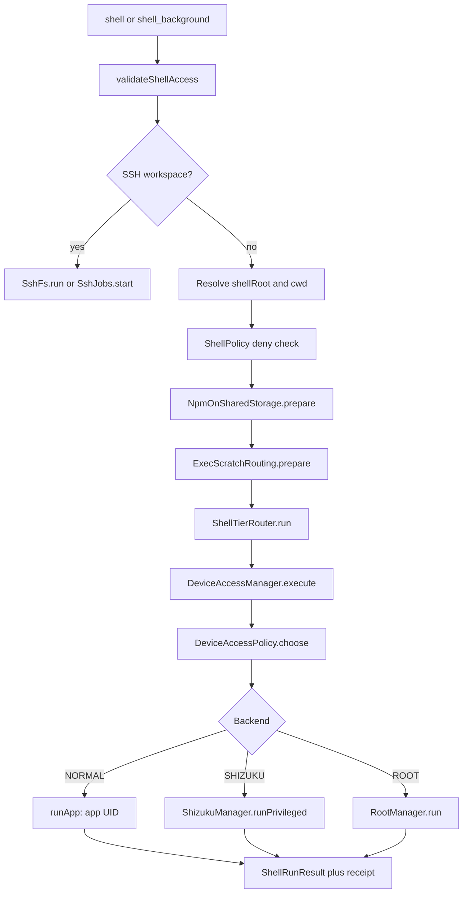

# Shell Execution and Device Access

> Runs shell commands through the correct privilege tier (app UID, Shizuku or Wireless ADB shell, direct root, or SSH) and records which transport actually executed the command.

`ShellTool` is a thin tool wrapper. The real work is split between `ShellTierRouter` (which engine runs a command given its working directory), `DeviceAccessManager` (which backend is allowed and reachable), `ShizukuManager` and `RootManager` (the privileged runners), and `LinuxEnvironmentManager` (the app-UID toolchain). Every result carries an `ExecutionReceipt` naming the backend and transport, so "it worked" is always attributable to a specific privilege domain.

## Module Responsibilities

- **`ShellTool`**: validates `access`, resolves `cwd`, applies pre-execution rewrites, calls the router or SSH, and formats exit code, stdout, stderr, and degradation notes.
- **`WorkspaceToolRouting`**: picks the workspace binding for a call and hides command tools when any selected binding is read-only.
- **`ExecScratchRouting`**: retargets `tar` extraction from exec-hostile shared storage into an exec-capable scratch root.
- **`DeviceAccessPolicy`**: pure backend selection order and root permission rule.
- **`DeviceAccessManager`**: reads preferences, holds the paused state and temporary root allowance, loops candidate backends, captures receipts, and reports status.
- **`ShellTierRouter`**: maps paths to `ExecutionTier`, launches app-UID processes, and delegates privileged execution.
- **`ShizukuManager`**: binds the in-server user service, deploys the toolchain to `/data/local/tmp`, runs and spawns privileged commands, probes liveness.
- **`RootManager`**: requests `su`, binds `RootHarnessService`, verifies UID 0, runs and stops commands.
- **`DhizukuManager`**: a separate Device Owner domain, never used as a Shizuku or root fallback.
- **`LinuxEnvironmentManager`**: owns the app prefix, environment, shell launch, and the deployed shell-tier copy.

## Architecture and Flow

The separation matters because reachability is path-dependent. The app UID cannot enter `/data/user/0` from outside, and the shell UID cannot enter the app's private data directory. `PathClassifier.regionOf` returns `APP_DATA`, `SHARED_STORAGE`, or `SYSTEM`, and `ShellTierRouter.resolveTier` uses that region to choose a tier (`ShellTierRouter.kt` lines 13-23 and 68-82).

## Invocation Chain

1. `AgentEngine.performWithPermission` computes the command with `ShellPolicy.commandOf`, applies the denylist unless Full access, builds a grant key, and calls the tool inside `deviceAccess.traceTool` (`AgentEngine.kt` lines 1321-1334 and 1419-1421).
2. `ShellTool.execute` validates `access` against the workspace type, resolves the root and `cwd`, re-checks `ShellPolicy.denyReason`, clamps the timeout to 1..600 seconds, and applies npm and tar rewrites (`ShellTool.kt` lines 44-79).
3. `ShellTierRouter.run` switches to `Dispatchers.IO` and calls `DeviceAccessManager.execute` when device access is wired in, otherwise it resolves a static tier (`ShellTierRouter.kt` lines 111-133).
4. `DeviceAccessManager.select` reads preferences, probes root readiness and the Shizuku UID, and calls `DeviceAccessPolicy.choose` (`DeviceAccessManager.kt` lines 126-136).
5. `DeviceAccessManager.execute` loops over candidate backends, claims a root lease when needed, dispatches under `VerifiedDeviceAccess`, stores the receipt, and returns the first real result (`DeviceAccessManager.kt` lines 139-170).
6. `ShellTierRouter.runApp` starts `linuxEnv.startShell`, polls every 50 ms, kills the process group on timeout or cancellation, reaps zombies, and returns `ShellRunResult` (`ShellTierRouter.kt` lines 222-308).
7. `ShellTool` formats the result: notes first, then `exit code:`, then `stdout (JSON string):` and `stderr (JSON string):`, each truncated at 100,000 chars (`ShellTool.kt` lines 96-122).

## Key State and Data Structures

`AccessPreferences` holds `mode`, `autoFallback`, `rootUse`, `rootProjects`, `temporaryRoot`, and `appWorkspacePrivileged` (`DeviceAccessPolicy.kt` lines 33-42). `AccessRequest` is a coroutine context element carrying project id, session id, `requireRoot`, `forceDevice`, `manual`, `requireShizuku`, a `RootLease`, and a receipt list. `VerifiedDeviceAccess` carries the chosen backend and UID so `ShizukuManager.runPrivileged` can refuse a binder whose UID changed after selection. `AccessDecision` is the pure result: backend, reason, UID. `ShellRunResult` is the uniform runner result: exit code, timeout flag, stdout, stderr, tier, note. `PrivilegedResult` is the binder-level form without a tier.

`AccessMode` is `AUTO`, `NORMAL`, `SHIZUKU`, `ROOT`, or `BOTH` (`DeviceAccessPolicy.kt` lines 5-10). `DeviceAccessPolicy.choose` builds the order as follows (`DeviceAccessPolicy.kt` lines 52-99):

| Mode | Order when fallback is on |
| --- | --- |
| `NORMAL` | `NORMAL` only |
| `SHIZUKU` | `SHIZUKU`, then `NORMAL` |
| `ROOT` | `ROOT`, `SHIZUKU`, `NORMAL` |
| `AUTO` | `ROOT` when allowed, then `SHIZUKU`, then `NORMAL` |
| `BOTH` | `SHIZUKU`, `ROOT`, `NORMAL`; `requireRoot` starts at `ROOT` |

An explicit `access="shizuku"` sets `requireShizuku` and never falls back to root or the app UID. An explicit `access="root"` sets `requireRoot` and never falls back to non-root. An app workspace returns `NORMAL` before the order is built unless the request forces a device backend (`DeviceAccessPolicy.kt` line 64 and `DeviceAccessManager.kt` lines 129-135).

Preferences are stored in the `device_access` DataStore, deliberately separate from portable settings backups: `mode`, `auto_fallback`, `root_use`, `root_projects`, `temporary_root`, and `app_workspace_privileged` (`DeviceAccessStore.kt` lines 8-32). `root_use` is `SESSION`, `CHAT`, or `NEXT_ACTION`.

## Path-Based Routing

`ShellTierRouter.run` is the entry point for device execution. When `deviceAccess` is present it passes three lambdas to `DeviceAccessManager.execute`: an app-tier runner, a Shizuku runner, and a root runner (`ShellTierRouter.kt` lines 117-124). When it is not present it uses `resolveTier`:

- `APP_DATA` always uses the app UID toolchain, or toybox when the environment is not installed.
- `SHARED_STORAGE` and `SYSTEM` prefer the privileged tier when `shizuku.hasPrivilegedAccess()` is true, otherwise the app tier.

`DeviceAccessManager.pinsAppUser` returns true for the private data directory unconditionally, and for other app-owned folders while `appWorkspacePrivileged` is false (`DeviceAccessManager.kt` lines 179-182). This is why builds in the app workspace stay on the app UID even with Shizuku connected. `liveTier` maps the selected backend to `ROOT`, `PRIVILEGED`, `APP_LINUX`, or `TOYBOX` for status display.

`resolveShellWorkingDirectory` canonicalizes `cwd`, rejects paths outside the workspace when the sandbox is on, and requires an existing directory (`ShellTool.kt` lines 133-142).

## Transports and Receipts

`ExecutionReceipt` contains `backend`, optional `uid`, optional `fallbackReason`, and optional `transport`. Its `label` prefers the transport name, so a Shizuku-compatible connection can read "Wireless ADB" while the backend stays `SHIZUKU` (`DeviceAccessPolicy.kt` lines 16-31).

`ShellAccessProvider` names the two supported Shizuku-compatible packages: Shizuku (`moe.shizuku.privileged.api`) and Shevery (`com.hamondev.shevery`) (`ShellAccessProvider.kt` lines 3-7). `ShizukuManager.transportLabel` returns "Wireless ADB" when the built-in ADB transport is the live runner, otherwise the provider label (`ShizukuManager.kt` lines 82-86).

Wireless ADB is a full ADB client implementation. `AdbKey` generates and signs with an RSA identity, `AdbPairingClient` performs TLS pairing with the six-digit code, `AdbClient` opens a shell stream, and the resulting runner exposes the same `CompatRequest` interface as the compatibility Shizuku path. `testUid` requires UID 2000 or 0 (`WirelessAdbManager.kt` lines 135-141). Pairing needs Android 11 or newer and a native pairing library (`WirelessAdbManager.kt` lines 68-80).

`ShizukuManager.runPrivileged` returns `null` only when dispatch never began. If the binder call throws after submission, it returns a failure result stating the command may have run and was not retried (`ShizukuManager.kt` lines 476-505). `RootManager.run` follows the same rule (`RootManager.kt` lines 162-168), as does `DhizukuManager.run` (`DhizukuManager.kt` lines 99-136). Callers therefore never replay a possibly executed command under a different UID.

## App Workspace, SSH, and Scratch Rules

- **App workspace**: `pinsAppUser` keeps ordinary builds on the app UID. Setting `app_workspace_privileged` lets app-owned external folders follow the selected mode, while the private data directory never does.
- **SSH refusal**: `validateShellAccess` accepts only `null`, `auto`, `shizuku`, or `root`, and rejects `shizuku`/`root` when the workspace is `SshFs` with "Shizuku and direct root are Android-local" (`ShellTool.kt` lines 125-131). `SshFs.shellRoot` is deliberately null, and `DeviceAccessManager.statusForAgent` states that local grants do not grant root on the remote host (`SshFs.kt` lines 11-33 and `DeviceAccessManager.kt` lines 236-238).
- **Exec scratch routing**: `ExecScratchRouting.prepare` detects `tar` extraction, checks whether the destination or `cwd` is `/storage/emulated/0` or `/sdcard`, and rewrites the destination into the first existing scratch root (`ShellPolicy.SCRATCH_ROOTS`). It appends a `-C "<scratch>"` when no directory flag exists and returns a note telling the model where the tree landed (`ExecScratchRouting.kt` lines 34-111).
- **Toolchain deployment**: `LinuxEnvironmentManager.ensureShellDeploy` stages the prefix, computes a tag, and asks `ShizukuManager.ensureTmpPrefix` to extract it, then syncs GitHub auth (`LinuxEnvironment.kt` lines 1510-1540). `tmpProcessEnv` builds PATH, `LD_PRELOAD`, git config paths, and TLS variables for that deployed copy (`LinuxEnvironment.kt` lines 1247-1306).

## Boundary Conditions

- **Paused privileged access**: `DeviceAccessManager.stopPrivileged` sets `stopped`, revokes the temporary allowance, and asks root, Shizuku, the owner app, and detached background tasks to stop. Selection then refuses every non-normal backend with "Privileged access is paused" (`DeviceAccessManager.kt` lines 301-311 and `DeviceAccessPolicy.kt` lines 85-95).
- **Temporary root**: in temporary mode, root needs a manual request or a project allow-list entry plus an active allowance. `NEXT_ACTION` is consumed by the first root lease; `CHAT` is bound to a session id (`DeviceAccessPolicy.kt` lines 49-50 and 103-139).
- **Root verification**: `RootManager.verify` requires a successful `id -u` returning `0`, a live binder, and service UID 0. It never prompts and never invokes `su` (`RootManager.kt` lines 107-146).
- **Timeout**: on timeout the app tier kills the whole process group, and `ShellTool` reports `exit code: killed (timeout)` with output captured before the kill (`ShellTierRouter.kt` lines 248-298 and `ShellTool.kt` lines 108-111).
- **Degraded tiers**: toybox fallback, privileged-without-toolchain, and fallback-to-app-UID each append an explicit note (`ShellTierRouter.kt` lines 200-217 and `ShellTool.kt` lines 99-110).
- **Symlink failures**: when `ln -s` fails on shared storage, `ShellTool` removes a stale zero-byte destination and reports that symlinks are unsupported (`ShellTool.kt` lines 81-101).

## Extension Points

- Add a new privileged transport by implementing the same `exec`/`spawn`/`alive`/`kill` compatibility requests and wiring it into `ShizukuManager` through the `wireless` constructor parameter.
- `DeviceAccessManager.stopBackgroundTasks` is a replaceable hook used by the service to stop detached jobs when privileged access is paused.
- `ShellTierRouter.runWorkspace` is the shared entry point for tools that already hold a `WorkspaceFs`.
- `LinuxEnvironmentManager.ensureScratchDirs` and `ShellPolicy.SCRATCH_ROOTS` define where exec-capable scratch trees may live.

## Known gaps

- FEATURES.md says Wireless ADB commands run as UID 2000 and that UID 0 features stay out of reach. The runner accepts either 2000 or 0 in `testUid`, which matches an ADB shell that is itself root on a rooted build; there is no per-command block that rejects a root UID from the wireless transport.

Sources: [app/src/main/java/com/androidharness/app/tools/ShellTool.kt](../app/src/main/java/com/androidharness/app/tools/ShellTool.kt)#L44-L142), [app/src/main/java/com/androidharness/app/data/env/DeviceAccessPolicy.kt](../app/src/main/java/com/androidharness/app/data/env/DeviceAccessPolicy.kt)#L5-L100), [app/src/main/java/com/androidharness/app/data/env/DeviceAccessManager.kt](../app/src/main/java/com/androidharness/app/data/env/DeviceAccessManager.kt)#L139-L188), [app/src/main/java/com/androidharness/app/data/env/ShellTierRouter.kt](../app/src/main/java/com/androidharness/app/data/env/ShellTierRouter.kt)#L111-L308)

## Source files

- `app/src/main/java/com/androidharness/app/tools/ShellTool.kt`
- `app/src/main/java/com/androidharness/app/tools/WorkspaceToolRouting.kt`
- `app/src/main/java/com/androidharness/app/tools/ExecScratchRouting.kt`
- `app/src/main/java/com/androidharness/app/data/env/DeviceAccessManager.kt`
- `app/src/main/java/com/androidharness/app/data/env/DeviceAccessPolicy.kt`
- `app/src/main/java/com/androidharness/app/data/env/DeviceAccessStore.kt`
- `app/src/main/java/com/androidharness/app/data/env/ShellTierRouter.kt`
- `app/src/main/java/com/androidharness/app/data/env/ShellAccessProvider.kt`
- `app/src/main/java/com/androidharness/app/data/env/ShizukuManager.kt`
- `app/src/main/java/com/androidharness/app/data/env/RootManager.kt`
- `app/src/main/java/com/androidharness/app/data/env/DhizukuManager.kt`
- `app/src/main/java/com/androidharness/app/data/env/LinuxEnvironment.kt`
- `app/src/main/java/com/androidharness/app/data/env/adb/WirelessAdbManager.kt`
- `app/src/main/java/com/androidharness/app/workspace/SshFs.kt`
