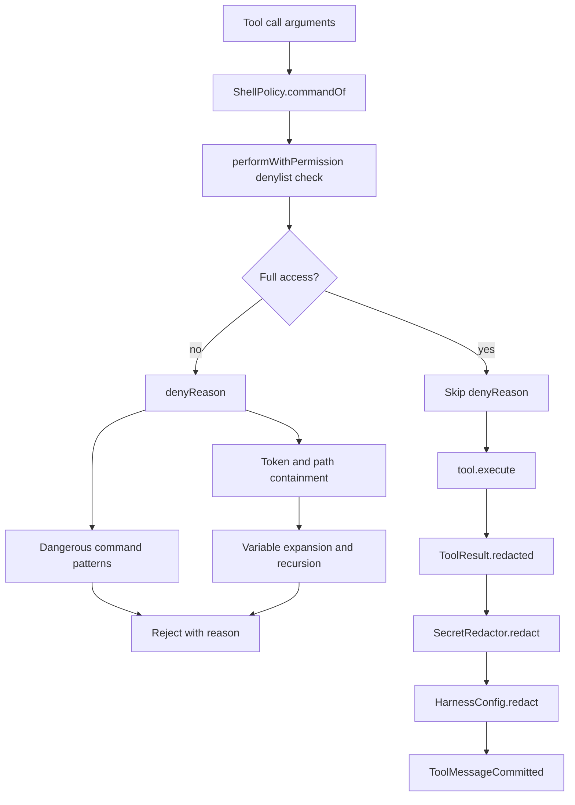

# Shell Policy and Secret Redaction

> Applies a fixed command denylist, workspace path containment, and credential-shaped output scrubbing to every shell command and every tool result.

Two independent guards sit around tool execution. `ShellPolicy` decides whether a command string is allowed before it is dispatched, and `SecretRedactor` removes credential-shaped text from results before they reach the model, the chat database, or the screen. Neither guard is configurable by the model, and Full access is the only mode that turns the shell guard off.

## Module Responsibilities

- **`ShellPolicy.denyReason`**: rejects destructive system commands and any path that resolves outside the workspace or the system/toolchain allowlist.
- **Command parsing**: `extractTokens`, `extractSubshells`, `extractVariableAssignments`, and `expandVariables` normalize a command before containment checks, so quoting, redirection, and variable tricks cannot hide a path.
- **Grant signatures**: `signature`, `grantKey`, and `isGranted` decide what "Always" remembers for a shell tool.
- **`SecretRedactor`**: matched vendor prefixes plus credential-named assignments and passwords.
- **`HarnessConfig.redact`**: adds project-sensitive values and MCP server environment or header values on top of `SecretRedactor`.
- **`ContextHygiene`**: bounds stale tool text for the model; it truncates, it does not redact.

## Architecture and Flow

The policy is re-checked in both the engine and the tool. `AgentEngine.performWithPermission` calls `ShellPolicy.denyReason` before asking for approval, and `ShellTool.execute` and `ShellBackgroundTool.execute` call it again unless `ctx.sandboxOff` is true (`AgentEngine.kt` lines 1325-1332, `ShellTool.kt` lines 59-64, `BgShell.kt` lines 49-54). The duplicate check is intentional: it closes the path where a tool is reached outside the normal engine flow, such as the environment repair retry.

## Invocation Chain

1. `performWithPermission` parses the arguments, and for shell tools extracts the command text with `ShellPolicy.commandOf` (`ShellPolicy.kt` lines 599-604).
2. If the mode is not `FULL_ACCESS`, `denyReason(command, workspace.shellRoot, workspace.shellRoot)` runs. A non-null reason becomes the tool result and no approval card is shown.
3. `ShellPolicy.denyReason` trims the command, applies the five always-blocked patterns, then calls `checkSandbox` on the raw command and on the variable-expanded form if it differs (`ShellPolicy.kt` lines 13-51).
4. `checkSandbox` recurses into `$(...)` and backtick substitutions, inspects variable assignments, checks every `cd` target, tokenizes the command, and scans for `..` traversals (`ShellPolicy.kt` lines 53-103).
5. `ShellTool` re-runs the same policy with the resolved `cwd` rather than the workspace root, which catches `cd` targets that only escape relative to the working directory.
6. After execution, `executeWithPermission` applies `result.redacted()` then `runConfig.redact` (`AgentEngine.kt` lines 1140-1144 and 1168-1169).
7. The committed tool message therefore holds only redacted text, so replaying it from the database does not reintroduce a secret.

## Dangerous Patterns

The always-blocked set is small and fixed (`ShellPolicy.kt` lines 17-35 and 624-632):

| Pattern | Reason |
| --- | --- |
| `rm` with recursive and force, or `--no-preserve-root`, targeting `/` | Recursive delete of the filesystem root |
| `curl` or `wget` piped into `sh` or `bash` | Piping a download into a shell |
| `mkfs` and variants | Formatting a block device |
| `dd` with `of=/dev/...` | Writing directly to a block device |
| `:(){ :|:& };:` | Fork bomb |
| `chmod ... 777 ... /` | World-writable filesystem root |

These are hard refusals in every mode except `FULL_ACCESS`, which skips `denyReason` entirely. The comment in `AgentEngine.kt` states that skipping the denylist "is the point of the mode". Project configuration and the user approval ladder still apply.

## Workspace Containment

`checkSandbox` performs five additional passes (`ShellPolicy.kt` lines 53-103):

1. Recurse into command substitutions and evaluate each nested command with the same rules.
2. Inspect `NAME=value` assignments. A value that looks like an out-of-workspace path produces "Blocked: variable NAME contains out-of-workspace path".
3. Check each `cd` target. Escaping targets produce "Blocked: cd outside the workspace is not allowed".
4. Split the command on `;`, `&&`, `||`, `|`, and `&`, then check each subcommand token by token (`ShellPolicy.kt` lines 105-224).
5. Scan for `../` traversals and resolve each candidate against the effective `cwd`.

`checkSubCommand` knows how a shell interprets specific programs. It skips arguments to `echo` and `printf`, skips the pattern argument of `grep`, `egrep`, `fgrep`, and `rg`, skips the script argument of `sed` and `awk`, and for script interpreters (`python`, `node`, `perl`, `ruby`, `sh`, `bash`, `eval`) it extracts absolute paths embedded in `-c` or `-e` strings (`ShellPolicy.kt` lines 150-221). This prevents a regex or sed script from being treated as a filesystem path while still catching `/etc/passwd` inside a one-liner.

Absolute paths are allowed when they resolve inside the workspace root or match `isAllowedSystemPath`. The allowlist covers `/system`, `/vendor`, `/apex`, `/bin`, `/usr/bin`, `/usr/lib`, `/sbin`, `/system_ext`, `/odm`, `/product`, `/dev`, `/proc`, `/sys`, `/tmp`, and the app's scratch, Linux prefix, and deployed toolchain paths for both package ids (`ShellPolicy.kt` lines 393-421). Redirection and symlink targets outside that set are rejected with distinct messages.

Symlink creation is handled separately. `ln -s` on `/storage/emulated/0` or `/sdcard` is refused because FUSE shared storage does not support symlinks, unless every argument already lives under an exec-capable scratch root (`ShellPolicy.kt` lines 105-109 and 367-388).

## Grant Signatures

`signature` takes the first two whitespace-separated tokens, or the single token when there is one (`ShellPolicy.kt` lines 575-581). `grantKey` returns `tool#signature` for `shell`, `shell_background`, and `device_owner_shell`, and the bare tool name for everything else (`ShellPolicy.kt` lines 583-590). `isGranted` also accepts a bare tool name for non-shell tools, so a remembered `write_file` grant works, but it never accepts a bare `shell` grant (`ShellPolicy.kt` lines 592-597).

The consequence is that approving `git status` once does not approve `git push`. Each distinct two-token prefix needs its own approval. Because the engine prefixes bound workspace calls with `workspace:<id>:`, the same command in two projects needs two grants.

## Key State and Data Structures

`ShellPolicy` is a stateless object; its state is the compiled regex constants and the `SCRATCH_ROOTS` list (`ShellPolicy.kt` lines 618-654). The effective inputs are the command string, the canonical workspace root, and the effective `cwd`. `SecretRedactor.Rule` pairs a regex with its replacement string, and the ordered `PREFIX_RULES` list is the entire vendor pattern table. `CREDENTIAL_WORDS` and `PASSWORD_WORDS` are `Set<String>` membership checks on name segments, not patterns. `HarnessConfig.sensitiveValues` is a `Set<String>` rebuilt on every configuration load and merged with MCP server environment and header values inside `redact`. Nothing in this subsystem persists state; durability comes from the settings file and the chat database, both of which only ever receive redacted tool text.

## Secret Patterns

`SecretRedactor` deliberately avoids entropy heuristics. The class comment explains why: a "long random string" rule would also swallow commit SHAs, hashes, and base64 blobs that the agent must feed back into later commands, and the regexes sit on every 100k-character tool result, so they must not backtrack super-linearly (`SecretRedactor.kt` lines 3-15).

Prefix rules cover (`SecretRedactor.kt` lines 19-82):

- PEM private key blocks, replaced whole.
- OpenAI `sk-`, project and admin key shapes, and OpenRouter `sk-or-v1-`.
- Anthropic `sk-ant-` keys.
- Groq `gsk_`, xAI `xai-`, Perplexity `pplx-`, Fireworks `fw_`, Replicate `r8_`, Hugging Face `hf_`, Together `tgp_v1_`, Tavily `tvly-`.
- AWS access key ids, Google API and OAuth tokens, DigitalOcean, Supabase.
- GitHub `gh[pousr]_`, fine-grained `github_pat_`, GitLab `glpat-`, npm, Docker Hub, Notion, Linear.
- Stripe live and test keys, Stripe webhooks, SendGrid, Twilio, Slack, Telegram bot tokens.
- JWT shapes, `Bearer` tokens, `Basic` credentials.
- `user:password@` userinfo in URLs; the scheme and host remain readable.

Assignment rules are two-stage. A generic `NAME = value` regex captures a 16-character-or-longer token, and the code then checks whether any `_`, `-`, or `.` segment of the name is in `CREDENTIAL_WORDS` (`key`, `apikey`, `secret`, `secretkey`, `token`, `accesstoken`, `credential`, `password`, `passwd`, `passphrase`, `passcode`, and similar). A second password regex allows shorter values but only for `PASSWORD_WORDS` (`SecretRedactor.kt` lines 88-117 and 124-139). `pwd` is intentionally excluded because `PWD=` in environment output is a directory.

## Redaction Boundaries

- **Tool results**: every result crosses `ToolResult.redacted()` before the model, the database, or the transcript sees it (`AgentEngine.kt` lines 1168-1169).
- **Project-sensitive values**: `HarnessConfig.redact` runs `SecretRedactor` first, then replaces every resolved `sensitiveValues` entry plus each MCP server `env` or `headers` value of four characters or more (`HarnessConfig.kt` lines 40-45). `sensitiveValues` is filled from `{env:...}`, `{secret:...}`, and `{file:...}` expansion inside the configuration loader (`HarnessConfig.kt` lines 171-178).
- **Plugin hooks**: the arguments passed to `tool.before` are redacted and capped at 16,000 characters; the hook prompt gets a redacted last user message capped at 32,000 characters (`AgentEngine.kt` lines 313 and 1134-1136).
- **Subagent previews and steps**: redacted individually before they enter the popup or the durable subagent record (`SubagentRuns.kt` lines 129-135 and 214).
- **Not redacted**: the actual command sent to the shell. Redaction is an output-side filter, so a command containing a literal token still runs; the model is expected to use environment variables or stored credentials.
- **Truncation is separate**: `ContextHygiene.shrinkToolResults` keeps the six most recent tool results verbatim and truncates older ones to 4,000 characters, keeping the head and tail and pointing at `read_tool_output` (`ContextHygiene.kt` lines 13-16 and 123-128). It does not redact, so any secret that survived the result filter would also survive context pruning.

## Boundary Conditions

- **Empty command**: `denyReason` returns null for an empty trimmed command; the shell tool then fails on its own missing-argument check.
- **No workspace root**: `checkAbsolutePath` and `checkRelativePath` still reject `..` patterns when the root is null, but absolute paths cannot be judged against a workspace and fall through to the system allowlist.
- **Canonicalization failure**: a path that cannot be canonicalized is compared as written (`ShellPolicy.kt` lines 254 and 282).
- **Regex cost**: the redactor's assignment regexes have fixed upper bounds (name 1..64, value 16+ or 3+), and no rule uses nested quantifiers over the whole input.
- **False positives**: a non-credential name with a 16+ character value stays readable, and a credential-named value is always replaced, even when it is a harmless identifier. That trade-off is deliberate.

## Extension Points

- Add a vendor token by adding a `Rule` to `PREFIX_RULES`; the replacement is usually `[redacted]`.
- Add a credential name segment in `CREDENTIAL_WORDS` or `PASSWORD_WORDS`.
- Add an allowed system prefix in `isAllowedSystemPath` or a scratch root in `SCRATCH_ROOTS`; `ExecScratchRouting.preferredScratch` also reads `SCRATCH_ROOTS`.
- Configuration files can pull values through `{env:NAME}`, `{secret:NAME}`, or `{file:path}`; each resolved value is added to `sensitiveValues` and stripped from tool output and plugin hook input.

## Known gaps

- The page brief names `agent/ContextHygiene.kt` as a redaction layer. The file contains no redaction call. It only truncates stale tool text and strips image payloads, so redaction boundaries must be described through `SecretRedactor` and `HarnessConfig.redact` (verified at `ContextHygiene.kt` lines 1-129).
- Shell policy applies to shell tools only. File tools rely on `WorkspaceFs.resolve` for containment, which is outside this page.

Sources: [app/src/main/java/com/androidharness/app/tools/ShellPolicy.kt](../app/src/main/java/com/androidharness/app/tools/ShellPolicy.kt)#L13-L103), [app/src/main/java/com/androidharness/app/tools/ShellPolicy.kt](../app/src/main/java/com/androidharness/app/tools/ShellPolicy.kt)#L575-L604), [app/src/main/java/com/androidharness/app/tools/SecretRedactor.kt](../app/src/main/java/com/androidharness/app/tools/SecretRedactor.kt)#L19-L141), [app/src/main/java/com/androidharness/app/config/HarnessConfig.kt](../app/src/main/java/com/androidharness/app/config/HarnessConfig.kt)#L40-L45)

## Source files

- `app/src/main/java/com/androidharness/app/tools/ShellPolicy.kt`
- `app/src/main/java/com/androidharness/app/tools/SecretRedactor.kt`
- `app/src/main/java/com/androidharness/app/agent/ContextHygiene.kt`
- `app/src/main/java/com/androidharness/app/agent/AgentEngine.kt`
- `app/src/main/java/com/androidharness/app/config/HarnessConfig.kt`
- `app/src/main/java/com/androidharness/app/tools/ReadToolOutputTool.kt`
