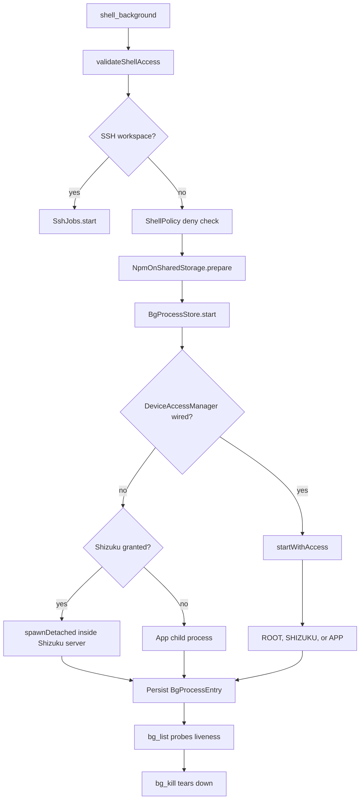

# Background Processes

> Starts, tracks, lists, and kills long-running shell jobs, keeping durable records and log files across app restarts.

`ShellBackgroundTool`, `BgListTool`, and `BgKillTool` in `app/src/main/java/com/androidharness/app/tools/BgShell.kt` are thin wrappers over `BgProcessStore`. The store owns the job registry, chooses between an app-child process, a Shizuku-detached process, a direct-root detached process, or an SSH job, writes stdout and stderr to a log file, and persists a JSON record so a restarted app can still report what is running and what already exited.

## Module Responsibilities

- **`ShellBackgroundTool`**: validates the command and `access` argument, applies `ShellPolicy`, applies the npm rewrite, starts the job, and returns an id plus log path.
- **`BgListTool`**: lists jobs filtered by `scope` (`chat`, `workspace`, `all`), shows liveness, exit state, owner, uptime, and a short log tail.
- **`BgKillTool`**: stops one job by id and reports whether termination was confirmed.
- **`BgProcessStore`**: the registry, persistence, backend selection, liveness probing, log tailing, and process teardown.
- **`backgroundCommand`**: wraps the user command so an `exit` or parse failure still writes a terminal exit code.
- **`SshJobs`**: the remote-host equivalent used when the workspace is `SshFs`.

## Architecture and Flow

The critical distinction is who owns the process. An `APP` job is a child of the app process and dies with it unless the foreground service keeps the app alive. A `SHIZUKU` job runs inside Shizuku's server process, so it survives the app being killed or minimized. A `ROOT` job runs inside the root service and lasts only while that connection survives.

## Invocation Chain

1. `ShellBackgroundTool.execute` reads `command`, calls `validateShellAccess`, and branches on `SshFs` (`BgShell.kt` lines 32-42).
2. For a local workspace it resolves `shellRoot`, applies `ShellPolicy.denyReason` unless `sandboxOff`, applies `NpmOnSharedStorage.prepare`, and calls `store.start(command, cwd, ctx.sessionId)` (`BgShell.kt` lines 43-60).
3. `BgProcessStore.startLocked` allocates an id, creates `<cwd>/.harness/bg/<id>-<bootToken>.log`, falls back to the store's own detached log directory if that path is not writable, and defines `<log>.exit` (`BgProcessStore.kt` lines 116-124).
4. `backgroundCommand` builds the monitored command: a subshell around `eval '<command>'`, capture of `$?` into `harness_bg_exit`, a `printf` to the exit file, then `exit "$harness_bg_exit"` (`BgProcessStore.kt` lines 377-381).
5. With `deviceAccess` present, `startWithAccess` runs `DeviceAccessManager.execute` with three starters and records the chosen tier (`BgProcessStore.kt` lines 178-219).
6. Without `deviceAccess`, a granted Shizuku gets `spawnDetached` with the deployed toolchain and `tmpProcessEnv`, otherwise the app starts `linuxEnv.shellProcessBuilder(monitoredCommand)` with append-to-log redirection and merged stderr (`BgProcessStore.kt` lines 130-176).
7. The entry is stored in a `ConcurrentHashMap` and persisted through a temp-file rename (`BgProcessStore.kt` lines 95-105 and 150-175).

## Backend Selection

`startWithAccess` hands `DeviceAccessManager.execute` three lambdas:

- `normal`: app child process with `Redirect.appendTo(log)` and `redirectErrorStream(true)`.
- `shizukuRun`: checks `shizuku.isServiceReady()`, ensures the deployed toolchain, then `shizuku.spawnDetached` with either the deployed bash or `/system/bin/sh`.
- `rootRun`: calls `svc.spawnDetached` with the app prefix environment plus `HARNESS_TMP_LIB` and `HARNESS_TMP_BIN`.

The tier reported by the returned `ShellRunResult` becomes `source`: `ROOT`, `SHIZUKU`, or `APP` (`BgProcessStore.kt` lines 191-218). `ShellBackgroundTool` adds a note for direct root jobs ("tied to this root service/app session") and for privileged jobs ("survives the app being minimized or killed") (`BgShell.kt` lines 61-66).

The fallback rule mirrors the foreground router: a `null` result means dispatch never began and the next backend may be tried; an exception or a real result is never replayed. `startWithAccess` enforces this with `check(result.exitCode == 0)` and the message "Detached start failed or its result is uncertain; it was not replayed" (`BgProcessStore.kt` lines 199-212).

## Key State and Data Structures

`BgProcessEntry` is the durable record (`BgProcessStore.kt` lines 18-34):

- `id`, `command`, `cwd`, `logPath`.
- `pid`: shell UID pid for Shizuku jobs, -1 for app-tier jobs.
- `source`: `APP`, `SHIZUKU`, or `ROOT`.
- `startedAt`, `exitCodePath`, `exitCode`, `finishedAt`, `termination`.
- `ownerSessionId`: the chat that started the job.

The registry is written to `filesDir/bg-processes.json` as a sorted JSON array through a `.tmp` file and rename (`BgProcessStore.kt` lines 95-105). On construction the file is loaded back, and `nextId` resumes above the highest loaded id (`BgProcessStore.kt` lines 83-93). Jobs started in a previous app session are detected by comparing `startedAt` with `bootAt`; `bg_list` labels them `[prev app session]` (`BgShell.kt` lines 111-117).

`bootToken` is a base-36 timestamp created once per store instance and embedded in every log filename. It prevents a new job with a recycled id from appending to an old session's log, which the code comment identifies as a previous bug (`BgProcessStore.kt` lines 69-78).

## Output Capture and Reading

Output is captured by file redirection, not by in-memory buffers. For app jobs `ProcessBuilder` appends both streams to the log; for detached jobs the privileged server writes to the same path, and the shell wrapper writes the exit code to the sibling `.exit` file.

Reading is tail-oriented. `BgListTool` asks `store.tail(entry, 800)` and prints the last 800 characters after filtering heartbeat lines (`BgShell.kt` lines 125-127). `tail` reads the whole log, drops any line containing "heartbeat" case-insensitively, and keeps the last `chars` characters, prefixing an ellipsis when truncated (`BgProcessStore.kt` lines 339-354). There is no offset or page parameter for background logs; the log file is a normal workspace file under `.harness/bg`, so `read_file` with `offset` and `limit` can page it. `read_tool_output` pages earlier tool results, not log files.

## Exit Codes, Killed State, and Liveness

`listLocked` computes liveness per source (`BgProcessStore.kt` lines 237-272):

- `ROOT`: if the exit file has a code, the job is finished; otherwise `rootLiveness` asks the root service `isProcessAlive`.
- `SHIZUKU`: if the exit file has a code, the job is finished; otherwise `privilegedLiveness` (default `shizuku.probeProcessAlive`) is consulted.
- `APP`: `appProcesses[id]?.isAlive`.

A `null` probe means "cannot verify". Display listing permits it and marks `termination = "unverified"`; storage cleanup refuses it with "Cannot verify a ... background process. Reconnect it before cleaning storage." When a probe returns false, the store writes `exitCode`, `finishedAt`, and `termination = "exited"` into the entry and removes the app process. When a kill succeeds it writes `termination = "killed"`.

The exit code comes from the recorded `.exit` file first, then from `Process.exitValue()` for an app child. A killed job therefore shows the last real exit code if the wrapper wrote one, otherwise the field stays null.

## Stopping and Resuming

- **`bg_kill`**: looks up the entry, refuses an already finished job, then calls `store.kill(id)` (`BgShell.kt` lines 143-155).
- **`killLocked`**: for `ROOT` it calls `killTrackedProcess(pid, logPath)`; for `SHIZUKU` it calls `shizuku.killProcess(pid, logPath)` and then `killPidsWithFd`; for `APP` it sends `SIGKILL` to the process group, `pkill -9 -P`, `SIGKILL` to the pid, then `destroyForcibly` and a two-second wait. Each branch confirms the probe reports false before writing `killed` (`BgProcessStore.kt` lines 286-337).
- **`killPidsWithFd`**: scans `/proc/<pid>/fd` for any process still holding the log file and kills it, which catches a wrapper that detached from the known pid (`BgProcessStore.kt` lines 356-374).
- **`killAll`**: iterates every unfinished entry and calls `kill` (`BgProcessStore.kt` lines 276-284).
- **`stopPrivilegedTasks`**: stops only `ROOT` and `SHIZUKU` entries and returns a confirmed versus unconfirmed count (`BgProcessStore.kt` lines 225-230). `HarnessApp` wires this into `DeviceAccessManager.stopBackgroundTasks`, so pausing privileged access also stops detached jobs (`HarnessApp.kt` lines 203-207).
- **Resume**: there is no resume for a killed job. The only resume path is `DeviceAccessManager.resume`, which calls `root.resume()`, `shizuku.resumeCommands()`, and `dhizuku.resumeCommands()` to unpause runners; it does not restart a process (`DeviceAccessManager.kt` lines 85-88).

## Retention and Cleanup

Finished entries are retained so `bg_list` can explain what exited. `listLocked` sorts terminal records by `finishedAt`, keeps the newest 100, and removes older records from the map and the JSON file (`BgProcessStore.kt` lines 265-271). Unfinished entries are never pruned, even when started in a previous app session, because no verified exit exists.

`withIdleStorage` refuses a storage cleanup while any job is live, with "Stop background processes and refresh their list before cleaning storage" (`BgProcessStore.kt` lines 64-67). `list` uses the strict path and `listForDisplay` allows unverified records, so the UI can show a stale job without letting cleanup delete it.

## Boundary Conditions

- **No real filesystem**: a workspace without `shellRoot` fails with "This workspace has no real filesystem path, so background processes cannot start here" (`BgShell.kt` lines 43-47).
- **Denied command**: the policy reason is returned as a failed `ToolResult` and no process starts.
- **App-tier reachability**: a start failure appends a hint to connect Shizuku or Wireless ADB, or to move the project into the app workspace (`BgShell.kt` lines 77-82).
- **Uncertain dispatch**: the store throws rather than pretending a job exists when the privileged result is uncertain.
- **SSH**: `SshJobs.start` returns its own result, and `bg_list`/`bg_kill` delegate to `SshJobs.list` and `SshJobs.stop` when the workspace is `SshFs` (`BgShell.kt` lines 98-100 and 147-149).

## Extension Points

- `BgProcessStore` accepts a custom `privilegedLiveness` probe for tests or alternate transports.
- `bootToken` and `bootAt` are public enough for UI code to distinguish current and previous sessions.
- The `.harness/bg` log convention means any file tool can inspect output without a dedicated pager.

## Known gaps

- FEATURES.md and the tool description imply the agent can inspect background output. The implemented inspection is a fixed tail of 800 characters in `bg_list`; reading further requires a separate file read. No paging parameters exist on `bg_list` itself.

Sources: [app/src/main/java/com/androidharness/app/tools/BgShell.kt](../app/src/main/java/com/androidharness/app/tools/BgShell.kt)#L11-L130), [app/src/main/java/com/androidharness/app/data/BgProcessStore.kt](../app/src/main/java/com/androidharness/app/data/BgProcessStore.kt)#L18-L176), [app/src/main/java/com/androidharness/app/data/BgProcessStore.kt](../app/src/main/java/com/androidharness/app/data/BgProcessStore.kt)#L232-L381)

## Source files

- `app/src/main/java/com/androidharness/app/tools/BgShell.kt`
- `app/src/main/java/com/androidharness/app/data/BgProcessStore.kt`
- `app/src/main/java/com/androidharness/app/workspace/SshJobs.kt`
- `app/src/main/java/com/androidharness/app/data/env/DeviceAccessManager.kt`
- `app/src/main/java/com/androidharness/app/HarnessApp.kt`
