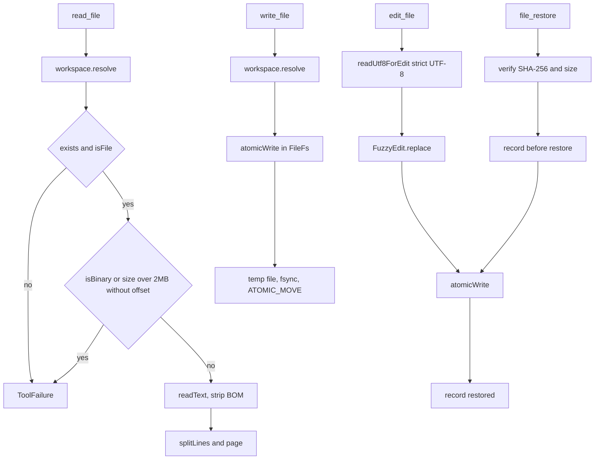

# File Tools, History, and Restore

> Implements the workspace file tools (read, write, edit, search, grep, list, move, delete) and the durable version history and restore path behind `file_history` and `file_restore`.

`FileTools.kt` holds the read and query tools. `MoreTools.kt` holds directory and move operations, and `PatchTools.kt` holds `multi_edit`. All of them resolve paths through `WorkspaceFs`, so calls to `resolve` enforce the workspace grant before any read or write. Mutating tools rely on the `FileFs` atomic write path, and the engine snapshots every target before the tool runs, so undo and file history stay aligned with what actually changed.

## Module Responsibilities

- **`ListDirTool`**: sorted directory listing, directories first, capped at 500 entries.
- **`ReadFileTool`**: line-numbered read with `offset` and `limit`, binary refusal, UTF-8 BOM removal, and hard output caps.
- **`FileInfoTool`**: size, type, line count, trailing newline, binary flag, with streaming measurement when stat metadata is unreliable.
- **`WriteFileTool`**: whole-file create or overwrite, automatic parent directories, POSIX trailing newline.
- **`EditFileTool`** and **`MultiEditTool`**: fuzzy whitespace-tolerant replacement with uniqueness enforcement.
- **`SearchFilesTool`**: glob walk with paging.
- **`GrepTool`**: regex content search with ReDoS checks, step and time budgets, and per-file skip reasons.
- **`CreateDirTool`, `DeleteFileTool`, `MoveFileTool`**: guarded structural changes.
- **`FileHistoryTool`, `FileRestoreTool`**: list and recover gzip snapshots with SHA-256 checks.
- **`ReadToolOutputTool`**: page an earlier tool result without re-running it.

## Architecture and Flow

The write path is deliberately narrow. `WorkspaceFs.writeText` converts to UTF-8 bytes, and `FileFs.writeBytes` calls `atomicWrite`, which creates a `.harness-write-*.tmp` file in the target directory, writes and calls `fd.sync()`, preserves POSIX permissions when the target existed, and moves with `ATOMIC_MOVE` and `REPLACE_EXISTING` (`WorkspaceFs.kt` lines 176-216). A crash mid-write leaves either the old file or the new file, not a truncated one.

## Invocation Chain

1. The engine admits the tool through the permission ladder and snapshots every path from `checkpointTargets`, which maps `write_file`, `edit_file`, `multi_edit`, `delete_file`, `create_dir`, and `file_restore` to `path`, and `move_file` to both `source` and `destination` (`AgentEngine.kt` lines 1570-1603).
2. `checkpointer.snapshot` records a `WorkspaceFileHistory` version reason "before edit" and inserts a per-turn `CheckpointEntity` (`CheckpointStore.kt` lines 19-49).
3. The tool resolves the path with `ctx.workspace.resolve(path)` and performs the operation.
4. The tool calls `file.writeText`, which reaches `FileFs.atomicWrite`.
5. The engine records an "after <tool>" version and, for `delete_file`, `move_file`, and `apply_patch`, records a missing file so history has a deletion marker (`AgentEngine.kt` lines 1424-1428).
6. Diff stats compare the pre-read text (only when 512,000 bytes or smaller) with the post text and emit `FileEdited` (`AgentEngine.kt` lines 1531-1566).

## Read and List Behavior

`read_file` accepts `offset` (1-based, must be positive) and `limit` (default 2000, clamped to 1..4000). A file larger than 2 MB is refused unless `offset` is supplied, which forces chunked reads (`FileTools.kt` lines 131-144). Reading removes a leading UTF-8 BOM so it does not pollute line 1. Output is capped at `MAX_READ_CHARS` (100,000) and each line at `MAX_READ_LINE_CHARS` (10,000), with explicit truncation markers. When the page ends before the file does, the result reports `[showing lines X..Y of Z]` (`FileTools.kt` lines 146-182).

Binary detection rejects the read rather than dumping bytes. `FileInfoTool` uses `inspectFileInfo`, which streams with a 1 MB cap for virtual or procfs entries whose stat size is 0 or untrustworthy. It reports `is_binary`, and for text it reports `line_count` and `trailing_newline` so the model can plan an exact edit (`FileTools.kt` lines 336-402 and 193-334).

`list_dir` sorts directories before files, then case-insensitive name, and stops at `MAX_LIST_ENTRIES` (500) with a "... and N more entries" line. It has no offset parameter.

## Write and Edit Behavior

`write_file` replaces the whole file. It refuses a directory target, creates parents through the workspace node, appends a newline when non-empty content lacks one, and warns when a newly created name collides case-insensitively on shared storage (`FileTools.kt` lines 404-444).

`edit_file` reads with `readUtf8ForEdit`, which uses a strict UTF-8 decoder that reports malformed input. On failure it throws "Cannot edit ... file is not valid UTF-8. No changes were written" (`WorkspaceFs.kt` lines 69-80). Matching goes through `FuzzyEdit.replace`, which tolerates indentation, trailing whitespace, and line-ending drift but still requires a unique match unless `replace_all` is true. Ambiguity fails with the occurrence count; a miss fails with the detail from the matcher (`FileTools.kt` lines 463-492).

`multi_edit` applies the same matcher to an ordered list in memory, aborts the whole call on the first missing or ambiguous edit, and writes once at the end, so a partial sequence never reaches disk (`PatchTools.kt` lines 40-80).

`create_dir` fails when the path is an existing file, returns success when it is already a directory, and otherwise calls `mkdirs` then verifies (`MoreTools.kt` lines 21-55). `delete_file` refuses the workspace root both by argument (`.` or blank) and by resolved `relPath`, requires `recursive=true` for a non-empty directory, and never silently deletes a populated tree (`MoreTools.kt` lines 57-107). `move_file` rejects a missing source, over-long names, the root as either side, identical source and destination, moving into itself or a descendant, a directory destination, and an existing file destination without `overwrite=true`. Same-directory moves use `renameTo`; cross-folder moves copy the file with `writeFrom` and then delete the source, refuse directory moves across folders, and report a copy that could not delete its source (`MoreTools.kt` lines 179-205).

## Search and Grep

`search_files` compiles the glob with `PathMatcher("glob:...")`, matches the file name and relative path, and treats a leading `**/` pattern as also matching root-level names. Results are sorted, then paged with `offset` and `limit` in 1..300 (`FileTools.kt` lines 501-571).

`grep` first runs `RegexSafety.checkReDos`, then compiles the pattern. It walks the workspace sorted by relative path, applies the `include` glob before any skip bookkeeping, skips files over 2 MB and binary files, and reads each file as text. Matching uses a `BudgetedCharSequence` with a 20,000,000 step budget and a 2,000 ms timeout, and calls `findInLongLine` for lines over 65,536 characters (`FileTools.kt` lines 573-580, 767-917). Output is `path:line: excerpt`, paged up to `MAX_GREP_MATCHES` (200), with `next offset` when more matches exist. Skips are summarized as `[Skipped: file (>2MB), file (binary)]`.

## History and Restore

`WorkspaceFileHistory` stores one `.gz` payload and one `.json` metadata file per version in `filesDir/workspace-file-history` (`HarnessApp.kt` lines 174-175). `FileVersion` holds `id`, `sessionId`, `workspace`, `path`, `sha256`, `bytes`, `createdAt`, `reason`, and `deleted` (`WorkspaceFileHistory.kt` lines 19-24).

`record` canonicalizes the location through `fs.resolve`, so the current grant is enforced even when reading history. It skips a non-file, skips a deletion unless `recordMissing` is true and an earlier version exists, refuses a file over 32 MiB, and returns the previous version when the SHA-256 is unchanged, which deduplicates repeated snapshots (`WorkspaceFileHistory.kt` lines 67-102). The `.gz` and `.json` files are written with `fd.sync()`, and the JSON is renamed into place only after the bytes are durable.

`file_history` requires a session, lists up to 50 versions newest first, and prints `id | timestamp | bytes or deleted | SHA-256 | reason` (`FileHistoryTools.kt` lines 7-20).

`file_restore` requires a session, a version id matching `[a-zA-Z0-9-]+`, and `expected_sha256` defaulting to the literal `missing`. It verifies that the version belongs to the same session, workspace, and normalized path, rejects a deletion record, verifies the stored gzip payload against `version.bytes` and `version.sha256`, and then checks the current target:

- When the file is absent, the expected hash must be `missing`.
- When the file exists, the caller must supply its exact current SHA-256.

Only then does it record "before restore", write the bytes atomically through `node.writeBytes`, and record "restored" (`WorkspaceFileHistory.kt` lines 104-129). The current version is therefore always backed up before replacement, and a blind overwrite is impossible.

`CheckpointStore` is the per-turn layer used by undo. Its `snapshot` writes a `WorkspaceFileHistory` version and a database row with Base64 text, `existedBefore`, and `wasDirectory`, keeping only the earliest snapshot per turn and path. `rewind` backs up every current file first, restores files, deletes files that did not exist, recreates empty directories, and refuses to recursively delete an agent-created directory that now contains untracked work (`CheckpointStore.kt` lines 19-49, 69-111).

## Key State and Data Structures

`FileVersion` is the on-disk history record (`WorkspaceFileHistory.kt` lines 19-24). `CheckpointEntity` is the database row used for rewind: `sessionId`, `turnId`, `relPath`, `contentB64`, `existedBefore`, `wasDirectory`, `createdAt` (`CheckpointStore.kt` lines 30-48). `CheckpointStore.RewindResult` reports restored count, failed count, and the restored paths. The tools themselves hold no state: every operation resolves a fresh `FsNode` from `WorkspaceFs`, and `ReadToolOutputTool` receives a `ToolOutputLoader` lambda that reads persisted chat data by session and tool call id (`ReadToolOutputTool.kt` lines 7-10). `FileLineInfo` is the streaming scan result used by `file_info`, including `measuredBytes` and `sizeTruncated` for entries whose stat size cannot be trusted.

## Size Caps and Retention

| Limit | Value | Source |
| --- | --- | --- |
| `read_file` output | 100,000 chars | `FileTools.kt` lines 61-65 |
| `read_file` single line | 10,000 chars | `FileTools.kt` lines 61-65 |
| `read_file` lines per page | 1..4000, default 2000 | `FileTools.kt` line 144 |
| `list_dir` entries | 500 | `FileTools.kt` lines 61-65 |
| `search_files` results | 1..300 | `FileTools.kt` lines 61-65 |
| `grep` matches | 1..200 | `FileTools.kt` lines 61-65 |
| `grep` file size | skip over 2 MB | `FileTools.kt` lines 841-843 |
| `file_history` rows shown | 50 | `FileHistoryTools.kt` line 16 |
| File history payload | 32 MiB | `WorkspaceFileHistory.kt` lines 143-144 |
| Diff-stat pre-read | 512,000 bytes | `AgentEngine.kt` lines 1402-1403 |
| `read_tool_output` page | 1..12000, default 4000 | `ReadToolOutputTool.kt` lines 24-27 |

There is no age-based retention for file history. Versions are added on edit, rewind, and restore, deduplicated by SHA-256, and never pruned by `WorkspaceFileHistory` itself. Chat backup and storage inventory treat the directory as a distinct storage role, but deletion is a user-driven cleanup path.

## Boundary Conditions

- **Binary and huge files**: `read_file` refuses binary content and files over 2 MB without `offset`; `grep` skips rather than fails and reports the skip.
- **UTF-8**: edits refuse invalid UTF-8 and write nothing; `write_file` always encodes UTF-8.
- **Atomicity**: `atomicWrite` rejects writes to a directory, to a special file, or to an unwritable path before creating a temp file.
- **Restore races**: a file that changes between `file_history` and `file_restore` fails the hash check rather than overwriting.
- **Corrupt history**: a gzip payload whose size or hash does not match its metadata is refused as a failed integrity check.
- **Rewind safety**: an untracked file inside an agent-created directory blocks directory deletion.
- **Tool output paging**: `read_tool_output` adjusts page boundaries so a surrogate pair is never split, and reports the next offset (`ReadToolOutputTool.kt` lines 28-37).

## Extension Points

- Add a file tool by implementing `Tool` and adding it to `ToolRegistry.default`; include its name in `WorkspaceToolRouting.fileTools` if it should remain available when a selected workspace is read-only.
- New mutation tools need a `checkpointTargets` entry so undo and history capture them.
- `WorkspaceFileHistory` is constructed in `HarnessApp` and passed to both `CheckpointStore` and the tool registry, so replacing its directory moves both layers together.

## Known gaps

- FEATURES.md says file history copies survive chat truncation and restarts, which the file-backed store does. It also implies retention management; no automatic pruning of history files exists in `WorkspaceFileHistory`, only the 32 MiB per-file cap and SHA deduplication.

Sources: [app/src/main/java/com/androidharness/app/tools/FileTools.kt](../app/src/main/java/com/androidharness/app/tools/FileTools.kt)#L101-L191), [app/src/main/java/com/androidharness/app/tools/FileTools.kt](../app/src/main/java/com/androidharness/app/tools/FileTools.kt)#L767-L917), [app/src/main/java/com/androidharness/app/data/WorkspaceFileHistory.kt](../app/src/main/java/com/androidharness/app/data/WorkspaceFileHistory.kt)#L59-L129), [app/src/main/java/com/androidharness/app/workspace/WorkspaceFs.kt](../app/src/main/java/com/androidharness/app/workspace/WorkspaceFs.kt)#L188-L216)

## Source files

- `app/src/main/java/com/androidharness/app/tools/FileTools.kt`
- `app/src/main/java/com/androidharness/app/tools/FileHistoryTools.kt`
- `app/src/main/java/com/androidharness/app/tools/ReadToolOutputTool.kt`
- `app/src/main/java/com/androidharness/app/data/WorkspaceFileHistory.kt`
- `app/src/main/java/com/androidharness/app/data/CheckpointStore.kt`
- `app/src/main/java/com/androidharness/app/tools/MoreTools.kt`
- `app/src/main/java/com/androidharness/app/tools/PatchTools.kt`
- `app/src/main/java/com/androidharness/app/workspace/WorkspaceFs.kt`
