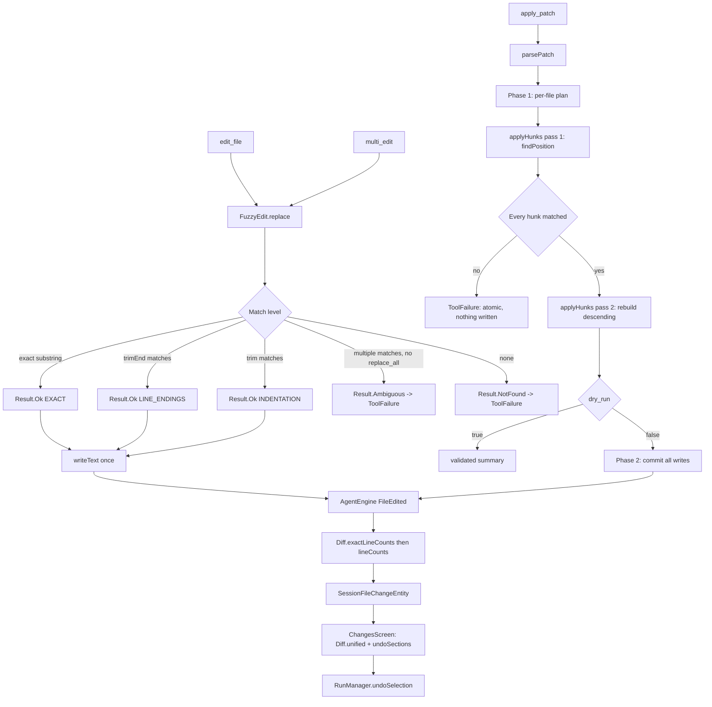

# Patch, Diff and Fuzzy Editing

> Applies string and unified-diff edits to workspace files and produces the diff data that approval cards, Files-changed tracking and undo consume.

Editing is split into three cooperating pieces. `FuzzyEdit` is a whitespace-tolerant string replacer shared by `edit_file` and `multi_edit`. `PatchTools.kt` holds `MultiEditTool` and `ApplyPatchTool`, the two write paths that validate first and write once. `core/Diff.kt` is a Myers line-diff engine that renders previews, counts added and removed lines, and carves a file into independently undoable sections. The agent layer snapshots the target paths before a write and re-reads them afterward, so the UI can show honest counts and undo can restore an exact baseline.

## Module Responsibilities

- **`FuzzyEdit`**: replaces an `old_string` with a `new_string` at three strictly increasing tolerances, refusing ambiguous matches. It is whitespace-only on purpose, so wrong-but-similar code fails instead of corrupting a file.
- **`MultiEditTool` (`multi_edit`)**: applies an ordered list of replacements to one file in memory and writes once after every edit succeeds.
- **`ApplyPatchTool` (`apply_patch`)**: parses a unified diff, plans create, delete and modify operations, validates every hunk and file section, then commits all writes or none.
- **`EditFileTool` (`edit_file`)**: the single-replacement surface over `FuzzyEdit`, implemented in `FileTools.kt`.
- **`Diff`**: parses unified diffs into `ParsedDiff` for the visual viewer, generates unified previews, computes line counts for the `+N / -M` chips, and builds `UndoSection` ranges.
- **`MoreTools.kt` file operations**: `DeleteFileTool` and `MoveFileTool` are not diff generators, but their paths appear in the agent's pre-write checkpoint set, so they participate in the same rollback story.

## Architecture and Flow

`FuzzyEdit.replace` tries an exact substring search first. If that finds nothing it slides a line window with `trimEnd()` comparison, then one with `trim()` comparison. A level that finds multiple matches without `replace_all` returns `Ambiguous` immediately and never falls through, because a strict-level ambiguity is a real error the caller must resolve. Only a level that finds zero matches is skipped. `finish` replaces the original text span, preserving the file's own line separator, and rebases the replacement's leading whitespace when a normalized match consumed a whole line.

`ApplyPatchTool` parses each `---`/`+++` pair into a `FilePatch`, validates the declared hunk line counts against the body, rejects repeated sections for the same resolved path, and moves into a planning phase. Every plan is computed against the current file contents and collected in `plans`; every failure is collected in `failures`. If any failure exists, the tool throws one message listing each failure and writes nothing. Only a fully clean plan set reaches the commit loop, which is skipped entirely for `dry_run`.

## Invocation Chain

1. `ToolRegistry.default` registers `ReadFileTool`, `WriteFileTool`, `EditFileTool`, `MultiEditTool` and `ApplyPatchTool` in that order (`tools/Tool.kt`, lines 101 to 109).
2. `AgentEngine.executeCall` computes `checkpointTargets` for the call before execution (`agent/AgentEngine.kt:1571`). The set covers `write_file`, `edit_file`, `multi_edit`, `delete_file`, `create_dir`, `file_restore`, both sides of `move_file`, and `apply_patch`. For patches it mirrors `ApplyPatchTool`'s prefix cleanup and deliberately captures deleted files from `+++ /dev/null` headers.
3. `EditFileTool.execute` reads through `FsNode.readUtf8ForEdit()` (`workspace/WorkspaceFs.kt:69`), which rejects malformed UTF-8 instead of round-tripping replacement characters, then calls `FuzzyEdit.replace` (`tools/FileTools.kt:476`).
4. `MultiEditTool.execute` resolves the path, reads once, loops `FuzzyEdit.replace` over `edits`, tracks whether any level was non-EXACT, and writes once at the end (`tools/PatchTools.kt:40`).
5. `ApplyPatchTool.execute` calls `parsePatch`, then `applyHunks` for each modify section. `applyHunks` runs pass 1 (`findPosition`) for every hunk, checks overlaps, then pass 2 rebuilds regions from the last position backward (`tools/PatchTools.kt:348`).
6. After a successful modifying tool call, `AgentEngine` re-reads each snapshotted path, computes `Diff.exactLineCounts` or falls back to `Diff.lineCounts`, and emits `AgentEvent.FileEdited` with `beforeText`, `existedBefore`, `existsAfter`, `callId` and `countsKnown` (`agent/AgentEngine.kt:1533`).
7. `ChatViewModel.fileDiff` renders a read-only comparison from the turn checkpoint to the current file with `Diff.unified` (`ui/chat/ChatViewModel.kt:1925`).
8. `ChangesScreen` computes the cumulative view with `Diff.unified` and `Diff.undoSections` (`ui/files/ChangesScreen.kt:326`).
9. `RunManager.undoSelection` validates the preview against current disk state, then calls `Diff.undoSection` or restores the whole baseline (`agent/RunManager.kt:1366`).

## Key State and Data Structures

- **`FuzzyEdit.Level`**: `EXACT`, `LINE_ENDINGS`, `INDENTATION`. `FuzzyEdit.Result` is a sealed interface with `Ok(newText, count, level)`, `NotFound(detail)` and `Ambiguous(count)`.
- **`FuzzyEdit.Match`**: `start` inclusive and `end` exclusive offsets into the original text.
- **`ApplyPatchTool.Hunk`**: `oldStart`, `removed`, `added` and `lines` (ordered `Pair<Char, String>` marked `' '`, `'-'` or `'+'`). The `context` field is always empty in the current parser.
- **`ApplyPatchTool.FilePatch`**: `path`, `isNewFile`, `isDelete`, `hunks`, `newFileHasNewline`.
- **`Plan`** (local data class): `path`, `op` (`create`, `delete`, `patch`), `content`, `hunksApplied`, `hunksTotal`.
- **`Diff.ParsedDiff`**: optional `oldPath` and `newPath`, `hunks`, `isTruncated`, plus derived `totalAdded` and `totalRemoved`.
- **`Diff.UndoSection`**: `offset`, `before`, `after`. Offsets are character offsets into the exact current text, not line numbers.
- **`SessionFileChangeEntity`**: stores `relPath`, `added`, `removed`, `isNew`, `isDeleted`, `baseGzip`, `hasBase` and `updatedAt`. `baseGzip` is the compressed baseline used by whole-file undo.

Previews are not persisted. `Diff.unified` output is recomputed from the entity's baseline and the current file whenever the Files-changed row is expanded. Persisted state is the baseline blob and the counters, which survive process death and are refreshed after rewind by `SessionRepository.refreshFileChangeAfterRewind` (`data/SessionRepository.kt:769`).

## Boundary Conditions

- An empty `old_string` returns `NotFound("old_string is empty")` rather than matching everywhere.
- `multi_edit` fails the whole call on the first `Ambiguous` or `NotFound`, naming the edit index, and has not written anything at that point.
- `apply_patch` rejects a hunk whose body line counts disagree with its `@@` header, reporting both declared and actual counts (`tools/PatchTools.kt:299`).
- Hunk matching slides a window of 40 lines in both directions from the declared `oldStart`. It tries `EXACT` then `LINE_ENDINGS`, never `INDENTATION`, so indentation drift does not anchor a patch.
- A hunk that models the file's final newline as an extra empty context line is retried once with that phantom line dropped (`tools/PatchTools.kt:384`). This handles the common `a\nb\n` versus `a\nb` confusion.
- Overlapping hunks are detected after resolution and abort the file with a message naming the line (`tools/PatchTools.kt:408`).
- Creating an existing file, deleting a missing file, deleting a directory, or patching a missing file all become plan failures, not exceptions thrown mid-write.
- `apply_patch` writes through `FsNode.writeText`, which uses `atomicWrite`: temp file in the same directory, `fsync`, POSIX permission copy, then `ATOMIC_MOVE` with replace (`workspace/WorkspaceFs.kt:192`).
- `Diff.unified` reads at most 3000 lines per side and appends `[diff truncated for preview]` when either side hits that cap.
- `Diff.exactLineCounts` returns null above 1,024,000 combined characters or when its 2,000,000 work-unit budget runs out. Callers then use the capped `lineCounts`.
- `Diff.undoSections` requires at most 3000 chunks and 1,000,000 combined characters; beyond that it throws "This file is too large for section undo. Use Undo file instead."
- `Diff.undoSection` requires the current text to equal the expected preview and the stored `after` span to still match, otherwise it refuses with "Section no longer matches".
- `RunManager.undoSelection` additionally checks that the workspace is idle, that the node is a file under 1,000,000 bytes, and that the current content still equals the preview before writing.

## Extension Points

- New edit operations implement `Tool` and are added in `ToolRegistry.default`. Any new file-mutating tool must also be added to `AgentEngine.checkpointTargets`, or it will not be snapshotted and its changes will not be undoable.
- `replace_all` is a per-edit flag on `multi_edit` and a per-call flag on `edit_file`. It is the only way to accept multiple matches.
- `dry_run=true` on `apply_patch` is the supported way to validate a patch without writing, and returns the same created, deleted or patched summary prefixed with `[dry run: validated, nothing written]`.
- `FuzzyEdit.lineEquals` is public inside the package and is reused by `ApplyPatchTool.findPosition`, so changing tolerance semantics affects both string edits and hunk anchoring.
- The diff preview for `write_file`, `edit_file` and `multi_edit` is computed by `AgentEngine.computeDiffPreview` (`agent/AgentEngine.kt:1606`) by replaying the same `FuzzyEdit` call against the current file. A new tool that wants a computed approval preview must be added there.

## Known gaps

- `apply_patch` approval previews are the raw patch text capped at 6000 characters (`agent/AgentEngine.kt:1643`), not a computed resulting diff. The approval card therefore shows the patch, not the post-apply file.
- `ApplyPatchTool.Hunk.context` is populated as `emptyList()` by the parser and never used. Context matching is driven entirely by `Hunk.lines`, so the field is dead state rather than a supported structure.

Sources: [app/src/main/java/com/androidharness/app/tools/PatchTools.kt](../app/src/main/java/com/androidharness/app/tools/PatchTools.kt)#L92-L216), [app/src/main/java/com/androidharness/app/tools/FuzzyEdit.kt](../app/src/main/java/com/androidharness/app/tools/FuzzyEdit.kt)#L18-L95), [app/src/main/java/com/androidharness/app/core/Diff.kt](../app/src/main/java/com/androidharness/app/core/Diff.kt)#L38-L316), [app/src/main/java/com/androidharness/app/agent/AgentEngine.kt](../app/src/main/java/com/androidharness/app/agent/AgentEngine.kt)#L1533-L1644)

## Source files

- `app/src/main/java/com/androidharness/app/tools/PatchTools.kt`
- `app/src/main/java/com/androidharness/app/tools/FuzzyEdit.kt`
- `app/src/main/java/com/androidharness/app/core/Diff.kt`
- `app/src/main/java/com/androidharness/app/tools/FileTools.kt`
- `app/src/main/java/com/androidharness/app/tools/MoreTools.kt`
- `app/src/main/java/com/androidharness/app/tools/Tool.kt`
- `app/src/main/java/com/androidharness/app/agent/AgentEngine.kt`
- `app/src/main/java/com/androidharness/app/agent/RunManager.kt`
- `app/src/main/java/com/androidharness/app/data/SessionRepository.kt`
- `app/src/main/java/com/androidharness/app/ui/files/ChangesScreen.kt`
- `app/src/main/java/com/androidharness/app/ui/chat/ChatViewModel.kt`
- `app/src/main/java/com/androidharness/app/workspace/WorkspaceFs.kt`
