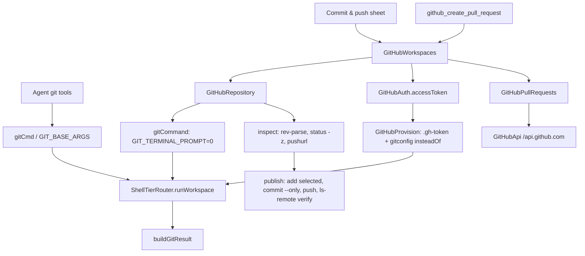

# Git and GitHub Tools

> Runs git in the workspace shell and wraps GitHub reads, authentication, repository import, commit and push, and pull request creation.

Two layers sit here. The agent gets `git_status`, `git_diff`, `git_commit`, `git_log`, `git_show`, `git_branch`, `git_branch_manage`, `git_checkout`, `git_push` and `git_pull` from `GitTools.kt`, all of which build shell commands through `ShellTierRouter`. GitHub-specific behavior lives in `tools/GitHubTools.kt` for read-only REST calls and in the `github` package for authentication, deterministic Git operations, repository import and pull requests. The UI in `ui/github` drives the same `GitHubWorkspaces` publisher, so the agent and the Commit & push sheet follow one set of guards.

## Module Responsibilities

- **`GitTools.kt`**: shell command builders (`gitCmd`, `gitDiffCmd`, `gitCommitCmd`, `gitLogCmd`, `gitShowCmd`, `gitCheckoutCmd`, `gitPushCmd`, `gitPullCmd`), retry and result formatting, and the ten agent tools.
- **`GitHubTools.kt`**: `GitHubReadClient`, path and repository validation, response formatting, and the read-only `github_api`, `github_search` and `github_file` tools.
- **`GitHubPullRequestTool.kt`**: the `github_create_pull_request` agent tool, its result marker, formatter and parser.
- **`github/GitHubAuth.kt`**: device flow, personal access token connection, token refresh, connection state and secret redaction.
- **`github/GitHubRepository.kt`**: state inspection, staging, commit, push verification, branch comparison and failure hints.
- **`github/GitHubWorkspaces.kt`**: the `PullRequestPublisher` implementation, token access checks, repository listing and import into private app storage.
- **`github/GitHubPullRequests.kt`**: REST calls for default branch, branch list, existing PR lookup and PR creation, plus body generation.
- **`ui/github/*`**: Commit & push dialog, import picker, change tree picker, push preset dialog and the Create pull request sheet.
- **`data/env/GitHubProvision.kt`**: materializes the token into the toolchain so git and gh authenticate without an interactive helper.

## Architecture and Flow

Every git invocation in `GitTools.kt` carries `-c 'safe.directory=*' -c gc.auto=0 -c maintenance.auto=false` through `GIT_BASE_ARGS` (`tools/GitTools.kt:25`). The safe-directory override handles repositories owned by another uid (the Shizuku shell uid or the media uid). Disabling auto-gc and auto-maintenance prevents git from spawning a detached maintenance process the sandbox cannot exec. Multi-step commands place the flags on each segment because `gitCmd` joins steps with `&&`.

The UI and PR paths use `github/GitHubRepository.kt` instead. Its `gitCommand` adds `GIT_TERMINAL_PROMPT=0` and `GIT_LITERAL_PATHSPECS=1` and quotes every argument (`github/GitHubRepository.kt:25`). The no-prompt flag turns a credential problem into a deterministic failure instead of a hang, and literal pathspecs stop a filename containing `*` from widening a commit.

Authentication reaches git without a credential helper. `GitHubProvision.gitConfigBody` writes `safe.directory = *`, a default identity, `init.defaultBranch = main`, and, when a token exists, a `url."https://x-access-token:<token>@github.com/".insteadOf = https://github.com/` rewrite (`data/env/GitHubProvision.kt:40`). `LinuxEnvironment.refreshGitHub` calls `materializeGitHub()`, verifies the files when `strict=true`, and then pushes the same payloads into the deployed Shizuku prefix with base64-wrapped writes (`data/env/LinuxEnvironment.kt:1095`). Token changes therefore apply without reinstalling the prefix.

## Invocation Chain

1. `ToolRegistry.default` registers the git tools (`tools/Tool.kt:123` to `133`) and, when a publisher is present, appends `GitHubCreatePullRequestTool` (`tools/Tool.kt:162`).
2. `HarnessApp` constructs `GitHubAuth` with `BuildConfig.GITHUB_CLIENT_ID`, the encrypted credential getter and setter, and `refreshGitHubAuth` (`HarnessApp.kt:275`). It constructs `GitHubWorkspaces(this)` at `HarnessApp.kt:353` and exposes it as `pullRequests` at `HarnessApp.kt:270`.
3. `GitCommitTool.execute` builds `gitCommitCmd`. That command first removes any `.harness` directory at any depth from the index, then runs `git add -A` with exclude pathspecs for the same paths, then removes them again, then commits (`tools/GitTools.kt:63`). If the commit fails with an unknown identity, the tool sets a repository-local identity and retries, falling back to global config (`tools/GitTools.kt:335`).
4. `GitPushTool.execute` resolves the current branch with `rev-parse --abbrev-ref HEAD`, reads `branch.<branch>.merge`, and only pushes without `-u` when that value equals `refs/heads/<branch>`. Otherwise it pushes with `-u` and notes the repair (`tools/GitTools.kt:539`).
5. `GitPullTool.execute` maps `mode` to `pull --ff-only`, `pull`, or `pull --rebase` and appends conflict guidance when output contains `CONFLICT` (`tools/GitTools.kt:588`).
6. `GitHubReadClient.get` normalizes the path, reads the saved token, sends `Authorization: Bearer`, and maps HTTP failures to actionable text (`tools/GitHubTools.kt:51`). `github_api`, `github_search` and `github_file` are chat-only tools, registered in `HarnessApp.kt:334` to `336`.
7. `GitHubWorkspaces.preparePullRequest` resolves the origin repository, asks GitHub for the default branch, compares the local branch with it, and looks for an existing open PR (`github/GitHubWorkspaces.kt:27`).
8. `GitHubCreatePullRequestTool.execute` rejects an empty ahead count and an unpushed branch, builds the body, and calls `openPullRequest` (`tools/GitHubPullRequestTool.kt:83`).
9. `GitHubPublishDialog` refreshes repository state, renders `GitHubChangePicker`, and calls `publish` with the selected paths; the footer calls the same method with `commit=true` (`ui/github/GitHubDialogs.kt:228` to `236`).
10. `GitHubPullRequestDialog` loads a `PullRequestPlan`, lets the user change the base branch, edit title and body, toggle checks and draft, and calls `openPullRequest` (`ui/github/PullRequestUi.kt:279`).

## Key State and Data Structures

- **`GitHubCredential`**: `token`, `login`, `oauth`, `refreshToken`, `expiresAt`, `refreshExpiresAt`, `scopes`, `clientId`. Saved through the app's encrypted key store, not in the git prefix.
- **`GitHubConnectionState`**: `login`, `oauth`, `busy`, `code` (`GitHubDeviceCode`), `message`. Exposed as `GitHubAuth.state: StateFlow`.
- **`GitHubRepoState`**: `remoteUrl`, `branch`, `head`, `changes: List<GitChange>`. `GitChange` carries `path`, two-character `status`, and optional `originalPath`.
- **`GitHubPushPreset`**: `remoteUrl`, `branch`, `commitMessage`, `paths`. Persisted inside an `AutomationTask`, so a saved preset survives restarts and can run hourly or daily.
- **`PullRequestBranch`**: `repository`, `branch`, `head`, `base`, `baseHead`, `remoteHead`, `ahead`, `behind`, `commits`, `files`, `uncommitted`. Derived `pushed` is `remoteHead == head`.
- **`PullRequestPlan`**: the compared branch, the default branch, and `existing` when an open PR already exists.
- **`PullRequestInfo`**: `number`, `url`, `title`, `draft`, `base`, `head`.
- **`PullRequestResult`**: parsed from the tool's `[pull-request]` marker line for the chat card, including `existing`, `commits` and `files`.

Persistence split: credentials live in encrypted preferences, repository contents live on disk, presets live in the automation task table, and PR state is never cached beyond the current dialog. `GitHubAuth.refreshIfNeeded` refreshes only expiring OAuth credentials and records a 60 second failure backoff so a broken refresh does not hammer GitHub (`github/GitHubAuth.kt:196`).

## Boundary Conditions

- Git requires a real filesystem path. `runGit` refuses a workspace with no `shellRoot` and no SFTP root, and points the user at Settings (`tools/GitTools.kt:179`). `GitHubCreatePullRequestTool.isAvailable` returns false for SSH and folder-only workspaces (`tools/GitHubPullRequestTool.kt:81`).
- Exit code 127 with "not found" produces a specific install message for the Linux environment or the SSH host.
- Dubious ownership is repaired by persisting `safe.directory '*'` globally once and re-running the command; the result carries a note (`tools/GitTools.kt:201`).
- `runGitWithRetry` retries only on `index.lock` or "another git process seems to be running", up to three times with 200, 400 and 800 ms delays (`tools/GitTools.kt:258`).
- `git_commit` never stages `.harness` at any depth, using glob pathspecs because a plain `*` stops at a path separator (`tools/GitTools.kt:53` to `61`).
- `GitHubRepository.inspect` requires the repository root: `rev-parse --show-prefix` must be blank. It also rejects a non-HTTPS origin, a differing `remote.origin.pushurl`, a detached HEAD, and any unmerged status pair (`DD`, `AU`, `UD`, `UA`, `DU`, `AA`, `UU`) (`github/GitHubRepository.kt:76`).
- `publish` re-inspects and requires the branch, remote URL and HEAD to equal the reviewed state. It stages only paths whose worktree status needs it, commits with `--only`, pushes the exact SHA to `refs/heads/<branch>`, then verifies with `ls-remote` that the remote head equals the local head (`github/GitHubRepository.kt:118`). It never force-pushes.
- pull request creation refuses when `ahead == 0` or `pushed` is false, and returns an existing open PR instead of a duplicate. The REST `create` call also converts a 422 "already exists" into `findOpen` (`github/GitHubPullRequests.kt:73`).
- `GitHubWorkspaces.checkAccess` refuses archived repositories and repositories where `permissions.push` is false (`github/GitHubWorkspaces.kt:75`).
- Git output is capped at 256,000 characters per stream in `GitHubWorkspaces.repository`; a larger result aborts rather than committing from an incomplete file list.
- Import clones into a new `github-projects/<name>-<random>` folder, isolates failures, and deletes the clone unless registration completed. Registration itself runs `NonCancellable` so cancellation cannot leave a workspace pointing at a deleted folder (`github/GitHubWorkspaces.kt:109`).
- PR bodies are capped at 60,000 characters, the commit list at 50, and the file list at 300 (`github/GitHubRepository.kt:48`, `github/GitHubPullRequests.kt:93`).

## Extension Points

- Add a new git command as an `internal fun gitXxxCmd(...)` in `GitTools.kt` so every segment gets `GIT_BASE_ARGS`, then a `Tool` class that calls `runGitWithRetry`.
- Modify `GIT_BASE_ARGS` to change global git behavior for every agent git call. Do not add a flag to one call site only, because multi-step commands need it per segment.
- The `PullRequestPublisher` interface (`github/GitHubPullRequests.kt:48`) is the seam shared by the agent tool and the sheet. A different host or a test double can implement it without touching either caller.
- Push presets are automation tasks with a `githubPush` field. `AutomationManager` calls `GitHubWorkspaces.pushPreset` (`automation/AutomationManager.kt:221`), so scheduling behavior is configured there, not in the Git layer.
- `GitChangeTree` and `toggleGitPaths` define how folder selection maps to exact changed files (`github/GitChangeTree.kt:4`). Folder rows never become a Git directory pathspec.

## Known gaps

- FEATURES.md line 73 lists git status, diff, commit, log, show, branch, checkout, push and pull but does not mention branch deletion or pull request creation. Both exist here (`git_branch_manage` and `github_create_pull_request`), so the feature list is incomplete rather than the implementation.
- The Commit & push sheet has no merge or rebase action. `git` conflicts are reported and the user must resolve them with the agent or a terminal; only `git_pull` exposes merge and rebase modes.

Sources: [app/src/main/java/com/androidharness/app/tools/GitTools.kt](../app/src/main/java/com/androidharness/app/tools/GitTools.kt)#L25-L273), [app/src/main/java/com/androidharness/app/github/GitHubRepository.kt](../app/src/main/java/com/androidharness/app/github/GitHubRepository.kt)#L69-L196), [app/src/main/java/com/androidharness/app/github/GitHubWorkspaces.kt](../app/src/main/java/com/androidharness/app/github/GitHubWorkspaces.kt)#L18-L139), [app/src/main/java/com/androidharness/app/data/env/GitHubProvision.kt](../app/src/main/java/com/androidharness/app/data/env/GitHubProvision.kt)#L23-L114)

## Source files

- `app/src/main/java/com/androidharness/app/tools/GitTools.kt`
- `app/src/main/java/com/androidharness/app/tools/GitHubTools.kt`
- `app/src/main/java/com/androidharness/app/tools/GitHubPullRequestTool.kt`
- `app/src/main/java/com/androidharness/app/github/GitHubAuth.kt`
- `app/src/main/java/com/androidharness/app/github/GitHubRepository.kt`
- `app/src/main/java/com/androidharness/app/github/GitHubWorkspaces.kt`
- `app/src/main/java/com/androidharness/app/github/GitHubPullRequests.kt`
- `app/src/main/java/com/androidharness/app/github/GitChangeTree.kt`
- `app/src/main/java/com/androidharness/app/ui/github/GitHubDialogs.kt`
- `app/src/main/java/com/androidharness/app/ui/github/GitHubChangePicker.kt`
- `app/src/main/java/com/androidharness/app/ui/github/GitHubImportPicker.kt`
- `app/src/main/java/com/androidharness/app/ui/github/PullRequestUi.kt`
- `app/src/main/java/com/androidharness/app/data/env/GitHubProvision.kt`
- `app/src/main/java/com/androidharness/app/data/env/LinuxEnvironment.kt`
- `app/src/main/java/com/androidharness/app/HarnessApp.kt`
- `app/src/main/java/com/androidharness/app/tools/Tool.kt`
- `app/src/main/java/com/androidharness/app/automation/AutomationManager.kt`
