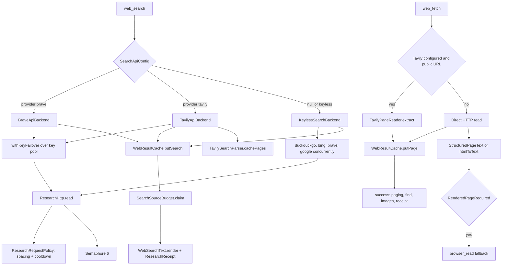

# Web Research and Search Backends

> Chooses a search backend, spends a per-turn source and page budget, reads pages, and records a receipt of what the harness actually retrieved.

`web_search` runs either a user-configured Brave or Tavily API or a keyless chain of HTML search endpoints. `web_fetch` reads a page directly, through Tavily Extract when configured, or through the rendered browser when the static read is not usable. Around both sits a shared request policy that spaces requests per site, respects `Retry-After`, and caches results briefly. `SearchSourceBudget` and `ResearchReceipt` make the difference between "the model says it searched" and "the harness can prove what it retrieved" explicit.

## Module Responsibilities

- **`SearchBackends.kt`**: `SearchBackend` interface, the keyless engine chain, `BraveApiBackend`, `TavilyApiBackend`, URL canonicalization and `WebResultCache`.
- **`SearchBudget.kt`**: per-depth batch sizes, read limits, read minimums, host diversification and `SearchSourceBudget`.
- **`ResearchHttp.kt`**: `ResearchHttpFailure`, `ResearchRequestPolicy` (per-site spacing and cooldown), `ResearchHttp.read` with a 6-request semaphore, and `ReadableWebPage` content checks.
- **`TavilyPageReader.kt`**: Tavily Extract client, public-URL gate and short failure cache.
- **`MoreTools.kt`**: `WebFetchTool`, its HTML to text reduction, PDF extraction, image scan and rendered-page fallback.
- **`NetTools.kt`**: `WebSearchTool` and the `web_search` tool surface. The `http_request` class in the same file belongs to the network page.
- **`StructuredPageText.kt`**: declarative JSON-LD article extraction and Reddit JSON thread extraction, with no script evaluation.
- **`WebSearchText.kt` / `PageImages.kt`**: the exact text shapes shared by tool output and UI parsing.
- **`core/ResearchReceipt.kt`**: the typed receipt attached to tool results.

## Architecture and Flow

Key selection happens per call, not per process. `HarnessApp.searchApiConfigFor` reads the enabled key pool for the provider and orders it with `RotatingKeyProvider.orderedKeys("search:$provider", pool)`, putting the first key in `apiKey` and the rest in `fallbackKeys` (`HarnessApp.kt:230`). `SearchApiConfig.keys` deduplicates and drops blanks. `withKeyFailover` tries each key and continues only when `ResearchHttpFailure.keySpecific()` is true, which covers 401, 402, 403, 429, 432 and 433 (`tools/SearchBackends.kt:65`). Any other failure propagates immediately, because another key would not fix it. A key already in cooldown fails before a request is sent.

The keyless chain runs every requested engine concurrently and caps the whole batch at 28 seconds. Completed engines contribute results in chain order, with canonical URL deduplication, until `count` is reached. Engines that have not completed are cancelled. This replaced a serial chain where one blocked engine could consume its full read timeout before the next one started (`tools/SearchBackends.kt:133` to `145`).

`ResearchHttp.read` wraps every request in two controls. `ResearchRequestPolicy.access` serializes requests to the same top private domain plus credential identity, waits for the site's `nextAt` spacing (default 1000 ms), and refuses while `blockedUntil` is in the future. Cooldowns default to 300 seconds for auth and credit failures, 30 seconds for 429, 60 seconds for 403, and 1 second otherwise, overridden by `Retry-After` in seconds or RFC 1123 form and capped at 7 days (`tools/ResearchHttp.kt:80`). The 6-permit semaphore bounds concurrent sockets. A second control retries once, and only for 429, 502, 503 or 504 with a computed wait at or below 2000 ms.

## Invocation Chain

1. `ToolRegistry.default` registers `WebFetchTool` with the rendered reader bridge, then `WebSearchTool`, then `HttpRequestTool` (`tools/Tool.kt:136` to `139`).
2. `AgentEngine` takes the registry's `web_search`, calls `forDepth(searchDepth)` to create a run-scoped copy with a `SearchSourceBudget`, then passes that budget to `web_fetch` and `browser_read` with `forBudget` (`agent/AgentEngine.kt:346` to `356`).
3. For a Chat conversation at depth `OFF`, `AgentEngine` removes `web_search` from the registry entirely (`agent/AgentEngine.kt:377`).
4. `WebSearchTool.execute` validates query, count, engine, freshness, language and country, builds `SearchOptions`, resolves the API config, checks the cache, and dispatches to the API backend or the keyless backend (`tools/NetTools.kt:97`).
5. `WebSearchTool.render` diversifies by host, claims results from the budget, appends the source and page counters, and returns a `ResearchReceipt` (`tools/NetTools.kt:192`).
6. `WebFetchTool.execute` takes `ResearchHttp.page(url)` as a single-flight lock and calls `readPage` (`tools/MoreTools.kt:246`).
7. `readPage` checks the read budget, returns a cached page when valid, tries Tavily Extract when the provider is Tavily and the URL passes `publicUrl`, then performs a direct HTTP read. On `RenderedPageRequired` the execute wrapper invokes the browser reader (`tools/MoreTools.kt:271`).
8. `WebFetchTool.success` claims one page read, renders paging or `find` excerpts, appends image URLs, and builds a receipt with `pageUrl`, `pageRead=true` and the backend label (`tools/MoreTools.kt:349`).

## Key State and Data Structures

- **`SearchApiConfig`**: `provider`, `apiKey`, `fallbackKeys`. `keys` is the deduplicated usable list. `credentialIdentity()` hashes the sorted keys with SHA-256 and keeps 12 bytes, so cooldowns and caches survive key rotation order. `toString` redacts the key.
- **`SearchOptions`**: `engine`, `freshness`, `language`, `country`, `deep`. `deep` is true only for `DEEP`, `DEEP_RESEARCH` and `MAX_RESEARCH`.
- **`WebSearchResult`**: `title`, `url`, `snippet`, optional `date`.
- **`SearchOutcome`**: results plus the `via` label used in `[via ...]`.
- **`SearchDepth`**: `OFF` (0 sources), `INSTANT` (5), `DEEP` (20), `AUTO` (null), `DEEP_RESEARCH` (50), `MAX_RESEARCH` (100) (`data/SearchDepth.kt:11`).
- **`SearchSourceBudget`**: `maxSources`, optional `maxReads`, `minReads`, a `LinkedHashSet` of canonical result URLs, a read counter, a set of read URLs, and one lock. `receipt()` returns a `ResearchReceipt`.
- **`ResearchReceipt`**: `sourcesUsed`, `sourcesMax`, `pagesRead`, `readsRequired`, `pageUrl`, `pageRead`, `backend`. Serialized with tool results so the UI can show provenance without trusting page text.
- **`WebResultCache`**: process-wide, synchronized LRU maps. Search TTL 10 minutes, page and image TTL 15 minutes, 24 searches and 24 pages, page text capped at 400,000 characters, images capped at 8.
- **`ExtractedPage`**: `text` plus `images: List<PageImage>`.

Budgets are per turn, not persisted. `SearchSourceBudget` is created when a run starts, passed to the scoped tools, and discarded at the end. `WebResultCache` survives turns but not process death, and its keys include the credential identity so a provider or key change does not return another account's cached data.

## Boundary Conditions

- `INSTANT` requests at most 5 results per call. Any research depth requests at least 20, with a per-call ceiling of 20; non-depth calls cap at 15 (`tools/SearchBudget.kt:11`).
- Read limits are 10 pages for `DEEP`, 25 for `DEEP_RESEARCH`, 40 for `MAX_RESEARCH`, and unlimited for every other depth. Minimum reads before answering are 2, 5 and 8 (`tools/SearchBudget.kt:24`).
- `diversifyResults` keeps at most 3 results per host by default, so one site cannot fill a batch (`tools/SearchBudget.kt:43`).
- A spent budget returns a plain successful result with an instruction to stop searching and answer, not an error (`tools/NetTools.kt:230`).
- Freshness maps per backend: DuckDuckGo `df=d|w|m|y`, Brave API `freshness=pd|pw|pm|py`, Google `tbs=qdr:d|w|m|y`, Tavily `time_range=day|week|month|year`. Language reaches keyless engines through engine parameters and `Accept-Language`, Brave through `search_lang`, and Tavily not at all. Country reaches DuckDuckGo `kl`, Bing `cc`, Google `gl`, and Brave `country` uppercased; Tavily ignores it.
- An active API backend does not fall back to scraping. A failed Brave or Tavily call returns an error that names the provider and says the API was not replaced (`tools/NetTools.kt:168`).
- A selected provider with no enabled key returns an error telling the user to fix Web search settings, rather than silently using keyless engines (`tools/NetTools.kt:138`).
- `ResearchHttp.bodyText` aborts above 8 MB. `web_fetch` allows 4 MB normally and 16 MB for a PDF, and rejects larger bodies before extraction.
- `ReadableWebPage.problem` rejects empty text, loading placeholders, access-check and rate-limit interstitials, and short "enable JavaScript" pages. `cooldownStatus` classifies the same text as 429 or 403 so the policy can cool the site down (`tools/ResearchHttp.kt:186`).
- `TavilyPageReader.publicUrl` refuses userinfo, secret-bearing query parameters (`token`, `api_key`, `password`, `signature`, `sig`, `auth`, `X-Amz-*`), localhost and internal suffixes, bare IP literals in private ranges, and hosts without a dot (`tools/TavilyPageReader.kt:21`).
- Tavily Extract failures are cached per credential plus canonical URL for 60 seconds, so a retry does not spend another extraction (`tools/TavilyPageReader.kt:37`).
- `web_fetch` caps `max_chars` at 60,000 and defaults to 20,000. `offset` beyond the text returns an error telling the caller to use offset 0.
- `WebSearchTool` and `web_fetch` share `SearchSourceBudget`, so a page read through either path consumes the same read allowance.

## Extension Points

- Implement `SearchBackend` and add a branch in `searchBackendFor` to support another provider. The budget, cache, receipts and fallback are already provider-agnostic.
- `SearchApiConfig.fallbackKeys` is the supported multi-key mechanism. Add keys in Settings and they are ordered and failed over automatically.
- `SearchOptions.deep` controls Tavily's `search_depth` and `include_raw_content`. Changing which depths set it is a one-line change in `WebSearchTool.execute`.
- `SearchSourceBudget.maxReads` and `minReads` come from `researchReadLimit` and `researchReadMinimum`. These are the settings-adjacent knobs for research depth behavior, though the values are code constants today.
- `StructuredPageText` recognizes `Article`, `NewsArticle`, `BlogPosting`, `DiscussionForumPosting`, `SocialMediaPosting`, `Comment`, `Question` and `Answer` schema types. Extending that set lets more declarative pages survive HTML reduction.
- Search provider and depth are stored under `web_search_provider` and `search_depth` (`data/SettingsRepository.kt:282`, `:323`), so a new UI only needs to write those keys.

## Known gaps

- The `TavilyApiBackend` class comment says the key travels in the JSON body, but the request sets `Authorization: Bearer $apiKey` and sends no key field (`tools/SearchBackends.kt:363` to `388`). The implementation is authoritative; the comment is stale.
- Tavily search requests never send language or country, even when the caller supplies them. Only freshness and the deep flag change the payload.
- `SearchSourceBudget` has no persistence. Restarting the app or starting a new turn resets the source and read counters.

Sources: [app/src/main/java/com/androidharness/app/tools/SearchBackends.kt](../app/src/main/java/com/androidharness/app/tools/SearchBackends.kt)#L25-L541), [app/src/main/java/com/androidharness/app/tools/SearchBudget.kt](../app/src/main/java/com/androidharness/app/tools/SearchBudget.kt)#L11-L108), [app/src/main/java/com/androidharness/app/tools/ResearchHttp.kt](../app/src/main/java/com/androidharness/app/tools/ResearchHttp.kt)#L28-L160), [app/src/main/java/com/androidharness/app/tools/MoreTools.kt](../app/src/main/java/com/androidharness/app/tools/MoreTools.kt)#L219-L356)

## Source files

- `app/src/main/java/com/androidharness/app/tools/SearchBackends.kt`
- `app/src/main/java/com/androidharness/app/tools/SearchBudget.kt`
- `app/src/main/java/com/androidharness/app/tools/ResearchHttp.kt`
- `app/src/main/java/com/androidharness/app/tools/TavilyPageReader.kt`
- `app/src/main/java/com/androidharness/app/tools/StructuredPageText.kt`
- `app/src/main/java/com/androidharness/app/tools/WebSearchText.kt`
- `app/src/main/java/com/androidharness/app/tools/PageImages.kt`
- `app/src/main/java/com/androidharness/app/tools/NetTools.kt`
- `app/src/main/java/com/androidharness/app/tools/MoreTools.kt`
- `app/src/main/java/com/androidharness/app/core/ResearchReceipt.kt`
- `app/src/main/java/com/androidharness/app/data/SearchDepth.kt`
- `app/src/main/java/com/androidharness/app/data/SettingsRepository.kt`
- `app/src/main/java/com/androidharness/app/HarnessApp.kt`
- `app/src/main/java/com/androidharness/app/agent/AgentEngine.kt`
