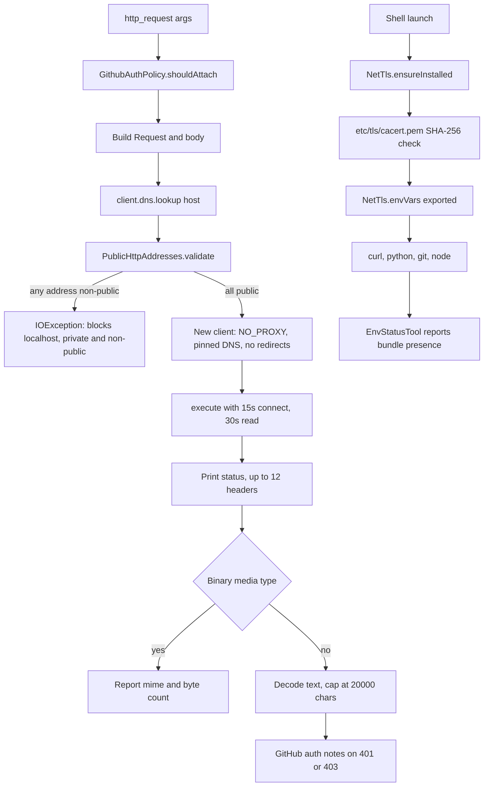

# Network, HTTP and TLS Diagnostics

> Constrains `http_request` to public addresses with no redirects, and provisions the CA material that lets shell tools verify TLS.

The network surface here is small but opinionated. `HttpRequestTool` is a general HTTP client for API testing that resolves and validates every address before connecting, disables proxies and redirects, and prints a bounded response. `PublicHttpAddresses` owns the address policy. `NetTls` owns the other half: it copies a Mozilla CA bundle into the Linux prefix so curl, git, python and node verify certificates, and exports the environment variables that point each stack at it. There is no certificate inspector at HEAD, which is recorded under Known gaps.

## Module Responsibilities

- **`HttpRequestTool` (`http_request`)**: generic GET, POST, PUT, PATCH, DELETE and other verbs with headers and a body, restricted to public addresses.
- **`GithubAuthPolicy`**: decides when the stored GitHub token is attached, by host and by the explicit `github_auth` argument.
- **`HttpBinaryDetector`**: classifies media types so binary bodies are described rather than decoded.
- **`PublicHttpAddresses`**: validates resolved `InetAddress` values against loopback, private, link-local, multicast, documentation and transition ranges.
- **`NetTls`**: installs `net/mozilla-ca-bundle.pem` as `etc/tls/cacert.pem` in the toolchain prefix, exports TLS environment variables, and names the OpenSSL config path.
- **`EnvStatusTool`**: reports whether the bundle exists and which variables are exported.
- **`LinuxEnvironment`**: calls `NetTls.ensureInstalled`, applies `envVars`, and mirrors the bundle and OpenSSL config into the deployed Shizuku prefix.

## Architecture and Flow

`HttpRequestTool.execute` resolves the host once with `client.dns.lookup`, passes the result through `PublicHttpAddresses.validate`, then builds a per-request client. That client sets `proxy(Proxy.NO_PROXY)` so a system proxy cannot reroute the validated connection, installs a `Dns` that re-validates any other hostname lookup, sets `followRedirects(false)` and `followSslRedirects(false)`, discards the shared connection pool, and uses 15 second connect and 30 second read timeouts (`tools/NetTools.kt:341` to `354`). The validated address list is returned for the request host, so the socket connects to an address that was actually checked rather than re-resolving later.

`NetTls.ensureInstalled` hashes the APK asset and the existing target, skips the copy when they match, and otherwise writes the bundle into the prefix. It catches every exception and leaves whatever exists in place, so an unwritable prefix does not crash startup. `NetTls.envVars` returns `SSL_CERT_FILE`, `CURL_CA_BUNDLE`, `REQUESTS_CA_BUNDLE`, `GIT_SSL_CAINFO` and `NODE_EXTRA_CA_CERTS` all pointing at the same PEM path (`tools/NetTls.kt:101`). `OPENSSL_CONF_RELATIVE_PATH` exists because the Termux-built OpenSSL bakes in a `/data/data/com.termux/...` config path that is EACCES when the Termux app is installed; exporting the prefix copy keeps node and curl on their own file.

## Invocation Chain

1. `ToolRegistry.default` constructs `HttpRequestTool(httpClient) { linuxEnv.githubToken() }` (`tools/Tool.kt:139`).
2. `HttpRequestTool.execute` reads `url`, `method`, `body`, `content_type` and `github_auth`, upper-cases the method, and resolves the host for auth policy (`tools/NetTools.kt:310`).
3. `GithubAuthPolicy.shouldAttach` returns false for explicit false, true for explicit true only on `github.com`, its subdomains, `githubusercontent.com` and its subdomains, and for an omitted flag only on `api.github.com` and `uploads.github.com` (`tools/NetTools.kt:245`).
4. The request is built with the GitHub token first, then caller headers, so an explicit `Authorization` header overrides the automatic one (`tools/NetTools.kt:323` to `330`).
5. GET, DELETE and HEAD get their dedicated builders. Every other method goes through `builder.method(method, body ?: empty)`.
6. `PublicHttpAddresses.validate` rejects the whole request if the lookup is empty or any address is non-public (`tools/PublicHttpAddresses.kt:7`).
7. The response is printed, binary bodies are summarized, and text is capped at 20,000 characters with `[truncated]` appended (`tools/NetTools.kt:355`).
8. `LinuxEnvironment` calls `NetTls.ensureInstalled(prefix, context)` during environment setup (`data/env/LinuxEnvironment.kt:351`), applies `NetTls.envVars` for the direct prefix (`:1007` to `1014`), and repeats both for the deployed prefix with `$tmpPrefix/etc/tls/cacert.pem` (`:1301` to `1308`).
9. `EnvStatusTool` checks `File(linuxEnv.prefix, NetTls.BUNDLE_RELATIVE_PATH)` and reports either "ready at ..." or "missing; falling back to system anchors" (`tools/EnvStatusTool.kt:69`, `:155`).

## Key State and Data Structures

- **`PublicHttpAddresses`**: a stateless object. `validate` throws on an empty or mixed result; `isPublic` performs the range checks.
- **`NetTls`**: constants `ASSET_PATH = "net/mozilla-ca-bundle.pem"`, `BUNDLE_RELATIVE_PATH = "etc/tls/cacert.pem"`, `OPENSSL_CONF_RELATIVE_PATH = "etc/tls/openssl.cnf"`. No mutable state; the prefix file is the state.
- **`HttpRequestTool`**: the OkHttp client and a `githubToken: () -> String?` provider. It holds no per-call state.
- **`GithubAuthPolicy`**: pure host policy with three outcomes (attach, do not attach, attach only on API hosts).
- **Result text**: status line, up to 12 headers, blank line, then body or a binary marker, optionally followed by a GitHub note. This is plain text, not structured, so callers parse it as output.

Nothing here persists in memory. The CA bundle persists on disk inside the app prefix and inside the deployed Shizuku prefix. It is re-verified by SHA-256 on every `ensureInstalled` call, so a corrupted copy is replaced on the next app start or environment refresh.

## Boundary Conditions

- Any non-public resolved address fails the entire request, including a hostname that resolves to both a public and a private address. There is no happy-eyeballs fallback to the public one.
- The IPv4 deny list covers `0/8`, `10/8`, `127/8`, `224/4` and above, `100.64/10`, `169.254/16`, `172.16/12`, `192.168/16`, `192.0.0/24`, `192.88.99/24`, `198.18/15`, `198.51.100/24` and `203.0.113/24` (`tools/PublicHttpAddresses.kt:20`). The IPv6 path accepts only global unicast in `2000::/3` and excludes `2002::/16`, `2001:db8::/32`, the `2001::/23` special block and `3fff::/20`.
- Redirects are not followed at all, neither HTTP nor HTTPS. A 301 or 302 is returned as a normal response with its `Location` header, and the caller must issue a second explicit request if it wants the target.
- Proxies are disabled for this tool. A device that can only reach the network through a proxy will fail here even though other tools work.
- The method is not restricted to a fixed allowlist. GET, DELETE and HEAD are special-cased, and any other string is passed to `builder.method`, so verbs outside the documented GET/POST/PUT/PATCH/DELETE set are accepted.
- There is no call timeout. Connect is 15 seconds and read is 30 seconds, but a server that drips bytes can keep the call alive longer than either value.
- Response bodies larger than 20,000 characters are truncated in the text output. Binary classification covers image, audio, video and font types, while JSON, XML, YAML, JavaScript, GraphQL, form encoded, SQL, CSV and SVG are treated as text.
- `NetTls.ensureInstalled` swallows every exception. A failed copy is invisible except as a missing bundle in `EnvStatusTool`.
- `NetTls` affects shell processes only. The app's own OkHttp client is `OkHttpClient()` with the Android system trust store and no custom trust manager or certificate pinning (`HarnessApp.kt:179`).
- `gitToolsReady` requires both `bin/git` and `lib/libtermux-exec-ld-preload.so`, so a prefix with git but without the preload library still reports tools as not ready (`data/env/LinuxEnvironment.kt:366`).

## Extension Points

- Add a TLS variable in `NetTls.envVars` to point another client at the bundle. Every shell tier picks it up because both the direct and deployed environments call the same function.
- Replace the asset in `app/src/main/assets/net/mozilla-ca-bundle.pem` to change trust anchors. The SHA-256 comparison makes the replacement automatic on the next run.
- Extend `PublicHttpAddresses.isPublic` to add or remove blocked ranges. This object is used only by `http_request`, so the change does not affect `web_fetch` or the browser.
- Extend `GithubAuthPolicy` to attach the token to another API host. Keep the default branch narrow, because the current design deliberately avoids leaking a token to arbitrary hosts.
- The OpenSSL config path is exposed as a constant so `CodeGraphManager` and future tools can export the same `OPENSSL_CONF` without duplicating the path.

## Known gaps

- No TLS probe or certificate inspector exists at HEAD. Nothing in `tools/`, `data/env/` or the UI opens a TLS connection to report the certificate subject, issuer, chain, expiry, negotiated protocol, cipher, or hostname verification result. The only TLS code is `NetTls`, which installs trust material, and `EnvStatusTool`, which reports whether that material is present.
- `FEATURES.md` does not claim certificate inspection. A page titled TLS diagnostics therefore describes provisioning and HTTP restrictions, not a live handshake report.
- `NetTls.envVars` does not include `JAVAX_NET_SSL_TRUSTSTORE`, although the class comment mentions a JKS store provisioned separately. No such provisioning exists in the files read for this page.

Sources: [app/src/main/java/com/androidharness/app/tools/NetTools.kt](../app/src/main/java/com/androidharness/app/tools/NetTools.kt)#L276-L396), [app/src/main/java/com/androidharness/app/tools/PublicHttpAddresses.kt](../app/src/main/java/com/androidharness/app/tools/PublicHttpAddresses.kt)#L6-L35), [app/src/main/java/com/androidharness/app/tools/NetTls.kt](../app/src/main/java/com/androidharness/app/tools/NetTls.kt)#L20-L108), [app/src/main/java/com/androidharness/app/data/env/LinuxEnvironment.kt](../app/src/main/java/com/androidharness/app/data/env/LinuxEnvironment.kt)#L1000-L1014)

## Source files

- `app/src/main/java/com/androidharness/app/tools/NetTools.kt`
- `app/src/main/java/com/androidharness/app/tools/NetTls.kt`
- `app/src/main/java/com/androidharness/app/tools/PublicHttpAddresses.kt`
- `app/src/main/java/com/androidharness/app/tools/EnvStatusTool.kt`
- `app/src/main/java/com/androidharness/app/data/env/LinuxEnvironment.kt`
- `app/src/main/java/com/androidharness/app/HarnessApp.kt`
