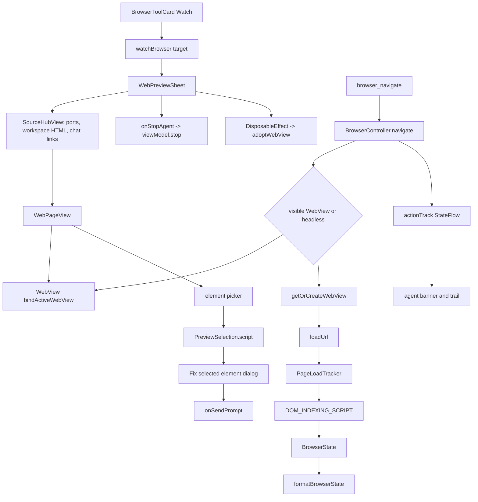

# Browser Control and Web Preview

> Drives an in-app WebView from agent tools and from a user-facing preview sheet, with one page state, one history, one console buffer and one element picker.

`BrowserController` owns the WebView the agent drives, either a headless instance or the visible preview sheet's instance after it is adopted on close. `BrowserTools.kt` exposes that controller as `browser_navigate`, `browser_click`, `browser_type`, `browser_scroll`, `browser_get_dom`, `browser_read`, `browser_eval`, `browser_screenshot`, `browser_get_logs`, `browser_wait_for`, `browser_back`, `browser_forward`, `browser_refresh`, `browser_get_url` and `browser_open_external`. The preview sheet in `ui/chat/components/WebPreviewSheet.kt` provides the source hub, the visible page, the console drawer, the element picker and the agent activity banner. Chat wires both surfaces together through a Watch button on browser tool cards.

## Module Responsibilities

- **`BrowserController`**: WebView lifecycle, navigation, click, type, scroll, eval, history, console capture, screenshots and action tracking.
- **`BrowserTools.kt`**: the fifteen agent tools and the shared `formatBrowserState` renderer.
- **`PageLoadTracker`**: distinguishes "a navigation started" from "its document committed and finished loading".
- **`HistoryStep.kt`**: pure decision logic for back and forward, including redirect bounces and overshoot correction.
- **`PreviewSelection.kt`**: element picking script and the prompt sent to the agent.
- **`BrowserToolActivity.kt`**: transcript-derived browser activity, Watch targets and human-readable action labels.
- **`WebPreviewSheet.kt`**: source hub, WebView host, toolbar, console, activity trail and element selection dialog.
- **`WebPreviewAvailability.kt`**: decides whether the chat shows the preview shortcut.
- **`BrowserToolCard.kt`**: the text-only browser card with the Watch button.
- **`WorkspacePathHandler.kt`**: serves workspace files under `https://harness.workspace/ws/...`.

## Architecture and Flow

The two entry points share one controller and therefore one page. When the user taps Watch, `ChatScreen.watchBrowser` sets `webPreviewUrl` from the tool's target or from `browser.getActiveUrl()` and opens the sheet (`ui/chat/ChatScreen.kt:309`). The sheet binds its WebView with `browserController.bindActiveWebView(this)`, so agent actions now run against the visible view. On dispose it calls `adoptWebView`, which keeps the page, scroll position and back/forward list alive in a headless view instead of destroying them (`app/src/main/java/com/androidharness/app/browser/BrowserController.kt:257`). A blank or uninitialized view is destroyed rather than adopted.

Every action captures a baseline before it runs and waits for a real document afterward. `PageLoadTracker` increments a generation on `onPageStarted`, marks the finished generation only while a load is in flight, and records errors and downloads. `awaitNavigation` first waits for the generation to move or the in-page document to change, then waits for the new document to report complete. When the WebView's client is not the controller's, `readDocumentProbe` asks the page for `location.href` and `readyState`, because `WebView.url` becomes provisional as soon as a navigation starts (`browser/PageLoadTracker.kt:143`). This is what stops a slow page from being reported as loaded with the previous document's URL and DOM.

Workspace HTML is served through `WebViewAssetLoader` on `https://harness.workspace`. `prepareWorkspacePreview` normalizes the relative path and records it as `baseUrlPath`; `interceptWorkspaceRequest` routes the whole host through `WorkspacePathHandler`, so relative links, forms, `fetch('/...')` and assets resolve like a real site without opening a socket (`browser/BrowserController.kt:225`). Both the headless and visible clients call the same interception, which is why agent and user see the same page.

## Invocation Chain

1. `ToolRegistry.default` adds the browser tools only when `browserController` is non-null (`tools/Tool.kt:181` to `197`).
2. `HarnessApp` creates one `BrowserController(appContext, images)` and passes it to the registry as `browserController` (`HarnessApp.kt:256`).
3. `BrowserNavigateTool.execute` calls `controller.navigate(url, ctx.workspace)` and renders the returned state (`tools/BrowserTools.kt:89`).
4. `navigate` tracks the action, normalizes local targets, reads the committed URL before the load, calls `loadUrl`, waits for navigation, rejects a download or a navigation that never started, then calls `extractState` (`browser/BrowserController.kt:669`).
5. `browser_click`, `browser_type` and `browser_scroll` call `click`, `type` and `scroll`, each of which tracks the action and returns a fresh `BrowserState` (`browser/BrowserController.kt:767`, `:799`, `:852`).
6. `browser_get_dom` calls `extractState`, which runs `DOM_INDEXING_SCRIPT` and decodes JSON into `BrowserState` (`browser/BrowserController.kt:1471`).
7. `browser_read` navigates, evaluates a script that prefers `article`, then `main`, then `body.innerText`, checks `ReadableWebPage`, claims a read from the budget, caches the page, optionally scans images and optionally captures a screenshot (`tools/BrowserTools.kt:269`).
8. `browser_eval` calls `evalUser`, which wraps the code in a sandboxed function and polls a staged promise when the result is a Promise (`browser/BrowserController.kt:1100`).
9. `browser_back`, `browser_forward` and `browser_refresh` call `back`, `forward` and `refresh`, all of which return a `BrowserState` with any load notes appended (`tools/BrowserTools.kt:580` to `636`).
10. The preview sheet's element picker converts a touch to page coordinates, evaluates `PreviewSelection.script`, opens the "Fix selected element" dialog, and sends `PreviewSelection.prompt` through `onFixBug`, which hides the sheet and calls `onSendPrompt` (`ui/chat/components/WebPreviewSheet.kt:1037`, `:230`).

## Key State and Data Structures

- **`BrowserState`**: `url`, `title`, `interactiveElements`, `textSummary`, `error`, `consoleErrorCount`, `scrollY`, `notices`, `visibility`, `hasFocus`, `documentVisibility`. This is the JSON shape produced by the DOM script.
- **`BrowserElement`**: numeric `id`, `tag`, optional `type`, `name`, `text`, `placeholder`, `ariaLabel`, `role`, `href`, plus `isVisible`, `isClickable`, `inViewport` and `disabled`.
- **`BrowserConsoleLog`**: `level`, `message`, `source`, `line`, `url`, `timestamp`. Stored in a `CopyOnWriteArrayList` capped at 200.
- **`BrowserActionTrack`**: `action`, `detail`, `ok`, `timestamp`. Kept in a `StateFlow<List<...>>` capped at 50 and mirrored by `isAgentControlling`.
- **`BrowserEvalOutcome`**: `ok`, `value`, `error`, `notices`.
- **`BrowserScreenshotResult`**: `filename`, `relPath`, `cachedFile`, `sizeBytes`, `mime`.
- **`BrowserPageCapture`**: `image: ImageRef`, `fullPage`, `truncated`.
- **`PreviewSelection`**: `selector`, `html` (4000 chars), `styles` (3000 chars), with `prompt(url, request, errors, screenshot)` and `script(x, y)`.
- **`BrowserToolActivity`**: `target`, `site`, `action`, `status`. Derived from the transcript, not from live browser state.

Console logs, the action trail and the DOM state are in memory only. Screenshots are written to `.harness/screenshots/yyyyMMdd_HHmmss.jpg` in the active workspace and copied into `ImageStore` for chat rendering, so they survive process death. The adopted WebView keeps history across sheet close but not across process death. The element selection prompt includes console errors from the sheet's local buffer, capped at five.

## Boundary Conditions

- `browser_read` accepts only `http` and `https`. `browser_navigate` additionally accepts workspace-relative HTML paths, `file://` paths inside the workspace, and scheme-less `localhost:PORT` dev servers, normalized by `LocalPortProbe.normalizeLocalUrl`.
- A navigation that produces a download, or one that never starts, throws instead of returning the previous page. The message names the download type and disposition when known (`browser/BrowserController.kt:742`).
- `awaitNavigation` allows 20 seconds for a navigate to finish, 2.5 seconds to detect that it started, 8 seconds for a pending load before a history step, and 100 ms polling. A page still loading is reported with an explicit note rather than as settled.
- History steps are bounded to 5 attempts. `decideHistoryStep` can land, correct an overshoot with `history.go`, treat a return to the starting document as a redirect bounce and step again, or stall with a reason. `sameDocument` keeps the query string and fragment in the identity, so redirect variants are not confused (`browser/HistoryStep.kt:44`).
- `waitFor` clamps its timeout to 250 through 30,000 ms. Unknown conditions are rejected before any script runs.
- `evalRawOn` times out after 10 seconds, terminates the render process, and throws "infinite loop or hang" instead of hanging the tool. `evalUser` also times out a Promise after 10 seconds unless the page navigated away, in which case the navigation wins.
- JavaScript dialogs are auto-handled and reported as browser notices: `alert` confirms, `confirm` returns false, `prompt` returns null, `beforeunload` confirms. Popups are blocked and reported, so a target that opens a new window must be loaded in place (`browser/BrowserController.kt:118` to `143`).
- `browser_screenshot` requires an attached, visible, focused preview. A hidden or detached surface throws rather than returning a blank image. `captureReadPage` for `browser_read` additionally samples a 64 by 64 downscale and rejects a uniform frame.
- Full-page capture is capped at 8192 px of height and 8 megapixels, and reports `truncated` when the page exceeds it.
- The visible preview allows mixed content (`MIXED_CONTENT_ALWAYS_ALLOW`) and enables zoom, while file and content access are disabled. The headless view also disables file and content access and appends `AndroidHarnessAgent/1.0` to the user agent.
- Console messages are deduplicated when the same level, text, source and line arrive within 150 ms, because both clients can dispatch one message. The buffer drops the oldest entry past 200.
- The sheet keeps its own console list, capped at 200, separate from the controller's buffer. The error badge reads the sheet list, while `browser_get_logs` reads the controller list.
- The agent stop button is enabled only while `agentRunning` is true and calls `viewModel.stop()`; it does not close the sheet.

## Extension Points

- Add a browser tool by wrapping a new `BrowserController` suspend function and registering it in the `browserController != null` block in `Tool.kt`. Add its label to `BrowserToolActivity.from` so cards and Watch targets stay readable.
- `AgentWebChromeClient` is open for override. The preview sheet subclasses it to receive progress, title and console callbacks while keeping the default dialog handling.
- `PreviewSelection.script` defines what the picker captures. Extending the style key list or the selector depth changes what the agent receives.
- `WebPreviewAvailability` can add another source signal (for example a new message attachment type) by extending the `combine` at the end of the file.
- `LocalPortProbe.COMMON_PORTS` controls which dev-server ports the source hub probes: 3000, 5173, 8000, 8080, 4321, 8081, 5000, 8888, 4200 and 9000 (`core/LocalPortProbe.kt:15`).
- `BrowserController.track` is the single place agent activity enters the preview banner. A new action automatically shows up there and expires after 10 seconds of idleness.

## Known gaps

- There is no download manager. A main-frame download is detected and reported, but the file is not saved or opened from the preview.
- Popups are always blocked. Pages that require a new window for login or checkout cannot complete inside the in-app browser.
- History, console logs and the action trail do not survive process death. Only screenshots and workspace files persist.
- `browser_screenshot` cannot capture a headless page. It intentionally fails unless the preview is open and visible, which means an agent cannot take a screenshot without user-visible UI.

Sources: [app/src/main/java/com/androidharness/app/browser/BrowserController.kt](../app/src/main/java/com/androidharness/app/browser/BrowserController.kt)#L175-L360), [app/src/main/java/com/androidharness/app/tools/BrowserTools.kt](../app/src/main/java/com/androidharness/app/tools/BrowserTools.kt)#L241-L378), [app/src/main/java/com/androidharness/app/ui/chat/components/WebPreviewSheet.kt](../app/src/main/java/com/androidharness/app/ui/chat/components/WebPreviewSheet.kt)#L178-L309), [app/src/main/java/com/androidharness/app/browser/HistoryStep.kt](../app/src/main/java/com/androidharness/app/browser/HistoryStep.kt)#L44-L108)

## Source files

- `app/src/main/java/com/androidharness/app/tools/BrowserTools.kt`
- `app/src/main/java/com/androidharness/app/tools/BrowserOpenExternalTool.kt`
- `app/src/main/java/com/androidharness/app/browser/BrowserController.kt`
- `app/src/main/java/com/androidharness/app/browser/PageLoadTracker.kt`
- `app/src/main/java/com/androidharness/app/browser/HistoryStep.kt`
- `app/src/main/java/com/androidharness/app/browser/PreviewSelection.kt`
- `app/src/main/java/com/androidharness/app/browser/BrowserToolActivity.kt`
- `app/src/main/java/com/androidharness/app/browser/WorkspacePathHandler.kt`
- `app/src/main/java/com/androidharness/app/ui/chat/components/WebPreviewSheet.kt`
- `app/src/main/java/com/androidharness/app/ui/chat/components/BrowserToolCard.kt`
- `app/src/main/java/com/androidharness/app/ui/chat/WebPreviewAvailability.kt`
- `app/src/main/java/com/androidharness/app/ui/chat/ChatScreen.kt`
- `app/src/main/java/com/androidharness/app/core/LocalPortProbe.kt`
- `app/src/main/java/com/androidharness/app/tools/Tool.kt`
