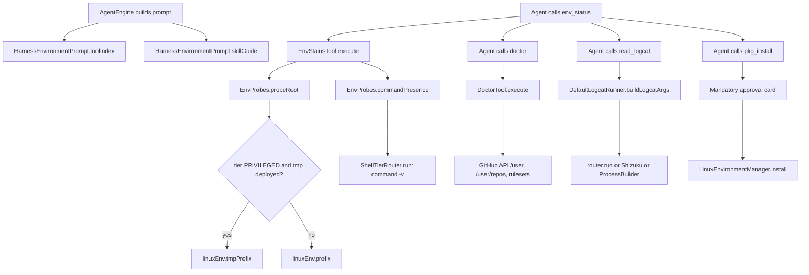

# Device and Environment Tools

> Agent tools that report what the device environment can actually do, install Linux and Android build tooling, and read system logs.

The agent runtime exposes five read-only diagnostics (`env_status`, `doctor`, `read_logcat`, `pkg_search`, `pkg_list`), two mutating installers (`pkg_install`, `android_sdk_install`), and a prompt builder that describes the environment to the model. The hard problem these classes solve is that Android privilege tiers make naive filesystem checks lie: the app UID cannot stat inside the deployed `/data/local/tmp` tree, and app-tier binaries run through linker shims that no `File.exists()` models. `EnvProbes` centralizes the tier-aware probing so status and doctor output reflect what the shell will really execute.

## Module Responsibilities

- **`EnvProbes`** (`internal object`): tier-routed probes shared by the status and doctor tools. Resolves the probe root, reads real permission bits, and checks command presence inside the live shell.
- **`EnvStatusTool`** (`env_status`): returns a live snapshot: Shizuku state, user-service state, Linux toolchain readiness, active execution tier, GitHub credential state, TLS bundle, exec-capable scratch, and storage access.
- **`DoctorTool`** (`doctor`): end-to-end GitHub diagnostics. One API ping with the configured token, real token-file mode, git spawn shell and `insteadOf` rewrite, and the free-plan branch-protection paywall.
- **`ReadLogcatTool`** (`read_logcat`): filtered logcat reads through `LogcatRunner`, either the tier router, Shizuku, or a local `ProcessBuilder`.
- **`PkgInstallTool` / `PkgSearchTool` / `PkgListTool`**: install from the Linux repository, search the package index, and list the installed marker.
- **`AndroidSdkInstallTool`** (`android_sdk_install`): one approval for OpenJDK, D8, apksigner, aapt2 (optionally Gradle) plus `android.jar` from Google's SDK repository.
- **`HarnessEnvironmentPrompt`**: builds the tool-family index and the environment skill guide injected into the system prompt.

## Architecture and Flow

The routing decision in `EnvProbes.probeRoot` runs before any binary check. `EnvStatusTool` resolves `cwd = workspace.shellRoot ?: linuxEnv.shellFallbackRoot`, then computes the tier with `router.deviceAccess?.liveTier(cwd) ?: router.resolveTier(cwd)`. That tier decides whether `/data/local/tmp/androidharness/linux` or `filesDir/linux` is probed.

`doctor` is independent of the status snapshot. It uses its own `OkHttpClient` copy with a 15 second call timeout and only performs GET requests. `read_logcat` has three execution paths, chosen in this order: tier router when `deviceAccess` is non-null, Shizuku when granted and the user service is ready, otherwise a local process.

## Invocation Chain

1. `ToolRegistry.default(...)` constructs the environment tools at `app/src/main/java/com/androidharness/app/tools/Tool.kt:114-120`, passing `shizuku`, `linuxEnv`, `shellRouter`, and `httpClient`.
2. `AgentEngine` filters schemas through `WorkspaceToolRouting.available` and `restrictedTo`, then injects `HarnessEnvironmentPrompt.toolIndex(tools)` at `app/src/main/java/com/androidharness/app/agent/AgentEngine.kt:2402`. The skill guide is appended around lines 2277-2278 and 2393-2402, together with the app prefix, deployed prefix, scratch, and cache paths.
3. `EnvStatusTool.execute` (`tools/EnvStatusTool.kt:31`) short-circuits for `SshFs` workspaces (lines 32-35), otherwise calls `router.deviceAccess.report()` and maps the Shizuku state.
4. Toolchain presence: `EnvProbes.probeRoot` (`tools/EnvProbes.kt:33`), then `EnvProbes.commandPresence` (`EnvProbes.kt:78`) with the headline list `bash, git, gh, python3, node, npm, pip` (`EnvStatusTool.kt:81`).
5. `DoctorTool.execute` (`tools/DoctorTool.kt:53`) calls `checkApiUser` (123), `checkTokenFile` (160), `checkGitTransport` (176), and `checkFreePlanTrap` (237). The token file mode comes back through `EnvProbes.fileMode` (49).
6. `ReadLogcatTool.execute` (`tools/LogcatTool.kt:46`) builds `LogcatQuery` and calls `DefaultLogcatRunner.runLogcat` (163). Command construction is `buildLogcatArgs` (210).
7. `PkgInstallTool.execute` (`tools/PkgTools.kt:46`) calls `LinuxEnvironmentManager.install` (`data/env/LinuxEnvironment.kt:409`) through the injected `installWithProgress` lambda. Approval happens earlier in `AgentEngine.kt:1345-1361`, where `isPkgInstall` forces a confirmation card in every permission mode.
8. `AndroidSdkInstallTool.execute` (`tools/AndroidSdkTools.kt:64`) installs packages, then `AndroidSdkInstaller.installPlatform` (`data/env/AndroidSdk.kt:54`).

## Key State and Data Structures

- **`LogcatQuery`** (`LogcatTool.kt:138-145`): `lines`, `level`, `tag`, `packageName`, `buffer`, `filter`. Immutable per call.
- **`LogcatRunResult`** (`LogcatTool.kt:147-152`): `ok`, `output`, resolved `pid`, and `tierNote`. A non-null `tierNote` is prefixed to the tool output.
- **`PackageInstallStatus`** (`data/env/PackageInstallStatus.kt:4-12`): `requested`, `phase`, `packages`, `completed`, `currentPackage`, `downloadedBytes`, `totalBytes`. Phases are `WAITING, RESOLVING, DOWNLOADING, VERIFYING, UNPACKING, CONFIGURING`.
- **Install marker**: `LinuxEnvironmentManager.marker = filesDir/linux/.harness-installed` (`LinuxEnvironment.kt:311`). `installedPackages()` reads it as newline-separated names (647-648). The marker is the persistence layer for `pkg_list`; a marker entry without its proof binary is treated as broken.
- **`AndroidSdkInstallTool.Plan`** (`AndroidSdkTools.kt:106`): `api`, `gradle`, `packages`. `BASE_PACKAGES = openjdk-21, d8, apksigner, aapt2` (`AndroidSdkTools.kt:111`); `gradle=true` appends `gradle`.
- **SDK constants** (`data/env/AndroidSdk.kt:13-37`): `BASE_URL = https://dl.google.com/android/repository/`, `LISTING = repository2-3.xml`, `SUPPORTED_API = 26..36`, `DEFAULT_API = 35`, `androidJar(sdkRoot, api) = platforms/android-$api/android.jar`.
- **Probe roots**: app prefix `filesDir/linux` (`LinuxEnvironment.kt:305`), deployed prefix `$TMP_ROOT/linux` where `TMP_ROOT = /data/local/tmp/androidharness` (`LinuxEnvironment.kt:309`, 1846). `probeRoot` treats `TMP_ROOT + "/"` as the opaque prefix guard (`EnvProbes.kt:24-25`).

## Boundary Conditions

- **Unknown versus missing.** `EnvProbes.commandPresence` returns null when the shell output is blank or contains zero recognized `name=state` lines. `EnvStatusTool` then reports "presence probe unavailable" instead of claiming tools are missing (`EnvStatusTool.kt:90-119`). This covers the case where a redeploy has gutted the tmp prefix.
- **Mode probing.** `EnvProbes.fileMode` runs `stat -c %a` under a `[ -f ... ]` guard with a 5 second timeout and a 200 byte cap. For app-prefix files it uses `Os.stat` and masks `st_mode` with `0x1FF`, and only when `f.isFile`. Any exception yields null (`EnvProbes.kt:49-73`).
- **Doctor severities.** Lines are prefixed `[ok]`, `[warn]`, or `[fail]`. The tool result is successful only when `fails == 0`. A token file mode other than `600` is a failure; an unreadable mode is a warning (`DoctorTool.kt:160-174`). A git config error is reported as a failure and stops transport probing, because git cannot run at all (`DoctorTool.kt:196-204`).
- **Logcat caps.** `MAX_LINES = 1000`, `MAX_OUTPUT_CHARS = 65536` (`LogcatTool.kt:133-134`). `lines` below 1 throws `ToolFailure`; values above 1000 are clamped and a note is prepended. Post-filtering trims to the requested count, and final output is truncated to the character cap.
- **Logcat fallback.** Without Shizuku the local runner emits a tier note that modern Android only permits reading the app's own logs (`LogcatTool.kt:312`). `pidof` timeouts are 3 seconds, logcat runs 15 seconds, and the router path quotes arguments by escaping single quotes.
- **Package install safety.** SSH workspaces are validated against `[A-Za-z0-9][A-Za-z0-9+_.-]*` before being passed to `pkg install -y` or `apt-get install -y` (600 second timeout). Local installs re-read `installedPackages()` after the call and fail if any requested package is still absent (`PkgTools.kt:80-83`). `install` holds `installMutex` and skips work when every package is present and unbroken (`LinuxEnvironment.kt:409-421`).
- **SDK install guards.** `android_sdk_install` refuses on `SshFs`. The API level must be in `26..36`. The repository listing is parsed with a plain zip-name regex and SHA-1 checksum, so a hostile listing cannot redirect the download. The jar must exist and exceed 1,000,000 bytes (`AndroidSdk.kt:54-73`, `AndroidSdkTools.kt:40-44`).

## Extension Points

- `LinuxEnvironmentManager.install(wanted, requester, onProgress)` accepts a progress callback that surfaces as `ToolContext.onPackageProgress` (`tools/Tool.kt:22`) and drives the install card.
- `ToolRegistry.default` takes `appSettings`, `deviceAccess`, and `dhizuku`, so tool availability can be filtered per workspace through `WorkspaceToolRouting`.
- `ReadLogcatTool` accepts an injectable `LogcatRunner`, which is how tests replace the device process.
- `AndroidSdkInstallTool.preview(argumentsJson)` (`AndroidSdkTools.kt:124`) supplies the approval card text; `AndroidSdkRepository.SUPPORTED_API` controls the accepted range.
- `HarnessEnvironmentPrompt.family` (`agent/HarnessEnvironmentPrompt.kt:20-31`) groups tool names for the prompt; adding a new prefix there changes how the model sees the catalog.

## Known gaps

- `doctor` advertises a `github` parameter but its description states it is "the only check set in this build" (`DoctorTool.kt:41-44`). No other check families were found.
- The free-plan probe inspects whichever private repository was pushed most recently plus one org repository. It is not a dedicated probe target, and results are labelled that way in the output.

Sources: [app/src/main/java/com/androidharness/app/tools/EnvProbes.kt](../app/src/main/java/com/androidharness/app/tools/EnvProbes.kt)#L17-L100), [app/src/main/java/com/androidharness/app/tools/EnvStatusTool.kt](../app/src/main/java/com/androidharness/app/tools/EnvStatusTool.kt)#L17-L176), [app/src/main/java/com/androidharness/app/tools/DoctorTool.kt](../app/src/main/java/com/androidharness/app/tools/DoctorTool.kt)#L27-L296), [app/src/main/java/com/androidharness/app/tools/LogcatTool.kt](../app/src/main/java/com/androidharness/app/tools/LogcatTool.kt)#L21-L324), [app/src/main/java/com/androidharness/app/tools/PkgTools.kt](../app/src/main/java/com/androidharness/app/tools/PkgTools.kt)#L10-L173), [app/src/main/java/com/androidharness/app/tools/AndroidSdkTools.kt](../app/src/main/java/com/androidharness/app/tools/AndroidSdkTools.kt)#L24-L139), [app/src/main/java/com/androidharness/app/agent/HarnessEnvironmentPrompt.kt](../app/src/main/java/com/androidharness/app/agent/HarnessEnvironmentPrompt.kt)#L7-L35)

## Source files

- `app/src/main/java/com/androidharness/app/tools/EnvProbes.kt`
- `app/src/main/java/com/androidharness/app/tools/EnvStatusTool.kt`
- `app/src/main/java/com/androidharness/app/tools/DoctorTool.kt`
- `app/src/main/java/com/androidharness/app/tools/LogcatTool.kt`
- `app/src/main/java/com/androidharness/app/tools/PkgTools.kt`
- `app/src/main/java/com/androidharness/app/tools/AndroidSdkTools.kt`
- `app/src/main/java/com/androidharness/app/agent/HarnessEnvironmentPrompt.kt`
- `app/src/main/java/com/androidharness/app/data/env/LinuxEnvironment.kt`
- `app/src/main/java/com/androidharness/app/data/env/AndroidSdk.kt`
- `app/src/main/java/com/androidharness/app/data/env/AndroidBuildToolchain.kt`
- `app/src/main/java/com/androidharness/app/data/env/PackageInstallStatus.kt`
- `app/src/main/java/com/androidharness/app/data/env/ShellTierRouter.kt`
