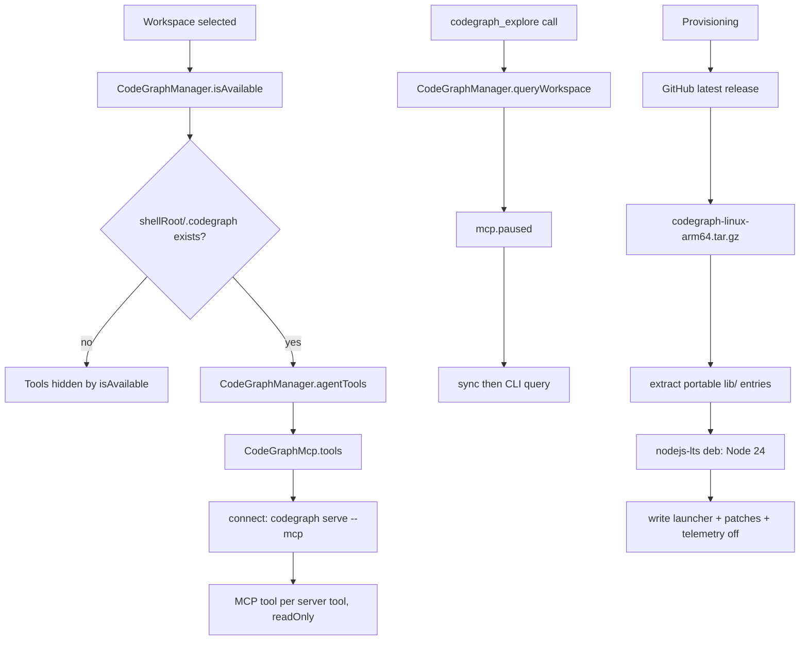

# CodeGraph, Repo Map, and Code Search

> Per-workspace code intelligence: a vendored CodeGraph runtime, five agent tools, an MCP tool surface, and a lightweight symbol map injected into the system prompt.

CodeGraph provides symbol lookup, caller and callee paths, impact analysis, and affected-test discovery for an indexed workspace. `CodeGraphManager` owns the runtime lifecycle (install, update, uninstall, launch) and the workspace commands. `CodeGraphMcp` exposes the runtime's own MCP tools to the agent. `RepoMapCache` and `RepoMapGenerator` build a separate, dependency-free outline of the project from regex symbol extraction and inject it into the system prompt.

## Module Responsibilities

- **`CodeGraphManager`**: version state, install/update from GitHub releases, Node runtime provisioning, launcher and bundle patching, workspace index commands, and query execution.
- **`CodeGraphCommands`**: the exact CLI strings (`init`, `sync`, `index`, `uninit`, `explore`, `node`, `impact`, `affected`, `version`) with argument quoting and depth and limit clamping.
- **`CodeGraphProvision`**: release metadata resolution across six sources, checksum lookup, asset selection, telemetry-off config, and archive path filtering.
- **`CodeGraphMcp`**: an app-owned stdio MCP connection that starts `codegraph serve --mcp` in the workspace root and adapts each server tool to a read-only `Tool`.
- **`CodeGraphBundlePatches`**: exact-text patches applied to the extracted JavaScript bundle, with fallback anchors for older patch generations.
- **`CodeGraphTools`**: the static tool wrappers `codegraph_explore`, `codegraph_node`, `codegraph_impact`, `codegraph_affected`, `codegraph_sync`.
- **`RepoMapCache` / `RepoMapGenerator` / `RepoSymbolExtractor`**: file walking, per-file symbol caching, tiered outline generation, and the regex extractors for Kotlin/Java, Python, JS/TS, and shell.

## Architecture and Flow

Provisioning deliberately avoids npm. Android reports `process.platform == "android"`, so the npm shim asks for `codegraph-android-arm64`, which is never published. Harness downloads the linux-arm64 release archive, keeps only `lib/` entries that carry no platform assumption (dropping `lib/kernel/`, `.map`, and `.d.ts`), and installs the Termux `nodejs-lts` package to supply Node 24.

Runtime layout under the app prefix is fixed by getters: `bin/codegraph` (launcher), `codegraph/node/bin/node`, `codegraph/bundle/lib/dist` (the JavaScript), and `codegraph/bundle.pristine/lib/dist` (an unpatched snapshot). The version marker is `.harness-codegraph-version` in the prefix root.

## Invocation Chain

1. `ToolRegistry.default` registers the five static CodeGraph tools at `app/src/main/java/com/androidharness/app/tools/Tool.kt:150-154`.
2. `WorkspaceToolRouting.available` consults each tool's `isAvailable(ctx)` override, which delegates to `CodeGraphManager.isAvailable(workspace)` (`tools/CodeGraphTools.kt:13`).
3. `CodeGraphManager.isAvailable` (`data/env/CodeGraphManager.kt:376-381`): SSH workspaces return true; local workspaces require `linuxEnv.isReady`, `bin/codegraph` existing, and `shellRoot/.codegraph` being a directory. It also calls `ensureLauncherCurrent()`.
4. `codegraph_explore` executes `codeGraph.explore` (`CodeGraphManager.kt:542`), which calls `queryWorkspace` (860).
5. `queryWorkspace` checks `requireIndexed` (993), then runs inside `mcp.paused` (36): a `sync` first, then the query, both with a 180 second timeout and an 80,000 character cap.
6. Workspace mutations (`init`, `sync`, `index`, `uninit`) enter `workspaceCommand` (876), which sets `CodeGraphRunState` and runs `runWithProgress` (910).
7. The MCP tool surface is assembled by `CodeGraphMcp.tools` (`data/env/CodeGraphMcp.kt:84`) and merged into the run's tool list by `McpManager` at `tools/mcp/McpManager.kt:354`, only when automatic command execution is allowed.
8. Repo map: `RunManager` reads `repoMapEnabled` (`agent/RunManager.kt:585`) and passes it into `AgentEngine`; `AgentEngine.systemPrompt` calls `repoMap?.getMap(workspace, maxChars = 10_000)` at `agent/AgentEngine.kt:2315` and appends the result under `# Repository Map (codebase index)` (2317-2318).

## Key State and Data Structures

- **`CodeGraphState`** (`CodeGraphManager.kt:290-301`): `version`, `latest`, `busy`, `action`, `message`, `failed`, plus a derived `updateAvailable` that compares versions through `CodeGraphProvision.isNewer`. Exposed as a `StateFlow` (`state`, line 363).
- **`CodeGraphRunState`** (`CodeGraphManager.kt:310-315`): `busy`, `action`, `message`, `failed`. Kept apart from install state so a sync's progress appears in the workspace card, not the install card.
- **`CodeGraphCommandResult`** (`CodeGraphManager.kt:303`): `ok` plus combined stdout and stderr. `ok` requires both `!timedOut` and `exitCode == 0` (1031-1045).
- **`CodeGraphBundlePatches.Result`** (`data/env/CodeGraphPatches.kt:68-70`): `applied` and `unresolved` path lists. `changed` is true when anything applied.
- **`CodeGraphBundlePatches.Patch`** (46-66): `relativePath`, `anchor`, `replacement`, `fallbackAnchors`, `fallbackReplacements`, `satisfiedMarkers`, `requiresMarker`. `VERSION = 12` gates the patch generation; `patchedFiles` lists 12 bundle files.
- **`FileEntry` / `SymbolInfo`** (`repomap/RepoMapGenerator.kt:3-6`, `repomap/RepoSymbolExtractor.kt:5-10`): `relPath` with symbols; each symbol has `name`, `kind`, `signature`, `line`.
- **Progress log**: `.harness-progress.log` (`CODEGRAPH_PROGRESS_LOG`) is written inside `.codegraph` once it exists, otherwise beside the workspace root. The app polls it every 400 ms and keeps the last 2,000 characters; each read pulls at most 64,000 bytes from the previous offset.

## Boundary Conditions

- **Query serialization.** `CodeGraphMcp` holds a `Mutex` around every tool call and every `paused` block (23-40). Install and uninstall run inside `busy` (1006), which uses `mcp.paused`, so no CLI run overlaps an install.
- **Idle retirement.** After a tool call, `retireWhenIdle` (42-48) schedules `close()` after five minutes. The next call reconnects with a 30 second handshake timeout.
- **Timeout budget.** Queries and workspace commands use 180 seconds by default; reindex uses 300 seconds (536-537). The HTTP client uses a 30 minute call timeout for the roughly 130 MB archive, while metadata lookups use a 20 second call timeout (328-343).
- **Checksum and path safety.** Downloads hash with SHA-256 and delete the file on mismatch (643-671). `portablePath` rejects any entry whose segments include `.` or `..` before dropping the archive's top-level directory, so a crafted path cannot escape the destination (273-287).
- **Patch convergence.** Every patch is idempotent because its replacement text also acts as the applied marker. A patch whose anchors all miss lands in `unresolved`; `ensureBundlePatched` (795) then restores the affected files from `bundle.pristine` and retries once.
- **Version verification.** `installOrUpdate` runs `codegraph version` after provisioning and refuses to record a version it cannot parse (434-450). A failed refresh deletes the marker (383-406).
- **Repo map limits.** `RepoMapCache.getMap` walks at most 200 files (`repomap/RepoMapCache.kt:31`), `RepoSymbolExtractor.extract` caps at 40 symbols per file (`RepoSymbolExtractor.kt:30`), and signatures longer than 90 characters are truncated (55). `RepoMapGenerator.generate` has three tiers under `maxChars` and falls back to a hard truncation with `... (more files)` (17-36).
- **Repo map gating.** The map is skipped when `repoMapEnabled` is false, and for multi-workspace chats `AgentEngine` passes `repoMapEnabled = false` explicitly (`agent/AgentEngine.kt:2203`). It is also skipped when the workspace permissions include `ask` or `deny` and full access is off (2313).
- **SSH path.** SSH workspaces bypass local installation checks (`isAvailable` returns true) and run `test -d .codegraph && <command>` on the host. If the host lacks CodeGraph or the index, the error text says so.

## Extension Points

- Settings toggles: `setRepoMapEnabled` writes the `repo_map_enabled` preference (`data/SettingsRepository.kt:338`, 975), exposed in the agent settings catalog as `repo_map` (`ui/settings/AgentSettingsCatalog.kt:257-259`).
- The Code intelligence settings section calls `initWorkspace`, `syncWorkspace`, `reindexWorkspace`, and `disableWorkspace` directly (`ui/settings/SettingsScreen.kt:854-888`).
- `CodeGraphProvision` is the single place for release URLs and asset names if the upstream repository or bundle layout changes.
- `CodeGraphBundlePatches.patchedFiles` defines which bundle files are snapshotted for self-heal; adding a patch means extending that list and bumping `VERSION`.
- `RepoMapCache.INDEXABLE_EXTENSIONS` (`RepoMapCache.kt:64-67`) controls which files enter the map.

## Known gaps

- `tools/SearchBackends.kt` does not contain code-indexing logic. It implements web search backends (`KeylessSearchBackend`, `BraveApiBackend`, `TavilyApiBackend`) and `WebResultCache` (`SearchBackends.kt:113-541`). Repository text search is performed separately by `SearchFilesTool` (`tools/FileTools.kt:501`) and `GrepTool` (`FileTools.kt:767`), not by CodeGraph.
- The repo map is intentionally shallow: it extracts declaration lines only. It has no call graph, no cross-file resolution, and no relation to the CodeGraph index.

Sources: [app/src/main/java/com/androidharness/app/data/env/CodeGraphManager.kt](../app/src/main/java/com/androidharness/app/data/env/CodeGraphManager.kt)#L288-L1051), [app/src/main/java/com/androidharness/app/data/env/CodeGraphMcp.kt](../app/src/main/java/com/androidharness/app/data/env/CodeGraphMcp.kt)#L23-L122), [app/src/main/java/com/androidharness/app/data/env/CodeGraphPatches.kt](../app/src/main/java/com/androidharness/app/data/env/CodeGraphPatches.kt)#L25-L1637), [app/src/main/java/com/androidharness/app/tools/CodeGraphTools.kt](../app/src/main/java/com/androidharness/app/tools/CodeGraphTools.kt)#L10-L113), [app/src/main/java/com/androidharness/app/repomap/RepoMapCache.kt](../app/src/main/java/com/androidharness/app/repomap/RepoMapCache.kt)#L8-L70), [app/src/main/java/com/androidharness/app/repomap/RepoMapGenerator.kt](../app/src/main/java/com/androidharness/app/repomap/RepoMapGenerator.kt)#L8-L93), [app/src/main/java/com/androidharness/app/repomap/RepoSymbolExtractor.kt](../app/src/main/java/com/androidharness/app/repomap/RepoSymbolExtractor.kt)#L12-L123), [app/src/main/java/com/androidharness/app/agent/AgentEngine.kt](../app/src/main/java/com/androidharness/app/agent/AgentEngine.kt)#L2313-L2319)

## Source files

- `app/src/main/java/com/androidharness/app/tools/CodeGraphTools.kt`
- `app/src/main/java/com/androidharness/app/data/env/CodeGraphManager.kt`
- `app/src/main/java/com/androidharness/app/data/env/CodeGraphMcp.kt`
- `app/src/main/java/com/androidharness/app/data/env/CodeGraphPatches.kt`
- `app/src/main/java/com/androidharness/app/repomap/RepoMapCache.kt`
- `app/src/main/java/com/androidharness/app/repomap/RepoMapGenerator.kt`
- `app/src/main/java/com/androidharness/app/repomap/RepoSymbolExtractor.kt`
- `app/src/main/java/com/androidharness/app/tools/SearchBackends.kt`
- `app/src/main/java/com/androidharness/app/tools/mcp/McpManager.kt`
