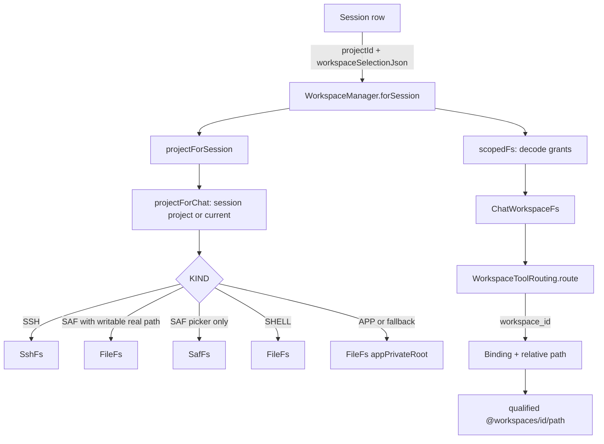

# Workspace Manager and Routing

> Maps projects to filesystem backends, persists per-chat workspace grants, and decides which backend a tool call reaches.

`WorkspaceManager` owns the project model (a row in the `projects` table), converts each project into a `WorkspaceFs`, and resolves the workspace set for a chat from its saved selection. `ChatWorkspaces.kt` defines that selection, including primary and read-only grants, and the composite filesystem that enforces them. `WorkspaceToolRouting` performs the per-call routing. `ProjectDeletion` and `StorageManager` consume the same project list for deletion and storage accounting.

## Module Responsibilities

- **`WorkspaceManager`**: default app workspace creation, project CRUD, chat assignment, selection validation, backend construction (`fsFor`), duplicate detection, SAF permission release, and path assessment.
- **`ChatWorkspaceSelection` / `ChatWorkspaceGrant`**: serializable per-chat grant list with a primary workspace.
- **`ChatWorkspaceFs`**: a `WorkspaceFs` over bindings. It never exposes a real `shellRoot`, enforces read-only flags on every mutation, and qualifies paths with `@workspaces/<id>/`.
- **`ChatWorkspaceBinding`**: `id`, `name`, `canEdit`, and the backing `WorkspaceFs`.
- **`ProjectDeletion`**: preview and guarded deletion of a project plus its chats and automation tasks.
- **`StorageManager`**: derives scan roots from `fsFor(project).shellRoot` and holds all work gates before cleaning.
- **`StorageAccess`**: only relevant here because `isGranted` decides whether a shared-storage path can run in the app tier; the full permission ladder is covered on the storage access page.

## Architecture and Flow

`WorkspaceManager.currentProject` takes the first project from `projectsFlow()`, creating the app workspace if none exists (`ensureDefaultProject`, 154-166). `current` maps that to a `WorkspaceFs`. `projectForChat` is the isolation boundary: a null `sessionId` uses the recent project, while an existing chat reads its own `projectId` and never inherits a later change to the recent project. A chat with a null project is bound once with `bindSessionProject` (62-72), which only updates rows where `projectId IS NULL`.

`scopedFs` (111-124) is where a saved grant list becomes a live filesystem. It rejects a selection whose `primaryId` no longer matches the chat's project, rejects missing projects, and rejects a `SHELL` project whose directory vanished. The returned `ChatWorkspaceFs` contains one binding per grant.

## Invocation Chain

1. `AgentEngine` asks `RunManager` for the run workspace; `RunManager` calls `workspace.forSession(sessionId)` (`agent/RunManager.kt`), which resolves `projectForSession` and then `scopedFs` (`workspace/WorkspaceManager.kt:105-110`).
2. Tool schemas gain a `workspace_id` enum in `WorkspaceToolRouting.schema` (`tools/WorkspaceToolRouting.kt:26-42`) when the workspace is a `ChatWorkspaceFs`.
3. On execution, `WorkspaceToolRouting.route` (`WorkspaceToolRouting.kt:43-69`) reads `workspace_id`, validates the binding, checks `hasReadOnly`, and returns a `Route` whose `path(path)` prefixes the id.
4. File tools receive `selected.fileAccess(binding)` (`ChatWorkspaces.kt:94-108`), which preserves the grant on every node operation. Executable tools receive `binding.fs` so shell and Git run against the real path or SSH host.
5. `WorkspaceManager.assignSelection` (126-131) validates and saves; `assignWorkspaces` in `RunManager` holds `workspaceGuard` and blocks while a task or subagent is active (`agent/RunManager.kt:164-179`).
6. `RunManager.assignWorkspace` (149-157) likewise refuses to change a chat's single workspace when checkpoints or file changes exist.
7. `ProjectDeletion.preview` (18-36) and `delete` (38-57) run before project rows are removed. `WorkspaceManager.deleteProject` (247-258) refuses to delete a project that still has chats.
8. `StorageManager.layout` (36-87) iterates `container.workspace.projects.first()` and takes `fsFor(project).shellRoot` as a scan root.

## Key State and Data Structures

- **`ProjectEntity`** (`data/db/Database.kt:111-117`): `id`, `name`, `kind`, `uri`, `lastUsedAt`. The comment says `"APP" or "SAF"`, but the code also uses `SHELL` and `SSH` (`WorkspaceManager.kt:393-396`). `uri` holds an absolute path for `SHELL`, a tree URI for `SAF`, and serialized `SshLocation` JSON for `SSH`.
- **`ChatWorkspaceSelection`** (`ChatWorkspaces.kt:14-31`): `primaryId` plus a non-empty, distinct `grants` list; the primary must be one of the grants. Serialized into `sessions.workspaceSelectionJson`; `null` means a legacy single-workspace chat.
- **`ChatWorkspaceFs`** (`ChatWorkspaces.kt:36-168`): `bindings`, `primary`, `hasReadOnly`, and `localRoots`, a map of binding id to canonical `Path` captured at construction. `shellRoot` is always null (line 45), which prevents `Full access` from substituting an unbounded filesystem.
- **Reserved prefix**: `PREFIX = "@workspaces"` (line 167). Saved checkpoint and file-change paths are rewritten to `@workspaces/<projectId>/<relative>` when a legacy chat gains a selection (`Database.kt:318-333`).
- **`ProjectDeletionPreview`** (`workspace/ProjectDeletion.kt:10-15`): `project`, `chatIds`, `automationIds`, `blocker`.
- **`StorageInventory`** (`data/storage/StorageManager.kt:14-22`): report, managed tools, protection map, cleanup candidates. `StorageManager.last` is a `StateFlow` of the previous scan so the UI can keep showing it during a rescan.

## Boundary Conditions

- **Read-only grants.** `ChatWorkspaceFs.BoundNode.edit` checks `binding.canEdit` before write, mkdir, delete, rename, or create (`ChatWorkspaces.kt:125`). `WorkspaceToolRouting.route` also rejects non-read-only tools against a read-only binding, and rejects every non-file tool when any binding is read-only (lines 56-59).
- **Containment.** `checkLocalPath` re-canonicalizes the backing root and compares it with the captured path, then requires the target's canonical path to start with that root (`ChatWorkspaces.kt:110-116`). A symlink or replaced directory cannot escape.
- **Path syntax.** `key` requires a relative path, rejects `..` segments and paths that already start with `@workspaces/`, and requires the id to be selected (`ChatWorkspaces.kt:54-60`). `target` accepts either a bare relative path (primary binding) or `@workspaces/<id>/<path>`.
- **Overlap.** `validateSelection` rejects any two bindings whose `workspacePaths()` overlap, including ancestor and descendant directories (`WorkspaceManager.kt:133-145`, `ChatWorkspaces.kt:170-176`). `RunManager.workspaceBusy` applies the same overlap test to concurrent runs.
- **Saved changes.** Adding or changing workspaces is refused when the chat has saved file changes unless the primary and all prior grants are retained (`RunManager.kt:172-176`). Legacy path qualification also refuses absolute paths, `..`, and reserved prefixes before rewriting (`Database.kt:318-331`).
- **Deletion preconditions.** `ProjectDeletion.preview` blocks the app workspace, projects whose chats live in another project, and projects with running or pending runs. `delete` re-runs `preview`, checks that chat ids, automation ids, and the project row are unchanged, then performs cleanup in `NonCancellable` (`ProjectDeletion.kt:38-56`). The DAO additionally requires every related chat to belong to the project and the expected id set to match (`Database.kt:341-352`).
- **App workspace permanence.** `WorkspaceManager.deleteProject` returns early for `KIND_APP`, and `deleteProjectAndChats` requires `kind != "APP"`.
- **Storage concurrency.** `StorageManager.withIdle` nests `runManager.withIdleStorage`, `backgroundProcesses.withIdleStorage`, and `terminal.withClosedStorage` (`StorageManager.kt:143-145`), so no task, background shell, or terminal session can start while a clean or toolchain uninstall runs. Package cleanup additionally holds `env.withPackageStorageLock`.
- **Scan gaps.** SSH projects become `StorageGap.SSH_HOST`, SAF-only projects become `StorageGap.SAF_FOLDER`, unreadable or missing roots get `PERMISSION_DENIED` or `MISSING`, and no scan root is registered for them (`StorageManager.kt:41-53`).

## Workspaces and Projects

The names in the code are older than the model. A row in the `projects` table (`ProjectEntity`) is a **workspace**: one folder with one backend. `projectId` on a session, in a grant and in a route argument always means a workspace id. A **project** in the product sense is a `WorkProjectEntity` row in `work_projects`: an id, a name, a creation time and `selectionJson`, which is an encoded `ChatWorkspaceSelection` (the grant list plus the main workspace).

- **Normal chat.** `sessions.workProjectId` is null and the chat has one workspace. `assignSelection` stores a selection of one editable grant as a plain `projectId` with no selection JSON, unless the chat already has saved `@workspaces/` paths that need the JSON to resolve.
- **Project chat.** `sessions.workProjectId` points at the project and the chat carries a copy of the project's selection. `RunManager.createProjectChat` creates one, `moveChatToProject` files an existing chat, and `assignProjectWorkspaces` saves an edited selection to the project and applies it to every chat in it. That call is all or nothing: it computes the change for every chat first and refuses if any of them is running.
- **Adding a folder.** `addSafProject`, `addPickedFolder`, `addShellProject` and `addSshProject` insert a workspace row and nothing else. No project is created by any of them.
- **Adoption.** `adoptUnfiledChats`, launched once from `HarnessApp` at startup, takes each chat that has selection JSON with more than one grant and no `workProjectId`, creates a project named after its main workspace plus the number of other folders, and files the chat under it. Chats with the same grants and main workspace share one project. It is idempotent, so it also repairs a run that was interrupted.
- **Deletion.** `RunManager.deleteWorkProject` deletes the project row and its chats and returns their ids. Workspace rows and files are not touched. Deleting a workspace still goes through `ProjectDeletion`.

The UI follows the same split. `WorkspaceSwitcher` (`ui/chat/components/WorkspaceSwitcherSheet.kt`) lists workspaces for a normal chat and offers New project and Move to a project. For a project chat it shows the project and opens `ProjectEditorSheet`, the only place where membership changes. `WorkProjectsScreen` and `WorkProjectScreen` (`ui/projects/WorkProjectsScreen.kt`) are the project list and page. `ProjectsScreen` and `ProjectScreen` are the workspace list and page.

## Extension Points

- New backend kinds: add a constant to `WorkspaceManager.Companion` (393-396), a branch in `fsFor` (167-181), a label in `describe` (328-367), and a dedupe rule in `dedupeKey` (421-429).
- New project creation flows: `addSafProject`, `addPickedFolder`, `addSshProject`, and `addShellProject` all funnel through `dao.insertProject` and optional `setActiveProject`.
- `dedupeKey` makes a SAF folder that maps to a real path collide with the same path added as a `SHELL` project, so the same folder cannot be added twice through different doors.
- Tool routing can be extended by adding names to `WorkspaceToolRouting.fileTools` or `independentTools`; file tools receive grant-preserving nodes, independent tools bypass workspace binding entirely.

## Known gaps

- Deleting a workspace does not remove its grant from a project that includes it. The project editor shows the grant as an unavailable workspace until the user removes it.

- None of the routing code verifies that a `SHELL` project path still exists at tool time beyond the `scopedFs` directory check and per-node existence checks. A folder removed while a chat is open surfaces as a tool error, not a selection invalidation.

Sources: [app/src/main/java/com/androidharness/app/workspace/WorkspaceManager.kt](../app/src/main/java/com/androidharness/app/workspace/WorkspaceManager.kt)#L39-L436), [app/src/main/java/com/androidharness/app/workspace/ChatWorkspaces.kt](../app/src/main/java/com/androidharness/app/workspace/ChatWorkspaces.kt)#L10-L176), [app/src/main/java/com/androidharness/app/workspace/ProjectDeletion.kt](../app/src/main/java/com/androidharness/app/workspace/ProjectDeletion.kt)#L10-L57), [app/src/main/java/com/androidharness/app/data/storage/StorageManager.kt](../app/src/main/java/com/androidharness/app/data/storage/StorageManager.kt)#L14-L163), [app/src/main/java/com/androidharness/app/tools/WorkspaceToolRouting.kt](../app/src/main/java/com/androidharness/app/tools/WorkspaceToolRouting.kt)#L9-L69), [app/src/main/java/com/androidharness/app/data/db/Database.kt](../app/src/main/java/com/androidharness/app/data/db/Database.kt)#L111-L117)

## Source files

- `app/src/main/java/com/androidharness/app/workspace/WorkspaceManager.kt`
- `app/src/main/java/com/androidharness/app/workspace/ChatWorkspaces.kt`
- `app/src/main/java/com/androidharness/app/workspace/ProjectDeletion.kt`
- `app/src/main/java/com/androidharness/app/data/storage/StorageManager.kt`
- `app/src/main/java/com/androidharness/app/data/env/StorageAccess.kt`
- `app/src/main/java/com/androidharness/app/tools/WorkspaceToolRouting.kt`
- `app/src/main/java/com/androidharness/app/agent/RunManager.kt`
- `app/src/main/java/com/androidharness/app/data/db/Database.kt`
