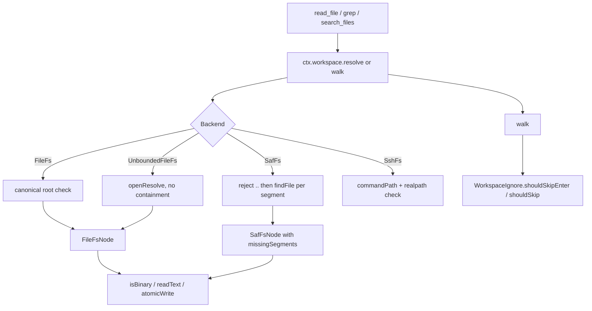

# Virtual File System, SAF, and Ignore Filters

> A single filesystem interface over real directories, full-access paths, SSH trees, and Android SAF document trees, with containment, binary detection, and crawl pruning.

`WorkspaceFs` and `FsNode` are the only filesystem surface the file tools use. `FileFs` backs app-private and device paths, `UnboundedFileFs` removes containment for Full access mode, `SafFs` backs a tree URI from the system picker, and `SshFs` backs a remote host. `WorkspaceIgnore` prunes build and dependency directories during `walk`, so grep and search do not crawl `.git` or `node_modules`.

## Module Responsibilities

- **`WorkspaceFs`**: `displayPath`, `shellRoot` (nullable, so remote and SAF trees never reach `java.io.File`), `isSaf`, `resolve(path)`, `walk(path)`.
- **`FsNode`**: metadata (`relPath`, `name`, `exists`, `isDirectory`, `isFile`, `length`, `fileType`), reads (`list`, `readText`, `openInputStream`, `isBinary`), and mutations (`writeText`, `writeBytes`, `writeFrom`, `mkdirs`, `delete`, `renameTo`, `createFile`, `createDir`).
- **`FileFs` / `FileFsNode`**: real-filesystem backend with canonical-root containment and atomic writes.
- **`UnboundedFileFs`**: same node type without the containment guard, used when Full access mode is on.
- **`SafFs` / `SafFsNode`**: `DocumentFile` backend that supports not-yet-existing trailing path segments.
- **`SafPathResolver`**: maps a tree URI back to a real path when the provider is external storage or Downloads, which lets the picker upgrade to `FileFs`.
- **`WorkspaceIgnore`**: the fixed directory deny set and the two skip predicates used by every `walk`.
- **Helpers**: `readUtf8ForEdit`, `normalizeRelPath`, `isBinaryStream`, `isNameTooLong`, `longFilenameGuidance`.

## Architecture and Flow

Resolution and traversal are separate contracts. `resolve` returns a node even for a path that does not exist, so write tools can create it, but both `walk` implementations throw `ToolFailure("Path does not exist")` for a missing start. `FileFs.walk` uses `walkTopDown`, enters directories unless `shouldSkipEnter` says no, and includes directories in its output while filtering ignored files. `SafFs.walk` is a breadth-first queue that yields only files, skipping ignored child directories before enqueueing them.

## Invocation Chain

1. `ReadFileTool.execute` (`tools/FileTools.kt:115-140`) calls `ctx.workspace.resolve(path)`, checks `exists`, `isFile`, and `isBinary()`, then enforces the 2 MB no-offset limit before reading.
2. `FileFs.resolve` (`workspace/WorkspaceFs.kt:95-108`): takes `root.canonicalFile.toPath()`, resolves the argument against it, normalizes, and rejects anything that does not start with the root path. Absolute arguments replace the base, so they are rejected unless they point inside the root.
3. `FileFsNode` then serves reads and writes. `atomicWrite` (`WorkspaceFs.kt:192-225`) rejects directories and special files, checks writability, resolves an existing symlink to its target, writes a temp file in the target directory, flushes and fsyncs, copies POSIX permissions when present, and moves atomically with `REPLACE_EXISTING`.
4. `SafFs.resolve` (`WorkspaceFs.kt:320-336`) splits on `/` and `\`, filters empty and `.` segments, rejects any `..`, then walks `DocumentFile.findFile` per segment. Unmatched trailing segments are kept in `missingSegments` for later creation.
5. `SafFsNode.resolveWriteTarget` (`397-435`) creates missing parent directories and then the file, using `mimeFor` to pick a MIME type, and writes with mode `"wt"` to truncate.
6. `WorkspaceManager.writablePickedFolder` calls `SafPathResolver.resolve` and `directFolderOrNull`; a writable real path becomes `FileFs`, otherwise the project stays `SafFs` (`workspace/WorkspaceManager.kt:216-217`).
7. `SafPathResolver.resolve` (`workspace/SafPathResolver.kt:17-21`) reads the tree document id and dispatches on authority: `com.android.externalstorage.documents` maps `primary:` and `home:` to the primary root and other volumes to `/storage/<volume>`, while `com.android.providers.downloads.documents` handles `downloads` and `raw:` IDs. Unknown authorities return null.
8. `walk` pipelines call `WorkspaceIgnore.shouldSkipEnter` in `onEnter` and `WorkspaceIgnore.shouldSkip` on file nodes (`WorkspaceFs.kt:110-120`, `289-298`, `338-358`).

## Key State and Data Structures

- **`FsNode.fileType`** (`WorkspaceFs.kt:35`): derived `"directory"`, `"file"`, or `"special"`; `FileFsNode` overrides it to return `"missing"` when attributes cannot be read (160-162).
- **`FileFsNode`** (`WorkspaceFs.kt:123-265`): holds `file` and the captured `rootPath`. `relPath` is lazy and canonicalizes once; when relativization fails, or yields a path starting with `..`, it falls back to the absolute path so Full access nodes stay readable.
- **`SafFsNode`** (`WorkspaceFs.kt:364-489`): `doc`, `missingSegments`, `allSegments`. `exists` is true only when `missingSegments` is empty and the document exists. `list()` returns an empty list for non-directories.
- **`normalizeRelPath`** (`WorkspaceFs.kt:492-504`): converts backslashes, drops `.` segments and duplicate slashes, preserves a leading slash for absolute paths, and returns `.` for an empty result.
- **`WorkspaceIgnore.DIR_NAMES`** (`workspace/WorkspaceIgnore.kt:9-18`): a fixed set of 24 names, including `.git`, `.svn`, `.hg`, `.codegraph`, `node_modules`, `bower_components`, `build`, `.gradle`, `.idea`, `__pycache__`, `.mypy_cache`, `.pytest_cache`, `.next`, `.nuxt`, `.turbo`, `.cache`, `dist`, `out`, `coverage`, `venv`, `.venv`, `target`, `.dart_tool`, `.terraform`.
- **`isBinaryStream`** (`WorkspaceFs.kt:506-545`): reads at most 1 KB, returns true on any NUL byte, on more than 10 percent control characters excluding tab, newline, and carriage return, or when strict UTF-8 decoding fails. It trims a trailing incomplete multibyte sequence before decoding so a 1 KB cut does not produce a false positive.

## Boundary Conditions

- **Containment.** `FileFs.resolve` normalizes before the prefix check, so `..` cannot climb out. It does not canonicalize the resolved path, so a symlink already inside the root that points outside is not rejected at this layer; `FileFsNode.relPath` then renders it as an absolute path. `ChatWorkspaceFs.checkLocalPath` adds canonical comparison for per-chat grants, and `SshFs.commandPath` plus `checked` reject remote paths and symlinks that leave the selected tree.
- **Special files.** `atomicWrite` refuses writes to directories and to anything that exists and is not a regular file ("special files are not supported"). Reads of non-files return null from `openInputStream`; `ReadFileTool` rejects them earlier with `isFile`.
- **Binary refusal.** `ReadFileTool` refuses binary content with `Cannot read <path>: binary file (not text)`. `FileInfoTool` reports `isBinary` and a trailing newline value of `none (binary)` instead of counting lines. `GrepTool` skips binary files and records them in its skipped list (`FileTools.kt:845-848`). Search skips files larger than 2 MB.
- **Strict edit decoding.** `readUtf8ForEdit` (`WorkspaceFs.kt:69-81`) decodes with `CodingErrorAction.REPORT` and refuses any file that is not valid UTF-8, so an edit never round-trips undecodable bytes through replacement characters.
- **SAF availability.** `requireRoot` refuses a tree that is no longer writable with "The picked workspace folder is no longer accessible". SAF `delete` and `renameTo` return the provider's boolean; there is no parent-directory fixup and no POSIX permission model.
- **Name limits.** `isNameTooLong` checks exception causes for `ENAMETOOLONG` and measures each segment in UTF-8 bytes, flagging 250 or more. `longFilenameGuidance` tells the user to rename it with a shell `mv`.
- **Ignore semantics.** `shouldSkipEnter` does not skip an ignored directory when that directory appears in the walk's start path, so an explicit search inside `node_modules` still works. `shouldSkip` compares only segments below the start path. `list_dir` is unaffected and still shows ignored directories.
- **Backend asymmetry.** `FileFs.walk` emits directories and files except ignored files. `SafFs.walk` emits only files. `UnboundedFileFs.walk` mirrors `FileFs` but starts from an arbitrary canonical path.
- **MIME creation.** SAF file creation uses `text/plain` for source and config extensions, `text/html`, `text/css`, and `application/octet-stream` otherwise. A wrong MIME type can make some providers refuse later writes.

## Extension Points

- Add a backend by implementing `WorkspaceFs` and returning it from `WorkspaceManager.fsFor`. Routing already treats `shellRoot == null` as non-shell, and `isSaf` drives UI wording.
- `WorkspaceIgnore.DIR_NAMES` is the single place to prune a new ecosystem directory; all four walk sites pick it up.
- `isBinaryStream` is shared by `FileFsNode.isBinary`, `SafFsNode.isBinary`, and the file-info scanner, so detection changes apply everywhere.
- `UnboundedFileFs` is selected by the execution path when Full access mode is active; it still delegates `displayPath` and `shellRoot` to the original root.

## Known gaps

- `WorkspaceIgnore` does not read `.gitignore`, `.harnessignore`, or any per-project ignore file. The deny set is hard-coded. No parsing code was found in `workspace/` or `tools/`.
- `FileFs` does not call `isSymbolicLink` during traversal or resolution. Symlink refusal exists in `SshFs.checked` and in `ShellPolicy` for shell-created links, not in the local VFS.

Sources: [app/src/main/java/com/androidharness/app/workspace/WorkspaceFs.kt](../app/src/main/java/com/androidharness/app/workspace/WorkspaceFs.kt)#L13-L571), [app/src/main/java/com/androidharness/app/workspace/SafPathResolver.kt](../app/src/main/java/com/androidharness/app/workspace/SafPathResolver.kt)#L15-L51), [app/src/main/java/com/androidharness/app/workspace/WorkspaceIgnore.kt](../app/src/main/java/com/androidharness/app/workspace/WorkspaceIgnore.kt)#L7-L48), [app/src/main/java/com/androidharness/app/tools/FileTools.kt](../app/src/main/java/com/androidharness/app/tools/FileTools.kt)#L115-L140), [app/src/main/java/com/androidharness/app/workspace/SshFs.kt](../app/src/main/java/com/androidharness/app/workspace/SshFs.kt)#L12-L55)

## Source files

- `app/src/main/java/com/androidharness/app/workspace/WorkspaceFs.kt`
- `app/src/main/java/com/androidharness/app/workspace/SafPathResolver.kt`
- `app/src/main/java/com/androidharness/app/workspace/WorkspaceIgnore.kt`
- `app/src/main/java/com/androidharness/app/workspace/SshFs.kt`
- `app/src/main/java/com/androidharness/app/tools/FileTools.kt`
- `app/src/main/java/com/androidharness/app/workspace/WorkspaceManager.kt`
