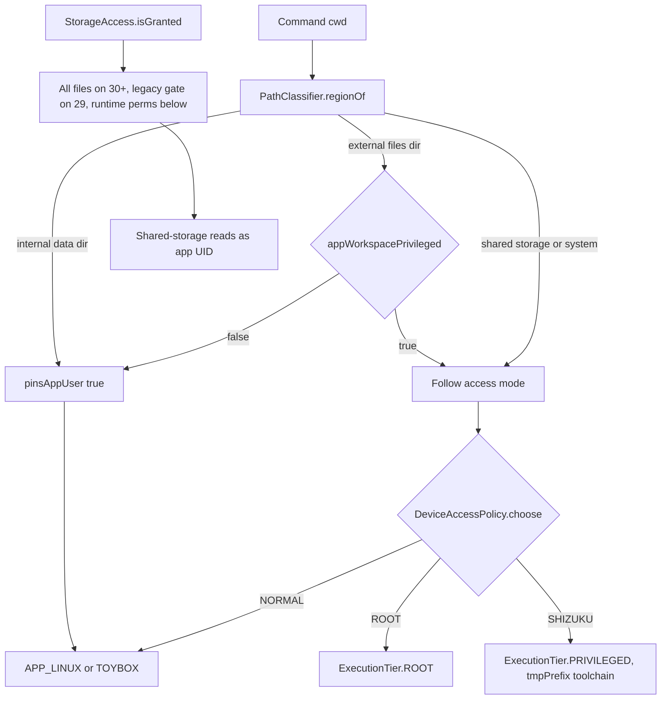

# Storage Access and App Workspace

> The storage permission ladder, the app workspace location, and the shell routing that decides whether app-owned folders run as the app UID or a privileged UID.

Harness reaches files through four different storage stories: its private data directory, the app-owned external files directory that holds the default workspace, shared storage (`/storage/emulated/0`), and the shell-tier deployment under `/data/local/tmp`. `StorageAccess` answers whether broad shared-storage access is available. `WorkspaceManager` places the app workspace and classifies project folders. `DeviceAccessManager` and `ShellTierRouter` decide which UID runs commands in each region, with one setting that opts the app workspace into privileged execution.

## Module Responsibilities

- **`StorageAccess`**: the permission predicate, split by SDK level, plus the runtime permission list.
- **`LinuxEnvironmentManager` storage roots**: app prefix, deployed prefix, caches, scratch directories, shell fallback root, and the internal data root used for region classification.
- **`WorkspaceManager.appPrivateRoot`**: the default app workspace directory and the `APP` project kind.
- **`DeviceAccessStore` / `AccessPreferences`**: device-local access mode and the `appWorkspacePrivileged` flag.
- **`DeviceAccessManager.pinsAppUser`**: forces the app UID for the private data dir and, by default, for app-owned external folders.
- **`ShellTierRouter`**: maps a path region to `ExecutionTier` and attaches a note when access is degraded.
- **`StorageManager`**: derives scan roots from projects and protects workspaces during cleanup.
- **`rememberStorageAccess` / `SystemGrants`**: the in-app grant flow and the intent ladder that opens the OS page.

## Architecture and Flow



Shared storage is reachable by the app UID only with the grant above, but a granted Shizuku shell reaches it without that grant. The tier router prefers `PRIVILEGED` for shared storage and system paths when `shizuku.hasPrivilegedAccess()` is true (`ShellTierRouter.kt:74-83`). When the app UID is used on shared storage without the grant, `permissionNote` attaches a warning that permission errors are expected (`85-103`).

### Permission Ladder

`StorageAccess.isGranted` delegates to an internal overload with four lazy parameters (`data/env/StorageAccess.kt:12-30`):

```kotlin
sdkInt >= 30 -> allFilesAccess()
sdkInt == 29 && !legacyStorage() -> false
else -> runtimePermissions(sdkInt).all(permissionGranted)
```

- **Android 11+ (API 30 and above)**: the only accepted grant is `Environment.isExternalStorageManager()`, which corresponds to the `MANAGE_EXTERNAL_STORAGE` permission declared at `app/src/main/AndroidManifest.xml:58`.
- **Android 10 (API 29)**: `requestLegacyExternalStorage="true"` is set in the manifest (line 68). If legacy storage is off, the predicate returns false even if runtime permissions are present. If legacy storage is on, the runtime permission check applies.
- **Android 8 and 9 (API 26 to 28)**: both `READ_EXTERNAL_STORAGE` and `WRITE_EXTERNAL_STORAGE` must be granted. The lambdas are not invoked on these levels because `isExternalStorageManager` and `isExternalStorageLegacy` do not exist there (`StorageAccess.kt:22`).
- **Runtime list**: `runtimePermissions` returns an empty array at API 30 and above, otherwise the read and write pair (`StorageAccess.kt:32-38`). The manifest caps `WRITE_EXTERNAL_STORAGE` at SDK 29 and `READ_EXTERNAL_STORAGE` at SDK 32 (`AndroidManifest.xml:59-64`).

The UI flow in `rememberStorageAccess` (`ui/common/StorageAccessState.kt:31-75`) refreshes on `ON_RESUME`. Its `request` first opens the all-files settings page when the SDK is 30 or above or access is already granted. Below 30 it requests runtime permissions, and if a permission is permanently denied it falls back to the settings page. `SystemGrants.openAllFilesAccess` (`ui/common/SystemGrants.kt:54-68`) tries `ACTION_MANAGE_APP_ALL_FILES_ACCESS_PERMISSION` with the package URI, then the global all-files page, then app details. Below 30 it goes straight to app details because the all-files page does not exist.

### Storage Roots

| Root | Path | Purpose |
| --- | --- | --- |
| `linuxEnv.prefix` | `filesDir/linux` | Installed Linux toolchain, launcher, CodeGraph bundle (`data/env/LinuxEnvironment.kt:305`) |
| `linuxEnv.tmpBase` / `tmpPrefix` | `/data/local/tmp/androidharness/<packageName>` and `/linux` | Per-build copy deployed for the shell UID (`308-309`, `1861`) |
| `linuxEnv.marker` | `filesDir/linux/.harness-installed` | Installed package list (`311`) |
| `linuxEnv.tempDir` | `cacheDir/deb-download` | Package downloads (`313`) |
| `linuxEnv.sharedCacheRoot` | `filesDir/package-cache` | npm and pip caches, outside the staging archive (`315`) |
| `linuxEnv.shellFallbackRoot` | `getExternalFilesDir(null)/shell-workspace` | Real cwd for SAF workspaces, shared with the shell UID (`327-338`) |
| `linuxEnv.internalDataRoot` | `context.dataDir` | `/data/user/0/<pkg>`, unreachable by the shell UID (`341`) |
| `linuxEnv.appPrivateScratch` | `filesDir/.harness-scratch` | Exec-capable scratch for this app UID (`998`) |
| `WorkspaceManager.appPrivateRoot` | `(externalFilesDir ?: filesDir)/workspace` | Default app workspace (`workspace/WorkspaceManager.kt:44-47`) |
| `ShellPolicy.SCRATCH_TMP` | `/data/local/tmp/androidharness-scratch` | Shell-owned scratch, mode 0700 (`tools/ShellPolicy.kt:642`) |

The constructor `init` block resets `dataDir` and `filesDir` to 0700 (`LinuxEnvironment.kt:347-348`), then provisions TLS, scratch, and GitHub credentials. `ensureScratchDirs` (`980-994`) creates the tmp scratch, chmods it to 0700, and creates the app-private scratch.

### App Workspace Mode

The `APP` project kind is created by `ensureDefaultProject` with `uri = null` and the label "App workspace" (`WorkspaceManager.kt:154-166`). `fsFor` falls through every kind check to `FileFs(appPrivateRoot)` (`167-181`). Despite the name, the directory lives under the external files directory, so the app UID can read and write it without any storage grant, and it is removed when the app is uninstalled.

For shell routing, two classifiers cooperate:

- `ShellTierRouter.regionOf` passes both `internalDataRoot` and `getExternalFilesDir(null)`, so both the internal data dir and the app external files dir classify as `APP_DATA` (`data/env/ShellTierRouter.kt:96-100`, `PathClassifier` at 12-20).
- `DeviceAccessManager.pinsAppUser` first pins the private data dir unconditionally, then pins app-owned external folders unless `appWorkspacePrivileged` is true (`data/env/DeviceAccessManager.kt:179-182`).

`resolveTier` sends `APP_DATA` to `APP_LINUX` or `TOYBOX` regardless of Shizuku state (`ShellTierRouter.kt:68-84`). The privilege path is the `DeviceAccessManager` route: when `appWorkspacePrivileged` is on, `pinsAppUser` returns false for the app workspace and the selected backend runs the command. `liveTier` maps `ROOT` to `ROOT`, `SHIZUKU` to `PRIVILEGED`, and anything else to `APP_LINUX` or `TOYBOX` (`DeviceAccessManager.kt:184-188`).

The setting is stored per device, not in portable settings, in the `device_access` DataStore under the key `app_workspace_privileged`, default false (`data/env/DeviceAccessStore.kt:17`, `24`, `30`). The toggle appears in `RootAccessSection` and is disabled when the access mode is `NORMAL` (`ui/settings/RootAccessSection.kt:123-132`). Its copy states the exact behavior: when off, app workspace commands run as the app user even with Wireless ADB, Shizuku, or root connected; when on, they follow the access mode, but the app's private data folder still uses the app user.

## Invocation Chain

1. Settings and setup call `rememberStorageAccess`, whose `request` reaches `SystemGrants.openAllFilesAccess` or launches `StorageAccess.runtimePermissions()`.
2. `LinuxEnvironmentManager` exposes `storageAccessGranted` as `StorageAccess.isGranted(context)` (`LinuxEnvironment.kt:342`); `AgentEngine` writes it into the environment block (`agent/AgentEngine.kt:2399`).
3. `ShellTierRouter.isAllFilesAccess` uses the same predicate (`ShellTierRouter.kt:66`).
4. A shell call enters `DeviceAccessManager.execute` with `appWorkspace = access.pinsAppUser(cwd)` (`ShellTierRouter.kt:118-126`), which passes the pinned flag into `DeviceAccessPolicy.choose`.
5. `StorageManager.layout` enumerates `container.workspace.projects.first()` and resolves each root through `fsFor(project).shellRoot` (`data/storage/StorageManager.kt:36-60`). The app workspace therefore appears as `externalFilesDir/workspace`.
6. `StorageManager.clean` runs under `runManager.withIdleStorage`, `backgroundProcesses.withIdleStorage`, and `terminal.withClosedStorage` (`143-145`).

## Key State and Data Structures

- **`AccessPreferences`** (`data/env/DeviceAccessPolicy.kt:33-42`): `mode`, `autoFallback`, `rootUse`, `rootProjects`, `temporaryRoot`, `appWorkspacePrivileged`. The last field is documented as "When true, app-owned workspaces follow mode instead of always running as the app user."
- **`StorageAccessState`** (`ui/common/StorageAccessState.kt:23-27`): `granted`, `request`, `refresh`.
- **`StorageInventory`** (`data/storage/StorageManager.kt:14-22`): the scan report, managed tools, per-package protection map, and cleanup candidates.
- **`PathAssessment`** (`workspace/WorkspaceManager.kt:30-33`): `directoryExists` and `region`, produced by `assessPath` for the "add device folder" flow.
- **`StorageGap`** entries: `SSH_HOST`, `SAF_FOLDER`, `MISSING`, `PERMISSION_DENIED`, `SCAN_ERROR` mark projects that contribute no scan root (`StorageManager.kt:41-53`).

## Boundary Conditions

- **No permission needed for the app workspace.** `getExternalFilesDir` is app-scoped, so the default project works with every grant revoked. Only shared storage and other app folders need the ladder.
- **The private data dir is always app-UID.** Shizuku and root cannot enter `/data/user/0/<pkg>` by design, so no setting can move it (`DeviceAccessManager.kt:180`).
- **29 is the special case.** Without legacy storage, API 29 devices report no access even if the runtime permissions are granted, because scoped storage blocks direct paths.
- **SAF workspaces skip the ladder.** They use `SafFs` with tree URI grants and do not require `MANAGE_EXTERNAL_STORAGE`. `StorageManager` omits them from scans (`StorageGap.SAF_FOLDER`).
- **Canonical scan roots.** `StorageManager.managed` canonicalizes paths only when they are inside `dataDir`; otherwise it canonicalizes the parent and keeps the name, so a managed-folder symlink is not turned into a broader scan root (`StorageManager.kt:27-30`).
- **Cleanup overlap protection.** Build-output candidates are skipped when any workspace root lies inside the `build` tree or the `build` tree lies inside another root (`StorageManager.kt:126-131`).
- **Staging exclusion.** The Linux deploy staging directory is `externalFilesDir/linux-deploy`; caches live outside it so they do not inflate the deployed archive (`StorageManager.kt:51-52`, `LinuxEnvironment.kt:313`).
- **Path alias.** The app's private path may appear as `/data/user/0/<pkg>` or `/data/data/<pkg>` depending on the caller. `AndroidBuildToolchain.javaHome` rewrites the deployed prefix relative to the app prefix instead of canonicalizing across the alias, because libjli compares the string with its loaded library path (`data/env/AndroidBuildToolchain.kt:22-30`).

## Extension Points

- Change the default workspace: `WorkspaceManager.appPrivateRoot` (44-47). Everything else follows from `fsFor`.
- Add or change the access probe: `StorageAccess.isGranted` and `runtimePermissions`; the UI and tier router call only these.
- Change the intent ladder: `SystemGrants.openAllFilesAccess` handles OEM variations centrally.
- The app workspace privilege flag is a single DataStore key and a single gate in `pinsAppUser`, so no command-level allowlist needs editing.

## Known gaps

- There is no per-folder storage grant record. A `SHELL` project stores an absolute path and depends on the global grant at run time; adding one while access is missing is possible, and failures appear when tools run.
- `StorageManager` never scans SAF tree contents, so storage totals exclude picked-folder usage by design. The UI labels this as a scan gap, not an error.

Sources: [app/src/main/java/com/androidharness/app/data/env/StorageAccess.kt](../app/src/main/java/com/androidharness/app/data/env/StorageAccess.kt)#L11-L38), [app/src/main/java/com/androidharness/app/data/env/LinuxEnvironment.kt](../app/src/main/java/com/androidharness/app/data/env/LinuxEnvironment.kt)#L305-L351), [app/src/main/java/com/androidharness/app/workspace/WorkspaceManager.kt](../app/src/main/java/com/androidharness/app/workspace/WorkspaceManager.kt)#L44-L181), [app/src/main/java/com/androidharness/app/data/env/DeviceAccessManager.kt](../app/src/main/java/com/androidharness/app/data/env/DeviceAccessManager.kt)#L172-L188), [app/src/main/java/com/androidharness/app/data/env/DeviceAccessStore.kt](../app/src/main/java/com/androidharness/app/data/env/DeviceAccessStore.kt)#L13-L31), [app/src/main/java/com/androidharness/app/data/storage/StorageManager.kt](../app/src/main/java/com/androidharness/app/data/storage/StorageManager.kt)#L24-L163), [app/src/main/java/com/androidharness/app/ui/common/StorageAccessState.kt](../app/src/main/java/com/androidharness/app/ui/common/StorageAccessState.kt)#L31-L75), [app/src/main/AndroidManifest.xml](../app/src/main/AndroidManifest.xml)#L54-L68)

## Source files

- `app/src/main/java/com/androidharness/app/data/env/StorageAccess.kt`
- `app/src/main/java/com/androidharness/app/data/storage/StorageManager.kt`
- `app/src/main/java/com/androidharness/app/data/env/LinuxEnvironment.kt`
- `app/src/main/java/com/androidharness/app/data/env/ShellTierRouter.kt`
- `app/src/main/java/com/androidharness/app/data/env/DeviceAccessManager.kt`
- `app/src/main/java/com/androidharness/app/data/env/DeviceAccessPolicy.kt`
- `app/src/main/java/com/androidharness/app/data/env/DeviceAccessStore.kt`
- `app/src/main/java/com/androidharness/app/workspace/WorkspaceManager.kt`
- `app/src/main/java/com/androidharness/app/ui/common/StorageAccessState.kt`
- `app/src/main/java/com/androidharness/app/ui/common/SystemGrants.kt`
- `app/src/main/java/com/androidharness/app/ui/settings/RootAccessSection.kt`
- `app/src/main/AndroidManifest.xml`
