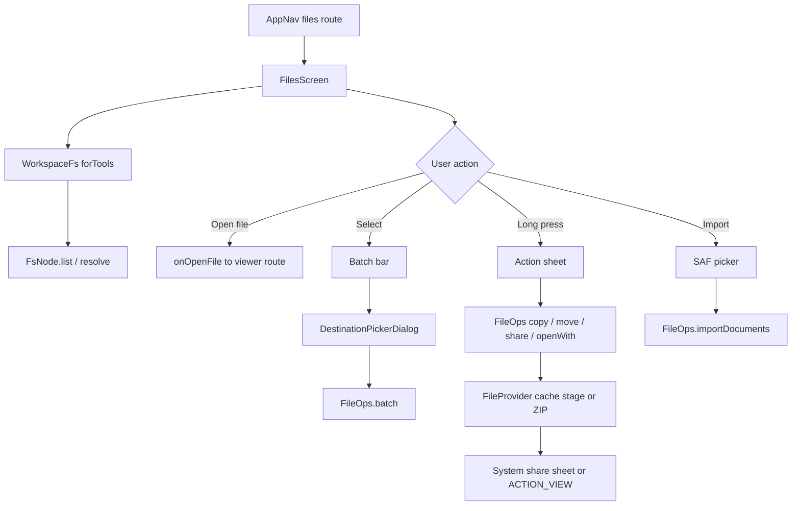

# File Manager, Import, and Sharing

> Workspace browsing, multi-select file operations, document import, sharing, and external open for the Files screen.

`FilesScreen` is the workspace file manager. It browses any `FsNode` tree through `WorkspaceFs`, so real folders, SAF trees, and SSH roots behave the same. `FileOps` implements copy, move, batch continuation, ZIP packaging, cached sharing, and SAF document import. Delete, create, and rename are called directly on `FsNode` from the screen. Chat attachments use a separate import path in `ChatViewModel`. `TransferFiles` is the transport used by FTP sharing and sync, not by the Files screen import picker.

## Module Responsibilities

- **`FilesScreen`**: Lists one directory, keeps the current path, filters names, establishes multi-select, and owns dialogs for create, rename, delete, copy, move, import, and share. It also displays per-file `+N -M` badges from `SessionFileChangeEntity` rows and a summary strip to `ChangesScreen`.
- **`FileOps`**: Encodes the actual byte and directory work on `FsNode`: recursive copy, same-parent rename, cross-root move, batch continuation, SAF import, ZIP creation, cache staging, share intents, and `ACTION_VIEW`.
- **`DestinationPickerDialog`**: A folder-only browser for copy or move targets. It filters dot folders and refuses the source subtree.
- **`NameDialog`**: Shared name entry for rename, new file, and new folder. It rejects slash, backslash, `.`, `..`, and duplicates.
- **`TransferFiles`**: A narrow filesystem interface for FTP and sync. `LocalTransferFiles` validates paths, rejects symlinks and special files, caps entries, and writes through a temporary file with an atomic move.

## Architecture and Flow

The screen obtains its filesystem from `container.workspace.forTools(sessionId, projectId)`. A `LaunchedEffect(fs, currentPath, refreshTick)` resolves the current path and lists entries on `Dispatchers.IO`, catching failures into `loadError`. Every mutation increments `refreshTick`, which reruns that effect. The listing is sorted with directories first and names compared case-insensitively.

Selection is path based. `selectedPaths` is intersected with the newly loaded entry paths, so stale selections disappear after navigation or deletion. `selectedNodes` is rebuilt from `entries`, not from the filtered list. Long press calls `toggleSelection`; the first toggle turns `selecting` on. `BatchBusy` blocks further changes, and the system Back handler closes selection before leaving the screen.

Operations go through `perform(description, block)` or `runBatch(action, nodes, operation)`. `perform` runs the block on `Dispatchers.IO`, reports the exception message in a toast, then refreshes. `runBatch` calls `FileOps.batch`, removes completed paths from the selection, collects failure lines into `batchErrors`, and clears selection only when no item failed.

Import uses two activity result contracts. `OpenMultipleDocuments` handles files, and `OpenDocumentTree` handles one folder. `importPicked` resolves the current directory once, calls `FileOps.importDocuments`, and shows `files_import_done` with the completed and requested counts. `importing` disables the menu items and drives an indeterminate progress bar.

Sharing differs by selection size. A single item's action sheet offers Share and Open externally for files only. Batch Share accepts files and folders: `FileOps.shareMany` stages each file separately, or writes one ZIP when any selection is a directory. `stageForShare` copies a file into `cache/shared`, prunes stages older than one day, and returns a `FileProvider` URI under the `${packageName}.update` authority.

`TransferFiles` is not part of the Files screen path. `FtpShareManager` wraps a `LocalTransferFiles` in `FtpShareServer`, and `SyncManager` uses `LocalTransferFiles` with `SyncEngine` for preview and apply. Its 512 MB file cap, 1 GB total cap, and 10,000 entry cap govern those transports.

## Invocation Chain

1. `AppNav` registers `files?session={session}&project={project}` and calls `FilesScreen` with `onOpenFile`, `onOpenFileAtLine`, `onOpenTerminal`, and `onOpenChanges` callbacks (`ui/AppNav.kt:770`).
2. `FilesScreen` resolves `container.workspace.forTools(sessionId, projectId)`, then calls `f.resolve(currentPath).list()` inside the load effect (`ui/files/FilesScreen.kt:210`).
3. Tapping a file calls `onOpenFile(row.relPath)`; tapping a folder sets `currentPath` and clears the filter (`ui/files/FilesScreen.kt:548`).
4. A row overflow opens `menuNode`, which renders the action sheet. Rename opens `NameDialog` and calls `node.renameTo`; delete calls `node.delete`; copy and move open `DestinationPickerDialog` and then call `FileOps.copy` or `FileOps.move` (`ui/files/FilesScreen.kt:651`).
5. Batch Delete builds a confirmation and calls `runBatch` with `node.delete()`. Batch Copy or Move opens `DestinationPickerDialog` with every selected directory in `mustAvoidSubtrees`, then calls `FileOps.copy(..., preserveAll = true)` or `FileOps.move` (`ui/files/FilesScreen.kt:818`).
6. Import pickers call `importPicked`, which calls `FileOps.importDocuments(context, uris, dir, tree)` (`ui/files/FilesScreen.kt:262`).
7. `FileOps.copy` validates the destination, computes a unique name, creates the target node, then recurses with `transferInto` (`ui/files/FileOps.kt:29`).
8. `FileOps.move` uses a direct rename when both paths share a parent; otherwise it copies with `preserveAll = true` and deletes the source (`ui/files/FileOps.kt:43`).
9. `FileOps.shareMany` creates a ZIP for directory selections or calls `stageForShare` per file, then starts `ACTION_SEND` or `ACTION_SEND_MULTIPLE` (`ui/files/FileOps.kt:140`).
10. `FileOps.openWith` stages the file and starts `ACTION_VIEW` with the MIME type derived by `mimeForName` (`ui/files/FileOps.kt:228`).
11. Chat attachment import enters `ChatViewModel.importAttachment`, which reads the display name and size from the content resolver, rejects files over `FileAttachments.COPY_BYTE_LIMIT` (64 MB), then either imports an image or copies a non-text file into `.harness/attachments` (`ui/chat/ChatViewModel.kt:1221`).

## Key State and Data Structures

- **`FileRow`**: `node`, `relPath`, `name`, `isDirectory`, `isFile`, `size`, `childCount`. It is built once on the IO thread so Compose never touches the filesystem while drawing (`ui/files/FilesScreen.kt:959`). A real `FileFsNode` supplies a child count; SAF and SSH rows show plain "Folder".
- **`FileBatchResult`**: `completed: Set<String>` and `failures: Map<String, String>`. `FileOps.batch` keeps independent items running after a failure and rethrows `CancellationException` immediately (`ui/files/FileOps.kt:78`).
- **`NameDialog`**: Tracks `value`, `trimmed`, `isDuplicate`, and `illegal`. Duplicates are case-sensitive; illegal names are blank, contain `/` or `\`, or equal `.` or `..` (`ui/files/FilesScreen.kt:1026`).
- **`DestinationPickerDialog`**: Holds `dir` and `dirs`. `isInsideForbidden` normalizes the candidate and compares it against each forbidden base. The confirm button is disabled while the current directory is forbidden (`ui/files/DestinationPickerDialog.kt:41`).
- **`FileOps.uniqueChildName`**: Appends ` (2)`, ` (3)`, and so on before the extension until the name is free (`ui/files/FileOps.kt:282`).
- **`TransferEntry`**: `path`, `directory`, `size`, `modified`. `LocalTransferFiles.list` sorts by path and filters symlinks, control characters, backslashes, and `.harness-transfer-` temporaries (`data/transfer/TransferFiles.kt:14`).
- **`SyncPlan` and `SyncResult`**: `SyncPlan` carries direction, changes, directories, and unchanged count. `SyncEngine.apply` rechecks the destination hash and source digest immediately before publishing (`data/transfer/TransferFiles.kt:130`).

## Boundary Conditions

- **Copy conflicts never overwrite.** `FileOps.copy` always allocates a unique target name. A same-parent move also suffixes when the requested name is taken, but an explicit move overwrites nothing.
- **A folder cannot enter its own subtree.** `checkDestination` normalizes both relative paths and rejects equality or a destination prefix (`ui/files/FileOps.kt:69`).
- **Partial moves are reported, not hidden.** A cross-root move that copies successfully but cannot delete the source throws "Copied to destination but could not delete the original".
- **Ignore filters apply only below the operation root.** `transferInto` skips `.git` and `node_modules` when `depth > 0` unless `preserveAll` is true. An explicit multi-select copy passes `preserveAll = true`; a single-folder copy does not.
- **Batch cancellation is preserved.** `FileOps.batch` calls `ensureActive()` before each item and rethrows cancellation rather than recording it as a per-item failure.
- **ZIP sharing refuses symlinks and deep trees.** `writeShareZip` checks depth against 100 and rejects a real symbolic link. A failed ZIP creation deletes the temporary file.
- **Share staging is pruned by age.** `stageForShare` deletes files in `cache/shared` older than 86,400,000 ms before writing a new stage.
- **Open externally requires a handler.** A missing activity becomes `ToolFailure("No app can open <name>")`. Share failures surface in a toast.
- **Import names are sanitized.** `importName` replaces slashes and NULs, trims, and falls back to `file` for empty, `.`, or `..` names. Duplicate names inside one import batch receive the same ` (n)` suffix used by copy.
- **Import progress is indeterminate.** `importing` renders `AppLinearProgressIndicator` without a fraction; the only count is the completion toast. `FileOps.importDocuments` has no per-byte callback.
- **Imported folders recurse without a depth guard.** `importDocument` walks `DocumentFile.listFiles()` recursively and sanitizes each child name with `importName`.
- **Attachment limits differ from file manager limits.** Chat attachment import rejects files over 64 MB, reads text-like files up to `FileAttachments.INLINE_CHAR_LIMIT` (32,000 characters), and copies other files into `.harness/attachments` under a timestamp and import id. In Chat mode, a file that is neither readable text nor a readable PDF becomes `UNSUPPORTED` instead of silently disappearing; in Code mode it is copied into the workspace.
- **The editor is not the file manager.** Files above `MAX_EDIT_BYTES` (16,000,000 bytes) are handled by `CodeEditorScreen` as share or open-with cases, not by `FilesScreen`.

## Presentation

`FilesScreen` renders inside `SettingsExpressiveTheme` and builds its list from the shared pieces in `ui/common/ExpressiveList.kt`: dense `ExpressiveListRow` segments with `ExpressiveIconBadge` leads, `ExpressiveRefreshButton`, `ExpressiveEmptyState`, and `ExpressiveSearchField` for the filter. Rows use `animateItem` with the expressive spring specs from `ui/theme/Motion.kt`. The workspace button opens `WorkspaceSwitcher`, the same host the chat header uses, so the file manager holds no add-workspace or picker state of its own. `WorkspaceToolsSheet` (quick open, project search, commands) uses `SettingsChoiceGroup` for the mode and the same rows for results.

## Extension Points

- **`FileOps` is an object with suspend methods.** New operations can follow the `FsNode` primitives and reuse `batch`, `uniqueChildName`, and `FileBatchResult`.
- **`DestinationPickerDialog` accepts `mustAvoidSubtrees`.** Callers can forbid several source directories, not only one.
- **`FileOps.mimeForName` is the single MIME registry.** Adding a type means adding a branch there; share type resolution uses its output and falls back to `*/*` when selected files disagree.
- **`TransferFiles` is the substitution point for remote transports.** FTP and SFTP implement the same `stat`, `list`, `read`, `mkdir`, and `writeAtomic` contract.
- **`ChatViewModel.importAttachment` is the shared attachment entry.** `attachImage`, `attachFile`, and `attachSharedFile` all delegate to it, so progress and failure states stay consistent.

Sources: [app/src/main/java/com/androidharness/app/ui/files/FilesScreen.kt](../app/src/main/java/com/androidharness/app/ui/files/FilesScreen.kt)#L113-L1078), [app/src/main/java/com/androidharness/app/ui/files/FileOps.kt](../app/src/main/java/com/androidharness/app/ui/files/FileOps.kt)#L20-L311), [app/src/main/java/com/androidharness/app/ui/files/DestinationPickerDialog.kt](../app/src/main/java/com/androidharness/app/ui/files/DestinationPickerDialog.kt)#L41-L154), [app/src/main/java/com/androidharness/app/data/transfer/TransferFiles.kt](../app/src/main/java/com/androidharness/app/data/transfer/TransferFiles.kt)#L11-L184)

## Source files

- `app/src/main/java/com/androidharness/app/ui/files/FilesScreen.kt`
- `app/src/main/java/com/androidharness/app/ui/files/FileOps.kt`
- `app/src/main/java/com/androidharness/app/ui/files/DestinationPickerDialog.kt`
- `app/src/main/java/com/androidharness/app/data/transfer/TransferFiles.kt`
- `app/src/main/java/com/androidharness/app/data/transfer/FtpShareManager.kt`
- `app/src/main/java/com/androidharness/app/data/transfer/SyncManager.kt`
- `app/src/main/java/com/androidharness/app/ui/chat/ChatViewModel.kt`
- `app/src/main/java/com/androidharness/app/ui/chat/FileAttachments.kt`
- `app/src/main/java/com/androidharness/app/ui/AppNav.kt`
