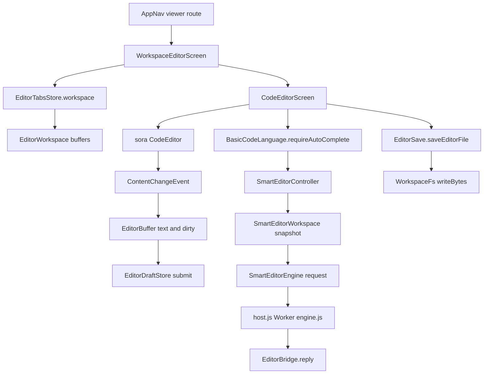

# Editor, Language Tools, and Drafts

> The workspace code editor, its tab and draft persistence, the bundled offline language worker, Markdown preview, and project-wide search and replace.

`WorkspaceEditorScreen` is the tabbed shell. It owns an `EditorWorkspace` from `EditorTabsStore` and renders one `CodeEditorScreen`, which wraps sora-editor. `EditorBuffer` holds live document state, `EditorDraftStore` writes recoverable drafts, and `EditorFileCodec` preserves charset, BOM, and line endings on save. Language features run through `SmartEditorController` into `SmartEditorEngine`, a sandboxed WebView worker loaded from `assets/editor-tools`. Quick Open, the command palette, and project search share `WorkspaceToolsSheet` and `WorkspaceSearch`.

## Module Responsibilities

- **`WorkspaceEditorScreen`**: Restores tabs for the chat, project, and workspace, opens the requested path, recovers inactive dirty buffers, persists tab state on dispose and `ON_STOP`, and supplies the command list and Quick Open entry points.
- **`CodeEditorScreen`**: Owns load state, the native `CodeEditor`, save, conflict handling, undo and redo, find and replace, Markdown preview switching, selection capture, and language action launch.
- **`EditorTabsStore`**: Keeps up to 100 open paths, the active path, request id, and per-path selection and scroll positions. It writes one JSON snapshot per chat, project, and workspace key.
- **`EditorDraftStore`**: Debounces and atomically writes unsaved text plus baseline, saved text, disk hash, charset, BOM, EOL, trailing newline state, and edit mode.
- **`EditorFileCodec`**: Lossless decode and encode. It detects UTF-8, UTF-16LE, and UTF-16BE BOMs, rejects NUL bytes and malformed UTF-8, and records the dominant EOL.
- **`EditorSave`**: Compares the current disk SHA-256 against the version the editor loaded, then writes the encoded bytes. A mismatch returns `EditorSaveResult.Conflict` instead of overwriting.
- **`BasicCodeLanguage`**: Tokenizes lines through `CodeTokenizer` and optionally requests semantic completions from `SmartEditorController`.
- **`SmartEditorWorkspace`**: Builds a bounded project snapshot from `WorkspaceSearch.index`, open buffers, and durable drafts.
- **`SmartEditorEngine`**: A single WebView hosting `host.js`, which creates `engine.js` as a Web Worker. It serializes requests and replies over the `EditorBridge` JavaScript interface.
- **`WorkspaceSearch`**: Builds the project file index, ranks Quick Open matches, runs regex or literal project search, computes replacements, and applies them with preflight checks.
- **`MarkdownPreview` and `MarkdownFilePreview`**: Decide when a Markdown file opens rendered and render it with the chat Markdown component.

## Architecture and Flow

`WorkspaceEditorScreen` derives a tab key from `EditorDraftStore.key(sessionId, projectId, fs.displayPath, "<open-tabs>")` and asks `container.editorTabs.workspace(key, identity)` for state. If the navigation `requestId` differs, it opens the requested path, sets `jumpLine` from `initialLine`, and persists. It then reads the draft store for every tab whose buffer is not loaded, so an inactive tab keeps its dirty dot without holding a native editor view.

`CodeEditorScreen` loads in this order: an existing live dirty buffer, then the durable draft, then the file. If a draft is restored, `buffer.recovered` becomes true and the status line says the file was unchanged. A new file read goes through `EditorFileCodec.decode`. `null` means binary, and text over `MAX_EDIT_BYTES` (16,000,000 bytes) becomes `Load.TooLarge`. Both cases render `NotTextView` with Share and Open with actions.

The native editor is created once inside `AndroidView`. Content changes update `buffer.text` and `dirty`, persist the draft, and, for a 1 to 2 character insert that is not an undo, schedule completion. Selection and scroll events update `buffer.selectionStart`, `selectionEnd`, `offsetX`, and `offsetY`. `onRelease` copies the final document and scroll state back before releasing the view. The `update` block only reapplies the theme and word wrap.

Completion has two paths. sora's `EditorAutoCompletion` calls `BasicCodeLanguage.requireAutoComplete`, which rejects empty prefixes, non-word preceding characters, and documents over 512,000 characters, then calls `controller.completions`. Separately, `CodeEditorScreen` debounces 180 ms after an insert and calls `requireCompletion()` for hardware keyboards that do not trigger the IME path. A completion result is discarded if the editor is not editable, the text changed, the cursor moved, or the selection is non-empty.

Language actions are launched from the overflow menu, the editor buttons, or function keys. `SmartEditorController.request` takes a fresh snapshot unless the operation is `complete`, in which case the five-second snapshot cache is reused. Rename requires a complete index with `limited == false` and `skipped == 0`. `SmartEditorSheet` renders outline symbols, definition and reference locations, a review diff for rename, or applies formatting as a minimal replacement that remains undoable.

Quick Open, command palette, and project search use `WorkspaceToolsSheet`. `WorkspaceSearch.index(fs)` walks with `ArrayDeque`, skips `WorkspaceIgnore.shouldSkip`, rejects absolute and `..` paths, and caps at 10,000 files, 20,000 inspected entries, and depth 40. Quick Open scores exact filename, prefix, substring, full path substring, then subsequence, and returns at most 80 paths. A trailing `:line` is parsed by `quickOpenQuery` and passed to the editor.

Project search uses `ProjectSearchOptions` for query, match case, regex, include, and exclude. Include and exclude values are comma-separated globs compiled by `patterns`, with `**/`, `*`, and `?` handling. Search reads at most 512,000 bytes per file, 16,000,000 bytes total, and 1,000 results. Replacements are previewed as unified diffs and applied only after every chosen file passes read-only, draft, size, and version checks. `apply` calls `saveEditorFile` per file and reports saved paths and per-file failures. On success `container.editorTabs.invalidateSaved` drops stale buffers for saved paths.

## Invocation Chain

1. `AppNav` registers `viewer/{path}?line={line}&session={session}&project={project}` and calls `WorkspaceEditorScreen` (`ui/AppNav.kt:803`).
2. `WorkspaceEditorScreen` obtains `EditorWorkspace` from `container.editorTabs.workspace`, opens the path, and recovers drafts for every tab (`ui/files/WorkspaceEditorScreen.kt:77`).
3. The active tab renders `CodeEditorScreen` with `suppliedBuffer = state.buffer(active)` and a `SmartEditorController` built for the same workspace (`ui/files/WorkspaceEditorScreen.kt:195`).
4. `CodeEditorScreen` reads the durable draft first, then resolves the file and decodes it (`ui/files/CodeEditorScreen.kt:148`).
5. The editor factory creates `CodeEditor`, sets `BasicCodeLanguage(path, smart)`, restores text and selection, applies the theme, and subscribes to content, selection, and scroll events (`ui/files/CodeEditorScreen.kt:585`).
6. Save calls `container.runManager.withIdleWorkspace`, then `saveEditorFile(fs, path, expectedVersion, EditorFileCodec.encode(dec, newText))` (`ui/files/CodeEditorScreen.kt:271`).
7. A successful save updates `diskVersion`, `lastSavedText`, and the draft, then calls `sessions.recordFileChange` when a session id is present, feeding the Files changed view (`ui/files/CodeEditorScreen.kt:309`).
8. A language action opens `SmartEditorSheet`, which calls `controller.request`, then `engine.request(op, path, snapshot.texts, offset, newName)` (`ui/files/SmartEditorController.kt:35`).
9. `SmartEditorEngine.request` builds a JSON payload, calls `window.editorRequest(encoded)`, and awaits the matching id for at most 20 seconds (`ui/files/SmartEditorEngine.kt:96`).
10. `host.js` forwards the request to the worker and replies through `EditorBridge.reply`; the worker owns parsing, completion, symbols, edits, and formatting (`assets/editor-tools/host.js:1`).
11. `WorkspaceToolsSheet` indexes the workspace on open, computes Quick Open results locally, debounces project search by 250 ms, and calls `WorkspaceSearch.apply` for an approved replacement set (`ui/files/WorkspaceToolsSheet.kt:93`).

## Key State and Data Structures

- **`EditorDraft`**: `version`, `text`, `baseline`, `saved`, `diskVersion`, `charset`, `bom`, `eol`, `missingTrailingNewline`, `editing`. `decoded()` reconstructs `EditorFileCodec.Decoded` from the saved shape (`ui/files/EditorDraftStore.kt:15`).
- **`EditorDraftStatus`**: `IDLE`, `SAVING`, `SAVED`, `FAILED`. The editor shows a status line only when dirty, and `FAILED` uses the error color (`ui/files/CodeEditorScreen.kt:553`).
- **`EditorBuffer`**: `document`, `selectionStart`, `selectionEnd`, `offsetX`, `offsetY`, `text`, `baseline`, `saved`, `editing`, `markdownPreview`, `dirty`, `saving`, `decoded`, `diskVersion`, `loaded`, `recovered`. `draft()` returns null when text equals saved or when decoded or disk version is missing (`ui/files/EditorBufferViewModel.kt:18`).
- **`EditorTabsSnapshot`**: `paths`, `active`, `requestId`, `positions`. `EditorTabPosition` stores path, selection range, and scroll x and y (`ui/files/EditorTabsStore.kt:19`).
- **`EditorWorkspace`**: `revision`, `persistenceError`, `paths`, `active`, `requestId`, `buffers`. `snapshot()` serializes every open tab, including tabs whose buffer was never created (`ui/files/EditorTabsStore.kt:25`).
- **`SmartSnapshot`**: `sources`, `limited`, `skipped`. Its `notice` explains whether the index was limited or some files could not be read (`ui/files/SmartEditorWorkspace.kt:23`).
- **`SmartCompletion`**: `label`, `detail`, `text`, `start`, `end`, `cursor`. `prefixLength` is set to `position.index - start` so sora replaces only the typed prefix (`ui/files/BasicCodeLanguage.kt:45`).
- **`SmartSymbol` and `SmartLocation`**: Symbol name, kind, start, end, line, and depth; location path, start, line, column, and preview (`ui/files/SmartEditorController.kt:14`).
- **`ProjectSearchResult`**: files, limited flag, skipped count, and a computed total match count. Each `ProjectSearchFile` stores path, disk version, decoded shape, hits, and count (`ui/files/WorkspaceSearch.kt:8`).
- **`ReplacementReceipt`**: saved paths and a map of failed paths to reasons (`ui/files/WorkspaceSearch.kt:19`).
- **Persisted editor preferences**: `editorWordWrap`, `editorMatchCase`, and `editorRegexSearch`, defaulting to false and stored through `SettingsRepository` (`data/SettingsRepository.kt:44`).

## Boundary Conditions

- **Binary and non-UTF-8 files are never faked as text.** `EditorFileCodec.decode` returns null on NUL bytes, malformed UTF-8, or a missing BOM for a non-UTF-8 byte stream. The screen then offers Share and Open with.
- **Files over 16 MB are not loaded.** `MAX_EDIT_BYTES` is checked before reading. `saveEditorFile` also refuses to compare a current file over the same limit.
- **Save conflicts never overwrite silently.** `saveEditorFile` compares the current disk SHA-256 to the version the editor loaded. On conflict the dialog offers Compare, Reload file, Keep my edits, or Cancel. Reload replaces the buffer with the reviewed bytes and persists the draft.
- **Drafts are atomic and app-lifetime.** Writes go to a `.tmp` file, call `fd.sync()`, then rename over the JSON record. `EditorDraftStore` holds its own `SupervisorJob` scope, so closing the editor does not cancel a pending write. A failed write sets `FAILED`; the UI tells the user recovery could not be saved.
- **Draft reads are bounded and validated.** A recovery file over 128 MB is refused, and the stored version must be 1, the charset must be UTF-8, UTF-16LE, or UTF-16BE, the EOL must be LF or CRLF, and `diskVersion` must be `missing` or 64 hex characters (`ui/files/EditorDraftStore.kt:72`).
- **Draft identity is scoped.** `EditorDraftStore.key` hashes length-prefixed session id, project id, workspace display path, and normalized relative path. The same file in a different chat or workspace gets a different draft.
- **Tab state is bounded.** `EditorWorkspace` takes at most 100 distinct paths, and `EditorTabsStore` refuses a saved tab file of 256,000 bytes or more. A persistence failure sets `persistenceError`, which the header displays.
- **The worker is sandboxed.** JavaScript is enabled, but file access, content access, network loads, DOM storage, and script-opened windows are disabled. `shouldOverrideUrlLoading` always returns true, and every request outside `/assets/editor-tools/` on `appassets.androidplatform.net` receives a 403. `index.html` also sets a content security policy of `default-src 'none'`, `script-src 'self'`, `worker-src 'self'`, and `connect-src 'none'`.
- **Worker requests are serialized.** `SmartEditorEngine` holds a `Mutex`, sends one id at a time, and caps a reply at 12,000,000 characters. The request JSON is passed as an argument to `window.editorRequest`, not interpolated into source, and U+2028 and U+2029 are escaped.
- **A worker failure is recoverable only by reopening.** Timeouts close the engine and throw "The local language service timed out. Reopen the editor to retry." A renderer crash or main-frame load error does the same. `SmartEditorSheet` keeps the error visible instead of blocking typing.
- **Completion failures are silent.** `BasicCodeLanguage.requireAutoComplete` swallows exceptions so a language worker problem never interrupts typing. Manual actions surface the error in the sheet.
- **Rename is all or nothing.** `SmartEditorController.applyRename` checks every file's read-only state, size, disk hash, and draft equality before touching any buffer. It then validates every live buffer on the main thread without yielding between the check and the edit set.
- **Project search is bounded.** The index cap is 10,000 files, search reads at most 512,000 bytes per file and 16,000,000 bytes total, and results stop at 1,000. Replacement is refused while `result.limited` is true.
- **Replacement refuses unsaved drafts and read-only files.** `WorkspaceSearch.apply` checks `ChatWorkspaceFs` grants, the presence of a draft, file type and size, and the preview hash before each write. Results with a draft are shown blocked in the review list.
- **Markdown preview has a size ceiling.** `MarkdownPreview.MAX_CHARS` is 400,000. A longer file stays in source view. The editor remains composed under the preview so undo history, selection, and scroll survive toggling.
- **Find is debounced and polled.** `FindBar` waits 250 ms, calls `EditorSearcher.search`, then polls up to 15 times at 60 ms intervals until the match count settles. Match case and regex are global settings; replace controls appear only in edit mode.
- **Quick Open ignores unsafe paths.** `WorkspaceSearch.index` never follows an absolute or `..` relative path and applies `WorkspaceIgnore.shouldSkip`.

## Extension Points

- **`SmartEditorSupport` is the language capability table.** `completion`, `navigation`, `rename`, `outline`, `format`, and `source` map extensions to available actions. Adding a language starts there and in the bundled worker.
- **`WorkspaceCommand`**: `title`, `detail`, `icon`, `action`. `WorkspaceEditorScreen` and `FilesScreen` each build a command list, so new palette entries are local additions.
- **`SmartEditorAction`**: `OUTLINE`, `DEFINITION`, `REFERENCES`, `RENAME`, `FORMAT`, each with an operation string sent to the worker.
- **`SmartEditorEngine.request`**: Any new worker operation can be added as a string and a JSON response shape; the bridge and timeout stay unchanged.
- **Editor settings**: `setEditorWordWrap` and `setEditorSearchOptions` persist through `SettingsRepository`; the editor reads them through the settings flow.
- **`EditorDraftStore` writer**: The root directory and debounce are constructor parameters, so tests or alternate storage can reuse the store.

## Known gaps

- `engine.js` is a single minified bundle of 10.7 MB. The bundled package versions are verified from `assets/editor-tools/LICENSES.txt` (TypeScript 5.9.3, prettier 3.9.6, vscode-html-languageservice 5.6.2, vscode-css-languageservice 6.3.10, vscode-json-languageservice 5.6.3). The per-language operation routing inside that bundle was not read line by line.

Sources: [app/src/main/java/com/androidharness/app/ui/files/WorkspaceEditorScreen.kt](../app/src/main/java/com/androidharness/app/ui/files/WorkspaceEditorScreen.kt)#L49-L248), [app/src/main/java/com/androidharness/app/ui/files/CodeEditorScreen.kt](../app/src/main/java/com/androidharness/app/ui/files/CodeEditorScreen.kt)#L106-L1071), [app/src/main/java/com/androidharness/app/ui/files/EditorDraftStore.kt](../app/src/main/java/com/androidharness/app/ui/files/EditorDraftStore.kt)#L15-L129), [app/src/main/java/com/androidharness/app/ui/files/EditorTabsStore.kt](../app/src/main/java/com/androidharness/app/ui/files/EditorTabsStore.kt)#L19-L89), [app/src/main/java/com/androidharness/app/ui/files/SmartEditorEngine.kt](../app/src/main/java/com/androidharness/app/ui/files/SmartEditorEngine.kt)#L26-L136), [app/src/main/assets/editor-tools/host.js](../app/src/main/assets/editor-tools/host.js)#L1-L6)

## Source files

- `app/src/main/java/com/androidharness/app/ui/files/WorkspaceEditorScreen.kt`
- `app/src/main/java/com/androidharness/app/ui/files/CodeEditorScreen.kt`
- `app/src/main/java/com/androidharness/app/ui/files/EditorBufferViewModel.kt`
- `app/src/main/java/com/androidharness/app/ui/files/EditorDraftStore.kt`
- `app/src/main/java/com/androidharness/app/ui/files/EditorTabsStore.kt`
- `app/src/main/java/com/androidharness/app/ui/files/EditorFileCodec.kt`
- `app/src/main/java/com/androidharness/app/ui/files/EditorSave.kt`
- `app/src/main/java/com/androidharness/app/ui/files/EditorNavigationGuard.kt`
- `app/src/main/java/com/androidharness/app/ui/files/BasicCodeLanguage.kt`
- `app/src/main/java/com/androidharness/app/ui/files/MaterialCompletionAdapter.kt`
- `app/src/main/java/com/androidharness/app/ui/files/SmartEditorWorkspace.kt`
- `app/src/main/java/com/androidharness/app/ui/files/SmartEditorController.kt`
- `app/src/main/java/com/androidharness/app/ui/files/SmartEditorEngine.kt`
- `app/src/main/java/com/androidharness/app/ui/files/SmartEditorSheet.kt`
- `app/src/main/java/com/androidharness/app/ui/files/WorkspaceSearch.kt`
- `app/src/main/java/com/androidharness/app/ui/files/WorkspaceToolsSheet.kt`
- `app/src/main/java/com/androidharness/app/ui/files/MarkdownPreview.kt`
- `app/src/main/java/com/androidharness/app/ui/files/SelectedCode.kt`
- `app/src/main/assets/editor-tools/index.html`
- `app/src/main/assets/editor-tools/host.js`
- `app/src/main/assets/editor-tools/engine.js`
