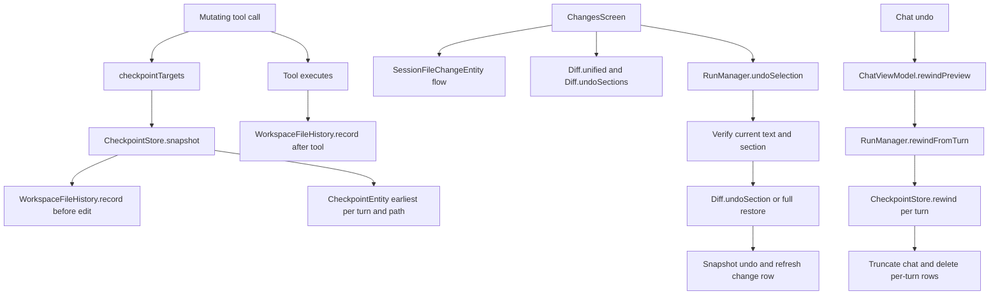

# Checkpoints, Undo, and File History

> Pre-edit snapshots, durable gzip file copies, per-file change tracking, and the undo and ask-about-changes paths for chat and code edits.

`AgentEngine` asks `CheckpointStore` to snapshot every path a mutating tool may touch before the tool runs. `CheckpointStore` writes one `CheckpointEntity` per turn and path in Room, and also delegates to `WorkspaceFileHistory`, which stores gzip copies and JSON metadata in app-private storage. `SessionRepository` accumulates per-file line counts and a baseline for the Files changed view. `ChangesScreen` renders diffs, section undo, and ask about changes. `RunManager` performs whole-turn rewind and single-file or single-section undo with verification.

## Module Responsibilities

- **`AgentEngine.checkpointTargets`**: Maps each write, edit, move, delete, directory, restore, or patch call to the paths it may change. `apply_patch` parses `---` and `+++` headers, including deletions to `/dev/null`.
- **`CheckpointStore`**: Inserts the earliest pre-turn text snapshot per `(turnId, relPath)`, exposes ordered turns, restores a turn, and records before and after copies in file history.
- **`WorkspaceFileHistory`**: Durable, checksummed gzip copies per chat, workspace, and path. It supports listing, missing-file detection, and restore with an expected current SHA-256.
- **`SessionRepository`**: Records cumulative `SessionFileChangeEntity` rows and per-turn `FileEditEntity` rows. `recordFileChange` keeps the earliest baseline and sums later counters.
- **`ChangesScreen`**: Shows one row per normalized path with `+N -M`, expands to a unified diff against the session baseline, lists changed sections, and offers Undo file, Undo section, and Ask about changes.
- **`RunManager`**: `rewindFromTurn` rolls files and chat back to before a checkpointed turn. `rewindAndTruncate` does the same when a user message is edited and resent. `undoSelection` restores one file or one changed section after checking the preview against the file.
- **`ChatViewModel` and `ChatScreen`**: Build the undo list, preview what a turn rewind will change, run the rewind, and report partial failure.
- **`Diff`**: Computes unified diffs, line counts, undo section boundaries, and applies a single section by offset.

## Architecture and Flow

A mutating tool call is wrapped in snapshot work. `AgentEngine` iterates `checkpointTargets`, calls `checkpointer.snapshot(sessionId, turnId, checkpointWorkspace, path)`, and aborts the tool with an error if any snapshot fails. It also captures `beforeTexts` for the immediate diff counters, capped at 512,000 characters per file. After the tool finishes, a `finally` block calls `saveVersion` with reason `"after <tool>"`; `recordMissing` is enabled for a successful `delete_file`, `move_file`, or `apply_patch`.

`CheckpointStore.snapshot` first records a file-history copy with reason `"before edit"`. It then checks the turn's existing rows and returns if the path is already present, so the earliest pre-turn state wins. Otherwise it inserts one row containing Base64 text, `existedBefore`, and `wasDirectory`. A directory has an empty `contentB64`; a missing path also stores empty content and `existedBefore = false`.

`CheckpointStore.rewind` backs up every current file in the turn with reason `"before rewind"` before consuming any checkpoint. It orders work so restored directories come first, ordinary files next, and paths that did not exist but are now directories last, with deeper paths first inside each rank. A path that did not exist is deleted only when it is not a non-empty directory, which protects files another process added. A file is rewritten from Base64. A directory that the agent removed is recreated empty. Each successful path records `"after rewind"` and its checkpoint row is deleted; a failed path increments the failure count and keeps its row.

`rewindFromTurn` is the chat-level operation. It orders checkpointed turns by first snapshot time, selects the chosen turn and every later turn, and rewinds newest turn first so older snapshots win per path. It stops at the first turn with a failure to avoid overwriting a newer failed restore. If all files succeeded, it truncates the conversation from the first non-user message of the chosen turn, deletes the removed turns' `file_edits` rows, and refreshes each restored path's cumulative change row. The whole operation runs under `workspaceGuard` and `NonCancellable`.

`undoSelection` is the Files changed operation. It does not use a checkpoint id. It recomputes the baseline from the row's `baseGzip`, verifies that the current file still equals the preview text and existence state, and either writes the full baseline or replaces one `Diff.UndoSection`. It snapshots the undo itself under a synthetic `undo-<uuid>` turn, records `"after undo"`, refreshes the change row, and appends a user message describing what was undone so the agent sees the new state.

## Invocation Chain

1. `AgentEngine` runs a tool after approval and permission checks. `checkpointTargets(call.name, args)` lists paths for `write_file`, `edit_file`, `multi_edit`, `delete_file`, `create_dir`, `file_restore`, `move_file`, and `apply_patch` (`agent/AgentEngine.kt:1571`).
2. Each target goes to `checkpointer.snapshot(sessionId, turnId, checkpointWorkspace, path)`; a failure returns a tool error and no edit is made (`agent/AgentEngine.kt:1396`).
3. `CheckpointStore.snapshot` records file history, checks for an existing row, then inserts `CheckpointEntity` with Base64 content and existence flags (`data/CheckpointStore.kt:20`).
4. After execution, `saveVersion` records `"after <tool>"` with missing-file recording for deletion-style tools (`agent/AgentEngine.kt:1426`).
5. The per-turn and cumulative change rows are written by `RunManager` from `AgentEvent.FileEdited`: `recordFileEdit` then `recordFileChange` (`agent/RunManager.kt:882`).
6. `ChangesScreen` collects `sessions.fileChangesFor(sessionId)` and merges duplicate path spellings with `mergeSessionChanges` (`ui/files/ChangesScreen.kt:85`).
7. Expanding a row calls `computeSessionDiff`, which gunzips the baseline, reads the current file, and calls `Diff.unified` and `Diff.undoSections` (`ui/files/ChangesScreen.kt:326`).
8. Undo file or Undo section opens a confirmation and calls `container.runManager.undoSelection(sessionId, change, preview.current, preview.exists, section)` (`ui/files/ChangesScreen.kt:149`).
9. Ask about changes calls `ChangeQuestion.prompt`, then the screen's `onAskAgent`, which stores the prompt in `container.pendingAgentPrompt` and navigates to the chat (`ui/AppNav.kt:793`).
10. The chat Undo dialog calls `viewModel.undoTurns()`, then `viewModel.rewindPreview(turnId)`, then `viewModel.performRewind(turnId)` (`ui/chat/ChatScreen.kt:984`).
11. `performRewind` calls `runManager.rewindFromTurn`, refreshes the checkpoint turn set, and returns a snackbar sentence with restored and failed counts (`ui/chat/ChatViewModel.kt:2032`).
12. `rewindFromTurn` calls `CheckpointStore.rewind` for each affected turn newest first, then truncates messages and recomputes change rows (`agent/RunManager.kt:1314`).

## Key State and Data Structures

- **`CheckpointEntity`**: `id`, `sessionId`, `turnId`, `relPath`, `contentB64`, `existedBefore`, `wasDirectory`, `createdAt`, indexed by `sessionId` (`data/db/Database.kt:140`).
- **`RewindResult`**: `restored`, `failed`, and `paths`. `paths` is a linked set of every successfully restored relative path so callers can refresh derived state (`data/CheckpointStore.kt:113`).
- **`FileVersion`**: `id`, `sessionId`, `workspace`, `path`, `sha256`, `bytes`, `createdAt`, `reason`, `deleted`. Each version has one JSON file and one `.gz` file named by id (`data/WorkspaceFileHistory.kt:20`).
- **`WorkspaceFileHistory.MAX_BYTES`**: 32 MB per file. A larger current file is refused before a copy is made (`data/WorkspaceFileHistory.kt:144`).
- **`SessionFileChangeEntity`**: `sessionId`, `relPath`, `added`, `removed`, `isNew`, `isDeleted`, `baseGzip`, `hasBase`, `updatedAt`. The primary key is `(sessionId, relPath)` (`data/db/Database.kt:216`).
- **`FileEditEntity`**: auto-generated `rowId`, `sessionId`, `turnId`, `relPath`, `added`, `removed`, `createdAt`. These are per-turn counters used by the undo preview (`data/db/Database.kt:180`).
- **`Diff.UndoSection`**: `offset`, `before`, `after`. The offset is a character index, and `before` and `after` include their newline characters (`core/Diff.kt:279`).
- **`RewindPreview`**: `files`, `messagesDeleted`, `turns`. Each `RewindFileStat` has `relPath`, `added`, `removed`, `willBeDeleted`, and `existsNow` (`ui/chat/ChatViewModel.kt:1901`).
- **`ChangeDiff`**: `hasBase`, `unified`, `base`, `current`, `exists`, `sections`, `sectionNote`. It is the UI payload for one expanded row (`ui/files/ChangesScreen.kt:320`).

## Boundary Conditions

- **One checkpoint per turn and path.** `snapshot` returns early when the turn already has the path, even if the current call would see different content. The earliest pre-turn state is the undo target.
- **Snapshot failure blocks the edit.** A path too large to read or an unreadable workspace returns a tool result saying no edit was made.
- **Rewind backs up before it restores.** A failed backup aborts the whole turn because the loop runs before any checkpoint is consumed or deleted. A failed restore keeps the checkpoint row, so a retry can target the same path.
- **Unmanaged files survive rewind.** Deleting a path that did not exist refuses a non-empty directory. Files added to an agent-created directory by a shell or another chat are never recursively deleted.
- **Chat rewind stops on the first failure.** `rewindFromTurn` breaks out of the newest-first loop when a turn reports a failure, skips message truncation, and reports the partial count. The UI says history and failed checkpoints were kept.
- **Rewind and undo wait for idle workspaces.** Both take `workspaceGuard` and reject a workspace with a running main task or active subagent. The operation is `NonCancellable`, so a cancelled caller cannot leave a half-restored tree.
- **Undo verification is exact.** `undoSelection` requires `hasBase`, rejects a non-file or a file over 1,000,000 bytes, and requires both the existence state and full current text to match the preview. Any mismatch says the file changed since the preview and aborts.
- **Section undo is membership checked.** The section must be present in a freshly computed `Diff.undoSections(base, current)`, and `Diff.undoSection` requires the exact `after` text at the recorded offset. Unrelated sections remain untouched.
- **Section diff has size limits.** `Diff.undoSections` requires at most 3,000 combined lines and 1,000,000 combined characters. A larger file must use Undo file.
- **Undo is itself undoable.** `undoSelection` inserts a checkpoint under `undo-<uuid>` before writing and records `"after undo"` in file history after writing.
- **Deleting a new file uses a guarded delete.** Full-file undo of a session-created file deletes it only if it exists, and the code checks the delete result.
- **Change rows accumulate.** `recordFileChange` sums `added` and `removed`, keeps the first available `baseGzip`, flips `isDeleted` according to the latest existence state, and clears `isDeleted` when a deleted path is recreated. When the baseline is unknown and nothing changed, no row is created.
- **Duplicate path spellings merge.** `mergeSessionChanges` groups by `normalizeRelPath`, sums counters, carries `isNew` and `hasBase` from any variant, takes `isDeleted` and `updatedAt` from the newest variant, and takes the first non-null baseline.
- **File history restore is checksum gated.** A restore requires the same chat, workspace, and path, a non-deleted version, the recorded byte count, a current SHA-256 equal to `expectedHash` (default `"missing"`), and a gzip payload whose size and hash match the metadata.
- **Identical content is not copied twice.** `recordLocked` returns the previous version when its SHA-256 matches the current digest.
- **History writes are atomic.** The gzip file is written and synced first, then the JSON metadata is written to a `.tmp` file and renamed. The JSON record is the commit point.
- **Retention has no age or count limit.** Checkpoint rows are deleted when a path is successfully restored, when `clearMessages` runs, or when a chat is deleted. No TTL, size cap, or background pruning exists in `CheckpointStore` or `WorkspaceFileHistory` at HEAD. File history directories are also not removed by chat deletion, so old copies remain until the app's data is cleared.

## Extension Points

- **`checkpointTargets`**: Add a tool name and its path arguments to make a new mutating tool undoable. A patch-like tool must parse its own path headers.
- **`WorkspaceFileHistory`**: `versions`, `missingFiles`, `record`, and `restore` are independent of checkpoints and are exposed to the agent through `file_history` and `file_restore` (`tools/FileHistoryTools.kt:7`).
- **`Diff.undoSections` and `Diff.undoSection`**: The section model can be reused by any text-based editor or review surface.
- **`ChangeQuestion.prompt`**: The ask path wraps a diff or section excerpt with an explicit no-edit instruction and a cap of 16,000 characters for a whole-file diff or 8,000 per section (`core/ChangeQuestion.kt:3`).
- **`RewindPreview`**: The UI can add per-file labels or counts without changing the rewind implementation.
- **`SessionFileChangeEntity` and `FileEditEntity` flows**: Room invalidation drives live badges; any new consumer can collect the same flows.

Sources: [app/src/main/java/com/androidharness/app/data/CheckpointStore.kt](../app/src/main/java/com/androidharness/app/data/CheckpointStore.kt)#L13-L122), [app/src/main/java/com/androidharness/app/data/WorkspaceFileHistory.kt](../app/src/main/java/com/androidharness/app/data/WorkspaceFileHistory.kt)#L20-L148), [app/src/main/java/com/androidharness/app/ui/files/ChangesScreen.kt](../app/src/main/java/com/androidharness/app/ui/files/ChangesScreen.kt)#L72-L382), [app/src/main/java/com/androidharness/app/agent/RunManager.kt](../app/src/main/java/com/androidharness/app/agent/RunManager.kt)#L1314-L1399)

## Source files

- `app/src/main/java/com/androidharness/app/data/CheckpointStore.kt`
- `app/src/main/java/com/androidharness/app/data/WorkspaceFileHistory.kt`
- `app/src/main/java/com/androidharness/app/data/db/Database.kt`
- `app/src/main/java/com/androidharness/app/data/SessionRepository.kt`
- `app/src/main/java/com/androidharness/app/agent/AgentEngine.kt`
- `app/src/main/java/com/androidharness/app/agent/RunManager.kt`
- `app/src/main/java/com/androidharness/app/ui/files/ChangesScreen.kt`
- `app/src/main/java/com/androidharness/app/ui/chat/ChatScreen.kt`
- `app/src/main/java/com/androidharness/app/ui/chat/ChatViewModel.kt`
- `app/src/main/java/com/androidharness/app/ui/chat/components/Bubbles.kt`
- `app/src/main/java/com/androidharness/app/core/Diff.kt`
- `app/src/main/java/com/androidharness/app/core/ChangeQuestion.kt`
- `app/src/main/java/com/androidharness/app/tools/FileHistoryTools.kt`
- `app/src/main/java/com/androidharness/app/HarnessApp.kt`
